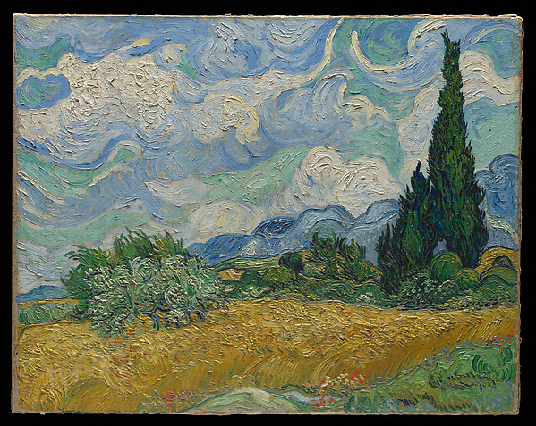
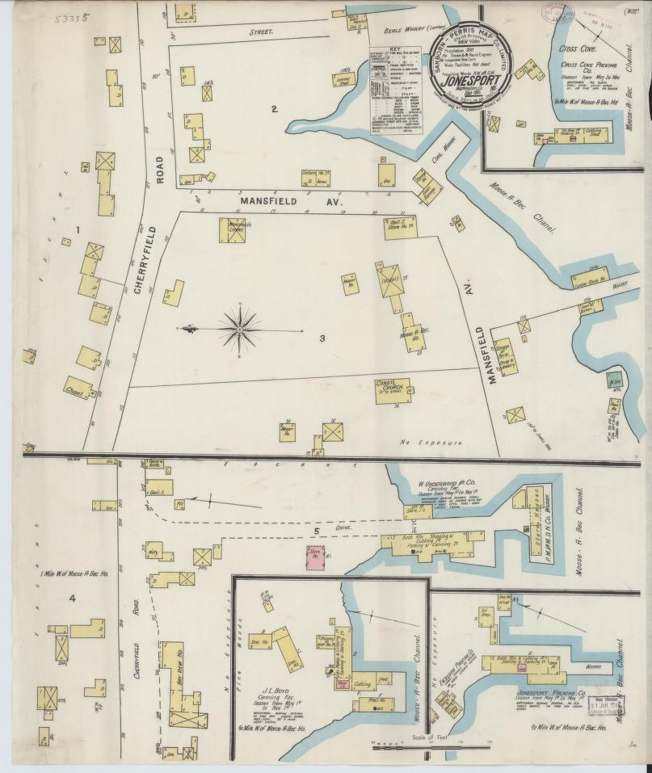
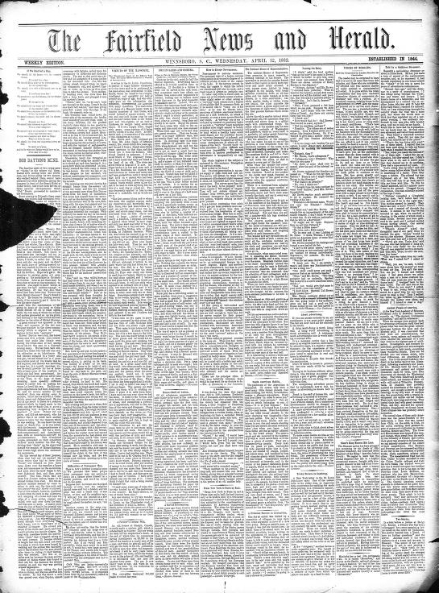

# Historico de APIs de movilidad CDMX

Este repositorio genera historicos versionados de tablas provenientes de Metrobús, TomTom, ECOBICI, DENUE/INEGI y Google Maps Routes API. GitHub Actions ejecuta cada fuente con la periodicidad adecuada, guarda CSVs consultables en el repositorio y hace commits recurrentes con la nueva informacion.

## Estructura de datos

| Ruta | Uso |
| --- | --- |
| `data/current/<tabla>.csv` | Ultimo snapshot disponible de cada tabla. |
| `data/history/<tabla>/<snapshot_id>.csv` | Historico completo por tabla. |
| `data/manifests/*.json` | Manifiestos por corrida: fuente, snapshot, filas, columnas y rutas. |
| `data/artifacts/current/*.html` | Ultimo artefacto visual HTML, por ejemplo mapas. |
| `data/artifacts/history/<artefacto>/` | Historico de artefactos visuales. |
| `configs/tables.yml` | Catalogo de tablas, fuentes, periodicidad y columnas clave. |
| `docs/README_LECTURA_TABLAS.md` | Guia para consultar cada tabla. |
| `docs/periodicidad.md` | Criterio de programacion y schedules de GitHub Actions. |
| `docs/tablas.md` | Diccionario de tablas y columnas. |

## Catálogo de datasets para nuevos análisis

El [catálogo de 78 datasets y fuentes reales de México y del mundo](docs/CATALOGO_DATASETS_REALES.md) reúne rifa del avión presidencial (GSE 235), APIs INEGI, presupuesto, códigos postales, educación, movilidad social, transporte, salud y seguridad. Incluye DOF para explicar Git y fuentes sobre exoplanetas, ondas gravitacionales, cantos de aves, arte, literatura, ovnis y más. La ampliación incluye restaurantes, apps, vuelos, viajes, Napoleón, diarios, literatura, conciertos, mapas, exámenes, UNAM, inmuebles, baile, teatro, retail y medicina histórica. Cada ficha incluye enlaces, cobertura, periodicidad, variables, llaves para cruces, ideas de análisis y límites de acceso/verificación.

La [versión estructurada JSON](catalogs/datasets_reales_mexico.json) permite filtrar y reutilizar las fichas. Cada ficha distingue datos estructurados, no estructurados y mixtos. Las [pruebas de acceso](source_tests/README.md) muestran resultados fechados, registros o ejemplos reales y errores; su [JSON de evidencia](source_tests/results.json) registra cada solicitud. El [ejemplo DOF/Git](examples/dof_git/README.md) incluye dos commits locales comprobados y su diff. La [guía de descubrimientos con IA](docs/GUIA_DESCUBRIMIENTOS_IA.md) conecta las temáticas con preguntas y validación. El [piloto de Bob Ross](examples/bob_ross_discovery/README.md) muestra un resultado calculado, con programa y evidencia. Es un catálogo de oportunidades: las nuevas fuentes no activan recolección programada; las pruebas son acotadas y bajo demanda. Revisión: 4 de noviembre de 2026.

**Deportes y juegos — ampliación del 7 de noviembre de 2026:** ajedrez con partidas de grandes maestros y archivo general por jugadores/aperturas, fútbol soccer, Scrabble, básquetbol, Fórmula 1 y Dota 2. [Ver las seis fichas](docs/CATALOGO_DATASETS_REALES.md#deportes-y-juegos) · [Tests y registros reales](source_tests/by_topic/deportes-y-juegos/README.md).

La [matriz de exploración con IA](docs/exploration/README.md) propone **234 preguntas (tres por cada fuente)**, skills reutilizables, MCP/herramientas y un arnés por método, con insumos pendientes y criterios de validación. Incluye su [plan estructurado](catalogs/exploration_plan.json).

<!-- SOURCE_TESTS:START -->
## Tests y ejemplos visibles

**78 fuentes probadas** y **9 ejemplos visuales descargados y decodificados**. Resultados guardados con fecha, URL y evidencia; no todas las fuentes entregaron datos.

| Resultado | Fuentes |
| --- | ---: |
| `BLOCKED` — Acceso bloqueado | 6 |
| `CACHED_SAMPLE` — Registros publicados en el repo | 2 |
| `DATA_SAMPLE` — Registros recuperados | 28 |
| `DOCUMENT_SAMPLE` — Documento recuperado | 5 |
| `DOC_ONLY` — Sólo portal o documentación | 22 |
| `HTTP_ERROR` — Error HTTP | 10 |
| `METADATA_SAMPLE` — Sólo catálogo o manifiesto | 5 |

[Ver todos los tests, registros e imágenes](source_tests/README.md) · [Pruebas por temática](source_tests/README.md#readme-por-temática)

Ejemplo de registros recuperados del CSV de paletas de Bob Ross:

| Título | Temporada | Episodio | Colores declarados |
| --- | ---: | ---: | ---: |
| A Walk in the Woods | 1 | 1 | 8 |
| Mt. McKinley | 1 | 2 | 8 |

Los tests de acceso y los de imágenes son independientes. A continuación, ejemplos reales de pintura, mapas, prensa y medicina histórica; los README temáticos también muestran producto, app, biodiversidad, sonograma y Bob Ross.

<a href="https://www.metmuseum.org/art/collection/search/436535"></a>

**Wheat Field with Cypresses — Vincent van Gogh, 1889**. The Metropolitan Museum of Art; Purchase, The Annenberg Foundation Gift, 1993. [Ficha original](https://www.metmuseum.org/art/collection/search/436535) · [Licencia y condiciones](https://www.metmuseum.org/about-the-met/policies-and-documents/open-access): Dominio público (isPublicDomain=true).

Prueba de imagen: **`IMAGE_DECODED`**, HTTP `200`, `JPEG`, **599 × 477 px**, 221,383 bytes. Captura UTC: `2026-11-05T03:19:49+00:00`.

Vista del recurso original; decodificación de imagen independiente de la prueba de registros.

Archivo de imagen conservado en el repo.

GET completo y decodificación de píxeles comprobados. SHA-256 completo: `af0e3486621c210b54932d055294051b5601aa3362af4b84ab97e2831f8163bc`. [Metadatos de origen](https://collectionapi.metmuseum.org/public/collection/v1/objects/436535).

<a href="https://www.loc.gov/item/sanborn03483_002/"></a>

**Mapa Sanborn de Jonesport, Maine — septiembre de 1895**. Library of Congress, Geography and Map Division, Sanborn Maps Collection. [Ficha original](https://www.loc.gov/item/sanborn03483_002/) · [Licencia y condiciones](https://www.loc.gov/collections/sanborn-maps/about-this-collection/rights-and-access/): Dominio público.

Prueba de imagen: **`IMAGE_DECODED`**, HTTP `200`, `JPEG`, **807 × 957 px**, 102,894 bytes. Captura UTC: `2026-11-05T03:19:49+00:00`.

Vista del recurso original; decodificación de imagen independiente de la prueba de registros.

Archivo de imagen conservado en el repo.

GET completo y decodificación de píxeles comprobados. SHA-256 completo: `57aed0aa7ecc19448dad7dbc63098719098e9dee46e7d3bd2a6d95f408187bca`. [Metadatos de origen](https://www.loc.gov/item/sanborn03483_002/?fo=json).

<a href="https://www.loc.gov/item/2012218613/1882-04-12/ed-1/"></a>

**The Fairfield news and herald — portada del 12 de abril de 1882**. Library of Congress; University of South Carolina, Columbia, SC. [Ficha original](https://www.loc.gov/item/2012218613/1882-04-12/ed-1/) · [Licencia y condiciones](https://www.loc.gov/collections/chronicling-america/about-this-collection/rights-and-access/): Dominio público (edición de 1882).

Prueba de imagen: **`IMAGE_DECODED`**, HTTP `200`, `JPEG`, **545 × 736 px**, 144,127 bytes. Captura UTC: `2026-11-05T03:19:49+00:00`.

Vista del recurso original; decodificación de imagen independiente de la prueba de registros.

Archivo de imagen conservado en el repo.

GET completo y decodificación de píxeles comprobados. SHA-256 completo: `472cbe967361142cd5f7bd80d2eae9f2bb842cc6d9108ec9f98165c5f3016662`. [Metadatos de origen](https://www.loc.gov/item/2012218613/1882-04-12/ed-1/?fo=json).

<a href="https://wellcomecollection.org/works/gvybrs3w"></a>

**Sleep and dreams; two lectures — John Addington Symonds, 1857, portada interior**. Wellcome Collection; John Addington Symonds. [Ficha original](https://wellcomecollection.org/works/gvybrs3w) · [Licencia y condiciones](https://creativecommons.org/publicdomain/mark/1.0/): Public Domain Mark 1.0.

Prueba de imagen: **`IMAGE_DECODED`**, HTTP `200`, `JPEG`, **684 × 1024 px**, 93,980 bytes. Captura UTC: `2026-11-05T03:19:49+00:00`.

Portada interior, canvas 5 del manifiesto IIIF. No es evidencia de sueño segmentado: esa hipótesis requiere lectura, contexto y contraste de textos.

Archivo de imagen conservado en el repo.

GET completo y decodificación de píxeles comprobados. SHA-256 completo: `4a7f014b22dee507e071388ffcae8e4638b569ba3272b59f1a2546b67929cbeb`. [Metadatos de origen](https://iiif.wellcomecollection.org/presentation/v2/b21001923).
<!-- SOURCE_TESTS:END -->

## Fuentes cubiertas

| Fuente | Tablas principales | Workflow |
| --- | --- | --- |
| Metrobús GTFS-Realtime | `metrobus_vehicle_positions`, `metrobus_trip_updates`, `metrobus_alerts`, `metrobus_vehicle_positions_enriched` | `.github/workflows/metrobus-realtime.yml` |
| Metrobús GTFS estatico | `metrobus_gtfs_static_*` | `.github/workflows/metrobus-static.yml` |
| TomTom Traffic | `tomtom_cdmx_incidents`, `tomtom_cdmx_flow` | `.github/workflows/tomtom-traffic.yml` y campaña limitada `.github/workflows/tomtom-one-month-history.yml` |
| ECOBICI GBFS realtime | `ecobici_gbfs_station_status`, `ecobici_realtime_stations` | `.github/workflows/ecobici-realtime.yml` |
| ECOBICI catalogo | `ecobici_gbfs_feed_urls`, `ecobici_gbfs_station_information` | `.github/workflows/ecobici-catalog.yml` |
| ECOBICI historicos | `ecobici_historico_raw`, `ecobici_historico_normalizado`, `ecobici_summary_*`, metadatos | `.github/workflows/ecobici-historical.yml` |
| DENUE/INEGI | `campus_cdmx_base`, `denue_*` | `.github/workflows/denue.yml` |
| Google Routes API | `routes_api_*` | `.github/workflows/google-routes.yml` |

## Secrets requeridos

Configure estos secrets en `Settings > Secrets and variables > Actions`:

| Secret | Usado por |
| --- | --- |
| `METROBUS_USER` | Metrobús realtime y estatico. |
| `METROBUS_PASS` | Metrobús realtime y estatico. |
| `TOMTOM` | TomTom Traffic y campaña de 1 mes. |
| `INEGI_DENUE_TOKEN` | DENUE/INEGI. |
| `GOOGLE_MAPS_API_KEY` | Google Routes API. |
| `MAPS` | Alternativa aceptada para Google Routes API. |

No deje llaves ni usuarios dentro de notebooks o codigo versionado.

## Puesta en marcha

1. Suba este repositorio a GitHub.
2. Configure los secrets listados arriba.
3. En `Settings > Actions > General`, habilite `Read and write permissions`.
4. Ejecute manualmente estos workflows una vez para poblar `data/current`:
   `Metrobus GTFS static`, `ECOBICI catalog`, `DENUE INEGI`, `ECOBICI historical`, `Google Routes`.
5. Luego ejecute `Metrobus realtime`, `ECOBICI realtime` y `TomTom traffic` para crear los primeros snapshots dinamicos.

## Campaña TomTom de 1 mes

Para recolectar un historico acotado de TomTom sin saturar la API, use el workflow `TomTom one-month history` (`.github/workflows/tomtom-one-month-history.yml`). Este workflow consulta TomTom 5 veces al dia en horario operativo aproximado de CDMX y comparte el mismo grupo de concurrencia que `tomtom-traffic.yml`, por lo que no ejecuta dos extracciones TomTom en paralelo.

Pasos recomendados:

1. Configure el secret `TOMTOM`.
2. Cree estas repository variables en `Settings > Secrets and variables > Actions > Variables`:
   - `TOMTOM_HISTORY_ENABLED=true`
   - `TOMTOM_HISTORY_START_DATE=YYYY-MM-DD`
   - `TOMTOM_HISTORY_END_DATE=YYYY-MM-DD` (por ejemplo, 30 dias despues del inicio).
3. Si quiere evitar duplicar capturas con el workflow permanente, deshabilite temporalmente `TomTom traffic` mientras dure la campaña.
4. Ejecute manualmente `TomTom one-month history` para probar una captura o deje activo el schedule hasta la fecha final.

El schedule no corre si faltan las variables de inicio/fin o si `TOMTOM_HISTORY_ENABLED` no es `true`; esto evita corridas indefinidas por accidente.

## Ejecucion local

```bash
pip install -e .
python -m historico_api source ecobici_realtime --config configs/tables.yml
python -m historico_api docs --config configs/tables.yml
```

Comandos disponibles:

```bash
python -m historico_api source metrobus_realtime --config configs/tables.yml
python -m historico_api source metrobus_static --config configs/tables.yml
python -m historico_api source tomtom --config configs/tables.yml
python -m historico_api source ecobici_realtime --config configs/tables.yml
python -m historico_api source ecobici_catalog --config configs/tables.yml
python -m historico_api source ecobici_historical --config configs/tables.yml --start-month 2025-01 --end-month 2025-01
python -m historico_api source denue --config configs/tables.yml
python -m historico_api source google_routes --config configs/tables.yml
```

## Consulta rapida

Para leer la ultima version:

```python
import pandas as pd

df = pd.read_csv("data/current/ecobici_realtime_stations.csv")
```

Para leer todo el historico de una tabla:

```python
from pathlib import Path
import pandas as pd

paths = sorted(Path("data/history/tomtom_cdmx_flow").glob("*.csv"))
historico = pd.concat((pd.read_csv(path) for path in paths), ignore_index=True)
```

La guia completa de lectura por tabla esta en `docs/README_LECTURA_TABLAS.md`.

## Primer descubrimiento ejecutado

Ya está disponible el [piloto retail: bruto frente a neto](examples/retail_discovery/README.md), con 541,909 filas leídas, controles, ranking, sensibilidad a duplicados y gráfica incrustada. El [avance de implementación](docs/exploration/IMPLEMENTACION.md) documenta las cuatro skills instaladas y el primer arnés ejecutable.

## Integración a las clases

El [plan docente de datasets e IA](docs/exploration/PLAN_DOCENTE_DATASETS.md) propone cómo llevar las 72 fuentes del catálogo original a las 22 clases: pregunta recomendada, justificación curricular, duración, guion de acción, preparación docente y contingencias. Incluye una primera actividad de retail de 30 minutos para la clase 11 y una secuencia inicial de seis cápsulas dentro de las horas existentes.

## Auditoría y validación

La [auditoría del 5 de noviembre de 2026](docs/revisiones/2026-11-05-auditoria/README.md) documenta hallazgos, correcciones, pruebas y límites de cobertura. Incluye registros públicos nuevos y pendientes de almacenamiento/observabilidad. Validación local sin secretos:

```bash
python -m pip install -e '.[audit]'
python -m pytest -q tests
python scripts/render_exploration_plan.py --check
python scripts/run_discovery.py --self-check
```

## Demo preparada para clase: clustering con Bob Ross

[Cuatro salas para Bob Ross](examples/bob_ross_clustering/README.md) convierte el catálogo en un problema de aula de 60 minutos (o una demo guiada de 35): tarjetas, trabajo con Codex/Claude, doce familias de motivos, clustering calculado y una trampa con el ID que cuestiona una métrica aparentemente mejor. Incluye [presentación HTML](examples/bob_ross_clustering/demo.html), material separado de alumno/docente y [tests con ejemplos e imágenes](examples/bob_ross_clustering/reference/README.md).
