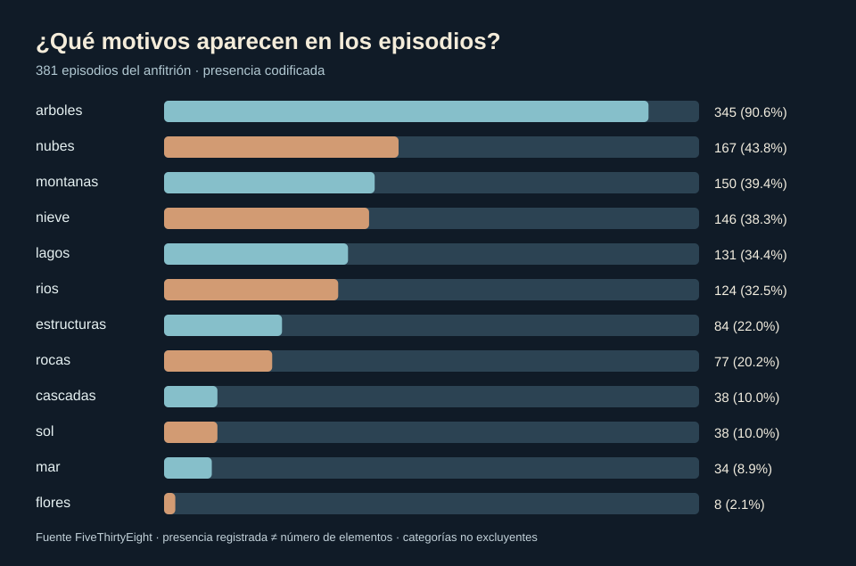
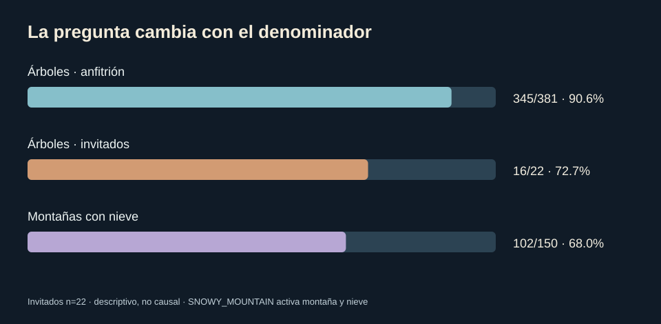
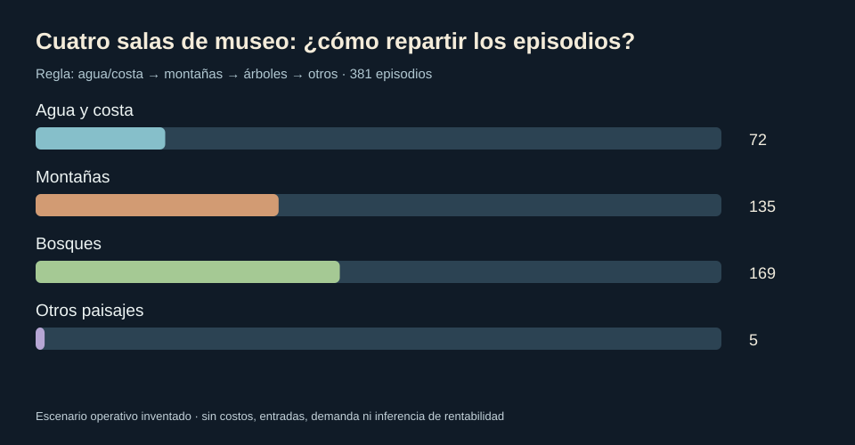

# AI Discovery Labs · Episodio Bob Ross — investigación científica y Paquete de Entrada

> **Estado de código:** infraestructura común y paquete integrados por PR #11 y PR #10 (pendiente de fusión al preparar esta versión). **Estado científico:** Fase 1 NO aprobada; Fases 2/3 bloqueadas. No se ha entrenado ningún modelo de las 14 preguntas.

## Punto de entrada CANÓNICO (leer primero)

- [START_HERE_NEW_CHAT.md](entry_pack/START_HERE_NEW_CHAT.md): inicio autocontenido para cualquier conversación nueva.
- [Paquete de Entrada](entry_pack/README.md): fuentes, metadatos, muestra, Deep Research y planificación.
- [QUESTIONS_MASTER.md](entry_pack/QUESTIONS_MASTER.md) + [questions_master.json](entry_pack/questions_master.json): **un solo banco editorial de 14 investigaciones**, cada una con O1→O2→O3, modelo + ejercicio estadístico propuestos, sin entrenar.
- [Guía Científica HTML V3](research_guide.html): una única sección de preguntas, con investigación de cambios hacia el final de su vida y límites de causalidad; **pendiente de tu aprobación**.
- [MODEL_FIT_BOB_ROSS.md](entry_pack/MODEL_FIT_BOB_ROSS.md): pertinencia específica de modelos para Bob Ross.

**Infraestructura reutilizable:** [Question Forge V2.1](../../shared/skills/question-forge/SKILL.md), [catálogo único de 24 modelos](../../shared/model_catalog/MODEL_SET.md), [plantilla de entrada](../../shared/templates/ENTRY_PACK_TEMPLATE.md) y [validador compartido](../../shared/validators/validate_entry_pack.py). Las skills, plantillas y el catálogo general **NO se duplican dentro del episodio**.

El antiguo `intake/`, `entry_pack/QUESTION_BANK.md`, `entry_pack/question_graph.json` y `questions.json` son materiales históricos/de compatibilidad; **no deben mostrarse como un segundo banco científico**. La interfaz `episode.html` conserva seis rutas didácticas originales para un prototipo anterior; su presencia no implica que estén aprobadas como temario definitivo.

**Gates:** Paquete de Entrada → Guía Científica HTML (**aprobación humana explícita**) → Storytelling Audiovisual HTML (**aprobación explícita**) → Video. Una fusión GitHub no equivale a aprobación de resultados científicos.

## Comprobaciones de integración sin entrenamiento

```bash
python discovery_labs/shared/validators/validate_entry_pack.py --entry-pack discovery_labs/episodes/bob-ross/entry_pack --guide discovery_labs/episodes/bob-ross/research_guide.html
python discovery_labs/episodes/bob-ross/entry_pack/validate_pack.py
python -m unittest discover -s discovery_labs/shared/validators/tests -v
python -m unittest discover -s discovery_labs/episodes/bob-ross/tests -v
```

---

## Referencia histórica: prototipo original de seis rutas

Las secciones siguientes describen el prototipo anterior, que permanece disponible para trazabilidad y desarrollo. El **banco editorial canónico** es siempre `entry_pack/QUESTIONS_MASTER.md`.

## Abrir en un minuto

1. Descarga **solamente esta carpeta**.
2. Abre [episode.html](episode.html) directamente en el navegador (sin servidor, cuentas ni red).
3. Vota una de las [seis preguntas](questions.json), escribe una hipótesis, revela los datos, prueba una objeción y firma la conclusión.
4. Utiliza [ALUMNO.md](ALUMNO.md) y [STORYBOARD.md](STORYBOARD.md) durante la sesión; [DOCENTE.md](DOCENTE.md) proporciona el guion de facilitación **publicado en GitHub, por lo que no es un solucionario secreto**.

La página contiene los 403 episodios en una representación autocontenida **derivada de los datos reales**, no un enlace externo ni un modelo generado por IA. El CSV original íntegro está en [data/elements-by-episode.csv](data/elements-by-episode.csv) y su procedencia en [data/manifest.json](data/manifest.json).

## Las seis preguntas del prototipo original (no el banco científico canónico)

| Ruta | Perspectiva | Pregunta |
|---|---|---|
| D85-A | Negocio (hipotético) | ¿Cómo repartir obras entre cuatro salas de museo sin saturar una sala? |
| D85-B | Social (descriptiva) | ¿Qué cambia entre invitados y anfitrión? |
| D85-C | Descubrimiento | ¿Qué grupos se forman con doce motivos y qué tan sensibles son? |
| D85-D1 | Creencia popular 1 | ¿Todos los cuadros de Bob Ross tienen árboles? |
| D85-D2 | Creencia popular 2 | ¿Todas las montañas tienen nieve? |
| D85-E | Detective de datos | ¿Cuándo una variable cronológica mejora el score pero arruina la interpretación? |

**Advertencias sobre el alcance:**

- La ruta A no estima ROI, entradas, gastos ni ingresos: **es un supuesto de museo ficticio**. Las reglas son operaciones interpretables y excluyentes, no una optimización económica.
- La ruta B compara un conjunto de **22 episodios con GUEST** con 381 restantes: no demuestra sesgos sociales, intención ni diferencias en calidad.
- Las rutas D1/D2 refutan frases **dentro de etiquetas codificadas**, no demuestran visualmente qué aparece en cada pintura. Las expresiones "creencia popular" son ganchos pedagógicos, no popularidad validada por encuesta.
- La ruta E necesita separar pruebas históricas del ejemplo de ID artificial de los resultados del clustering ejecutado en esta carpeta.
- La ruta C ofrece **dos métodos diferentes**: asignación transparente por reglas y k-medoids con Jaccard/Euclídea; ninguno implica que existan cuatro estilos naturales.

## Los datos

| Atributo | Valor comprobado en el registro de la fuente |
|---|---|
| Productor | Walt Hickey / FiveThirtyEight |
| Universo | 403 episodios etiquetados de *The Joy of Painting* |
| Unidad | Episodio |
| Esquema | 69 columnas (EPISODE, TITLE, 67 etiquetas binarias) |
| Grupo anfitrión | 381 episodios (GUEST=0) |
| Invitados | 22 episodios (GUEST=1) |
| Formato | CSV UTF-8, 66,315 bytes |
| Origen fijado | commit `4c1ff5e3aef1816ae04af63218015066e186c147` |
| SHA-256 | `42045c8b8aaa8296095d6b294927fb9d0f73a57259f59b560c375844c0fe01cf` |
| Licencia del CSV | CC BY 4.0; **no cubre pinturas ni vídeos** |
| Periodo | Temporadas S01–S31; no son fechas observadas en este CSV |

El análisis agrega doce familias binarias mediante **OR** (véase [DICCIONARIO.md](DICCIONARIO.md)): árboles, montañas, lagos, ríos, mar, nieve, cascadas, estructuras, nubes, rocas, sol y flores. Una etiqueta TREE=1 indica presencia codificada, **no** número de árboles. SNOWY_MOUNTAIN participa en montaña y nieve; la correlación es en parte constructiva. Los ceros son ausencia codificada, no faltantes.

El CSV en esta carpeta es copia byte por byte del ya verificado en `examples/bob_ross_clustering/data/` del mismo repositorio. Se mantiene aislado para no depender de archivos externos a esta carpeta al ejecutar.

## Vista de las primeras visualizaciones

Las figuras siguientes son **referencias estáticas derivadas del CSV fijado**. El script `run.py --write` genera versiones SVG reproducibles en `output/` para revisar el análisis.







Las gráficas respetan que las doce familias no son mutuamente excluyentes, que invitados tienen `n=22` y que el museo ficticio no dispone de ingresos o costos.

## Pipeline reproducible (sin dependencias adicionales)

Desde la raíz del repositorio:

```bash
# Verificar SHA, 403 episodios, esquema, preguntas y controles
python discovery_labs/episodes/bob-ross/run.py --check

# Generar Silver CSV, resultados JSON y tres SVG descriptivos
python discovery_labs/episodes/bob-ross/run.py --write

# Calcular agrupamientos k-medoids Jaccard vs Euclídea, ARI y cuarto SVG
python discovery_labs/episodes/bob-ross/clustering.py --write

# Tests (sólo unittest de la librería estándar)
python -m unittest discover -s discovery_labs/episodes/bob-ross/tests -v

# Opcional, sin npm, si está instalado Node.js:
node discovery_labs/episodes/bob-ross/qa_static.cjs
```

**Toda la escritura ocurre en `discovery_labs/episodes/bob-ross/output/`** y no toca tablas actuales, pipelines de movilidad, la plataforma del curso ni otros experimentos. La salida de cada comando debe contrastarse antes de anunciar que una ruta está lista para aula.

### Archivos del episodio

| Archivo | Propósito |
|---|---|
| [episode.html](episode.html) | Experiencia interactiva offline; seis rutas, apuesta, evidencia, prueba adversarial y cierre |
| [questions.json](questions.json) | Contratos medibles, métodos, limitaciones y criterios para las seis rutas |
| [run.py](run.py) | Ingesta local, SHA, validación de esquema, limpieza semántica, resultados y SVG |
| [clustering.py](clustering.py) | k-medoids Jaccard/Euclídea, representantes reales, ARI y figura de salas |
| [data/elements-by-episode.csv](data/elements-by-episode.csv) | Raw/Bronze original íntegro; licencia de datos CC BY 4.0 |
| [data/manifest.json](data/manifest.json) | Procedencia, fuente, hash, restricciones |
| [DICCIONARIO.md](DICCIONARIO.md) | Grano, variables, definición de features, sesgos y validaciones |
| [ALUMNO.md](ALUMNO.md) | Instrucciones, prompts y entregable; no depende de saber programar |
| [DOCENTE.md](DOCENTE.md) | Guion, tiempos, preguntas y respuestas de referencia con advertencias |
| [STORYBOARD.md](STORYBOARD.md) | Actos narrativos, tensión, visuales y bifurcaciones honestas |
| [tests/test_episode.py](tests/test_episode.py) | Controles del dataset, método, interfaz y gráficos |
| [qa_static.cjs](qa_static.cjs) | QA estático opcional de HTML, JavaScript y datos embebidos con Node |
| [QA_STATUS.md](QA_STATUS.md) | Evidencias verificadas, pruebas aún no ejecutadas y puertas de aprobación |

**No se versionan automáticamente outputs generados**: ejecutar los scripts produce archivos en `output/`, incluso sin red. El HTML funciona sin regenerarlos, porque incrusta un subconjunto semánticamente fiel de las columnas necesarias: identificador, título, invitado, temporada y doce motivos agregados. Los 67 campos originales no se eliminan del CSV raw.

## Una sesión de 45 minutos

| Min | Etapa | Evidencia |
|---:|---|---|
| 0–5 | Gancho y voto | Pregunta única |
| 5–10 | Apuesta, métrica, denominador | Hipótesis escrita |
| 10–14 | Dos caminos propuestos por IA | Plan elegido y justificado |
| 14–28 | Leer CSV y explorar / visualizar | Tabla y gráfica |
| 28–36 | Contrastar hipótesis, revisar contraejemplos | Prueba adversarial |
| 36–42 | Debate | Qué se puede / no se puede concluir |
| 42–45 | Firma humana | Una frase cuantificada, límite y nueva pregunta |

Instalación, descarga y prerrequisitos ocurren antes de clase. Si hay problemas de ejecución, se utiliza el HTML con datos embebidos y se distingue claramente análisis de referencia de cálculo en vivo.

## Qué reutiliza y qué NO modifica

Se reutilizan ideas y evidencia verificadas de:

- [Cuatro salas para Bob Ross](../../../examples/bob_ross_clustering/README.md): doce motivos, k=4, medoids reales, experimento de ID contaminante.
- [Piloto V2](https://github.com/jcval94/DataCollectionMov/blob/feat/ai-discovery-labs-v2/discovery_labs/pilots/bob-ross-elementos/README.md), aún en PR #2: árbol, nieve/montaña, invitados y dependencia de distancia.

**No se modifica ninguna carpeta anterior, ningún workflow de GitHub Actions, ningún archivo de datos histórico, ni el portal de `mvp-ds-course`.**

## Puertas pendientes antes de publicar

- Ejecutar y registrar todas las pruebas del nuevo episodio sobre la revisión definitiva.
- Inspección visual real de escritorio/móvil y accesibilidad con lector de pantalla/teclado.
- Verificar que las seis preguntas tengan datos y rutas suficientes para la votación inicial.
- Ensayo humano cronometrado de 45 minutos y revisión pedagógica independiente.
- Decidir dónde se almacenará en privado la guía docente si debe protegerse del alumno.

El mejor resultado posible no siempre es encontrar un grupo bonito. A veces consiste en demostrar que **la pregunta está mal formulada o que el dato no alcanza**.
