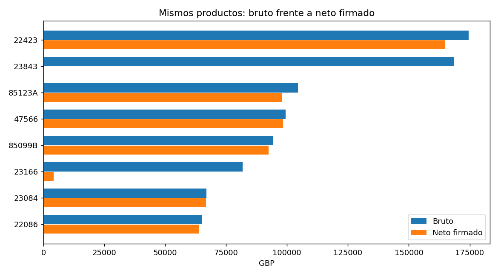
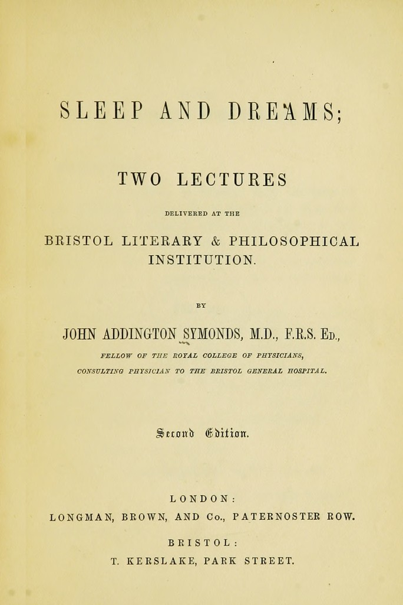

# Plan docente: datasets reales, IA y decisiones verificables

**The Agentic Data Scientist · Propuesta de integración a la Generación 1**

**Revisión:** 4 de noviembre de 2026, hora de CDMX. **Alcance:** 22 clases, 10 módulos, 72 fuentes. Documento de planeación; no modifica el programa aprobado, la oferta, el portal, los casos ni las reglas de calificación.

## 1. Recomendación principal

Incorporar los datos como **laboratorios breves de transferencia** después de los casos que ya enseñan el concepto. El alumno enfrenta una decisión nueva, hace una apuesta, encuentra una dificultad en la evidencia, usa una operación mínima, verifica y firma. Mantener un caso principal por clase y una sola pregunta central por actividad.

**Primera actividad recomendada:** clase 11, «La métrica que mentía», con Online Retail. **Duración: 30 minutos dentro de las tres horas.** Pregunta: **«¿Qué producto merece llamarse estrella de ventas y cambia tu elección al definir cómo contamos los créditos y cancelaciones?»**

La elección se apoya en un piloto ya ejecutado: tenemos archivo completo identificado por hash, cálculo exacto, ranking, sensibilidad, registros reales y una gráfica. La decisión didáctica es qué métrica y afirmación publicar; **no** se decide qué comprar sin conocer costos, inventario y contexto comercial. [Resultado y tests del piloto](../../examples/retail_discovery/README.md).

**Primera secuencia sugerida:** seis cápsulas —clases 1, 5, 11, 13, 19, 20—, que ocupan **185 minutos (3 h 05 min)**, **4.67% de las 66 horas**, redistribuidos dentro del tiempo de transferencia. Las otras fichas son opciones para sustituir una cápsula, lectura, proyecto o una edición posterior; no se suman todas las fuentes a la agenda.

Las 22 fichas permiten una alternativa por sesión. Si se eligieran todas, consumirían **655 minutos (10 h 55 min)**, **16.54%** del curso. Es un escenario de máxima integración, no la recomendación de primera edición. El banco de 72 fuentes tampoco se suma a esas cifras: se elige una fuente o un cruce acotado por actividad.

## 2. Índice

- [Base real del curso y supuestos](#3-base-real-del-curso-y-supuestos).
- [Cómo se aprende y cómo se revela la evidencia](#4-secuencia-de-aprendizaje).
- [Tiempo dentro de una clase de tres horas](#5-presupuesto-de-tiempo).
- [Mapa de las 22 clases](#6-mapa-de-las-22-clases).
- [Guion completo de la primera incorporación](#7-primera-incorporacion-clase-11).
- [Fichas de acción de las 22 clases](#8-fichas-de-accion-por-clase).
- [Las 72 fuentes: clase, pregunta, tiempo y motivo](#9-las-72-fuentes-y-su-mejor-ubicacion).
- [Skills, herramientas y arnés](#10-skills-herramientas-y-arnes-en-el-aula).
- [Preparación y disponibilidad](#11-preparacion-del-docente-y-disponibilidad).
- [Proyectos y rutas por interés](#12-proyectos-y-rutas-por-interes).
- [Comprobar aprendizaje sin cambiar la calificación](#13-evidencia-de-aprendizaje-y-seguimiento).
- [Contingencias, accesibilidad y ritmo](#14-contingencias-accesibilidad-y-ritmo).
- [Encargos copiables y próximas acciones](#15-encargos-copiables-y-proximas-acciones).
- [Trazabilidad y validación del plan](#16-trazabilidad-y-validacion-documental).

<a id="3-base-real-del-curso-y-supuestos"></a>
## 3. Base real del curso y supuestos

| Aspecto | Base consultada / decisión de este plan |
| --- | --- |
| Estructura en vivo | 22 clases de 180 min, 11 semanas, 66 horas. Viernes 18:00–21:00 y sábados 08:00–11:00, CDMX, del 8 de enero al 20 de marzo de 2027, según la estructura y decisiones actuales. No se propone cambiar esos horarios. |
| Unidad para ubicar actividades | La clase de la Generación 1; los niveles son biblioteca y prerrequisitos. No equiparar Nivel 11 con Clase 11. |
| Biblioteca | Ruta canónica de 14 niveles; 13 publicados. Nivel 10 canónico, sin paquete publicado. Sus temas aparecen en las clases aprobadas, pero eso no crea un laboratorio publicado. |
| Audiencia | Adultos que comienzan sin programación. Acciones en español, controles y formularios; código nuevo a cargo del docente o del agente y revisado por una persona. |
| Entorno inicial | Clases 1–4: planificar con página, tarjetas, tablas o proyección. La decisión de migrar esos módulos fuera de Colab seguía en revisión el 4 de noviembre; no crear cuadernos nuevos allí. Desde Módulo 3, usar Colab existente si el formato aprobado aplica. |
| Relación con historias | Los casos históricos aprobados siguen de ancla. Un dataset no reemplaza su verificación ni se presenta como fuente de aquellos hechos si no lo es. La taquería es transferencia opcional; no se atribuye experiencia histórica o técnica nueva a Don Juan o Paco. |
| Agentes | Una competencia auxiliar por actividad. Niveles 1–2: resultados preparados, no instalación ni delegación abierta. Mayor autonomía sólo tras los prerrequisitos. |
| Calificación | Actividades nuevas propuestas como práctica formativa; no añadir bits, registros en producción ni criterios de constancia. La calificación y proyecto siguen lo aprobado. |
| Proyecto final | Individual, datos y problema reales, GitHub y video breve según oferta actual. Se permite repositorio privado con acceso al profesor; publicación/despliegue opcional. |
| Supuestos de duración | Son estimaciones de diseño, no tiempos medidos con alumnos. Incluyen lectura, discusión, transición y verificación de la cápsula; excluyen instalar, descargar corpus y crear cuentas. |

### Jerarquía usada cuando los documentos tienen distinto alcance

Para qué caso va en cada clase se usó `docs/ESTRUCTURA_GENERACION_1.md`; para oferta y calendario, `docs/DECISIONES_GENERACION_1.md`; para el modo de enseñar, `docs/CRITERIO_PRIMERO.md`; para niveles y prerrequisitos, `docs/CURRICULUM_MAP.md`. Se leyó también `docs/agents/COLABORADOR.md`. El PRD contiene historia de la fábrica, así que no se usó para reemplazar decisiones actuales de la Generación 1. No se copian respuestas, tolerancias o rúbricas de los retos del curso ni se consulta el backend privado.

<a id="4-secuencia-de-aprendizaje"></a>
## 4. Secuencia de aprendizaje

### La experiencia que se repite

1. **Apostar:** una decisión breve con razón propia antes de ver el resultado. La apuesta es revisable, no una trampa ni una calificación sorpresiva.
2. **Mirar:** mostrar pocas filas, una imagen, un pasaje o una gráfica con fuente y unidad. El material inicial puede ser un extracto, siempre rotulado como tal.
3. **Encontrar fricción:** aparece un denominador, una fila negativa, una fecha, un grupo o una cita que la primera lectura no contemplaba.
4. **Usar lo mínimo:** resolver la dificultad con una operación o herramienta nueva. Nombrar el concepto después de que la necesidad sea visible.
5. **Verificar:** realizar dos comprobaciones que el principiante pueda explicar; una validación técnica automática no sustituye comprender una fila.
6. **Firmar y transferir:** decidir con límites, comparar contra la apuesta y aplicar el criterio a otra situación. La IA no firma.

Un mecanismo narrativo puede ser muy atractivo y aun así no producir aprendizaje. Pedir una acción observable: calcular una fila, señalar qué no está representado, reconstruir una comparación, encontrar una cita o rechazar una afirmación excesiva. Evitar una visita guiada de 30 minutos al catálogo.

### Por qué este diseño

La guía del Institute of Education Sciences recomienda distribuir práctica en el tiempo, alternar ejemplos resueltos con problemas, combinar representaciones gráficas y verbales y volver a recuperar lo aprendido. Aquí se traduce en una demostración corta, una acción independiente y un regreso posterior con otra pregunta. [Guía oficial, 2007](https://ies.ed.gov/ncee/wwc/PracticeGuide/1).

Freeman y colaboradores analizaron aprendizaje activo en cursos universitarios STEM. Se toma como apoyo para hacer que el alumno produzca decisiones y explicaciones; no permite prometer un efecto numérico para este curso de adultos en línea. [Investigación, 2014](https://pubmed.ncbi.nlm.nih.gov/24821756/). Las duraciones, fuentes elegidas y su prioridad son decisiones de diseño de esta propuesta, por validar en un piloto.

### Mantener sorpresa sin esconder el método

- Preparar una versión para el alumno con pregunta, evidencia gradual e instrucciones, y otra para facilitar con resultado, pruebas y notas. Este plan público no es un banco de respuestas de retos oficiales.
- Los README de resultados ya contienen hallazgos: abrirlos después de la firma, no como enlace inicial de la apuesta.
- Si hay un error plantado, anunciar que la salida preparada puede contener un error; rotularla como material didáctico y conservar el original íntegro. No atribuir esa salida a una IA que no se ejecutó.
- No revelar una conclusión histórica por medio del título, miniatura o nombre de archivo. La hipótesis del sueño sigue abierta; una portada no la resuelve.
- Ante incertidumbre real, el desenlace puede ser «la evidencia todavía no alcanza». No fabricar una inversión de rankings, un efecto causal o una caída de precisión para conseguir un giro.

<a id="5-presupuesto-de-tiempo"></a>
## 5. Presupuesto de tiempo

### Plantilla de 180 minutos para clases 1–21

| Minutos de sesión | Duración | Bloque |
| --- | ---: | --- |
| 0–10 | 10 | Recuperación de la clase anterior y decisión que abre la sesión. |
| 10–20 | 10 | Gancho y apuesta del caso principal. |
| 20–65 | 45 | Trabajo del caso principal, con lectura y herramienta mínima. |
| 65–75 | 10 | Verificación, firma y revelación del caso principal. |
| 75–85 | 10 | Pausa. |
| 85–110 | 25 | Caso aprobado del costo del error; si el principal se alarga, seguir el recorte previsto por el programa. |
| 110–125 | 15 | Laboratorio o explicación puntual que pide el caso. |
| 125–125+T | T | Cápsula de este catálogo: T entre 15 y 45 min según ficha. |
| 125+T–170 | 45−T | Práctica/transferencia individual y ayuda. |
| 170–180 | 10 | Recuperar apuesta, límite y salida de la sesión. |

**Total: 180 min para cualquier T de 15 a 45.** Una cápsula de 35 min deja 10 min de práctica adicional; una de 30 deja 15. No añadir una cápsula encima de una sesión ya completa. Si el caso principal consumió el margen, omitir la cápsula o pasarla a práctica opcional; nunca sacrificar su verificación y firma.

### Versión mínima y extendida de una cápsula

| Formato | Tiempo | Contenido | Uso |
| --- | ---: | --- | --- |
| Microtransferencia | 10–15 min | Una evidencia, una comparación y una frase con límite. | Cuando la sesión se retrasó o el dataset sólo sirve de contraste. |
| Cápsula habitual | 20–35 min | Apuesta, lectura, fricción, operación, dos verificaciones y firma. | Recomendación para integrar sin reemplazar los casos. |
| Taller guiado | 45 min | Una pregunta con más lectura, grupos o una segunda comprobación. | Sustituir todo el bloque de transferencia; no sumar a la cápsula habitual. |
| Proyecto | 30–45 min de clínica; trabajo fuera de clase según alcance | Definir alcance, revisar evidencia y resolver un bloqueo. | La investigación completa no se promete en la duración de la clínica. |

### Clase 22: presupuesto especial para presentaciones

| Minutos | Bloque |
| --- | --- |
| 0–10 | Recuperación y propósito de firmar. |
| 10–25 | Caso principal S01, en recorrido corto. |
| 25–45 | Caso del error E61, en discusión guiada. |
| 45–55 | Pausa. |
| 55–155 | Presentaciones: hasta 30 personas × 3 min = 90 min y 10 min de transiciones; con menos alumnos, usar margen para preguntas/revisión, no para introducir otro dataset. |
| 155–170 | Cápsula de entrega y comprobación entre pares, 15 min. |
| 170–180 | Cierre, responsabilidad y siguientes usos del proyecto. |

Este horario de la clase 22 es una propuesta de facilitación, no una sustitución aprobada de sus casos ni una nueva condición de la constancia. Si una revisión requiere más profundidad, realizarla antes o después del bloque de presentaciones con acceso permitido al proyecto.

<a id="6-mapa-de-las-22-clases"></a>
## 6. Mapa de las 22 clases

Los títulos y casos son los aprobados; sólo la columna de integración es propuesta. Las fechas se muestran en CDMX. «Primera secuencia» identifica las seis cápsulas sugeridas para adoptar gradualmente; las demás quedan como alternativas.

| Clase / fecha | Módulo y niveles | Clase aprobada | Fuente propuesta | Pregunta central abreviada | Tiempo de cápsula | Uso inicial |
| --- | --- | --- | --- | --- | ---: | --- |
| [C01](#c01) · 2027-01-08 | M1 · N1 | ¿Qué aviones no volvieron? | [gbif-biodiversidad](../../docs/CATALOGO_DATASETS_REALES.md#gbif-biodiversidad) | Si no hay observaciones en una zona, ¿dirías que no hay especies o que aún no lo sabemos? | 20 min | Primera secuencia |
| [C02](#c02) · 2027-01-09 | M1 · N1 | 2.4 millones de boletas equivocadas | [openfoodfacts-alimentos](../../docs/CATALOGO_DATASETS_REALES.md#openfoodfacts-alimentos) | ¿Se pueden comparar dos etiquetas si una informa por porción y otra por 100 gramos? | 25 min | Alternativa |
| [C03](#c03) · 2027-01-15 | M2 · N2 | El mapa que detuvo una epidemia | [inegi-denue](../../docs/CATALOGO_DATASETS_REALES.md#inegi-denue) | ¿La zona con más establecimientos también es la que tiene mayor oferta relativa a la población? | 30 min | Alternativa |
| [C04](#c04) · 2027-01-16 | M2 · N2 | La rosa que cambió un hospital | [nyc-restaurantes](../../docs/CATALOGO_DATASETS_REALES.md#nyc-restaurantes) | ¿Un restaurante con más filas tiene más inspecciones o más infracciones dentro de una misma inspección? | 25 min | Alternativa |
| [C05](#c05) · 2027-01-22 | M3 · N3 | ¿Azar o descubrimiento? | [bob-ross-elementos](../../docs/CATALOGO_DATASETS_REALES.md#bob-ross-elementos) | ¿Árboles y montañas aparecen juntos más de lo esperable si sólo conocemos lo frecuente que es cada motivo? | 30 min | Primera secuencia |
| [C06](#c06) · 2027-01-23 | M3 · N3 | Encontrar un avión en el fondo del mar | [usgs-sismos](../../docs/CATALOGO_DATASETS_REALES.md#usgs-sismos) | Si cambia la magnitud publicada de un mismo sismo, ¿apareció otro evento o se revisó lo que sabíamos? | 25 min | Alternativa |
| [C07](#c07) · 2027-01-29 | M4 · N4 y 10 | La paradoja que absolvió a Berkeley | [nyc-restaurantes](../../docs/CATALOGO_DATASETS_REALES.md#nyc-restaurantes) | ¿Se mantiene una diferencia entre zonas cuando comparamos el mismo tipo de inspección y periodo? | 30 min | Alternativa |
| [C08](#c08) · 2027-01-30 | M4 · N4 y 10 | Causas sin experimento | [nyc-ratas](../../docs/CATALOGO_DATASETS_REALES.md#nyc-ratas) | Si mejora el resultado de una reinspección, ¿qué comparación faltaría para atribuirlo a la intervención? | 35 min | Alternativa |
| [C09](#c09) · 2027-02-05 | M5 · N9 y 10 | El sorteo que convenció al mundo | [shcp-srft](../../docs/CATALOGO_DATASETS_REALES.md#shcp-srft) | ¿Comparar municipios que recibieron más recursos con los que recibieron menos demuestra el efecto del gasto? | 25 min | Alternativa |
| [C10](#c10) · 2027-02-06 | M5 · N9 y 10 | A/B: el botón, la carta y la paciencia | [gsm8k-examenes](../../docs/CATALOGO_DATASETS_REALES.md#gsm8k-examenes) | ¿Cambiar sólo la redacción de un problema equivalente cambia la respuesta de un asistente? | 25 min | Alternativa |
| [C11](#c11) · 2027-02-12 | M5 · N9 y 10 | La métrica que mentía | [uci-retail](../../docs/CATALOGO_DATASETS_REALES.md#uci-retail) | ¿Qué producto merece llamarse estrella de ventas y cambia tu elección al definir cómo contamos los créditos y cancelaciones? | 30 min | Primera secuencia |
| [C12](#c12) · 2027-02-13 | M6 · N5 | La consulta que perdió 16,000 casos | [uci-retail](../../docs/CATALOGO_DATASETS_REALES.md#uci-retail) | Si definimos cliente activo con una ventana de tiempo, ¿quién cambia de grupo al cambiar esa regla? | 35 min | Alternativa |
| [C13](#c13) · 2027-02-19 | M6 · N5 | Cuando el sistema y la persona no coinciden | [nyc-restaurantes](../../docs/CATALOGO_DATASETS_REALES.md#nyc-restaurantes) | ¿Por qué sube un total si unimos inspecciones con sus infracciones sin cambiar ninguna visita? | 35 min | Primera secuencia |
| [C14](#c14) · 2027-02-20 | M7 · N6 y 7 | ¿Hace falta un modelo? | [ct-ventas-inmuebles](../../docs/CATALOGO_DATASETS_REALES.md#ct-ventas-inmuebles) | ¿Un modelo aporta más que una referencia sencilla dentro de propiedades y periodos comparables? | 35 min | Alternativa |
| [C15](#c15) · 2027-02-26 | M7 · N6 y 7 | Validar sin hacer trampa | [xeno-canto-audio](../../docs/CATALOGO_DATASETS_REALES.md#xeno-canto-audio) | ¿Un clasificador reconoce la especie o reconoce al grabador, el sitio o la misma grabación recortada? | 35 min | Alternativa |
| [C16](#c16) · 2027-02-27 | M7 · N6 y 7 | Cuánto cuesta equivocarse | [apple-resenas-apps](../../docs/CATALOGO_DATASETS_REALES.md#apple-resenas-apps) | Si clasificamos quejas para revisión humana, ¿qué error resulta más costoso y cómo cambia el umbral elegido? | 30 min | Alternativa |
| [C17](#c17) · 2027-03-05 | M8 · N8 y 9 | Encontrar lo raro | [bob-ross-paletas](../../docs/CATALOGO_DATASETS_REALES.md#bob-ross-paletas) | ¿Dos cuadros con paletas parecidas pertenecen al mismo tipo de paisaje o estamos agrupando otra cosa? | 35 min | Alternativa |
| [C18](#c18) · 2027-03-06 | M8 · N8 y 9 | Pronosticar la próxima ola | [ecobici-gbfs](../../docs/CATALOGO_DATASETS_REALES.md#ecobici-gbfs) | ¿Podemos anticipar disponibilidad mejor que repetir la última observación usando únicamente el pasado? | 35 min | Alternativa |
| [C19](#c19) · 2027-03-12 | M9 · N13 y 12 ligero | Cómo piensa (y alucina) un LLM | [wellcome-medicina-antigua](../../docs/CATALOGO_DATASETS_REALES.md#wellcome-medicina-antigua) | ¿Qué puede responderse sobre el sueño a partir de este expediente y qué evidencia falta para hablar de una costumbre histórica? | 35 min | Primera secuencia |
| [C20](#c20) · 2027-03-13 | M9 · N13 y 12 ligero | Delegar a un agente sin perder el control | [dof-publicaciones](../../docs/CATALOGO_DATASETS_REALES.md#dof-publicaciones) | ¿Podemos explicar y verificar un cambio documental sin conceder al agente permiso para alterar o publicar el original? | 35 min | Primera secuencia |
| [C21](#c21) · 2027-03-19 | M10 · N11 y 14 | Lo que el modelo no debía saber | [ceey-emovi-2023](../../docs/CATALOGO_DATASETS_REALES.md#ceey-emovi-2023) | ¿Podríamos usar una encuesta nacional de movilidad social para decidir oportunidades por código postal? | 30 min | Alternativa |
| [C22](#c22) · 2027-03-20 | M10 · N11 y 14 | Firmo esta decisión | [uci-retail](../../docs/CATALOGO_DATASETS_REALES.md#uci-retail) | ¿Qué parte del análisis puedes firmar y qué afirmación retirarías porque su evidencia aún no alcanza? | 15 min | Alternativa |

<a id="7-primera-incorporacion-clase-11"></a>
## 7. Primera incorporación: clase 11

### Objetivo y pregunta recomendados

**Clase:** C11, viernes 12 de febrero de 2027, Módulo 5 «¿Funcionó?». **Caso principal que se conserva:** Moneyball. **Caso del costo del error:** Volkswagen. **Hábito de la cápsula:** `mide`. **Competencia auxiliar:** inspeccionar entradas, definiciones y salidas del cálculo; no crear un agente nuevo.

**Objetivo observable:** el alumno define la métrica con su población y unidad, comprueba cómo trata créditos y cancelaciones y redacta una afirmación sobre el ranking que podría defender.

**Pregunta elegida:** «¿Qué producto merece llamarse estrella de ventas y cambia tu elección al definir cómo contamos los créditos y cancelaciones?» Es preferible a «haz un dashboard de ventas» porque exige una definición y una decisión concretas. También evita prometer que el neto firmado basta para decidir inventario o utilidad.

### Material real que ya existe

| Archivo | Uso y momento |
| --- | --- |
| [README del piloto](../../examples/retail_discovery/README.md) | Resultado completo y límites. El docente lo lee antes; el alumno lo abre tras la apuesta y firma. |
| [inputs_manifest.json](../../examples/retail_discovery/inputs_manifest.json) | Fuente, licencia, tamaño y hash del archivo completo. |
| [run.json](../../examples/retail_discovery/run.json) | Pregunta, política, código y pruebas de la ejecución registrada. |
| [product_ranking.csv](../../examples/retail_discovery/product_ranking.csv) | Ranking calculado para el conjunto elegible; no presentarlo como tabla de líneas originales. |
| [product_ranking_deduplicated.csv](../../examples/retail_discovery/product_ranking_deduplicated.csv) | Sensibilidad al retirar duplicados exactos, sin afirmar que todos eran errores. |
| [metrics.json](../../examples/retail_discovery/metrics.json) | Conteos, importes, variantes y ejemplos reales para cotejar. |
| [run_discovery.py](../../scripts/run_discovery.py) | Ejecutor del primer adaptador; lectura y cálculo los realiza el docente/agente, no el principiante de memoria. |

Hechos del piloto, ya calculados: se leyeron 541,909 filas, 536,429 quedaron elegibles bajo la política declarada y se obtuvieron 3,914 códigos de producto. El producto 23843 tiene 168,469.60 GBP de importe positivo y la misma magnitud negativa: neto firmado cero. Es una conciliación de registros, no una explicación comercial verificada. No convertir su puesto neto en una medida de importancia: hay empates que el script ordena por código.

### Preparar antes de entrar

1. Elegir cuatro códigos del ranking y conservar los cálculos derivados del conjunto completo; no recalcular posiciones sobre un extracto y llamarlas globales.
2. Crear una vista inicial con código, descripción y bruto. Guardar créditos/neto y el README completo para la siguiente escena.
3. Preparar las líneas originales necesarias para comprobar al menos un producto. El piloto conserva las dos líneas del 23843. Rotular la selección como extracto deliberado, no muestra representativa.
4. Preparar una hoja de decisión sin solución: apuesta, definición, dos comprobaciones, límite y firma. No mezclarla con los retos calificados del curso.
5. Tener disponibles la gráfica, tablas y una copia local; abrir todos los archivos antes de Meet. No ejecutar una descarga de 45 MB con alumnos esperando.
6. Ensayar una explicación de «crédito registrado» y «neto firmado» en lenguaje simple. No llamar automáticamente devolución física a una cantidad negativa.

### Path de acción de 30 minutos

| Minuto de cápsula | Docente | Estudiante | Evidencia que aparece |
| --- | --- | --- | --- |
| 0–4 | Plantea que debe publicarse un ranking y muestra el bruto de cuatro productos. | Hace una apuesta y explica qué entiende por estrella. | Tabla inicial, sin neto ni resultado revelado. |
| 4–10 | Abre una línea original y pregunta qué representa cada campo. | Calcula cantidad × precio y nombra la unidad. | Una factura/línea con fecha y producto. |
| 10–15 | Añade las líneas negativas disponibles. No anuncia aún cuál producto cambia más. | Revisa si su definición inicial sigue siendo suficiente. | Signo, referencia de factura y valor registrado. |
| 15–21 | Facilita tres sumas: positivo, magnitud negativa y diferencia. | Reconstruye una métrica y vuelve a comparar el ranking. | Bruto, créditos y neto firmado con definiciones explícitas. |
| 21–27 | Solicita una comprobación manual y otra independiente. | Conciliar un producto; cotejar otra suma o variante de duplicados y anotar qué encontró. | Registros originales y salida del ejecutor. |
| 27–30 | Pide decisión y límite, y abre el README completo después. | Firma qué afirmación publicaría y qué dato falta para hablar de beneficio o reposición. | Tarjeta de métrica y resultado contrastado con la apuesta. |

### Frases útiles para conducir, sin dar una respuesta automática

- «¿Qué tendría que contar y qué tendría que restar para que este número responda tu pregunta?»
- «¿Estás comparando productos, líneas de factura o clientes?»
- «¿Qué registro original te permitiría comprobar esa cifra?»
- «Si el neto cambia, ¿eso ya demuestra por qué ocurrió la operación?»
- «¿Firmarías una recomendación de compra con estos datos, o sólo una afirmación descriptiva?»

Si alguien dice «entonces siempre hay que usar neto», devolver la pregunta de decisión: el bruto puede describir actividad positiva y el neto otra cosa. La práctica exige elegir una definición, no memorizar una métrica universal. Si propone borrar negativos o duplicados, pedir una razón documental y comparar sensibilidad antes de alterar el conjunto.

### Gráfica de referencia para el cierre

Mostrar sólo después de revisar la apuesta. La imagen procede del cálculo del piloto, no de una IA generativa.



### Reproducir como preparación docente

Desde la raíz de DataCollectionMov:

```bash
python scripts/run_discovery.py --self-check
# Descargar y recalcular sólo si hace falta actualizar el piloto, antes de la clase:
python scripts/run_discovery.py --case uci-retail
# Para una sesión offline, usar un original local y cotejar su SHA-256 con el manifiesto:
python scripts/run_discovery.py --input /ruta/data.csv --output /ruta/ensayo-retail
```

El dibujo requiere matplotlib según el README del piloto. Un nuevo resultado se etiqueta con su propia versión y fecha; no se asume idéntico al aquí descrito. La prueba `--self-check` verifica comportamiento del adaptador, no que el alumno haya comprendido la métrica.

### Versión corta y regreso

Si sólo quedan 15 minutos: apuesta 2, leer dos líneas 4, conciliar 4, verificar 3 y firmar 2. Dejar duplicados como lectura opcional. En C12 la fuente puede volver para una regla de cliente activo; en C17, para segmentos; en C20, como ejemplo de un arnés que registra entradas y pruebas. Esos regresos requieren preparar análisis nuevos: el piloto actual no calcula automáticamente RFM, retención o clustering.

<a id="8-fichas-de-accion-por-clase"></a>
## 8. Fichas de acción por clase

Los tiempos siguientes son relativos al inicio de cada cápsula, no al inicio de la sesión. C01–C21 se colocan en el bloque 125–125+T; C22 usa 155–170 de su horario especial. El caso aprobado del costo del error separa el hábito del caso principal y el de la cápsula; si se reordena la sesión, revisar que no queden dos casos seguidos con el mismo hábito principal.

<a id="c01"></a>
### C01 · ¿Qué aviones no volvieron?

**Fecha prevista:** 2027-01-08 · **Módulo 1:** Datos que mienten · **Biblioteca:** niveles 1 · **Cápsula:** 20 min (11.1% de la sesión).

**Caso principal aprobado:** 1.1 Abraham Wald y los bombarderos (`faltan`). **Costo del error:** E64 Puerto Rico: 64 o 2,975 (`mide`). Se conservan como referencias del programa, no se reescriben aquí.

**Fuente principal propuesta:** [gbif-biodiversidad](../../docs/CATALOGO_DATASETS_REALES.md#gbif-biodiversidad). **Acceso registrado:** `DATA_SAMPLE`. **Madurez de material:** B: muestra real; preparar y revisar paquete.

**Pregunta recomendada:** Si no hay observaciones en una zona, ¿dirías que no hay especies o que aún no lo sabemos?

**Objetivo observable:** Distinguir ausencia de registro de ausencia del fenómeno. **Hábito:** `faltan`.

**Por qué encaja aquí:** Transfiere el hábito de Wald a un fenómeno actual y visual, sin introducir mapas complejos ni inferencia.

**Prerrequisitos y responsabilidad del docente:** Reconocer fila y variable; el caso principal introduce selección y supervivencia.

**Paquete de evidencia que debe estar preparado:** Tres fichas reales de ocurrencia con ID, lugar, tipo y fecha, una fotografía autorizada y una nota sobre cobertura desconocida; usar la selección ya probada, no un supuesto inventario completo.

**Path posible durante la cápsula:**

| Minutos | Momento | Acción del grupo y facilitación |
| --- | --- | --- |
| 0–3 | Apuesta | Mostrar fotografía y fichas; pedir una apuesta sobre qué zona podría describirse como menos observada. |
| 3–7 | Lectura de evidencia | Leer qué representa cada registro y qué no aparece: esfuerzo de observación y zonas no visitadas. |
| 7–10 | Fricción | Comparar el enunciado «no hay especies» con «no hay registros en este extracto»; cada pareja marca qué dato falta. |
| 10–14 | Operación / herramienta mínima | El docente muestra una ficha preparada que confunde ocurrencias con especies únicas; pedir una corrección. |
| 14–18 | Dos verificaciones | Contar registros y taxones por separado; comprobar un ID en la ficha y el alcance del extracto. |
| 18–20 | Firma / transferencia | Reescribir la afirmación inicial con una limitación y una fuente que se necesitaría para ampliar la conclusión. |

**Comprobaciones mínimas que el alumno puede explicar:**

- Contar manualmente tres registros frente a especies distintas.
- Localizar el campo de tipo/fecha y comprobar que no mide esfuerzo total.

**Salida del alumno:** Una afirmación corregida y una pregunta sobre el proceso de observación.

**Límite que debe quedar visible:** No estimar biodiversidad territorial desde tres fichas ni inferir especies mediante una imagen aislada.

**Preparación docente estimada:** 30–45 min: preparar fichas y atribución; excluir coordenadas sensibles o generalizadas sin explicación. Son estimaciones para producir/revisar material, no tiempo añadido a la clase.

**Skills y arnés detrás del paquete:** BASE, INGEST, GEO, VISION; ejecución E4; controles H0, TAB, GEO, VISION. [Definiciones y situación de implementación](README.md). La asignación viene de la fuente; el docente activa sólo lo necesario para este objetivo, no todos los perfiles a la vez.

<a id="c02"></a>
### C02 · 2.4 millones de boletas equivocadas

**Fecha prevista:** 2027-01-09 · **Módulo 1:** Datos que mienten · **Biblioteca:** niveles 1 · **Cápsula:** 25 min (13.9% de la sesión).

**Caso principal aprobado:** 1.2 La encuesta del Literary Digest (`faltan`). **Costo del error:** E48 El planeador de Gimli (`verificar`). Se conservan como referencias del programa, no se reescriben aquí.

**Fuente principal propuesta:** [openfoodfacts-alimentos](../../docs/CATALOGO_DATASETS_REALES.md#openfoodfacts-alimentos). **Acceso registrado:** `DATA_SAMPLE`. **Madurez de material:** B: muestra real; preparar y revisar paquete.

**Pregunta recomendada:** ¿Se pueden comparar dos etiquetas si una informa por porción y otra por 100 gramos?

**Objetivo observable:** Reconocer que la unidad y la base de comparación cambian la lectura. **Hábito:** `mide`.

**Por qué encaja aquí:** Conecta el error de unidades de Gimli con un objeto cotidiano; la gráfica o el cálculo llega después de necesitar una base común.

**Prerrequisitos y responsabilidad del docente:** Tipos numéricos, proporción sencilla y lectura de unidades; no se requiere nutrición.

**Paquete de evidencia que debe estar preparado:** Dos o tres productos reales del mismo tipo con etiqueta legible, cantidades y unidad verificadas. La prueba actual sólo aporta un producto; conseguir los otros antes de la sesión.

**Path posible durante la cápsula:**

| Minutos | Momento | Acción del grupo y facilitación |
| --- | --- | --- |
| 0–3 | Apuesta | Mostrar dos fichas sin alinear las bases y pedir cuál parece tener mayor cantidad del nutriente elegido. |
| 3–8 | Lectura de evidencia | Localizar tamaño de porción, denominador y unidad en las imágenes de las etiquetas. |
| 8–12 | Fricción | Pedir una comparación y detenerla cuando mezclen porción con 100 g; señalar qué información falta. |
| 12–17 | Operación / herramienta mínima | Convertir una sola cantidad a una base común usando una ficha resuelta por el docente. |
| 17–22 | Dos verificaciones | Cada pareja comprueba otra conversión con aritmética y la coteja con el registro estructurado. |
| 22–25 | Firma / transferencia | Firmar una comparación limitada a productos, país, versión y unidad; reconocer si no se puede completar. |

**Comprobaciones mínimas que el alumno puede explicar:**

- Conversión manual de una porción.
- Cotejo del número y unidad contra la fotografía.

**Salida del alumno:** Tabla pequeña con base homogénea y una comparación defendible.

**Límite que debe quedar visible:** No emitir consejo dietético ni comparar gramos y mililitros sin una relación justificable.

**Preparación docente estimada:** 45–60 min: verificar dos etiquetas adicionales, versión y datos faltantes; sin comparación lista, usar sólo auditoría de unidad de la ficha existente. Son estimaciones para producir/revisar material, no tiempo añadido a la clase.

**Skills y arnés detrás del paquete:** BASE, INGEST, VISION, CORPUS; ejecución E4; controles H0, TAB, TEXT, VISION. [Definiciones y situación de implementación](README.md). La asignación viene de la fuente; el docente activa sólo lo necesario para este objetivo, no todos los perfiles a la vez.

<a id="c03"></a>
### C03 · El mapa que detuvo una epidemia

**Fecha prevista:** 2027-01-15 · **Módulo 2:** Ver para decidir · **Biblioteca:** niveles 2 · **Cápsula:** 30 min (16.7% de la sesión).

**Caso principal aprobado:** 2.1 John Snow y el cólera (`comparar`). **Costo del error:** 2.3 El transbordador Challenger (`faltan`). Se conservan como referencias del programa, no se reescriben aquí.

**Fuente principal propuesta:** [inegi-denue](../../docs/CATALOGO_DATASETS_REALES.md#inegi-denue). **Acceso registrado:** `CACHED_SAMPLE`. **Madurez de material:** B: muestra real; preparar y revisar paquete.

**Pregunta recomendada:** ¿La zona con más establecimientos también es la que tiene mayor oferta relativa a la población?

**Objetivo observable:** Mostrar cómo el denominador altera una comparación territorial. **Hábito:** `comparar`.

**Por qué encaja aquí:** Continúa el mecanismo de Snow: un mapa de puntos es una observación, pero comparar necesita denominador y cobertura.

**Prerrequisitos y responsabilidad del docente:** Conteo, proporción y lectura de mapa; el cruce espacial lo prepara el docente.

**Paquete de evidencia que debe estar preparado:** Dos zonas definidas, un recorte DENUE con cobertura explícita y población compatible con su geografía/fecha. Si no existe denominador válido, el paquete se limita a explicar qué comparación no puede hacerse.

**Path posible durante la cápsula:**

| Minutos | Momento | Acción del grupo y facilitación |
| --- | --- | --- |
| 0–4 | Apuesta | Presentar dos mapas con la misma escala y preguntar dónde parece haber más oferta. |
| 4–10 | Lectura de evidencia | Mostrar conteos y aclarar actividad SCIAN, corte y territorio de cada grupo. |
| 10–15 | Fricción | Añadir población compatible y pedir si se mantiene la primera lectura. |
| 15–21 | Operación / herramienta mínima | Calcular una tasa descriptiva por población con un ejemplo trabajado; no dibujar rutas nuevas. |
| 21–27 | Dos verificaciones | Verificar manualmente una tasa y contrastar que no se duplicaron establecimientos al unir zonas. |
| 27–30 | Firma / transferencia | Firmar una comparación y nombrar una razón por la que oferta registrada no es acceso efectivo. |

**Comprobaciones mínimas que el alumno puede explicar:**

- Conteo independiente de una pequeña lista de establecimientos.
- División manual y revisión de unidad del denominador.

**Salida del alumno:** Dos mapas y una frase que distinga cantidad, tasa y acceso.

**Límite que debe quedar visible:** Censo 2020 y una edición posterior de DENUE no describen simultaneidad; no atribuir demanda ni capacidad.

**Preparación docente estimada:** 90–150 min iniciales: preparar geografía, cobertura, denominadores y mapa; recapturas posteriores 20–30 min. No se hace este cruce en vivo. Son estimaciones para producir/revisar material, no tiempo añadido a la clase.

**Skills y arnés detrás del paquete:** BASE, INGEST, GEO; ejecución E1; controles H0, TAB, GEO. [Definiciones y situación de implementación](README.md). La asignación viene de la fuente; el docente activa sólo lo necesario para este objetivo, no todos los perfiles a la vez.

<a id="c04"></a>
### C04 · La rosa que cambió un hospital

**Fecha prevista:** 2027-01-16 · **Módulo 2:** Ver para decidir · **Biblioteca:** niveles 2 · **Cápsula:** 25 min (13.9% de la sesión).

**Caso principal aprobado:** 2.2 Florence Nightingale en Crimea (`mide`). **Costo del error:** E29 Shipman y el gráfico que nadie hizo (`comparar`). Se conservan como referencias del programa, no se reescriben aquí.

**Fuente principal propuesta:** [nyc-restaurantes](../../docs/CATALOGO_DATASETS_REALES.md#nyc-restaurantes). **Acceso registrado:** `DATA_SAMPLE`. **Madurez de material:** B: muestra real; preparar y revisar paquete.

**Pregunta recomendada:** ¿Un restaurante con más filas tiene más inspecciones o más infracciones dentro de una misma inspección?

**Objetivo observable:** Distinguir filas de infracción de inspecciones al construir una tasa. **Hábito:** `mide`.

**Por qué encaja aquí:** Conecta tasas y comparación justa con registros administrativos repetidos; evita hacer un ranking por un conteo mal definido.

**Prerrequisitos y responsabilidad del docente:** Unidad de análisis y proporciones; no se exige escribir SQL.

**Paquete de evidencia que debe estar preparado:** Recorte real de 20–40 filas de dos o tres restaurantes con CAMIS, fecha, tipo e infracción; conservar inspecciones completas de la selección.

**Path posible durante la cápsula:**

| Minutos | Momento | Acción del grupo y facilitación |
| --- | --- | --- |
| 0–3 | Apuesta | Mostrar un ranking por filas y pedir qué comunica. |
| 3–8 | Lectura de evidencia | Agrupar visualmente tarjetas por restaurante, fecha y tipo de inspección. |
| 8–12 | Fricción | Revelar que varias filas pertenecen a una sola visita; preguntar qué denominador corresponde. |
| 12–17 | Operación / herramienta mínima | Construir una tabla de inspecciones y un conteo de infracciones por inspección en una salida preparada. |
| 17–22 | Dos verificaciones | Conciliar manualmente un restaurante y revisar si el tipo de inspección es comparable. |
| 22–25 | Firma / transferencia | Escribir un título honesto para la gráfica y una limitación sobre vigilancia. |

**Comprobaciones mínimas que el alumno puede explicar:**

- Enumerar visitas únicas en un grupo de tarjetas.
- Conciliar suma de infracciones antes/después de agrupar.

**Salida del alumno:** Tabla con dos granos y título corregido.

**Límite que debe quedar visible:** No usar puntaje sanitario como sabor ni atribuir diferencias a una cultura culinaria.

**Preparación docente estimada:** 45–75 min: ampliar la muestra y comprobar llaves; si sólo hay dos filas de la prueba, no simular inspecciones que no existen. Son estimaciones para producir/revisar material, no tiempo añadido a la clase.

**Skills y arnés detrás del paquete:** BASE, INGEST, GEO, CORPUS; ejecución E1; controles H0, TAB, GEO, TEXT. [Definiciones y situación de implementación](README.md). La asignación viene de la fuente; el docente activa sólo lo necesario para este objetivo, no todos los perfiles a la vez.

<a id="c05"></a>
### C05 · ¿Azar o descubrimiento?

**Fecha prevista:** 2027-01-22 · **Módulo 3:** Apostar con incertidumbre · **Biblioteca:** niveles 3 · **Cápsula:** 30 min (16.7% de la sesión).

**Caso principal aprobado:** 4.1 Semmelweis y el lavado de manos (`incertidumbre`). **Costo del error:** 3.1 El caso Sally Clark (`quien`). Se conservan como referencias del programa, no se reescriben aquí.

**Fuente principal propuesta:** [bob-ross-elementos](../../docs/CATALOGO_DATASETS_REALES.md#bob-ross-elementos). **Acceso registrado:** `DATA_SAMPLE`. **Madurez de material:** A: piloto/demostración ejecutados; falta adaptación de aula.

**Pregunta recomendada:** ¿Árboles y montañas aparecen juntos más de lo esperable si sólo conocemos lo frecuente que es cada motivo?

**Objetivo observable:** Comparar coocurrencia con una frecuencia base y una referencia de azar. **Hábito:** `incertidumbre`.

**Por qué encaja aquí:** Transfiere la referencia de azar de Semmelweis a un caso ligero; una sorpresa visual se convierte en pregunta estadística.

**Prerrequisitos y responsabilidad del docente:** Conteos, proporciones, independencia y simulación explicadas en el caso principal.

**Paquete de evidencia que debe estar preparado:** CSV de 403 episodios y métricas del piloto; tabla 2×2 y simulaciones/permutaciones preparadas para esta pregunta si se desea inferencia. Las métricas actuales son descriptivas, no un p-value ya ejecutado.

**Path posible durante la cápsula:**

| Minutos | Momento | Acción del grupo y facilitación |
| --- | --- | --- |
| 0–4 | Apuesta | Mostrar episodios o títulos seleccionados y pedir una apuesta sobre la asociación. |
| 4–10 | Lectura de evidencia | Leer la definición TREE OR TREES y MOUNTAIN OR MOUNTAINS como presencia. |
| 10–15 | Fricción | Mostrar la frecuencia base de árboles y preguntar por qué una coocurrencia grande puede ser poco sorprendente. |
| 15–21 | Operación / herramienta mínima | Comparar la tabla observada con una referencia de independencia; si hay simulación validada, mover una permutación a la vez. |
| 21–27 | Dos verificaciones | Comprobar los cuatro conteos con el archivo o una tabla pequeña y comparar con la variante sin invitados. |
| 27–30 | Firma / transferencia | Firmar una conclusión descriptiva o inferencial según la evidencia efectivamente disponible, sin convertirla en intención artística. |

**Comprobaciones mínimas que el alumno puede explicar:**

- Reconciliar las cuatro celdas con los márgenes y el total.
- Comparar el resultado con una segunda definición/variante documentada.

**Salida del alumno:** Tabla 2×2 anotada, apuesta revisada y conclusión delimitada.

**Límite que debe quedar visible:** No buscar todas las parejas y presentar la más vistosa como confirmación; no inventar una simulación ejecutada.

**Preparación docente estimada:** 45–60 min usando el piloto; 30–60 min adicionales si se prepara y verifica permutación. Tiempo de aula sigue siendo 30 min. Son estimaciones para producir/revisar material, no tiempo añadido a la clase.

**Skills y arnés detrás del paquete:** BASE, INGEST, GRAPH; ejecución E1; controles H0, TAB, GRAPH. [Definiciones y situación de implementación](README.md). La asignación viene de la fuente; el docente activa sólo lo necesario para este objetivo, no todos los perfiles a la vez.

<a id="c06"></a>
### C06 · Encontrar un avión en el fondo del mar

**Fecha prevista:** 2027-01-23 · **Módulo 3:** Apostar con incertidumbre · **Biblioteca:** niveles 3 · **Cápsula:** 25 min (13.9% de la sesión).

**Caso principal aprobado:** 3.3 La búsqueda del vuelo 447 de Air France (`incertidumbre`). **Costo del error:** E09 Fukushima y el tsunami «imposible» (`fuera`). Se conservan como referencias del programa, no se reescriben aquí.

**Fuente principal propuesta:** [usgs-sismos](../../docs/CATALOGO_DATASETS_REALES.md#usgs-sismos). **Acceso registrado:** `DATA_SAMPLE`. **Madurez de material:** B: muestra real; preparar y revisar paquete.

**Pregunta recomendada:** Si cambia la magnitud publicada de un mismo sismo, ¿apareció otro evento o se revisó lo que sabíamos?

**Objetivo observable:** Actualizar una afirmación cuando cambia la evidencia y separar revisión de evento nuevo. **Hábito:** `incertidumbre`.

**Por qué encaja aquí:** Acompaña la idea de actualización del AF447 sin pretender que el feed sea una demostración bayesiana completa.

**Prerrequisitos y responsabilidad del docente:** ID de evento, fecha y diferencia entre observación y estimación; Bayes se trabaja en el caso principal.

**Paquete de evidencia que debe estar preparado:** Dos snapshots reales del mismo ID capturados en momentos distintos; si no se ha observado una revisión, mostrar dos capturas idénticas y discutir qué no se puede demostrar.

**Path posible durante la cápsula:**

| Minutos | Momento | Acción del grupo y facilitación |
| --- | --- | --- |
| 0–3 | Apuesta | Mostrar dos tarjetas sin destacar el ID y pedir si representan uno o dos eventos. |
| 3–8 | Lectura de evidencia | Localizar ID, timestamp del evento y fecha de actualización. |
| 8–12 | Fricción | Comparar magnitud y estado de revisión, sin asumir que hubo un cambio. |
| 12–17 | Operación / herramienta mínima | Ordenar las versiones y escribir una afirmación por fecha de conocimiento. |
| 17–22 | Dos verificaciones | Comprobar el mismo ID y cotejar el campo updated con la captura guardada. |
| 22–25 | Firma / transferencia | Firmar qué información podría usarse en cada momento y por qué no es una predicción del siguiente sismo. |

**Comprobaciones mínimas que el alumno puede explicar:**

- Identidad del evento en ambos snapshots.
- Orden temporal y campos realmente modificados.

**Salida del alumno:** Cronología de conocimiento de un evento o constatación de que no hubo revisión observable.

**Límite que debe quedar visible:** La revisión de un catálogo no es Bayes numérico calculado ni permite pronosticar sismos.

**Preparación docente estimada:** 30–45 min más espera de capturas, sin tiempo de espera dentro de la clase; no garantizar un evento revisado. Son estimaciones para producir/revisar material, no tiempo añadido a la clase.

**Skills y arnés detrás del paquete:** BASE, INGEST, GEO; ejecución E1; controles H0, TAB, GEO. [Definiciones y situación de implementación](README.md). La asignación viene de la fuente; el docente activa sólo lo necesario para este objetivo, no todos los perfiles a la vez.

<a id="c07"></a>
### C07 · La paradoja que absolvió a Berkeley

**Fecha prevista:** 2027-01-29 · **Módulo 4:** Comparaciones justas · **Biblioteca:** niveles 4 y 10 · **Cápsula:** 30 min (16.7% de la sesión).

**Caso principal aprobado:** 4.2 Admisiones de posgrado en Berkeley (`comparar`). **Costo del error:** 6.2 La terapia hormonal en la menopausia (`verificar`). Se conservan como referencias del programa, no se reescriben aquí.

**Fuente principal propuesta:** [nyc-restaurantes](../../docs/CATALOGO_DATASETS_REALES.md#nyc-restaurantes). **Acceso registrado:** `DATA_SAMPLE`. **Madurez de material:** B: muestra real; preparar y revisar paquete.

**Pregunta recomendada:** ¿Se mantiene una diferencia entre zonas cuando comparamos el mismo tipo de inspección y periodo?

**Objetivo observable:** Estratificar antes de comparar dos grupos observacionales. **Hábito:** `comparar`.

**Por qué encaja aquí:** Permite transferir el hábito de Berkeley sin fabricar una nueva paradoja de Simpson.

**Prerrequisitos y responsabilidad del docente:** Tablas cruzadas, denominadores y confusores del caso principal.

**Paquete de evidencia que debe estar preparado:** Inspecciones consolidadas en su grano correcto, dos grupos y estratos reales con sus tamaños; no elegir datos sólo para forzar inversión.

**Path posible durante la cápsula:**

| Minutos | Momento | Acción del grupo y facilitación |
| --- | --- | --- |
| 0–4 | Apuesta | Mostrar una diferencia agregada y pedir una interpretación provisional. |
| 4–10 | Lectura de evidencia | Leer tamaños, tipo de inspección y ventana temporal de los grupos. |
| 10–15 | Fricción | Reorganizar la misma evidencia por estrato; aceptar que el patrón puede mantenerse o cambiar. |
| 15–21 | Operación / herramienta mínima | Calcular proporciones comparables con una salida preparada y explicar qué cambia de población. |
| 21–27 | Dos verificaciones | Verificar un estrato a mano y confirmar que sus registros no se duplicaron. |
| 27–30 | Firma / transferencia | Firmar una asociación y proponer una explicación alternativa; no decidir que estratificar identifica causalidad. |

**Comprobaciones mínimas que el alumno puede explicar:**

- Reconciliar agregado con estratos.
- Recalcular una proporción y revisar tamaños pequeños.

**Salida del alumno:** Comparación agregada/estratificada con límites.

**Límite que debe quedar visible:** No prometer una inversión que aún no se ha medido ni culpar a una cocina o zona por selección de inspecciones.

**Preparación docente estimada:** 60–90 min; reutilizar el recorte de clase 4 si tiene cobertura suficiente, ampliándolo con procedencia si hace falta. Son estimaciones para producir/revisar material, no tiempo añadido a la clase.

**Skills y arnés detrás del paquete:** BASE, INGEST, GEO, CORPUS; ejecución E1; controles H0, TAB, GEO, TEXT. [Definiciones y situación de implementación](README.md). La asignación viene de la fuente; el docente activa sólo lo necesario para este objetivo, no todos los perfiles a la vez.

<a id="c08"></a>
### C08 · Causas sin experimento

**Fecha prevista:** 2027-01-30 · **Módulo 4:** Comparaciones justas · **Biblioteca:** niveles 4 y 10 · **Cápsula:** 35 min (19.4% de la sesión).

**Caso principal aprobado:** 6.3 El salario mínimo en Nueva Jersey (`comparar`). **Costo del error:** E16 Hoy No Circula (`mide`). Se conservan como referencias del programa, no se reescriben aquí.

**Fuente principal propuesta:** [nyc-ratas](../../docs/CATALOGO_DATASETS_REALES.md#nyc-ratas). **Acceso registrado:** `DATA_SAMPLE`. **Madurez de material:** B: muestra real; preparar y revisar paquete.

**Pregunta recomendada:** Si mejora el resultado de una reinspección, ¿qué comparación faltaría para atribuirlo a la intervención?

**Objetivo observable:** Explicar por qué una mejora antes/después no basta para atribuir un efecto. **Hábito:** `comparar`.

**Por qué encaja aquí:** Hace visible el contrafactual que el caso de Nueva Jersey introduce, sin afirmar que estas inspecciones identifiquen un efecto causal.

**Prerrequisitos y responsabilidad del docente:** Antes/después, selección por extremos y contrafactual; no se requiere estimar diferencias en diferencias en esta cápsula.

**Paquete de evidencia que debe estar preparado:** Secuencias de inspecciones reales con BBL, tipo, fecha y resultado; otra tabla de cobertura y posibles grupos de comparación.

**Path posible durante la cápsula:**

| Minutos | Momento | Acción del grupo y facilitación |
| --- | --- | --- |
| 0–4 | Apuesta | Presentar una secuencia que parece mejorar y pedir si autorizarían una afirmación causal. |
| 4–11 | Lectura de evidencia | Ordenar inspección, intervención y reinspección; distinguir fechas y selección. |
| 11–17 | Fricción | Preguntar qué habría pasado sin intervención y mostrar que ese dato no está observado. |
| 17–24 | Operación / herramienta mínima | Dibujar un diseño de comparación posible con grupos y preperiodos, sin inventar asignación aleatoria. |
| 24–31 | Dos verificaciones | Buscar diferencias iniciales y revisar si el supuesto de comparación puede comprobarse con el paquete. |
| 31–35 | Firma / transferencia | Firmar una conclusión sobre lo observado y una condición que impida estimar un efecto todavía. |

**Comprobaciones mínimas que el alumno puede explicar:**

- Secuencia temporal de un predio.
- Comparabilidad de una variable previa entre grupos propuestos.

**Salida del alumno:** Esquema de diseño y una afirmación causal aceptada, limitada o rechazada con fundamento.

**Límite que debe quedar visible:** No evaluar eficacia del control de plagas sin selección, seguimiento y comparación defendibles.

**Preparación docente estimada:** 90–120 min: preparar secuencias y documentación del proceso; sin ello, usarlo sólo como crítica de diseño. Son estimaciones para producir/revisar material, no tiempo añadido a la clase.

**Skills y arnés detrás del paquete:** BASE, INGEST, GEO; ejecución E1; controles H0, TAB, GEO. [Definiciones y situación de implementación](README.md). La asignación viene de la fuente; el docente activa sólo lo necesario para este objetivo, no todos los perfiles a la vez.

<a id="c09"></a>
### C09 · El sorteo que convenció al mundo

**Fecha prevista:** 2027-02-05 · **Módulo 5:** ¿Funcionó? · **Biblioteca:** niveles 9 y 10 · **Cápsula:** 25 min (13.9% de la sesión).

**Caso principal aprobado:** S06 Progresa: quién entra primero, al azar (`comparar`). **Costo del error:** E15 «Scared Straight» (`quien`). Se conservan como referencias del programa, no se reescriben aquí.

**Fuente principal propuesta:** [shcp-srft](../../docs/CATALOGO_DATASETS_REALES.md#shcp-srft). **Acceso registrado:** `HTTP_ERROR`. **Madurez de material:** D: acceso falló/bloqueado; usar otra fuente hasta resolverlo.

**Pregunta recomendada:** ¿Comparar municipios que recibieron más recursos con los que recibieron menos demuestra el efecto del gasto?

**Objetivo observable:** Separar una pregunta de asignación de recursos de una identificación causal. **Hábito:** `comparar`.

**Por qué encaja aquí:** Contrasta la asignación aleatoria del caso principal con una fuente administrativa donde la asignación no se supone aleatoria.

**Prerrequisitos y responsabilidad del docente:** Asignación, tratamiento, comparación y unidad del experimento.

**Paquete de evidencia que debe estar preparado:** Diccionario, reglas publicadas del fondo elegido y, sólo tras recuperar el recurso, algunos registros reales de proyecto y corte. Si no se recupera, trabajar el diseño con reglas y declarar que no hay resultado empírico.

**Path posible durante la cápsula:**

| Minutos | Momento | Acción del grupo y facilitación |
| --- | --- | --- |
| 0–3 | Apuesta | Plantear la decisión de evaluar un fondo, sin presentar un resultado del portal bloqueado. |
| 3–8 | Lectura de evidencia | Leer qué significa monto, proyecto, localidad y corte en el diccionario permitido. |
| 8–12 | Fricción | Preguntar quién decide la asignación y si las necesidades iniciales pueden diferir. |
| 12–17 | Operación / herramienta mínima | Dibujar una comparación y escribir qué tendría que ser aleatorio o justificable. |
| 17–22 | Dos verificaciones | Comprobar unidad de asignación y no sumar cortes acumulados en un ejemplo real disponible. |
| 22–25 | Firma / transferencia | Firmar qué se puede describir y qué efecto aún no puede estimarse. |

**Comprobaciones mínimas que el alumno puede explicar:**

- Comprobar regla de asignación en documento.
- Separar proyecto/corte de municipio y detectar duplicación de monto por ubicación.

**Salida del alumno:** Ficha de diseño causal; no una estimación del efecto del gasto.

**Límite que debe quedar visible:** La prueba SRFT actual falló: actividad condicionada a documento suficiente; no inventar microdatos ni sustituir Progresa con esta fuente.

**Preparación docente estimada:** 60–120 min si hay acceso; si no lo hay, esta alternativa permanece en banco y se conserva el caso principal. Son estimaciones para producir/revisar material, no tiempo añadido a la clase.

**Skills y arnés detrás del paquete:** BASE, INGEST, GEO; ejecución E1; controles H0, FIN, TAB, GEO. [Definiciones y situación de implementación](README.md). La asignación viene de la fuente; el docente activa sólo lo necesario para este objetivo, no todos los perfiles a la vez.

<a id="c10"></a>
### C10 · A/B: el botón, la carta y la paciencia

**Fecha prevista:** 2027-02-06 · **Módulo 5:** ¿Funcionó? · **Biblioteca:** niveles 9 y 10 · **Cápsula:** 25 min (13.9% de la sesión).

**Caso principal aprobado:** S09 Las cartas del fisco británico (`simple`). **Costo del error:** 5.6 Optimizely y el problema de espiar las pruebas (`verificar`). Se conservan como referencias del programa, no se reescriben aquí.

**Fuente principal propuesta:** [gsm8k-examenes](../../docs/CATALOGO_DATASETS_REALES.md#gsm8k-examenes). **Acceso registrado:** `DATA_SAMPLE`. **Madurez de material:** B: muestra real; preparar y revisar paquete.

**Pregunta recomendada:** ¿Cambiar sólo la redacción de un problema equivalente cambia la respuesta de un asistente?

**Objetivo observable:** Distinguir un experimento de variantes de un benchmark expuesto y acotado. **Hábito:** `simple`.

**Por qué encaja aquí:** Conecta condiciones comparables y varias métricas con un ejemplo pequeño; se diseña una comparación, no se generaliza desempeño con cinco preguntas.

**Prerrequisitos y responsabilidad del docente:** Métrica, unidad de asignación y paciencia experimental; aritmética básica.

**Paquete de evidencia que debe estar preparado:** Cuatro problemas públicos seleccionados y variantes equivalentes revisadas; respuestas archivadas sólo si se ejecutaron realmente y consta modelo/configuración. Sin ellas, hacer comparación humana y dejar la medición del asistente como diseño.

**Path posible durante la cápsula:**

| Minutos | Momento | Acción del grupo y facilitación |
| --- | --- | --- |
| 0–3 | Apuesta | Resolver un problema breve y apostar si el cambio de redacción debería alterar su respuesta. |
| 3–8 | Lectura de evidencia | Leer la variante y comprobar que el contenido matemático no cambió. |
| 8–12 | Fricción | Identificar qué cambia si además se cambia modelo o prompt: ya no hay una sola diferencia. |
| 12–17 | Operación / herramienta mínima | Proponer orden aleatorio/contrabalanceado y fijar acierto, consistencia y tiempo como registros distintos. |
| 17–22 | Dos verificaciones | Verificar una solución por operaciones y revisar si dos variantes cuentan como observaciones independientes. |
| 22–25 | Firma / transferencia | Firmar un diseño que no confunda memoria del benchmark con capacidad general. |

**Comprobaciones mínimas que el alumno puede explicar:**

- Equivalencia matemática de una pareja.
- Separación entre problema, variante, intento y modelo.

**Salida del alumno:** Mini protocolo de comparación y tabla de observaciones; sin conclusión general de ranking de modelos.

**Límite que debe quedar visible:** No llamar ensayo A/B robusto a una muestra pedagógica ni ejecutar APIs pagadas desde el laboratorio.

**Preparación docente estimada:** 45–75 min: revisar soluciones y variantes; las transcripciones de IA exigen ejecución previa registrada y acceso autorizado. Son estimaciones para producir/revisar material, no tiempo añadido a la clase.

**Skills y arnés detrás del paquete:** BASE, INGEST, MATH, CORPUS; ejecución E3; controles H0, MATH, TEXT, TAB. [Definiciones y situación de implementación](README.md). La asignación viene de la fuente; el docente activa sólo lo necesario para este objetivo, no todos los perfiles a la vez.

<a id="c11"></a>
### C11 · La métrica que mentía

**Fecha prevista:** 2027-02-12 · **Módulo 5:** ¿Funcionó? · **Biblioteca:** niveles 9 y 10 · **Cápsula:** 30 min (16.7% de la sesión).

**Caso principal aprobado:** 7.1 Moneyball y los Oakland Athletics (`mide`). **Costo del error:** E19 Volkswagen y el software que sabía cuándo lo medían (`verificar`). Se conservan como referencias del programa, no se reescriben aquí.

**Fuente principal propuesta:** [uci-retail](../../docs/CATALOGO_DATASETS_REALES.md#uci-retail). **Acceso registrado:** `DATA_SAMPLE`. **Madurez de material:** A: piloto/demostración ejecutados; falta adaptación de aula.

**Pregunta recomendada:** ¿Qué producto merece llamarse estrella de ventas y cambia tu elección al definir cómo contamos los créditos y cancelaciones?

**Objetivo observable:** Elegir una definición de ventas y comprobar cuánto cambia una decisión descriptiva. **Hábito:** `mide`.

**Por qué encaja aquí:** Es la mejor primera incorporación: mismo problema de métrica que Moneyball, evidencia ya calculada y una fricción comprensible sin programar.

**Prerrequisitos y responsabilidad del docente:** Filas, signo, multiplicación, agrupación, comparaciones y métrica; no requiere costos ni inventario.

**Paquete de evidencia que debe estar preparado:** Ranking bruto de cuatro productos, líneas originales positivas/negativas relevantes, definiciones del piloto y tabla comparativa revelada por etapas. El docente conserva los resultados completos hasta después de la apuesta.

**Path posible durante la cápsula:**

| Minutos | Momento | Acción del grupo y facilitación |
| --- | --- | --- |
| 0–4 | Apuesta | Presentar cuatro candidatos por importe positivo y pedir un ranking con una justificación escrita. |
| 4–10 | Lectura de evidencia | Leer una línea: producto, cantidad, precio y factura; calcular un importe positivo. |
| 10–15 | Fricción | Revelar líneas negativas reales y preguntar si la definición inicial sigue respondiendo la pregunta. |
| 15–21 | Operación / herramienta mínima | Construir bruto, créditos y neto firmado con la mínima operación necesaria; luego poner nombre a las métricas. |
| 21–27 | Dos verificaciones | Recalcular un producto con sus dos líneas y cotejar otra suma/variante de duplicados. |
| 27–30 | Firma / transferencia | Firmar qué ranking publicaría, con qué definición y qué dato faltaría para decidir reposición o utilidad. |

**Comprobaciones mínimas que el alumno puede explicar:**

- Multiplicar cantidad por precio y conciliar un producto.
- Cotejar bruto menos créditos contra el neto y revisar la variante sin duplicados.

**Salida del alumno:** Tarjeta de métrica y ranking firmado con dos verificaciones.

**Límite que debe quedar visible:** Neto firmado no es utilidad ni prueba de devolución física; no decidir inventario sin costos, stock y contexto.

**Preparación docente estimada:** 45–60 min con artefactos existentes; primera adaptación docente completa 90–120 min incluyendo revisión de revelación y ensayo. Son estimaciones para producir/revisar material, no tiempo añadido a la clase.

**Skills y arnés detrás del paquete:** BASE, INGEST; ejecución E1; controles H0, TAB, FIN. [Definiciones y situación de implementación](README.md). La asignación viene de la fuente; el docente activa sólo lo necesario para este objetivo, no todos los perfiles a la vez.

<a id="c12"></a>
### C12 · La consulta que perdió 16,000 casos

**Fecha prevista:** 2027-02-13 · **Módulo 6:** Dónde viven los datos · **Biblioteca:** niveles 5 · **Cápsula:** 35 min (19.4% de la sesión).

**Caso principal aprobado:** S18 ¿Sigue siendo cliente? La regla del hiato (`simple`). **Costo del error:** 13.3 Los casos de COVID perdidos en Excel (`verificar`). Se conservan como referencias del programa, no se reescriben aquí.

**Fuente principal propuesta:** [uci-retail](../../docs/CATALOGO_DATASETS_REALES.md#uci-retail). **Acceso registrado:** `DATA_SAMPLE`. **Madurez de material:** A: piloto/demostración ejecutados; falta adaptación de aula.

**Pregunta recomendada:** Si definimos cliente activo con una ventana de tiempo, ¿quién cambia de grupo al cambiar esa regla?

**Objetivo observable:** Traducir una regla de negocio a una consulta y revisar quién entra y sale. **Hábito:** `simple`.

**Por qué encaja aquí:** Acompaña el caso del hiato; el dataset permite experimentar con fecha y población sin enseñar sintaxis por memoria.

**Prerrequisitos y responsabilidad del docente:** Fechas, grano cliente frente a línea, filtros y agrupación; el docente provee consulta y formulario.

**Paquete de evidencia que debe estar preparado:** Facturas con cliente identificado y fechas verificadas, corte histórico fijo y dos ventanas candidatas. Conservar una tabla separada de CustomerID faltante; no tratarla como cliente único.

**Path posible durante la cápsula:**

| Minutos | Momento | Acción del grupo y facilitación |
| --- | --- | --- |
| 0–4 | Apuesta | Pedir una regla en español para llamar activo a un cliente. |
| 4–11 | Lectura de evidencia | Leer tres historiales reales y fijar una fecha de observación histórica. |
| 11–17 | Fricción | Mostrar que contar filas o usar compras posteriores al corte cambia la clasificación. |
| 17–24 | Operación / herramienta mínima | Delegar una consulta acotada de última compra previa al corte con parámetros visibles. |
| 24–31 | Dos verificaciones | Revisar un cliente a mano y reconciliar identificados, excluidos por fecha y clientes faltantes. |
| 31–35 | Firma / transferencia | Firmar la definición y describir qué pasará con clientes sin identificación. |

**Comprobaciones mínimas que el alumno puede explicar:**

- Una última compra por cliente anterior o igual al corte.
- Conteos de entrada/salida y ausencia de datos futuros.

**Salida del alumno:** Regla en español, consulta inspeccionada y tabla cliente–corte.

**Límite que debe quedar visible:** El piloto actual no construye RFM ni actividad: preparar este nuevo recorte/consulta antes de enseñarlo.

**Preparación docente estimada:** 60–90 min más prueba en entorno limpio; ventana se elige pedagógicamente, sin pretender que sea óptima comercialmente. Son estimaciones para producir/revisar material, no tiempo añadido a la clase.

**Skills y arnés detrás del paquete:** BASE, INGEST; ejecución E1; controles H0, TAB, FIN. [Definiciones y situación de implementación](README.md). La asignación viene de la fuente; el docente activa sólo lo necesario para este objetivo, no todos los perfiles a la vez.

<a id="c13"></a>
### C13 · Cuando el sistema y la persona no coinciden

**Fecha prevista:** 2027-02-19 · **Módulo 6:** Dónde viven los datos · **Biblioteca:** niveles 5 · **Cápsula:** 35 min (19.4% de la sesión).

**Caso principal aprobado:** 13.8 Google y MapReduce (`simple`). **Costo del error:** E56 Horizon: cuando el sistema acusó a cientos (`verificar`). Se conservan como referencias del programa, no se reescriben aquí.

**Fuente principal propuesta:** [nyc-restaurantes](../../docs/CATALOGO_DATASETS_REALES.md#nyc-restaurantes). **Acceso registrado:** `DATA_SAMPLE`. **Madurez de material:** B: muestra real; preparar y revisar paquete.

**Pregunta recomendada:** ¿Por qué sube un total si unimos inspecciones con sus infracciones sin cambiar ninguna visita?

**Objetivo observable:** Anticipar y verificar cómo cambia el grano al unir tablas. **Hábito:** `mide`.

**Por qué encaja aquí:** Conecta conciliación y el costo de acusar a partir de registros con una explosión de filas visible y comprobable.

**Prerrequisitos y responsabilidad del docente:** Relaciones, llave y agrupación de clase 12; evitar introducir CRS o otro método nuevo.

**Paquete de evidencia que debe estar preparado:** Dos tablas derivadas del mismo recorte real: inspección y detalle de infracción; diccionario, llave compuesta y totales antes/después. Declarar la derivación y no presentarlas como dos publicaciones originales.

**Path posible durante la cápsula:**

| Minutos | Momento | Acción del grupo y facilitación |
| --- | --- | --- |
| 0–4 | Apuesta | Pedir cuántas visitas esperan tras unir dos tablas pequeñas. |
| 4–11 | Lectura de evidencia | Leer llaves y dibujar la relación uno a muchos con tarjetas. |
| 11–17 | Fricción | Mostrar el resultado unido y localizar por qué una medida de inspección se repite. |
| 17–24 | Operación / herramienta mínima | Comparar agregar antes del JOIN con deduplicar por una regla válida; no borrar filas arbitrariamente. |
| 24–31 | Dos verificaciones | Conciliar una inspección manualmente y cotejar totales por ambas rutas. |
| 31–35 | Firma / transferencia | Firmar el grano de la tabla final y un contrato que impida sumar la medida repetida. |

**Comprobaciones mínimas que el alumno puede explicar:**

- Cardinalidad de una llave en cada tabla.
- Conciliación de visitas y medidas antes/después.

**Salida del alumno:** Contrato de JOIN con filas esperadas, repetidas y no emparejadas.

**Límite que debe quedar visible:** No usar factura+producto o restaurante+fecha como llave única sin probarlo; la tabla detalle no es una duplicación accidental.

**Preparación docente estimada:** 60–90 min para recorte, dos derivaciones y consulta de referencia; clase 4/7 ofrece continuidad si se eligieron esas alternativas. Son estimaciones para producir/revisar material, no tiempo añadido a la clase.

**Skills y arnés detrás del paquete:** BASE, INGEST, GEO, CORPUS; ejecución E1; controles H0, TAB, GEO, TEXT. [Definiciones y situación de implementación](README.md). La asignación viene de la fuente; el docente activa sólo lo necesario para este objetivo, no todos los perfiles a la vez.

<a id="c14"></a>
### C14 · ¿Hace falta un modelo?

**Fecha prevista:** 2027-02-20 · **Módulo 7:** Predecir sin engañarte · **Biblioteca:** niveles 6 y 7 · **Cápsula:** 35 min (19.4% de la sesión).

**Caso principal aprobado:** 8.1 El árbol del dolor de pecho (`simple`). **Costo del error:** E23 El algoritmo que confundía gasto con necesidad (`mide`). Se conservan como referencias del programa, no se reescriben aquí.

**Fuente principal propuesta:** [ct-ventas-inmuebles](../../docs/CATALOGO_DATASETS_REALES.md#ct-ventas-inmuebles). **Acceso registrado:** `DATA_SAMPLE`. **Madurez de material:** B: muestra real; preparar y revisar paquete.

**Pregunta recomendada:** ¿Un modelo aporta más que una referencia sencilla dentro de propiedades y periodos comparables?

**Objetivo observable:** Comparar una predicción con una regla simple y detectar etiquetas engañosas. **Hábito:** `simple`.

**Por qué encaja aquí:** Permite extender la pregunta sobre complejidad del caso principal a un dominio no clínico y con errores de medición visibles.

**Prerrequisitos y responsabilidad del docente:** Distribuciones, mediana, error y separación de información disponible en el momento.

**Paquete de evidencia que debe estar preparado:** Transacciones con fecha, ciudad, tipo, precio y códigos de exclusión; partición temporal preparada y predicciones de referencia y modelo sencillo calculadas antes de la clase.

**Path posible durante la cápsula:**

| Minutos | Momento | Acción del grupo y facilitación |
| --- | --- | --- |
| 0–4 | Apuesta | Pedir una regla simple para estimar un precio en un grupo comparable. |
| 4–11 | Lectura de evidencia | Leer qué significa venta registrada frente a anuncio y avalúo fiscal. |
| 11–17 | Fricción | Separar transferencias especiales antes de comparar errores. |
| 17–24 | Operación / herramienta mínima | Mostrar predicciones fuera de muestra de la referencia y de un modelo sencillo, sin prometer cuál gana. |
| 24–31 | Dos verificaciones | Calcular un error y comprobar que el valor fiscal/variables estaban disponibles antes de la venta. |
| 31–35 | Firma / transferencia | Firmar si la mejora observada justifica complejidad y qué decisión no cubre la prueba. |

**Comprobaciones mínimas que el alumno puede explicar:**

- Error absoluto de una observación.
- Corte temporal y disponibilidad de variables/etiqueta.

**Salida del alumno:** Comparación fuera de muestra con decisión sobre complejidad.

**Límite que debe quedar visible:** Connecticut no es México; un valor fiscal coetáneo puede filtrar información y no debe asumirse válido como predictor.

**Preparación docente estimada:** 120–180 min para modelado y revisión de disponibilidad; sin este paquete se conserva como proyecto, no demo improvisada. Son estimaciones para producir/revisar material, no tiempo añadido a la clase.

**Skills y arnés detrás del paquete:** BASE, INGEST, GEO; ejecución E1; controles H0, TAB, GEO. [Definiciones y situación de implementación](README.md). La asignación viene de la fuente; el docente activa sólo lo necesario para este objetivo, no todos los perfiles a la vez.

<a id="c15"></a>
### C15 · Validar sin hacer trampa

**Fecha prevista:** 2027-02-26 · **Módulo 7:** Predecir sin engañarte · **Biblioteca:** niveles 6 y 7 · **Cápsula:** 35 min (19.4% de la sesión).

**Caso principal aprobado:** 8.4 El Netflix Prize (`simple`). **Costo del error:** 8.6 La mantequilla de Bangladesh y la bolsa (`fuera`). Se conservan como referencias del programa, no se reescriben aquí.

**Fuente principal propuesta:** [xeno-canto-audio](../../docs/CATALOGO_DATASETS_REALES.md#xeno-canto-audio). **Acceso registrado:** `DATA_SAMPLE`. **Madurez de material:** B: muestra real; preparar y revisar paquete.

**Pregunta recomendada:** ¿Un clasificador reconoce la especie o reconoce al grabador, el sitio o la misma grabación recortada?

**Objetivo observable:** Detectar fuga entre entrenamiento y prueba por grupos compartidos. **Hábito:** `verificar`.

**Por qué encaja aquí:** Concreta la validación fuera de muestra con audio y una fuga perceptible, sin pedir teoría de señales a principiantes.

**Prerrequisitos y responsabilidad del docente:** Train/test, generalización y etiquetas del caso principal; sin espectrogramas como nuevo objetivo.

**Paquete de evidencia que debe estar preparado:** Metadatos y grupos de grabaciones autorizadas, divisiones alternativas y evaluaciones archivadas del mismo modelo/referencia. Si no hay audio decodificado, hacer sólo auditoría de particiones con tarjetas de metadatos.

**Path posible durante la cápsula:**

| Minutos | Momento | Acción del grupo y facilitación |
| --- | --- | --- |
| 0–4 | Apuesta | Presentar dos maneras de repartir clips y pedir cuál probaría generalización. |
| 4–11 | Lectura de evidencia | Leer IDs de grabación, sitio, fecha y grabador. |
| 11–17 | Fricción | Identificar clips del mismo origen presentes en ambos lados de una partición. |
| 17–24 | Operación / herramienta mínima | Reorganizar tarjetas por grupos y mostrar métricas archivadas sólo si ese ensayo se ejecutó. |
| 24–31 | Dos verificaciones | Comprobar que un grupo no cruza particiones y que ambas métricas usan la misma definición. |
| 31–35 | Firma / transferencia | Firmar qué significa la prueba: nuevo clip, nuevo sitio o nuevo grabador. |

**Comprobaciones mínimas que el alumno puede explicar:**

- Intersección de grupos train/test vacía.
- Misma tarea/métrica y ausencia de clips vecinos duplicados.

**Salida del alumno:** Partición justificada y alcance de generalización.

**Límite que debe quedar visible:** El sonograma validado no equivale a audio completo; no inventar una caída de precisión ni exigir escucha como única evidencia.

**Preparación docente estimada:** 45–60 min para tarjetas; 180–300 min adicionales para corpus/modelo acústico evaluado. Disponer de transcripción/descripción visual accesible. Son estimaciones para producir/revisar material, no tiempo añadido a la clase.

**Skills y arnés detrás del paquete:** BASE, INGEST, AUDIO, GEO; ejecución E4; controles H0, TAB, AUDIO, GEO. [Definiciones y situación de implementación](README.md). La asignación viene de la fuente; el docente activa sólo lo necesario para este objetivo, no todos los perfiles a la vez.

<a id="c16"></a>
### C16 · Cuánto cuesta equivocarse

**Fecha prevista:** 2027-02-27 · **Módulo 7:** Predecir sin engañarte · **Biblioteca:** niveles 6 y 7 · **Cápsula:** 30 min (16.7% de la sesión).

**Caso principal aprobado:** D04 La cuarta oportunidad en el futbol americano (`decision`). **Costo del error:** 8.8 Los subsidios en Países Bajos (`quien`). Se conservan como referencias del programa, no se reescriben aquí.

**Fuente principal propuesta:** [apple-resenas-apps](../../docs/CATALOGO_DATASETS_REALES.md#apple-resenas-apps). **Acceso registrado:** `DATA_SAMPLE`. **Madurez de material:** B: muestra real; preparar y revisar paquete.

**Pregunta recomendada:** Si clasificamos quejas para revisión humana, ¿qué error resulta más costoso y cómo cambia el umbral elegido?

**Objetivo observable:** Relacionar errores de clasificación con un costo explícito de revisión. **Hábito:** `decision`.

**Por qué encaja aquí:** Ofrece una tarea no clínica para practicar los costos asimétricos del caso principal, con un significado tangible de falso negativo.

**Prerrequisitos y responsabilidad del docente:** Matriz de confusión y umbral; no requiere entrenar un clasificador en vivo.

**Paquete de evidencia que debe estar preparado:** Veinte reseñas autorizadas y desidentificadas para proyección, etiqueta manual revisada y salidas archivadas de un clasificador sólo si existen. Los costos de aula se rotulan como supuestos didácticos, no costos reales de Apple.

**Path posible durante la cápsula:**

| Minutos | Momento | Acción del grupo y facilitación |
| --- | --- | --- |
| 0–4 | Apuesta | Plantear la decisión de qué reseñas revisar con un cupo limitado. |
| 4–10 | Lectura de evidencia | Leer la definición de categoría y dos casos ambiguos sin nombres de usuario. |
| 10–15 | Fricción | Pedir consecuencias de omitir un problema y de revisar un falso aviso. |
| 15–21 | Operación / herramienta mínima | Comparar dos políticas de umbral con la misma muestra y costos declarados. |
| 21–27 | Dos verificaciones | Recontar una celda y verificar que la referencia fue revisada independientemente. |
| 27–30 | Firma / transferencia | Firmar una política de revisión y condiciones para abstenerse o escalar. |

**Comprobaciones mínimas que el alumno puede explicar:**

- Matriz reconstruida desde casos individuales.
- Costo calculado por cada política y sensibilidad al supuesto.

**Salida del alumno:** Política de umbral y tabla de consecuencias.

**Límite que debe quedar visible:** Muestra de reseñadores no es toda la base; no inferir fallas de seguridad reales sin evidencia. No pedir datos privados de cuentas.

**Preparación docente estimada:** 90–150 min para muestra, etiquetas y resultados verificables; alternativa: etiquetas de contenido no sensible y reglas manuales. Son estimaciones para producir/revisar material, no tiempo añadido a la clase.

**Skills y arnés detrás del paquete:** BASE, INGEST, CORPUS; ejecución E2; controles H0, TEXT, TAB. [Definiciones y situación de implementación](README.md). La asignación viene de la fuente; el docente activa sólo lo necesario para este objetivo, no todos los perfiles a la vez.

<a id="c17"></a>
### C17 · Encontrar lo raro

**Fecha prevista:** 2027-03-05 · **Módulo 8:** Patrones y futuro · **Biblioteca:** niveles 8 y 9 · **Cápsula:** 35 min (19.4% de la sesión).

**Caso principal aprobado:** 9.1 Tesco Clubcard (`decision`). **Costo del error:** 9.2 Markopolos y Madoff (`verificar`). Se conservan como referencias del programa, no se reescriben aquí.

**Fuente principal propuesta:** [bob-ross-paletas](../../docs/CATALOGO_DATASETS_REALES.md#bob-ross-paletas). **Acceso registrado:** `DATA_SAMPLE`. **Madurez de material:** B: muestra real; preparar y revisar paquete.

**Pregunta recomendada:** ¿Dos cuadros con paletas parecidas pertenecen al mismo tipo de paisaje o estamos agrupando otra cosa?

**Objetivo observable:** Tratar agrupamientos como hipótesis que requieren revisión y decisión. **Hábito:** `decision`.

**Por qué encaja aquí:** Complementa segmentación y anomalías con imágenes atractivas y una distinción clara entre dato declarado y observación visual.

**Prerrequisitos y responsabilidad del docente:** Similitud, distancia y grupos exploratorios; una representación por vez.

**Paquete de evidencia que debe estar preparado:** Doce a veinte paletas e imágenes permitidas por sus derechos, categorías humanas de contraste y dos agrupaciones preparadas. Si sólo se dispone de una imagen, no fingir revisión de una galería completa.

**Path posible durante la cápsula:**

| Minutos | Momento | Acción del grupo y facilitación |
| --- | --- | --- |
| 0–4 | Apuesta | Agrupar algunas tarjetas visuales a mano y explicar el criterio. |
| 4–11 | Lectura de evidencia | Leer pigmentos declarados y distinguirlos de colores de píxel. |
| 11–17 | Fricción | Comparar parejas parecidas en una representación pero distintas en la otra. |
| 17–24 | Operación / herramienta mínima | Mover un parámetro de agrupación preparado y observar qué miembros cambian. |
| 24–31 | Dos verificaciones | Revisar una pareja y comprobar ID de episodio/imagen en ambos grupos. |
| 31–35 | Firma / transferencia | Firmar para qué serviría ese agrupamiento y qué revisión exigiría antes de etiquetarlo como estilo. |

**Comprobaciones mínimas que el alumno puede explicar:**

- Correspondencia paleta–episodio–imagen.
- Revisión humana de un caso concordante y otro discordante.

**Salida del alumno:** Galería agrupada con etiquetas propuestas y desacuerdos.

**Límite que debe quedar visible:** No atribuir intención, estilo definitivo o pigmentos al color fotografiado. Imágenes de Bob Ross no se asumen abiertas.

**Preparación docente estimada:** 90–150 min para galería/permiso y características; usar Met abierto si no se pueden obtener derechos suficientes. Son estimaciones para producir/revisar material, no tiempo añadido a la clase.

**Skills y arnés detrás del paquete:** BASE, INGEST, VISION; ejecución E4; controles H0, TAB, VISION. [Definiciones y situación de implementación](README.md). La asignación viene de la fuente; el docente activa sólo lo necesario para este objetivo, no todos los perfiles a la vez.

**Actualización 2026-11-07 — demo de aula preparada:** [Cuatro salas para Bob Ross](../../examples/bob_ross_clustering/README.md) ofrece una alternativa con **motivos**, no paletas: K-means sobre 381 episodios sin invitados, doce familias binarias, datos locales y una prueba deliberadamente incorrecta con ID secuencial. Tiene versión de 60 minutos y demostración de 35 que cabe en esta cápsula. Incluye problema del alumno, guion docente, presentación y referencia calculada; ensayo con alumnos pendiente. No cambia los casos principales ni el calendario.

<a id="c18"></a>
### C18 · Pronosticar la próxima ola

**Fecha prevista:** 2027-03-06 · **Módulo 8:** Patrones y futuro · **Biblioteca:** niveles 8 y 9 · **Cápsula:** 35 min (19.4% de la sesión).

**Caso principal aprobado:** D08 Cerrar la ciudad con pocos datos: influenza 2009 (`decision`). **Costo del error:** 10.3 Google Flu Trends (`fuera`). Se conservan como referencias del programa, no se reescriben aquí.

**Fuente principal propuesta:** [ecobici-gbfs](../../docs/CATALOGO_DATASETS_REALES.md#ecobici-gbfs). **Acceso registrado:** `DATA_SAMPLE`. **Madurez de material:** B: muestra real; preparar y revisar paquete.

**Pregunta recomendada:** ¿Podemos anticipar disponibilidad mejor que repetir la última observación usando únicamente el pasado?

**Objetivo observable:** Comparar un pronóstico temporal con una referencia respetando cobertura. **Hábito:** `incertidumbre`.

**Por qué encaja aquí:** Traslada la validación temporal de influenza a una señal del repo, haciendo visible el costo del muestreo irregular.

**Prerrequisitos y responsabilidad del docente:** Orden temporal, error y línea base; no se requiere streaming en vivo.

**Paquete de evidencia que debe estar preparado:** Serie de una estación con timestamps, estado operativo y cobertura; ventanas temporales y predicciones archivadas de persistencia y alternativa. Se requiere historia suficiente, no sólo una respuesta actual GBFS.

**Path posible durante la cápsula:**

| Minutos | Momento | Acción del grupo y facilitación |
| --- | --- | --- |
| 0–4 | Apuesta | Mostrar el pasado de una estación y pedir una predicción del siguiente punto observado. |
| 4–11 | Lectura de evidencia | Revelar frecuencia real de capturas y estados no operativos. |
| 11–17 | Fricción | Comparar un corte correcto con otro que mezcla futuro en la preparación. |
| 17–24 | Operación / herramienta mínima | Desplazar ventanas de evaluación preparadas y comparar con persistencia. |
| 24–31 | Dos verificaciones | Calcular un error y comprobar que el timestamp objetivo era posterior a todas las entradas. |
| 31–35 | Firma / transferencia | Firmar si hay evidencia de mejora, con qué cobertura y qué no sabemos entre capturas. |

**Comprobaciones mínimas que el alumno puede explicar:**

- Orden de todas las entradas respecto al objetivo.
- Error manual y horas con observación válida.

**Salida del alumno:** Backtest pequeño con referencia y cobertura.

**Límite que debe quedar visible:** Fracción de snapshots vacíos no es tiempo continuo sin servicio; no extrapolar desde una semana atípica.

**Preparación docente estimada:** 90–180 min más periodo de historia existente; si falta cobertura, clase de límites del feed en lugar de pronóstico. Son estimaciones para producir/revisar material, no tiempo añadido a la clase.

**Skills y arnés detrás del paquete:** BASE, INGEST, GEO; ejecución E1; controles H0, TAB, GEO. [Definiciones y situación de implementación](README.md). La asignación viene de la fuente; el docente activa sólo lo necesario para este objetivo, no todos los perfiles a la vez.

<a id="c19"></a>
### C19 · Cómo piensa (y alucina) un LLM

**Fecha prevista:** 2027-03-12 · **Módulo 9:** Tu equipo de agentes · **Biblioteca:** niveles 13 y 12 ligero · **Cápsula:** 35 min (19.4% de la sesión).

**Caso principal aprobado:** S20 La frontera irregular de la IA (`decision`). **Costo del error:** 12.7 Los precedentes inventados del caso Avianca (`verificar`). Se conservan como referencias del programa, no se reescriben aquí.

**Fuente principal propuesta:** [wellcome-medicina-antigua](../../docs/CATALOGO_DATASETS_REALES.md#wellcome-medicina-antigua). **Acceso registrado:** `METADATA_SAMPLE`. **Madurez de material:** C: portal/metadatos; adquirir contenido o limitar la pregunta.

**Pregunta recomendada:** ¿Qué puede responderse sobre el sueño a partir de este expediente y qué evidencia falta para hablar de una costumbre histórica?

**Objetivo observable:** Responder con localizadores y abstenerse cuando la evidencia no alcanza. **Hábito:** `incertidumbre`.

**Por qué encaja aquí:** Es un caso de alto potencial de sorpresa donde distinguir portada, texto y testimonio evita una alucinación convincente.

**Prerrequisitos y responsabilidad del docente:** Afirmación, evidencia, contexto y fecha; similitud de clase 17 si se amplía recuperación.

**Paquete de evidencia que debe estar preparado:** Portada interior y ficha verificadas, inventario del contenido disponible y preguntas de metadatos frente a prácticas. Para ampliar a RAG histórico: añadir 3–5 páginas reales cotejadas y localizadores, sin presuponer que ya existen en el paquete.

**Path posible durante la cápsula:**

| Minutos | Momento | Acción del grupo y facilitación |
| --- | --- | --- |
| 0–4 | Apuesta | Mostrar la portada y registrar qué cree saber cada persona antes de consultar contenido. |
| 4–11 | Lectura de evidencia | Separar preguntas respondibles por ficha de las que necesitan pasajes del libro. |
| 11–17 | Fricción | Presentar dos respuestas preparadas por el docente, rotuladas como material didáctico: una con respaldo limitado y otra que afirma demasiado; no atribuirlas a un modelo no ejecutado. |
| 17–24 | Operación / herramienta mínima | Pedir al asistente o a una ficha archivada que responda sólo con IDs del expediente y se abstenga fuera de él. |
| 24–31 | Dos verificaciones | Abrir la evidencia citada y comprobar tanto localizador como alcance de la afirmación; título no es prueba de práctica. |
| 31–35 | Firma / transferencia | Firmar qué puede publicarse y diseñar la búsqueda de contraejemplos para una investigación posterior. |

**Comprobaciones mínimas que el alumno puede explicar:**

- Existencia del localizador y correspondencia con el pasaje/ficha.
- Diferencia entre lo afirmado y lo efectivamente respaldado.

**Salida del alumno:** Tabla afirmación–evidencia–abstención y una pregunta histórica mejor delimitada.

**Límite que debe quedar visible:** No universalizar sueño segmentado ni afirmar que el libro demuestra la hipótesis; no usar historia como consejo médico.

**Preparación docente estimada:** 45–60 min con portada/ficha; 120–240 min adicionales para OCR/páginas y revisión histórica. No instalar modelos ni MCP durante la clase. Son estimaciones para producir/revisar material, no tiempo añadido a la clase.

**Skills y arnés detrás del paquete:** BASE, INGEST, CORPUS, VISION; ejecución E2; controles H0, TEXT, VISION. [Definiciones y situación de implementación](README.md). La asignación viene de la fuente; el docente activa sólo lo necesario para este objetivo, no todos los perfiles a la vez.

<a id="c20"></a>
### C20 · Delegar a un agente sin perder el control

**Fecha prevista:** 2027-03-13 · **Módulo 9:** Tu equipo de agentes · **Biblioteca:** niveles 13 y 12 ligero · **Cápsula:** 35 min (19.4% de la sesión).

**Caso principal aprobado:** S21 Más lentos con IA, y convencidos de ir más rápido (`mide`). **Costo del error:** 15.4 El agente de Replit que borró una base (`firmar`). Se conservan como referencias del programa, no se reescriben aquí.

**Fuente principal propuesta:** [dof-publicaciones](../../docs/CATALOGO_DATASETS_REALES.md#dof-publicaciones). **Acceso registrado:** `DOCUMENT_SAMPLE`. **Madurez de material:** A: piloto/demostración ejecutados; falta adaptación de aula.

**Pregunta recomendada:** ¿Podemos explicar y verificar un cambio documental sin conceder al agente permiso para alterar o publicar el original?

**Objetivo observable:** Distinguir modelo, tool, skill y arnés al reconstruir una ejecución controlada. **Hábito:** `verificar`.

**Por qué encaja aquí:** El DOF vuelve concreto Git y separa una capacidad atómica de un procedimiento y de los controles que lo rodean.

**Prerrequisitos y responsabilidad del docente:** Versiones, contrato y dos comprobaciones; introducción a tools/skills en el caso principal.

**Paquete de evidencia que debe estar preparado:** Ejemplo DOF/Git existente, antes/después didácticos, ejecución con dos commits y enlaces oficiales; carpeta temporal o copia aislada. Para interpretar vigencia real, preparar transitorios y edición oficial.

**Path posible durante la cápsula:**

| Minutos | Momento | Acción del grupo y facilitación |
| --- | --- | --- |
| 0–4 | Apuesta | Pedir una representación del cambio y qué archivo autorizarían modificar. |
| 4–11 | Lectura de evidencia | Leer el contrato de entrada/salida, distinguir originales y resúmenes, y enumerar permisos. |
| 11–17 | Fricción | Comparar dos trazas: una que sólo lee y registra y otra que intenta una acción fuera de alcance, preparada y rotulada si es un caso negativo. |
| 17–24 | Operación / herramienta mínima | Ejecutar o recorrer log/diff/blame de la demo temporal, mostrando una sola tool nueva por vez. |
| 24–31 | Dos verificaciones | Cotejar un cambio con su fuente y comprobar árbol limpio/dos commits de la demo; revisar publicación frente a vigencia sólo con evidencia. |
| 31–35 | Firma / transferencia | Firmar el cambio representado y denegar una publicación automática fuera del encargo. |

**Comprobaciones mínimas que el alumno puede explicar:**

- Diff y número de commits, no sólo una explicación del asistente.
- Fuente/página y alcance de la representación didáctica.

**Salida del alumno:** Traza de encargo, herramienta, skill, comprobaciones y decisión humana.

**Límite que debe quedar visible:** Git no consolida leyes; no publicar ni reescribir historia real. MCP se explica como interfaz; la demo funciona con herramientas nativas.

**Preparación docente estimada:** 45–75 min para ensayo y paquete; no hace falta configurar un servidor MCP. Comparación de vigencia exige preparación documental adicional. Son estimaciones para producir/revisar material, no tiempo añadido a la clase.

**Skills y arnés detrás del paquete:** BASE, INGEST, CORPUS, VERSION; ejecución E2; controles H0, TEXT, LAW. [Definiciones y situación de implementación](README.md). La asignación viene de la fuente; el docente activa sólo lo necesario para este objetivo, no todos los perfiles a la vez.

<a id="c21"></a>
### C21 · Lo que el modelo no debía saber

**Fecha prevista:** 2027-03-19 · **Módulo 10:** Firmar la decisión · **Biblioteca:** niveles 11 y 14 · **Cápsula:** 30 min (16.7% de la sesión).

**Caso principal aprobado:** 14.1 COMPAS y el riesgo de reincidencia (`quien`). **Costo del error:** E66 Sweeney y el expediente del gobernador (`verificar`). Se conservan como referencias del programa, no se reescriben aquí.

**Fuente principal propuesta:** [ceey-emovi-2023](../../docs/CATALOGO_DATASETS_REALES.md#ceey-emovi-2023). **Acceso registrado:** `DOC_ONLY`. **Madurez de material:** C: portal/metadatos; adquirir contenido o limitar la pregunta.

**Pregunta recomendada:** ¿Podríamos usar una encuesta nacional de movilidad social para decidir oportunidades por código postal?

**Objetivo observable:** Reconocer límites de representación y de inferencia territorial en una decisión. **Hábito:** `quien`.

**Por qué encaja aquí:** Cierra la brecha entre un resultado interesante y su uso responsable, alineado con equidad y privacidad de la clase.

**Prerrequisitos y responsabilidad del docente:** Muestra, población, asociación y costo de error; diseño de encuestas lo prepara el docente, no se enseña entero en esta cápsula.

**Paquete de evidencia que debe estar preparado:** Diseño, población objetivo y diccionario; para cifras, tablas ponderadas con incertidumbre preparadas y revisadas. Si no hay microdatos, se audita sólo el uso propuesto, sin inventar estimaciones.

**Path posible durante la cápsula:**

| Minutos | Momento | Acción del grupo y facilitación |
| --- | --- | --- |
| 0–4 | Apuesta | Plantear una decisión hipotética de asignar oportunidades y pedir qué dato querrían utilizar. |
| 4–10 | Lectura de evidencia | Leer el dominio representativo y separar región de CP. |
| 10–15 | Fricción | Mostrar el salto indebido de un agregado a una persona y preguntar quién soporta el error. |
| 15–21 | Operación / herramienta mínima | Comparar una afirmación compatible con el diseño con otra que requiere más desagregación de la disponible. |
| 21–27 | Dos verificaciones | Comprobar población objetivo y una nota de incertidumbre/supresión de celda si existe tabla preparada. |
| 27–30 | Firma / transferencia | Firmar un uso permitido y otro que debe rechazarse o revisarse con especialistas. |

**Comprobaciones mínimas que el alumno puede explicar:**

- Dominio en la documentación original.
- Correspondencia entre unidad del dato y unidad de la decisión.

**Salida del alumno:** Ficha de límites de uso y grupos potencialmente perjudicados.

**Límite que debe quedar visible:** No producir pronósticos por CP, inferir destino individual ni enlazar personas entre encuestas independientes.

**Preparación docente estimada:** 45–60 min para diseño; 180–300 min adicionales si se preparan estimaciones con ponderadores, estratos y UPM. Son estimaciones para producir/revisar material, no tiempo añadido a la clase.

**Skills y arnés detrás del paquete:** BASE, INGEST, SURVEY; ejecución E1; controles H0, SURVEY, TAB. [Definiciones y situación de implementación](README.md). La asignación viene de la fuente; el docente activa sólo lo necesario para este objetivo, no todos los perfiles a la vez.

<a id="c22"></a>
### C22 · Firmo esta decisión

**Fecha prevista:** 2027-03-20 · **Módulo 10:** Firmar la decisión · **Biblioteca:** niveles 11 y 14 · **Cápsula:** 15 min (8.3% de la sesión).

**Caso principal aprobado:** S01 El bombardero que nadie podía volar de memoria (`simple`). **Costo del error:** E61 Boeing 737 MAX: un solo sensor (`firmar`). Se conservan como referencias del programa, no se reescriben aquí.

**Fuente principal propuesta:** [uci-retail](../../docs/CATALOGO_DATASETS_REALES.md#uci-retail). **Acceso registrado:** `DATA_SAMPLE`. **Madurez de material:** A: piloto/demostración ejecutados; falta adaptación de aula.

**Pregunta recomendada:** ¿Qué parte del análisis puedes firmar y qué afirmación retirarías porque su evidencia aún no alcanza?

**Objetivo observable:** Entregar una decisión rastreable con alcance y evidencia suficiente. **Hábito:** `decision`.

**Por qué encaja aquí:** Funciona como lista de verificación de entrega, sin consumir el tiempo principal de presentaciones ni imponer retail a todos.

**Prerrequisitos y responsabilidad del docente:** Proyecto final y todos los hábitos previos; no introducir una herramienta nueva.

**Paquete de evidencia que debe estar preparado:** Una tarjeta de proyecto por alumno con pregunta, versión, dos comprobaciones y límite; retail sirve sólo como ejemplo de formato. Repo privado con acceso al docente es válido.

**Path posible durante la cápsula:**

| Minutos | Momento | Acción del grupo y facilitación |
| --- | --- | --- |
| 0–2 | Apuesta | Elegir una afirmación central del proyecto y nombrar quién decide. |
| 2–5 | Lectura de evidencia | Localizar archivo, fuente, fecha y unidad que permiten sostenerla. |
| 5–7 | Fricción | Identificar una afirmación atractiva que excede el alcance del análisis. |
| 7–10 | Operación / herramienta mínima | Completar una tarjeta de entrega y registrar la versión revisada. |
| 10–13 | Dos verificaciones | Otra persona intenta seguir dos comprobaciones sin recibir instrucciones extra. |
| 13–15 | Firma / transferencia | Firmar la decisión, la incertidumbre y una condición para revisarla. |

**Comprobaciones mínimas que el alumno puede explicar:**

- Enlace a evidencia accesible al docente.
- Reproducción de una comprobación por otra persona.

**Salida del alumno:** Tarjeta de entrega con firma humana y alcance.

**Límite que debe quedar visible:** No convertir esta propuesta en una nueva rúbrica, calificación o requisito de constancia; respetar la oferta vigente.

**Preparación docente estimada:** 15–30 min para paquete ejemplo; cada proyecto requiere revisión acorde con su alcance, no un tiempo universal prometido. Son estimaciones para producir/revisar material, no tiempo añadido a la clase.

**Skills y arnés detrás del paquete:** BASE, INGEST; ejecución E1; controles H0, TAB, FIN. [Definiciones y situación de implementación](README.md). La asignación viene de la fuente; el docente activa sólo lo necesario para este objetivo, no todos los perfiles a la vez.

<a id="9-las-72-fuentes-y-su-mejor-ubicacion"></a>
## 9. Las 72 fuentes y su mejor ubicación

Cada fila propone **la mejor pregunta de entrada para aprender en esa clase**, que puede ser más acotada que la pregunta de investigación del catálogo. Las otras ubicaciones son alternativas compatibles, no necesariamente regresos posteriores; no obligan a usar la fuente en todas ellas. El tiempo es la dosis si se elige esa alternativa; no se suma al de la fuente principal de la ficha. Un proyecto de 45 min significa una clínica guiada, con trabajo fuera de clase según sección 12.

**Uso:** cápsula = tiene ficha detallada en este plan; banco = reemplazo opcional de una cápsula; proyecto = necesita más preparación, profundidad o acompañamiento. Ninguna de estas etiquetas acredita disponibilidad. El estado de acceso es el observado en los tests guardados; consultar [evidencia y ejemplos](../../source_tests/README.md) antes de preparar el paquete.

| Estado | Implicación para el aula |
| --- | --- |
| A: piloto/demostración | Retail, motivos de Bob Ross y demo DOF tienen ejecución comprobada; aún hace falta versión para alumno y ensayo docente. |
| B: muestra | DATA_SAMPLE, DOCUMENT_SAMPLE o CACHED_SAMPLE permiten empezar a preparar; no acreditan un paquete completo o representativo. |
| C: portal/metadatos | DOC_ONLY/METADATA_SAMPLE requieren recuperar contenido o ajustar explícitamente el objetivo a metadatos/abstención. Una imagen descargada es otra capa. |
| D: fallo/bloqueo | No programar una dependencia en vivo hasta conseguir recurso autorizado; elegir un reemplazo o trabajar el límite documentado. |

### Rifa del avión

| Fuente | Clase preferente / otras ubicaciones | Uso y dosis | Mejor pregunta de entrada | Por qué aquí | Acceso / preparación |
| --- | --- | --- | --- | --- | --- |
| [rifa-235-premios](../../docs/CATALOGO_DATASETS_REALES.md#rifa-235-premios) — GSE 235: lista oficial de premios | [C05](#c05); otras C02, C19 | Banco, 30 min | ¿La concentración observada es inusual bajo las reglas reales del sorteo? | Simulación y estructura de un sorteo; requiere lista y reglas recuperadas, no acusaciones por patrones. | `HTTP_ERROR` · D: acceso falló/bloqueado; usar otra fuente hasta resolverlo |
| [rifa-235-reportes](../../docs/CATALOGO_DATASETS_REALES.md#rifa-235-reportes) — GSE 235: balance y beneficiarios publicados | [C11](#c11); otras C13, C20 | Banco, 30 min | ¿Qué cifra cambia cuando separamos ventas, premios, gastos y recursos transferidos? | Conceptos financieros cambian por corte y definición; distinguir anuncio de uso comprobado. | `BLOCKED` · D: acceso falló/bloqueado; usar otra fuente hasta resolverlo |
| [rifa-235-asf](../../docs/CATALOGO_DATASETS_REALES.md#rifa-235-asf) — GSE 235: auditoría de gestión financiera | [C02](#c02); otras C11, C13 | Banco, 25 min | ¿La diferencia entre dos cifras es real o mezcla pesos, miles de pesos y cortes? | Unidades y cuadros auditados permiten conciliar sin un modelo. | `DOCUMENT_SAMPLE` · B: muestra real; preparar y revisar paquete |
### INEGI y contexto

| Fuente | Clase preferente / otras ubicaciones | Uso y dosis | Mejor pregunta de entrada | Por qué aquí | Acceso / preparación |
| --- | --- | --- | --- | --- | --- |
| [inegi-indicadores-api](../../docs/CATALOGO_DATASETS_REALES.md#inegi-indicadores-api) — API del Banco de Indicadores | [C18](#c18); otras C12, C20 | Banco, 35 min | ¿Una tendencia cambia al fijar unidad, base y versión de la serie? | Serie, frecuencia, revisión y procedencia; enseñar API sólo después de necesitar una observación. | `DOC_ONLY` · C: portal/metadatos; adquirir contenido o limitar la pregunta |
| [inegi-denue](../../docs/CATALOGO_DATASETS_REALES.md#inegi-denue) — DENUE: establecimientos y actividad económica | [C03](#c03); otras C13, C17 | Cápsula, 30 min | ¿Más establecimientos significa mayor oferta relativa a población y territorio? | Establecimientos frente a población: mapas, denominadores y cruces verificables. | `CACHED_SAMPLE` · B: muestra real; preparar y revisar paquete |
| [inegi-censo-2020-ageb](../../docs/CATALOGO_DATASETS_REALES.md#inegi-censo-2020-ageb) — Censo 2020: indicadores por AGEB y manzana urbana | [C03](#c03); otras C13, C21 | Banco, 30 min | ¿Qué zonas cambian de prioridad al comparar proporción y número de personas? | Denominadores territoriales y límites de una agregación. | `DOC_ONLY` · C: portal/metadatos; adquirir contenido o limitar la pregunta |
| [inegi-marco-geoestadistico](../../docs/CATALOGO_DATASETS_REALES.md#inegi-marco-geoestadistico) — Marco Geoestadístico y equivalencias | [C13](#c13); otras C03, C21 | Banco, 30 min | ¿Cambió la población o cambiaron los límites de la unidad que estamos comparando? | Clave y edición permiten detectar un JOIN espacial que pierde o duplica unidades. | `DOC_ONLY` · C: portal/metadatos; adquirir contenido o limitar la pregunta |
| [inegi-entorno-urbano-2020](../../docs/CATALOGO_DATASETS_REALES.md#inegi-entorno-urbano-2020) — Características del entorno urbano 2020 | [C03](#c03); otras C17, C21 | Proyecto, 45 min | ¿Una escuela cercana al transporte tiene también un entorno peatonal registrado como accesible? | Distinguir proximidad de accesibilidad; preparar el cruce fuera de clase. | `DOC_ONLY` · C: portal/metadatos; adquirir contenido o limitar la pregunta |
| [inegi-enigh-2024](../../docs/CATALOGO_DATASETS_REALES.md#inegi-enigh-2024) — ENIGH 2024: ingresos y gastos del hogar | [C07](#c07); otras C11, C21 | Proyecto, 45 min | ¿Cambia la carga de transporte al comparar monto, proporción del ingreso y hogares comparables? | Comparaciones por composición y denominadores; diseño muestral preparado por el docente. | `DOC_ONLY` · C: portal/metadatos; adquirir contenido o limitar la pregunta |
| [inegi-enoe](../../docs/CATALOGO_DATASETS_REALES.md#inegi-enoe) — ENOE: empleo, ingresos laborales e informalidad | [C07](#c07); otras C18, C21 | Proyecto, 45 min | ¿Se mantiene una brecha al comparar ingreso por hora y ocupaciones comparables? | Comparar horas, ingresos y composición sin estimar salarios por CP. | `DOC_ONLY` · C: portal/metadatos; adquirir contenido o limitar la pregunta |
| [inegi-eod-zmvm-2017](../../docs/CATALOGO_DATASETS_REALES.md#inegi-eod-zmvm-2017) — Encuesta Origen Destino ZMVM 2017 | [C03](#c03); otras C07, C17 | Proyecto, 45 min | ¿Quiénes combinan más transbordos con mayor tiempo reportado de traslado en 2017? | Viaje no es persona; tiempos y modos con expansión muestral. | `DOC_ONLY` · C: portal/metadatos; adquirir contenido o limitar la pregunta |
### Código postal y territorio

| Fuente | Clase preferente / otras ubicaciones | Uso y dosis | Mejor pregunta de entrada | Por qué aquí | Acceso / preparación |
| --- | --- | --- | --- | --- | --- |
| [sepomex-codigos-postales](../../docs/CATALOGO_DATASETS_REALES.md#sepomex-codigos-postales) — Catálogo Nacional de Códigos Postales | [C13](#c13); otras C02, C21 | Banco, 25 min | ¿Por qué aumenta el número de establecimientos al unir por un CP repetido? | CP es texto y una llave no necesariamente única; ejemplo claro de uno a muchos. | `DOC_ONLY` · C: portal/metadatos; adquirir contenido o limitar la pregunta |
| [cdmx-codigos-postales-poligonos](../../docs/CATALOGO_DATASETS_REALES.md#cdmx-codigos-postales-poligonos) — Códigos postales CDMX: capa geográfica | [C13](#c13); otras C03, C21 | Proyecto, 45 min | ¿La asignación por CP cambia si usamos centroide, punto real o población distribuida? | Geometrías y cardinalidad espacial revelan bordes y equivalencias imperfectas. | `HTTP_ERROR` · D: acceso falló/bloqueado; usar otra fuente hasta resolverlo |
### Presupuesto

| Fuente | Clase preferente / otras ubicaciones | Uso y dosis | Mejor pregunta de entrada | Por qué aquí | Acceso / preparación |
| --- | --- | --- | --- | --- | --- |
| [shcp-pef](../../docs/CATALOGO_DATASETS_REALES.md#shcp-pef) — Presupuesto de Egresos de la Federación aprobado | [C11](#c11); otras C12, C21 | Banco, 30 min | ¿Un programa gana prioridad real o sólo crece en pesos nominales? | Propuesta frente a aprobado, nominal frente a real y métricas de asignación. | `BLOCKED` · D: acceso falló/bloqueado; usar otra fuente hasta resolverlo |
| [shcp-cuenta-publica](../../docs/CATALOGO_DATASETS_REALES.md#shcp-cuenta-publica) — Cuenta Pública: gasto al cierre | [C11](#c11); otras C13, C20 | Banco, 35 min | ¿Qué conclusión cambia al definir ejecución con un momento contable distinto? | Aprobado, modificado, devengado y pagado no se suman como partidas independientes. | `HTTP_ERROR` · D: acceso falló/bloqueado; usar otra fuente hasta resolverlo |
| [shcp-srft](../../docs/CATALOGO_DATASETS_REALES.md#shcp-srft) — SRFT: ejercicio y destino del gasto federalizado | [C09](#c09); otras C08, C13 | Banco, 25 min | ¿Recibir más recursos permite atribuir mejores resultados al gasto? | Diferencia entre asignación observada y aleatoria; después, conciliación de cortes. | `HTTP_ERROR` · D: acceso falló/bloqueado; usar otra fuente hasta resolverlo |
### Educación

| Fuente | Clase preferente / otras ubicaciones | Uso y dosis | Mejor pregunta de entrada | Por qué aquí | Acceso / preparación |
| --- | --- | --- | --- | --- | --- |
| [sep-cct](../../docs/CATALOGO_DATASETS_REALES.md#sep-cct) — Catálogo de Centros de Trabajo | [C13](#c13); otras C03, C21 | Banco, 30 min | ¿Cuántas escuelas contamos si varios servicios comparten inmueble? | Centro, servicio, turno e inmueble: grano y llaves antes de contar. | `DOC_ONLY` · C: portal/metadatos; adquirir contenido o limitar la pregunta |
| [sep-formato-911](../../docs/CATALOGO_DATASETS_REALES.md#sep-formato-911) — Formato 911: alumnado, docentes y escuelas | [C04](#c04); otras C07, C13 | Banco, 30 min | ¿Crece la matrícula más rápido que docentes o grupos dentro de niveles comparables? | Tasas por docentes/grupos y cambios de clasificación; no mide aprendizaje. | `BLOCKED` · D: acceso falló/bloqueado; usar otra fuente hasta resolverlo |
| [anuies-anuario](../../docs/CATALOGO_DATASETS_REALES.md#anuies-anuario) — Anuario Estadístico de Educación Superior | [C07](#c07); otras C04, C21 | Banco, 30 min | ¿La diferencia agregada cambia al comparar la misma carrera y ciclo? | Composición por carrera e institución; evitar tasas de cohorte inventadas. | `DOC_ONLY` · C: portal/metadatos; adquirir contenido o limitar la pregunta |
### Movilidad social

| Fuente | Clase preferente / otras ubicaciones | Uso y dosis | Mejor pregunta de entrada | Por qué aquí | Acceso / preparación |
| --- | --- | --- | --- | --- | --- |
| [ceey-emovi-2023](../../docs/CATALOGO_DATASETS_REALES.md#ceey-emovi-2023) — ESRU–EMOVI 2023 | [C21](#c21); otras C07, C22 | Cápsula, 30 min | ¿Podemos convertir una encuesta representativa en decisiones individuales por CP? | Representatividad y uso responsable de resultados de movilidad social. | `DOC_ONLY` · C: portal/metadatos; adquirir contenido o limitar la pregunta |
| [ceey-emovi-2017](../../docs/CATALOGO_DATASETS_REALES.md#ceey-emovi-2017) — ESRU–EMOVI 2017 | [C07](#c07); otras C21, C22 | Proyecto, 45 min | ¿Qué conclusiones sobreviven al armonizar conceptos entre 2017 y 2023? | Comparar cohortes y origen sin llamar panel a olas independientes. | `DOC_ONLY` · C: portal/metadatos; adquirir contenido o limitar la pregunta |
| [inegi-mmsi-2016](../../docs/CATALOGO_DATASETS_REALES.md#inegi-mmsi-2016) — Módulo de Movilidad Social Intergeneracional 2016 | [C07](#c07); otras C21, C22 | Proyecto, 45 min | ¿Subir en escolaridad significa necesariamente ascender en ocupación? | Movilidad educativa y ocupacional como variables distintas con retrospectiva. | `DOC_ONLY` · C: portal/metadatos; adquirir contenido o limitar la pregunta |
| [coneval-pobreza-municipal](../../docs/CATALOGO_DATASETS_REALES.md#coneval-pobreza-municipal) — Pobreza municipal 2010–2020 | [C04](#c04); otras C07, C21 | Banco, 30 min | ¿Priorizar por tasa de pobreza lleva a los mismos municipios que priorizar por personas afectadas? | Tasa frente a volumen, carencias frente a pobreza; territorio no es trayectoria personal. | `DOC_ONLY` · C: portal/metadatos; adquirir contenido o limitar la pregunta |
| [conapo-marginacion-2020](../../docs/CATALOGO_DATASETS_REALES.md#conapo-marginacion-2020) — Índices de marginación 2020 | [C04](#c04); otras C17, C21 | Banco, 30 min | ¿Dos territorios con igual grado de marginación tienen las mismas necesidades? | Índice compuesto y perfiles diferentes bajo un mismo grado. | `BLOCKED` · D: acceso falló/bloqueado; usar otra fuente hasta resolverlo |
### Movilidad

| Fuente | Clase preferente / otras ubicaciones | Uso y dosis | Mejor pregunta de entrada | Por qué aquí | Acceso / preparación |
| --- | --- | --- | --- | --- | --- |
| [metrobus-gtfs](../../docs/CATALOGO_DATASETS_REALES.md#metrobus-gtfs) — Metrobús: GTFS estático y tiempo real | [C01](#c01); otras C13, C18 | Banco, 25 min | ¿Una captura de vehículos permite afirmar cuánto esperó una persona? | Snapshots incompletos muestran diferencia entre observación de vehículo y viaje. | `CACHED_SAMPLE` · B: muestra real; preparar y revisar paquete |
| [ecobici-viajes](../../docs/CATALOGO_DATASETS_REALES.md#ecobici-viajes) — ECOBICI: viajes históricos | [C18](#c18); otras C12, C17 | Proyecto, 45 min | ¿Los patrones por hora cambian entre días laborales y fin de semana en ventanas comparables? | Viajes como eventos, estacionalidad y red OD con cambios de sistema. | `DATA_SAMPLE` · B: muestra real; preparar y revisar paquete |
| [ecobici-gbfs](../../docs/CATALOGO_DATASETS_REALES.md#ecobici-gbfs) — ECOBICI: catálogo y disponibilidad GBFS | [C18](#c18); otras C01, C20 | Cápsula, 35 min | ¿Una alternativa predice mejor que repetir el último dato, usando sólo el pasado? | Historial de disponibilidad, referencia de persistencia y cobertura. | `DATA_SAMPLE` · B: muestra real; preparar y revisar paquete |
### Salud y seguridad

| Fuente | Clase preferente / otras ubicaciones | Uso y dosis | Mejor pregunta de entrada | Por qué aquí | Acceso / preparación |
| --- | --- | --- | --- | --- | --- |
| [salud-clues](../../docs/CATALOGO_DATASETS_REALES.md#salud-clues) — CLUES: establecimientos de salud | [C03](#c03); otras C13, C21 | Proyecto, 45 min | ¿Hay proximidad registrada a unidades activas del tipo requerido, y qué no demuestra esa proximidad? | Ubicación de establecimientos frente a capacidad y acceso efectivo. | `HTTP_ERROR` · D: acceso falló/bloqueado; usar otra fuente hasta resolverlo |
| [cdmx-fgj-carpetas](../../docs/CATALOGO_DATASETS_REALES.md#cdmx-fgj-carpetas) — Carpetas de investigación FGJ CDMX | [C04](#c04); otras C18, C21 | Proyecto, 45 min | ¿Cambia el patrón horario al usar fecha de hechos en lugar de fecha de apertura? | Fecha de hechos frente a apertura y sesgo de denuncia; alta precaución interpretativa. | `HTTP_ERROR` · D: acceso falló/bloqueado; usar otra fuente hasta resolverlo |
| [inegi-atus](../../docs/CATALOGO_DATASETS_REALES.md#inegi-atus) — ATUS: accidentes de tránsito urbanos y suburbanos | [C04](#c04); otras C07, C21 | Banco, 30 min | ¿Más accidentes registrados significa mayor riesgo por desplazamiento? | Conteo frente a exposición y diferencias de cobertura en accidentes. | `DOC_ONLY` · C: portal/metadatos; adquirir contenido o limitar la pregunta |
### Fuentes sorprendentes y multimodales

| Fuente | Clase preferente / otras ubicaciones | Uso y dosis | Mejor pregunta de entrada | Por qué aquí | Acceso / preparación |
| --- | --- | --- | --- | --- | --- |
| [dof-publicaciones](../../docs/CATALOGO_DATASETS_REALES.md#dof-publicaciones) — DOF/SIDOF: publicaciones y reformas para explicar Git | [C20](#c20); otras C13, C19, C22 | Cápsula, 35 min | ¿Qué cambió, cómo lo verifico y qué permiso necesita realmente el agente? | Git, evidencia, herramientas y procedimientos verificables con originales inmutables. | `DOCUMENT_SAMPLE` · A: piloto/demostración ejecutados; falta adaptación de aula |
| [usgs-sismos](../../docs/CATALOGO_DATASETS_REALES.md#usgs-sismos) — Terremotos del último día y sus revisiones | [C06](#c06); otras C18, C20 | Cápsula, 25 min | ¿Cambió el evento o cambió la estimación publicada sobre el mismo evento? | Revisiones y fechas del conocimiento; actualizaciones sin duplicar evento. | `DATA_SAMPLE` · B: muestra real; preparar y revisar paquete |
| [nasa-exoplanetas](../../docs/CATALOGO_DATASETS_REALES.md#nasa-exoplanetas) — Planetas fuera del Sistema Solar | [C01](#c01); otras C02, C14 | Banco, 25 min | ¿Lo más común en el catálogo es lo más común entre todos los planetas? | Selección por método de detección y distribuciones sesgadas por el instrumento. | `DATA_SAMPLE` · B: muestra real; preparar y revisar paquete |
| [gwosc-ondas-gravitacionales](../../docs/CATALOGO_DATASETS_REALES.md#gwosc-ondas-gravitacionales) — Colisiones de agujeros negros y ondas gravitacionales | [C06](#c06); otras C18, C22 | Proyecto, 45 min | ¿Qué cambia al comparar intervalos de estimación en lugar de sólo valores centrales? | Parámetros e incertidumbre; separar catálogo de señales físicas. | `HTTP_ERROR` · D: acceso falló/bloqueado; usar otra fuente hasta resolverlo |
| [noaa-ghcn](../../docs/CATALOGO_DATASETS_REALES.md#noaa-ghcn) — El clima escrito por estaciones meteorológicas | [C18](#c18); otras C02, C15 | Proyecto, 45 min | ¿Se mantiene una tendencia al exigir cobertura estable y revisar banderas de calidad? | Estaciones con faltantes, unidades y validación temporal. | `METADATA_SAMPLE` · C: portal/metadatos; adquirir contenido o limitar la pregunta |
| [gbif-biodiversidad](../../docs/CATALOGO_DATASETS_REALES.md#gbif-biodiversidad) — Dónde se ha observado vida: especies y sesgo de muestreo | [C01](#c01); otras C03, C15 | Cápsula, 20 min | ¿No hay especies o no hay registros suficientes para saberlo? | Sesgo de observación con registros e imágenes intuitivos. | `DATA_SAMPLE` · B: muestra real; preparar y revisar paquete |
| [xeno-canto-audio](../../docs/CATALOGO_DATASETS_REALES.md#xeno-canto-audio) — Cantos de aves, murciélagos e insectos | [C15](#c15); otras C17, C22 | Cápsula, 35 min | ¿Reconocemos la especie o el origen de la grabación? | El sitio y el grabador permiten demostrar fuga por grupos. | `DATA_SAMPLE` · B: muestra real; preparar y revisar paquete |
| [met-arte](../../docs/CATALOGO_DATASETS_REALES.md#met-arte) — Arte, objetos e imágenes del Metropolitan Museum | [C17](#c17); otras C01, C19 | Banco, 35 min | ¿Qué agrupación por imagen resiste una revisión humana de obras comparables? | Colección abierta, rasgos visuales y relación imagen–metadatos. | `DATA_SAMPLE` · B: muestra real; preparar y revisar paquete |
| [loc-prensa-historica](../../docs/CATALOGO_DATASETS_REALES.md#loc-prensa-historica) — Periódicos antiguos: portadas, OCR y metadatos | [C19](#c19); otras C17, C21 | Proyecto, 45 min | ¿Tenemos varios testimonios o copias de la misma noticia? | OCR, citas, republicación y selección de periódicos. | `METADATA_SAMPLE` · C: portal/metadatos; adquirir contenido o limitar la pregunta |
| [gutenberg-quijote](../../docs/CATALOGO_DATASETS_REALES.md#gutenberg-quijote) — Don Quijote como corpus de lenguaje | [C17](#c17); otras C19, C22 | Banco, 35 min | ¿Los personajes más mencionados son también los que conectan grupos narrativos? | Texto como datos, voces y similitud; limitar una sola representación por actividad. | `DOCUMENT_SAMPLE` · B: muestra real; preparar y revisar paquete |
| [openfoodfacts-alimentos](../../docs/CATALOGO_DATASETS_REALES.md#openfoodfacts-alimentos) — Alimentos: ingredientes, nutrientes y fotos de etiquetas | [C02](#c02); otras C17, C19 | Cápsula, 25 min | ¿Podemos comparar cantidades si las bases y unidades son distintas? | Unidad, base de comparación e imagen de etiqueta frente al registro. | `DATA_SAMPLE` · B: muestra real; preparar y revisar paquete |
| [nuforc-ovnis](../../docs/CATALOGO_DATASETS_REALES.md#nuforc-ovnis) — Relatos de avistamientos de ovnis/UAP | [C19](#c19); otras C01, C18 | Proyecto, 45 min | ¿Cambian los fenómenos observados o la forma y frecuencia de reportarlos? | Relatos frente a hechos verificados y efecto de cobertura mediática. | `DOC_ONLY` · C: portal/metadatos; adquirir contenido o limitar la pregunta |
| [gdelt-noticias](../../docs/CATALOGO_DATASETS_REALES.md#gdelt-noticias) — El mundo contado por noticias: eventos y menciones | [C19](#c19); otras C13, C18 | Proyecto, 45 min | ¿Muchas menciones implican muchos hechos independientes? | Evento, mención y artículo no son unidades equivalentes; sesgo de cobertura. | `METADATA_SAMPLE` · C: portal/metadatos; adquirir contenido o limitar la pregunta |
| [nasa-bolidos](../../docs/CATALOGO_DATASETS_REALES.md#nasa-bolidos) — Bólidos: entradas atmosféricas detectadas por sensores | [C02](#c02); otras C06, C17 | Banco, 25 min | ¿Un extremo sigue siendo extremo después de revisar unidades y campos faltantes? | Unidades, extremos y selección por completitud. | `DATA_SAMPLE` · B: muestra real; preparar y revisar paquete |
| [nyc-ratas](../../docs/CATALOGO_DATASETS_REALES.md#nyc-ratas) — Inspecciones de ratas por predio en Nueva York | [C08](#c08); otras C04, C18 | Cápsula, 35 min | ¿La mejora observada habría ocurrido sin la intervención? | Reinspección e intervención no ofrecen por sí solas un contrafactual. | `DATA_SAMPLE` · B: muestra real; preparar y revisar paquete |
### Comida, viajes y aplicaciones

| Fuente | Clase preferente / otras ubicaciones | Uso y dosis | Mejor pregunta de entrada | Por qué aquí | Acceso / preparación |
| --- | --- | --- | --- | --- | --- |
| [nyc-restaurantes](../../docs/CATALOGO_DATASETS_REALES.md#nyc-restaurantes) — Inspecciones de restaurantes de Nueva York | [C04](#c04); otras C07, C13 | Cápsula, 25 min | ¿Más filas representan más visitas o más infracciones por visita? | Granularidad visible; el regreso cambia la pregunta a comparación y JOIN. | `DATA_SAMPLE` · B: muestra real; preparar y revisar paquete |
| [openflights-red-aerea](../../docs/CATALOGO_DATASETS_REALES.md#openflights-red-aerea) — Aeropuertos, aerolíneas, aviones y rutas históricas | [C17](#c17); otras C03, C22 | Banco, 35 min | ¿Qué aeropuerto conecta grupos que se separarían al quitarlo de la red registrada? | Red histórica y conectividad; no es un planificador de viajes actual. | `DATA_SAMPLE` · B: muestra real; preparar y revisar paquete |
| [bts-puntualidad-vuelos](../../docs/CATALOGO_DATASETS_REALES.md#bts-puntualidad-vuelos) — Puntualidad, cancelaciones y demoras aéreas | [C07](#c07); otras C11, C18 | Banco, 35 min | ¿Quién cambia de posición al incluir cancelaciones y comparar rutas/horas equivalentes? | Puntualidad condicionada a sobrevivir a una cancelación. | `DOC_ONLY` · C: portal/metadatos; adquirir contenido o limitar la pregunta |
| [apple-apps](../../docs/CATALOGO_DATASETS_REALES.md#apple-apps) — Catálogo público de apps de Apple | [C17](#c17); otras C11, C19 | Banco, 30 min | ¿Apps de categorías distintas prometen resolver el mismo problema? | Similitud entre promesas y selección de un catálogo de búsqueda. | `DATA_SAMPLE` · B: muestra real; preparar y revisar paquete |
| [apple-resenas-apps](../../docs/CATALOGO_DATASETS_REALES.md#apple-resenas-apps) — Reseñas públicas de apps por tienda | [C16](#c16); otras C17, C19 | Cápsula, 30 min | ¿Qué error priorizaríamos evitar al seleccionar reseñas para revisión humana? | Etiquetado verificable y costo de omitir una queja; no medir toda la base. | `DATA_SAMPLE` · B: muestra real; preparar y revisar paquete |
| [insideairbnb-cdmx](../../docs/CATALOGO_DATASETS_REALES.md#insideairbnb-cdmx) — Alojamiento turístico: Inside Airbnb CDMX | [C17](#c17); otras C03, C14, C21 | Proyecto, 45 min | ¿La concentración cambia al distinguir anuncios persistentes y múltiples anuncios del mismo anfitrión? | Segmentos y concentración de anuncios; precio anunciado no es ingreso. | `DATA_SAMPLE` · B: muestra real; preparar y revisar paquete |
### Historia, diarios y literatura

| Fuente | Clase preferente / otras ubicaciones | Uso y dosis | Mejor pregunta de entrada | Por qué aquí | Acceso / preparación |
| --- | --- | --- | --- | --- | --- |
| [napoleonica-cartas](../../docs/CATALOGO_DATASETS_REALES.md#napoleonica-cartas) — Correspondencia general de Napoleón | [C19](#c19); otras C17, C22 | Proyecto, 45 min | ¿Cambia el vocabulario según destinatario dentro del mismo periodo y tipo de carta? | Destinatario, género y edición permiten una hipótesis histórica acotada. | `DOC_ONLY` · C: portal/metadatos; adquirir contenido o limitar la pregunta |
| [gallica-napoleon](../../docs/CATALOGO_DATASETS_REALES.md#gallica-napoleon) — Gallica: libros históricos sobre Napoleón y su correspondencia | [C19](#c19); otras C17, C22 | Proyecto, 45 min | ¿Qué retratos distintos de Napoleón dependen del género y fecha de edición? | Volúmenes y reediciones permiten auditar dependencia entre testimonios. | `BLOCKED` · D: acceso falló/bloqueado; usar otra fuente hasta resolverlo |
| [pepys-diarios](../../docs/CATALOGO_DATASETS_REALES.md#pepys-diarios) — Diario de Samuel Pepys: vida cotidiana, enfermedad y ciudad | [C19](#c19); otras C17, C18 | Banco, 35 min | ¿Una mención de vigilia describe una práctica cotidiana o un caso excepcional? | Entradas fechadas y voz editorial para separar mención de hábito. | `DOCUMENT_SAMPLE` · B: muestra real; preparar y revisar paquete |
### Música, baile y teatro

| Fuente | Clase preferente / otras ubicaciones | Uso y dosis | Mejor pregunta de entrada | Por qué aquí | Acceso / preparación |
| --- | --- | --- | --- | --- | --- |
| [musicbrainz-conciertos](../../docs/CATALOGO_DATASETS_REALES.md#musicbrainz-conciertos) — Eventos, artistas y lugares de conciertos | [C17](#c17); otras C13, C22 | Proyecto, 45 min | ¿Qué recintos conectan escenas distintas dentro de los eventos registrados? | Red de artistas, eventos y lugares con entidades y cobertura incompletas. | `DOC_ONLY` · C: portal/metadatos; adquirir contenido o limitar la pregunta |
| [setlist-conciertos](../../docs/CATALOGO_DATASETS_REALES.md#setlist-conciertos) — Repertorios y orden de canciones en conciertos | [C17](#c17); otras C18, C22 | Proyecto, 45 min | ¿Qué canción abre o cierra de manera estable una gira y cuáles conciertos son distintos? | Secuencias, versiones y repertorios; API con clave y cobertura limitada. | `DOC_ONLY` · C: portal/metadatos; adquirir contenido o limitar la pregunta |
| [cmu-movimiento-baile](../../docs/CATALOGO_DATASETS_REALES.md#cmu-movimiento-baile) — Movimiento humano y secuencias de baile CMU MoCap | [C15](#c15); otras C17, C22 | Proyecto, 45 min | ¿Un patrón distingue el movimiento o al intérprete que ya vimos en entrenamiento? | Fuga por sujeto y secuencia; movimiento como series con FPS/esqueleto. | `HTTP_ERROR` · D: acceso falló/bloqueado; usar otra fuente hasta resolverlo |
| [aist-dance](../../docs/CATALOGO_DATASETS_REALES.md#aist-dance) — AIST++: baile, música y movimiento 3D | [C15](#c15); otras C17, C18, C22 | Proyecto, 45 min | ¿La clasificación funciona con bailarines y canciones no vistos? | Distintas vistas de una secuencia pueden contaminar una partición. | `DOC_ONLY` · C: portal/metadatos; adquirir contenido o limitar la pregunta |
| [dracor-teatro](../../docs/CATALOGO_DATASETS_REALES.md#dracor-teatro) — DraCor: teatro, personajes y redes de diálogo | [C17](#c17); otras C19, C22 | Banco, 35 min | ¿El protagonista por palabras es el mismo que conecta grupos de personajes? | TEI estructura personajes/escenas y hace verificable una red. | `DATA_SAMPLE` · B: muestra real; preparar y revisar paquete |
### Mapas e inmuebles

| Fuente | Clase preferente / otras ubicaciones | Uso y dosis | Mejor pregunta de entrada | Por qué aquí | Acceso / preparación |
| --- | --- | --- | --- | --- | --- |
| [osm-mapas-restaurantes](../../docs/CATALOGO_DATASETS_REALES.md#osm-mapas-restaurantes) — OpenStreetMap / Overpass: lugares y mapas vivos | [C13](#c13); otras C03, C17 | Proyecto, 45 min | ¿Faltan servicios o falta cartografía en las zonas discrepantes entre fuentes? | IDs, objetos duplicados y completitud cartográfica frente a DENUE. | `HTTP_ERROR` · D: acceso falló/bloqueado; usar otra fuente hasta resolverlo |
| [loc-mapas-historicos](../../docs/CATALOGO_DATASETS_REALES.md#loc-mapas-historicos) — Mapas históricos digitalizados | [C03](#c03); otras C17, C19 | Banco, 35 min | ¿Cambió el lugar o cambió la manera de representarlo en dos mapas? | Representación espacial y leyendas; georreferenciación como extensión especializada. | `METADATA_SAMPLE` · C: portal/metadatos; adquirir contenido o limitar la pregunta |
| [ct-ventas-inmuebles](../../docs/CATALOGO_DATASETS_REALES.md#ct-ventas-inmuebles) — Ventas inmobiliarias registradas en Connecticut | [C14](#c14); otras C02, C17 | Cápsula, 35 min | ¿Un modelo mejora una referencia simple usando sólo variables disponibles antes de la venta? | Regresión con referencia y exclusiones; campo temporal puede filtrar información. | `DATA_SAMPLE` · B: muestra real; preparar y revisar paquete |
### Educación, exámenes y UNAM

| Fuente | Clase preferente / otras ubicaciones | Uso y dosis | Mejor pregunta de entrada | Por qué aquí | Acceso / preparación |
| --- | --- | --- | --- | --- | --- |
| [gsm8k-examenes](../../docs/CATALOGO_DATASETS_REALES.md#gsm8k-examenes) — GSM8K: problemas matemáticos con soluciones | [C10](#c10); otras C15, C19 | Cápsula, 25 min | ¿Un problema equivalente conserva la respuesta cuando cambia su redacción? | Variantes comparables, referencia matemática y evaluación de IA. | `DATA_SAMPLE` · B: muestra real; preparar y revisar paquete |
| [unam-colecciones](../../docs/CATALOGO_DATASETS_REALES.md#unam-colecciones) — Colecciones universitarias abiertas UNAM | [C01](#c01); otras C17, C19 | Proyecto, 45 min | ¿Una zona poco representada tiene menos objetos/especies o menos colecta digitalizada? | Una colección homogénea sirve para estudiar sesgo de colecta y digitalización. | `HTTP_ERROR` · D: acceso falló/bloqueado; usar otra fuente hasta resolverlo |
| [unam-agenda-estadistica](../../docs/CATALOGO_DATASETS_REALES.md#unam-agenda-estadistica) — Agenda Estadística y numeralia UNAM | [C04](#c04); otras C07, C19 | Banco, 30 min | ¿Qué cambia al comparar crecimiento relativo en lugar de números absolutos? | Matrícula, personal y oferta requieren unidades y cuadros comparables. | `DOC_ONLY` · C: portal/metadatos; adquirir contenido o limitar la pregunta |
| [unam-guias-examenes](../../docs/CATALOGO_DATASETS_REALES.md#unam-guias-examenes) — Guías públicas de exámenes extraordinarios CCH | [C19](#c19); otras C10, C15 | Banco, 35 min | ¿Un cambio de representación revela un error de lectura o de solución? | Fórmula, gráfica y texto como tareas de extracción y verificación con referencia humana. | `DOCUMENT_SAMPLE` · B: muestra real; preparar y revisar paquete |
### Arte, pintura y Bob Ross

| Fuente | Clase preferente / otras ubicaciones | Uso y dosis | Mejor pregunta de entrada | Por qué aquí | Acceso / preparación |
| --- | --- | --- | --- | --- | --- |
| [artic-pintura](../../docs/CATALOGO_DATASETS_REALES.md#artic-pintura) — Obras, textos e imágenes del Art Institute of Chicago | [C17](#c17); otras C19, C22 | Banco, 35 min | ¿La similitud visual se mantiene al controlar medio y colección? | Contraste de colecciones, metadatos e imagen y sesgo de reproducción. | `BLOCKED` · D: acceso falló/bloqueado; usar otra fuente hasta resolverlo |
| [bob-ross-elementos](../../docs/CATALOGO_DATASETS_REALES.md#bob-ross-elementos) — Elementos que aparecen en los cuadros de Bob Ross | [C05](#c05); otras C07, C15, C17 | Cápsula, 30 min | ¿La coocurrencia sigue siendo sorprendente una vez que sabemos cuántos cuadros tienen árboles? | Conteos y frecuencias base ya calculados; referencia de azar como extensión validada. | `DATA_SAMPLE` · A: piloto/demostración ejecutados; falta adaptación de aula |
| [bob-ross-paletas](../../docs/CATALOGO_DATASETS_REALES.md#bob-ross-paletas) — Cuadros, paletas y episodios de Bob Ross | [C17](#c17); otras C02, C19 | Cápsula, 35 min | ¿Paletas parecidas producen imágenes parecidas según una revisión humana? | Lista declarada frente a reproducción; similitud es una hipótesis revisable. | `DATA_SAMPLE` · B: muestra real; preparar y revisar paquete |
### Comercio y medicina

| Fuente | Clase preferente / otras ubicaciones | Uso y dosis | Mejor pregunta de entrada | Por qué aquí | Acceso / preparación |
| --- | --- | --- | --- | --- | --- |
| [uci-retail](../../docs/CATALOGO_DATASETS_REALES.md#uci-retail) — Online Retail: facturas y líneas de pedido reales | [C11](#c11); otras C12, C17, C20, C22 | Cápsula, 30 min | ¿Qué producto cambia de posición al contar créditos y cancelaciones explícitamente? | Métrica, SQL, segmentos y reproducibilidad pueden volver con dificultad creciente. | `DATA_SAMPLE` · A: piloto/demostración ejecutados; falta adaptación de aula |
| [openfda-etiquetas](../../docs/CATALOGO_DATASETS_REALES.md#openfda-etiquetas) — Etiquetas y documentación farmacéutica pública | [C19](#c19); otras C20, C21 | Proyecto, 45 min | ¿El asistente conserva negaciones y condiciones al resumir una advertencia documental? | Extracción con citas, negación y versiones; sin convertir etiquetas en riesgo clínico. | `DATA_SAMPLE` · B: muestra real; preparar y revisar paquete |
| [wellcome-medicina-antigua](../../docs/CATALOGO_DATASETS_REALES.md#wellcome-medicina-antigua) — Libros, archivos e ilustraciones de medicina histórica | [C19](#c19); otras C17, C21, C22 | Cápsula, 35 min | ¿Qué evidencia permitiría distinguir costumbre, consejo médico, enfermedad y metáfora? | Portada frente a contenido; contexto y abstención antes de una conclusión histórica. | `METADATA_SAMPLE` · C: portal/metadatos; adquirir contenido o limitar la pregunta |

<a id="10-skills-herramientas-y-arnes-en-el-aula"></a>
## 10. Skills, herramientas y arnés en el aula

### Qué debe ver el alumno y qué prepara el docente

| Etapa en vivo | Competencia auxiliar visible | Lo que ocurre detrás | Límite |
| --- | --- | --- | --- |
| C1–C4 | Describir qué entra, qué sale y cómo detectar un resultado equivocado. | Docente prepara tablas, imágenes y operaciones. Una skill puede mostrarse como procedimiento con pasos, sin instalarla ni explicarlo todo. | Nada de configurar servidores, programar desde cero o delegar búsquedas abiertas. |
| C5–C13 | Hacer un encargo acotado y revisar cálculo/consulta. | Skills de integración y geografía ayudan a fijar muestras y llaves; SQL/Python lo realiza el docente o agente con salida verificable. | Un cálculo o consulta por actividad; no convertir SQL en memorización de sintaxis. |
| C14–C18 | Verificar pipeline, referencia y particiones. | Evals por grupo/tiempo, modelos y resultados preparados antes de la sesión. | No comparar un modelo entrenado con una referencia evaluada en otra población; no entrenar audio/pose pesado en vivo. |
| C19–C20 | Distinguir evidencia, tool, skill, estado, permiso y criterio de parada. | Corpus cerrado, traza archivada y entorno aislado; demostrar el sistema con herramientas nativas. | No API pagada obligatoria, instalación de MCP ni un chatbot genérico dentro del laboratorio. |
| C21–C22 | Auditar alcance, responsabilidad, reproducibilidad y publicación. | Checklist y manifiesto del proyecto, acceso privado cuando corresponda. | No obligar a publicar datos o proyectos ni modificar evaluación/constancia. |

### Uso concreto de las cuatro skills instaladas

| Skill | Trabajo de preparación útil | Primera exposición didáctica sugerida |
| --- | --- | --- |
| Integrar fuentes públicas | Encontrar recurso, fijar versión/licencia, descargar con límites y distinguir muestra de corpus. | C1: qué representa la fuente; C12–C13: contrato y linaje. |
| Analizar territorio en México | Preparar CP/AGEB, puntos/polígonos y cardinalidad; verificar CRS y cobertura. | C3 con mapa ya preparado; C13 con un cruce acotado si se elige esa alternativa. |
| Investigar corpus con evidencia | Seleccionar ediciones/páginas, separar voces, preparar contraejemplos y localizadores. | C19; antes, sólo lectura de evidencia breve que no agregue otra técnica. |
| Comparar versiones documentales | Mantener originales, alinear cambios y separar publicación de vigencia. | C20 con el ejemplo DOF/Git, precedido de una pregunta concreta. |

Las skills SURVEY, VISION, AUDIO, MOTION, GRAPH y MATH siguen como especialidades propuestas del catálogo. No asignar al alumno instalar diez skills para comenzar. El interés por un dominio no exige dominar su infraestructura. [Estado y accesos de las cuatro instaladas](IMPLEMENTACION.md).

### Papel de MCP

Explicarlo en C20 después de que el alumno haya necesitado leer un recurso y registrar un cambio: una tool ofrece una capacidad, una skill un procedimiento y el arnés coordina/limita la ejecución. MCP es una interfaz de conexión, no una garantía de verdad, licencia o permisos.

El docente puede usar el conector GitHub para leer versiones, HTTP para un recurso original y Python para calcular; el alumno puede completar la actividad con una traza archivada. Un servidor adicional sólo se prueba fuera de clase si resuelve una necesidad repetida. Docling para documentos y LangGraph para flujos con estado siguen opciones de implementación, no requisitos del alumno ni capacidades ya desplegadas en este proyecto.

### Arnés mínimo del paquete de clase

| Componente | Qué fija | Qué comprueba el alumno |
| --- | --- | --- |
| Encargo | Una pregunta, unidad, ventana y salida. | Que la operación responde a su decisión. |
| Original y manifiesto | Fuente, edición, licencia, captura, hash y alcance de descarga. | Que la cifra o cita corresponde al documento indicado. |
| Contrato | Campos, unidades, llaves, filtros y denominadores. | Una fila, un total o una relación. |
| Ejecución | Código/parámetros o transformación preparada, sin estado oculto. | Que no se cambió la pregunta o población sin aviso. |
| Pruebas | Casos de borde, muestra revisada y controles pertinentes al objetivo. | Dos comprobaciones independientes comprensibles. |
| Salida | Tabla, mapa, gráfica, pasaje o traza con límites. | Que no dice más de lo que respalda. |
| Firma | Decisión de una persona y condición para revisarla. | Que la responsabilidad no se atribuya a la IA. |

Los perfiles de método H0/TAB/FIN/GEO/SURVEY/TEXT/LAW/VISION/AUDIO/MOTION/GRAPH/MATH del [plan de exploración](README.md) sirven al docente. En aula, elegir las dos comprobaciones que revelan el mecanismo central; el resto pertenece a preparación y QA. El primer adaptador ejecutable es retail; las fichas de otros métodos no son ejecutores listos.

<a id="11-preparacion-del-docente-y-disponibilidad"></a>
## 11. Preparación del docente y disponibilidad

### Contrato del paquete que se entrega a clase

Antes de agendar una cápsula, debe existir:

- Una pregunta central y un objetivo que pueda observarse en la salida del alumno.
- Un recorte real fijo, legible y permitido, con diccionario mínimo. Indicar selección deliberada o muestra; ninguna se presenta como población completa por comodidad.
- Fuente, edición, fecha, licencia y hash del original o alcance del prefijo. Para un recorte derivado, guardar además su propia procedencia y transformación.
- Dos estados de presentación si hay revelación: evidencia inicial y evidencia ampliada. Ambos son versiones de exhibición, no modificaciones silenciosas del original.
- Una operación resuelta por el docente y dos comprobaciones independientes con evidencia localizable.
- Imagen, audio o animación únicamente si ayuda a resolver la pregunta; crédito y condiciones por recurso, no sólo por metadato.
- Un archivo offline y una hoja que permita hacer el recorrido sin acceso a modelos ni APIs.
- Un criterio de recorte por tiempo y una pregunta de transferencia a un contexto diferente.
- Ensayo con una persona que no conozca el resultado. Si puede contestar sin mirar evidencia, reformular la actividad.

### Primera secuencia y esfuerzo de adaptación

| Orden de producción sugerido | Clase | Dosis en aula | Material existente | Preparación que falta | Estimación inicial de trabajo docente |
| --- | --- | ---: | --- | --- | --- |
| 1 | C11 retail | 30 min | Piloto, ejemplos, tests, ranking, sensibilidad e imagen. | Hoja sin solución, evidencia gradual y ensayo. | 90–120 min para primera adaptación completa. |
| 2 | C5 Bob Ross | 30 min | CSV identificado y asociación descriptiva comprobada. | Tabla 2×2 didáctica y pregunta; inferencia sólo si se prepara su referencia de azar. | 60–120 min, según se incluya simulación. |
| 3 | C20 DOF | 35 min | Antes/después didácticos y dos commits ejecutados. | Vista de traza, contrato y ejemplo de permiso fuera de alcance. | 60–90 min sin añadir estudio jurídico de vigencia. |
| 4 | C1 biodiversidad | 20 min | Fichas y fotografía verificadas. | Tarjetas y contraste registro/especie sin exponer ubicaciones sensibles. | 30–45 min. |
| 5 | C13 restaurantes | 35 min | Muestra de acceso y grano conocido. | Recorte suficiente, tablas derivadas y conciliación. | 60–90 min. |
| 6 | C19 medicina histórica | 35 min | Ficha y portada. | Expediente de metadatos y abstención; páginas sólo si se amplía la pregunta. | 60–120 min para versión básica; OCR histórico profundo aparte. |

Estimación conjunta: **6–9 h 45 min** de adaptación inicial para estas seis versiones básicas, más **2–3 h** de revisión/ensayo. Es presupuesto tentativo, no un compromiso medido. Si aparece un problema de derechos, datos o interpretación, usar una fuente alternativa sin perseguir un giro a toda costa.

### Secuencia operativa

| Momento | Acción | Resultado |
| --- | --- | --- |
| Dos semanas antes | Elegir pregunta, fuente y grano; cotejar encaje con el caso aprobado y disponibilidad. | Decisión de producir, reducir o reemplazar. |
| Una semana antes | Congelar snapshot y recorte; preparar salida y dos verificaciones; comprobar licencia y herramientas. | Paquete offline completo y legible. |
| 48 h antes | Recorrer como principiante, comprobar enlaces/figuras y ocultar revelación inicial. | Guion con tiempos estimados y corte mínimo. |
| Antes de Meet | Abrir originales, hojas, resultados y alternativa offline. | Cero dependencias de instalación durante la sesión. |
| Durante | Registrar sólo observaciones necesarias de facilitación, sin crear seguimiento personal nuevo. | Tiempo por fase, bloqueos y decisiones de recorte. |
| Después | Comparar apuesta con salida y tiempo real; ajustar paquete. | Versión revisada con razón del cambio, no más funciones sin evidencia. |

### Casos que exigen más preparación de la que aparentan

- **Rifa:** la auditoría sí tiene documento; lista de premios y comunicados fallaron/bloquearon. No mezclar disponibles e inaccesibles ni convertir una anomalía en acusación.
- **INEGI:** documentación de API no equivale a token, descarga o microdatos listos. DENUE integrado cubre un alcance particular, no todo el directorio.
- **Movilidad social:** entregar al principiante tablas correctamente ponderadas; hacer estimación de diseño sin apoyo experto es un proyecto distinto.
- **Presupuesto:** diccionario, unidad, corte y momento contable antes de sumar. No exigir una identidad contable no válida ni duplicar proyectos al expandir ubicaciones.
- **Literatura histórica:** escoger páginas y leerlas; una coincidencia de términos no prueba costumbre. Edición, traducción, género y contraejemplos importan.
- **Audio/baile:** descargar, decodificar, verificar licencia y grupos de partición antes de prometer clasificación. No transformar la clase en un tutorial de dependencias.
- **Mapas:** red caminable, puntos de control y georreferenciación pertenecen a la preparación o a un proyecto acompañado; un parecido visual no demuestra cambio territorial.
- **Arte:** dominio público de una obra, licencia de foto y permiso del archivo no son automáticamente lo mismo. Usar imágenes abiertas verificadas cuando no haya permiso suficiente para Bob Ross.
- **Apps/conciertos:** feeds limitados y bases colaborativas no son censos; una clave requerida no se pega en un cuaderno del alumno.

### Ejemplo visual del alcance documental

Esta portada interior ya fue descargada y decodificada. Sirve para leer título, autor y edición; no demuestra un hábito de sueño ni representa un corpus OCR completo. Fuente y derechos: Wellcome Collection, Public Domain Mark 1.0. [Prueba visual y metadatos](../../catalogs/visual_examples.json).



<a id="12-proyectos-y-rutas-por-interes"></a>
## 12. Proyectos y rutas por interés

En C11 cada alumno puede registrar un tema candidato. C13 sirve para comprobar si hay datos y llaves; C16 para comprobar una decisión o métrica; C19–C20 para revisar evidencia y ejecución; C22 para entregar. Son usos posibles de espacios de práctica/ayuda existentes, no cinco tareas adicionales obligatorias. Elegir una pregunta por proyecto y un solo resultado central.

| Ruta / interés | Fuentes preferidas | Pregunta viable | Primera entrega acotada | Tiempo de trabajo autónomo estimado, después de recibir datos curados |
| --- | --- | --- | --- | --- |
| Retail y negocio | UCI Retail | ¿Qué productos cambian de posición con una definición explícita de ventas? | Ranking, conciliación y límite de negocio. | 3–5 h; no incluye modelado predictivo. |
| Arte y Bob Ross | Motivos de Bob Ross; Met como alternativa visual abierta | ¿Una asociación o agrupación resiste frecuencias base y revisión de imágenes? | Una pareja de motivos o una galería pequeña, no todas las asociaciones. | 3–6 h; conseguir derechos puede ampliar el tiempo. |
| Ciudad, restaurantes y transporte | DENUE, Censo, estaciones; OSM sólo si está curado | ¿Qué cambia al comparar conteos con oferta relativa y cobertura? | Dos zonas, una actividad y un corte con mapa y límites. | 5–8 h con geografía ya preparada. |
| Apps y experiencia | Catálogo y reseñas de apps | ¿Qué problema aparece en reseñas y cómo lo verificamos con citas? | Muestra delimitada, taxonomía corta y casos ambiguos revisados. | 4–6 h; sin inferir usuarios totales. |
| Napoleón, diarios y literatura | Napoleonica/Gallica, Pepys, Quijote o DraCor; escoger una colección | ¿Cambia el lenguaje o la red según voz, destinatario o periodo? | Diez a veinte textos/pasajes con edición y etiquetas; red sólo si los IDs están resueltos. | 5–8 h con corpus accesible; adquisición aparte. |
| Medicina histórica | Wellcome y contraste de género con Pepys/prensa | ¿Qué significa una mención de vigilia en su contexto? | Corpus pequeño de pasajes con categorías y contraejemplos, sin universalizar. | 6–10 h con páginas legibles; lectura experta puede ampliar alcance. |
| Educación y UNAM | Agenda UNAM, ANUIES, guías CCH | ¿Qué cambia al homologar cuadros o representaciones? | Una comparación de cuadros o un conjunto pequeño de ejercicios; no ambos. | 4–6 h con materiales revisados. |
| Aviones y conciertos | OpenFlights o MusicBrainz/setlist, elegir una red | ¿Qué nodo o repertorio conecta grupos distintos? | Grafo delimitado con significado de relaciones y cobertura. | 5–8 h; sin convertir red histórica en servicio vigente. |
| Vivienda y viajes | Ventas Connecticut o anuncios Inside Airbnb, elegir un proceso | ¿La aparente anomalía se explica por tipo de transacción o definición del dato? | Tabla de casos comparables y exclusiones; no tasación profesional. | 4–7 h con diccionario. |
| Presupuesto | PEF/Cuenta Pública o auditoría de rifa accesible | ¿Qué diferencias se concilian al fijar concepto, corte y unidad? | Una conciliación de conceptos/documentos, no un juicio de corrupción. | 5–8 h con cuadros recuperados y supervisión. |
| Movilidad social | EMOVI/MMSI y documentación de diseño | ¿Qué comparación puede sostener una estimación ponderada? | Tabla acotada con incertidumbre y límites de uso. | 6–10 h con acompañamiento en encuestas; no primera opción sin diseño curado. |
| Audio y baile | Xeno-canto, CMU o AIST++, escoger una modalidad | ¿Generaliza fuera del sitio/intérprete/canción de origen? | Auditoría de particiones o características pequeñas; modelo sólo con apoyo. | 8–15 h con corpus/licencia/herramientas listos; proyecto avanzado opcional. |

Los tiempos son rangos orientativos, sin medición de esta cohorte; no son promesas ni requisitos nuevos. La descarga bloqueada, obtención de permisos, OCR deficiente o preparación matemática no caben mágicamente en ese presupuesto. Reducir alcance antes de añadir horas.

### Tres regresos que generan profundidad

- **Retail:** C11 define la métrica; C12 define población/ventana; C17 explora segmentos; C20 audita ejecución. Cada regreso cambia una pregunta y su comprobación, no repite el mismo ranking.
- **Restaurantes:** C4 distingue fila/inspección; C7 compara grupos; C13 verifica el JOIN. Usar el mismo recorte cuando alcance evita enseñar tres diccionarios.
- **Corpus:** C17 explora similitud; C19 exige evidencia localizada y abstención; C21 revisa daños y generalización. Si texto como datos aún no se trabajó, C19 puede quedarse en lectura y cita, sin embeddings.

<a id="13-evidencia-de-aprendizaje-y-seguimiento"></a>
## 13. Evidencia de aprendizaje y seguimiento

Esta sección describe observaciones formativas, no una rúbrica oficial ni tolerancias de retos. No se cambia el sistema de bits, ni se crean eventos, alumnos o calificaciones en la base real. Un documento local o la conversación del aula pueden servir mientras el autor define cualquier integración a la plataforma.

### Hoja del alumno para cualquier cápsula

| Campo | Acción |
| --- | --- |
| Apuesta y razón | Registrar una respuesta provisional antes de la evidencia ampliada. |
| Qué representa una fila/página/clip | Explicarlo con una unidad concreta, no con el nombre de la tabla. |
| Qué revisé 1 | Escribir operación o localizador, qué encontró y si cambió la interpretación. |
| Qué revisé 2 | Usar otra comprobación; repetir la misma salida del asistente no cuenta como evidencia independiente. |
| Decisión | Elegir una acción descriptiva, de revisión o de abstención con razón. |
| Límite | Nombrar qué no puede concluir y qué evidencia haría cambiar la decisión. |
| Firma | Una persona responde por lo que entrega; conservar alias sólo si el flujo aprobado ya lo contempla. |

### Salidas rápidas para comprobar transferencia

- Al cerrar C1: pedir otra situación donde falten observaciones por el proceso de captura, no otra lista de especies.
- Al cerrar C5: cambiar la pregunta a otro motivo con frecuencia base diferente, sin abrir una búsqueda indiscriminada de asociaciones.
- Al cerrar C11: pedir una métrica alternativa para un negocio diferente y una consecuencia de contarla mal.
- Al cerrar C13: mostrar una nueva relación uno a muchos y pedir anticipar qué medida se repetiría.
- Al cerrar C19: dar una afirmación sin pasaje y preguntar qué consulta o abstención corresponde.
- Al cerrar C20: pedir que distinga una tool, un procedimiento y un control de permiso en un flujo distinto de Git.

### Recuperación y ajuste después del piloto

En la siguiente clase, usar dos minutos del bloque 0–10 para recuperar el criterio sin notas, antes de mostrar el ejemplo anterior. Semanas después, volver con otra fuente y preguntar qué regla se conserva. Registrar de forma agregada tiempo usado, dificultades observadas, si se consultó evidencia y si las afirmaciones incluyeron límites. No interpretar satisfacción o sorpresa como prueba de transferencia.

Al terminar el primer piloto, comparar con lo previsto: ¿se consumieron los 30 minutos?, ¿la fricción fue comprensible?, ¿alcanzó para dos verificaciones?, ¿se adelantó el resultado?, ¿la salida se pudo explicar sin leer el notebook? Ajustar primero el paquete o la pregunta. Los objetivos cuantitativos de dominio se acuerdan y validan antes de usarse como evaluación; este plan no los inventa.

<a id="14-contingencias-accesibilidad-y-ritmo"></a>
## 14. Contingencias, accesibilidad y ritmo

| Situación | Respuesta preparada | Qué se conserva |
| --- | --- | --- |
| API caída, token ausente o límite de peticiones | Usar snapshot local ya verificado. Si no existe, cambiar a una fuente del banco con paquete completo. | Pregunta y verificación; no fingir una consulta en vivo. |
| Colab se desconecta | Avisar que hay que recuperar la sesión desde su primera celda según el material aprobado; docente continúa con salida archivada. | Evidencia y firma. No dejar JSON técnico suelto como cierre. |
| Sin acceso a un asistente | Usar una respuesta preparada y rotulada, o pedir la operación manual/por parejas. | Encargo, crítica y comprobación; no atribuir una salida inventada a un modelo. |
| Se retrasó el caso principal | Pasar a microtransferencia o cancelar la cápsula. | Caso ancla y su cierre; el catálogo no impone más contenido. |
| Corpus u OCR incompletos | Limitar la actividad a lo recuperado y a abstención; no declarar leídas páginas ausentes. | Criterio sobre evidencia insuficiente. |
| Diferencias grandes de nivel | Parejas con roles de quien decide, quien verifica y quien explica; rotar para que una persona experta no haga todo. | Producción individual breve al cierre. |
| Datos o tema incómodo | Usar arte/retail/literatura como alternativa compatible; no pedir experiencias de salud, ingreso o victimización personales. | Mismo concepto con dominio distinto. |
| Audio o animación no accesibles | Añadir descripción visual/textual, ejes y tabla de características; no depender sólo de oír o de distinguir colores. | Comparación y verificación equivalentes. |
| Lectura pequeña o idioma técnico | Selección legible, traducción rotulada y original localizable; ampliar texto y usar alto contraste. | Contexto y procedencia, sin perder negaciones o unidades. |

Reglas transversales: no más de una vista nueva a la vez; ejes y unidades visibles; no usar color como única señal; ofrecer estado estático cuando la animación se reduce; proyectar imágenes con atribución y localizador; evitar que el alumno tenga que alternar constantemente entre cinco ventanas. Las clases 1–4 se pueden resolver mediante página, hoja o proyección mientras se define su entorno definitivo.

<a id="15-encargos-copiables-y-proximas-acciones"></a>
## 15. Encargos copiables y próximas acciones

### Encargo técnico del docente para preparar retail

> Usa únicamente el snapshot identificado en examples/retail_discovery/inputs_manifest.json y la política de scripts/run_discovery.py. Prepara una vista inicial de cuatro productos por bruto y otra que revele créditos y neto firmado; conserva original, selección y cálculos separados. Incluye las líneas reales necesarias para conciliar un producto y dos comprobaciones independientes. No inventes transacciones, costos o explicaciones comerciales. Guarda una versión de alumno sin solución y otra de facilitación con pruebas. La actividad debe caber en 30 minutos y funcionar sin red. No modifiques los retos, calificaciones o reglas de la plataforma.

### Encargo del alumno cuando ya corresponde delegar

> Quiero responder una sola pregunta: qué cambia en este ranking según la definición de ventas. Trabaja con los archivos y columnas que aparecen en la ficha. Antes de calcular, explica qué representa una fila y qué filtros aplicarás. Entrega una tabla con unidades y cuenta cuántas filas entraron y salieron. No borres negativos o faltantes por conveniencia, no inventes valores ni cambies la pregunta. Yo comprobaré una operación manual y una conciliación antes de firmar.

### Encargo para una lectura histórica

> Usa sólo las páginas y fichas del expediente indicado. Para cada afirmación, devuelve documento, edición y localizador con evidencia breve. Distingue testimonio, consejo, ficción, metáfora y caso ambiguo; si la pregunta no puede responderse con lo recuperado, abstente y di qué falta. No conviertas una portada en contenido leído ni repitas citas como testimonios independientes. Busca un contraejemplo antes de generalizar.

### Encargo para una consulta o cruce

> Antes de unir, muestra el grano y la llave de cada tabla y anticipa la cardinalidad. Mantén CP/IDs como texto y declara fecha y población. Después, entrega conteos antes y después, no emparejados y una comprobación manual. No sumes una medida repetida por el JOIN ni traduzcas cercanía en acceso efectivo sin evidencia. Guarda la consulta y los parámetros para repetirla.

### Plan de acción inmediato, sin ampliar el alcance

1. Producir y ensayar sólo la cápsula de C11. Entrada: artefactos retail existentes. Salida: paquete de alumno, evidencia de facilitación separada y guion de 30 min.
2. Pasar la prueba manual de la siguiente subsección. Ajustar pregunta o evidencia si el alumno responde sin mirar datos o si no alcanza a verificar.
3. Registrar tiempo real y bloqueos del ensayo; corregir el paquete. No añadir dashboard, automatización o servidor MCP para resolver un problema que es de claridad.
4. Preparar C5 y C20 reutilizando sus pilotos. Sólo después seleccionar las otras tres cápsulas de la primera secuencia según disponibilidad y carga docente.
5. Si se decide incorporar una actividad al sitio, abrir una tarea de contenido específica en el repo del curso y seguir su flujo de revisión; este documento no despliega ni sustituye contenido aprobado.

### Vertical slice recomendada

| Elemento | Definición |
| --- | --- |
| Usuario | Adulto principiante de C11 y docente que facilita por Meet. |
| Entrada | Cuatro productos de un ranking real, líneas originales de contraste, definiciones y archivos del piloto. |
| Flujo | Apuesta → lectura → créditos → definición de métrica → dos comprobaciones → firma → revelación. |
| Salida | Tarjeta de métrica y comparación defendible, con un límite comercial explícito. |
| Prueba manual | Una persona que no conoce el resultado completa el recorrido con evidencia, sin escribir Python y sin acceso a una API. |
| Definition of Done propuesta | El paquete conserva procedencia, permite las dos comprobaciones, no revela antes de la apuesta, cabe en el tiempo de ensayo registrado y funciona offline. El docente puede explicar cada cifra. |
| No objetivos | Modelo predictivo, recomendación de inventario, utilidad, servidor MCP, integración con Supabase o nuevos puntos/calificación. |

<a id="16-trazabilidad-y-validacion-documental"></a>
## 16. Trazabilidad y validación documental

### Fuentes del programa consultadas

Lectura del repositorio público `jcval94/mvp-ds-course` en el commit **1bf7d38f78c9ebacbea5f18c97bb150c7426b06d**. Las fechas/horarios y casos se transcriben como base vigente de esa lectura; cualquier cambio posterior exige revisar este mapa.

| Documento | Para qué se usó |
| --- | --- |
| [ESTRUCTURA_GENERACION_1.md](https://github.com/jcval94/mvp-ds-course/blob/1bf7d38f78c9ebacbea5f18c97bb150c7426b06d/docs/ESTRUCTURA_GENERACION_1.md) | Clases, módulos, casos y orden aprobado; fuente principal del mapa. |
| [DECISIONES_GENERACION_1.md](https://github.com/jcval94/mvp-ds-course/blob/1bf7d38f78c9ebacbea5f18c97bb150c7426b06d/docs/DECISIONES_GENERACION_1.md) | 22 clases, 66 horas, calendario y reglas de la oferta. |
| [CRITERIO_PRIMERO.md](https://github.com/jcval94/mvp-ds-course/blob/1bf7d38f78c9ebacbea5f18c97bb150c7426b06d/docs/CRITERIO_PRIMERO.md) | Apuesta, revelación, hábito y Delegar · Verificar · Firmar. No se reproducen claves o rúbricas de retos. |
| [CURRICULUM_MAP.md](https://github.com/jcval94/mvp-ds-course/blob/1bf7d38f78c9ebacbea5f18c97bb150c7426b06d/docs/CURRICULUM_MAP.md) | Niveles, prerrequisitos y situación del Nivel 10. |
| [COLABORADOR.md](https://github.com/jcval94/mvp-ds-course/blob/1bf7d38f78c9ebacbea5f18c97bb150c7426b06d/docs/agents/COLABORADOR.md) | Principiantes, cambios de dirección y límite de los primeros módulos. |

Se leyeron además AGENTS.md, IDEA.md, PRD.md, CASE_MISSION_MAP.md y las instrucciones de arquitectura curricular para distinguir biblioteca, fábrica y generación en vivo. Esta entrega es un documento de propuesta en DataCollectionMov: no produce un nivel nuevo ni modifica la oferta del curso.

### Fuentes de datasets y pruebas

Base de DataCollectionMov: commit **248d400b10791f821fdfe894c1f0bc9901ef8192**. Se reutilizan resultados guardados, no una nueva comprobación de las 72 fuentes.

- [Catálogo de fuentes](../../catalogs/datasets_reales_mexico.json): identificadores, grano, acceso y límites.
- [Tests y ejemplos](../../source_tests/README.md): respuestas recuperadas y fallos por petición.
- [Evidencia JSON de acceso](../../source_tests/results.json): fechas, campos y alcance de las muestras.
- [Plan de exploración](../../catalogs/exploration_plan.json): preguntas y perfiles de skills/arnés por fuente.
- [Imágenes verificadas](../../catalogs/visual_examples.json): decodificación, fuente y condiciones de cada medio.
- [Implementación actual](IMPLEMENTACION.md): cuatro skills instaladas y primer arnés, con límites de los pilotos.
- [Retail](../../examples/retail_discovery/README.md), [Bob Ross](../../examples/bob_ross_discovery/README.md), [DOF/Git](../../examples/dof_git/README.md): material ejecutado que puede adaptarse.

### Comprobaciones de este documento

| Comprobación | Resultado y alcance |
| --- | --- |
| Cobertura del curso | 22 fichas, con clase y caso principal/costo del error cotejados contra la estructura consultada. |
| Cobertura de fuentes | 72/72 IDs del catálogo, cada uno con clase inicial, regresos, pregunta, motivo y dosis. |
| Tiempos de cápsulas | Seis fases por ficha; cada suma coincide con su duración declarada. No se suman fuentes del banco como actividades adicionales. |
| Presupuesto de sesión | Plantilla 10+10+45+10+10+25+15+T+(45−T)+10 = 180; clase 22 suma 180 por separado. |
| Primera secuencia | 185 minutos en seis clases, redistribuidos dentro de 3,960 minutos existentes. |
| Pedagogía y prerrequisitos | Un objetivo principal y una competencia auxiliar por actividad; herramientas después de apuesta; dos verificaciones y firma; código no exigido de memoria. |
| Integridad de evidencia | Se distingue muestra, documento, metadato y contenido ausente; simulaciones/modelos no ejecutados se describen como preparación necesaria. |
| Aislamiento de cambios | Propuesta documental; sin modificar programa, casos aprobados, calificación, plataforma, datos de alumnos o backend. |

**Alcance de la validación:** cobertura, consistencia documental, aritmética de tiempos, referencias locales y coherencia con los documentos consultados. No es validación del aprendizaje real, autorización de paquetes nuevos, revisión jurídica de vigencia ni certificación de disponibilidad de fuentes. No se ejecutó `python -m harness all` del curso porque no se modificó ese repositorio ni se construyó un paquete educativo. La prueba de aula de C11 es el siguiente paso que esta propuesta permite realizar.

### Qué podría obligar a cambiar el plan

Cambio del programa o entorno de C1–C4; recursos que ya no puedan usarse bajo sus condiciones; cohortes que requieran más tiempo; falta de referentes para una clasificación; resultados que no presenten el contraste esperado; un caso principal que necesite más espacio. Ante cualquiera de ellos, conservar el objetivo y simplificar o sustituir el material. Una clase puede terminar con una pregunta mejor formulada y un límite explícito: eso también forma criterio.

