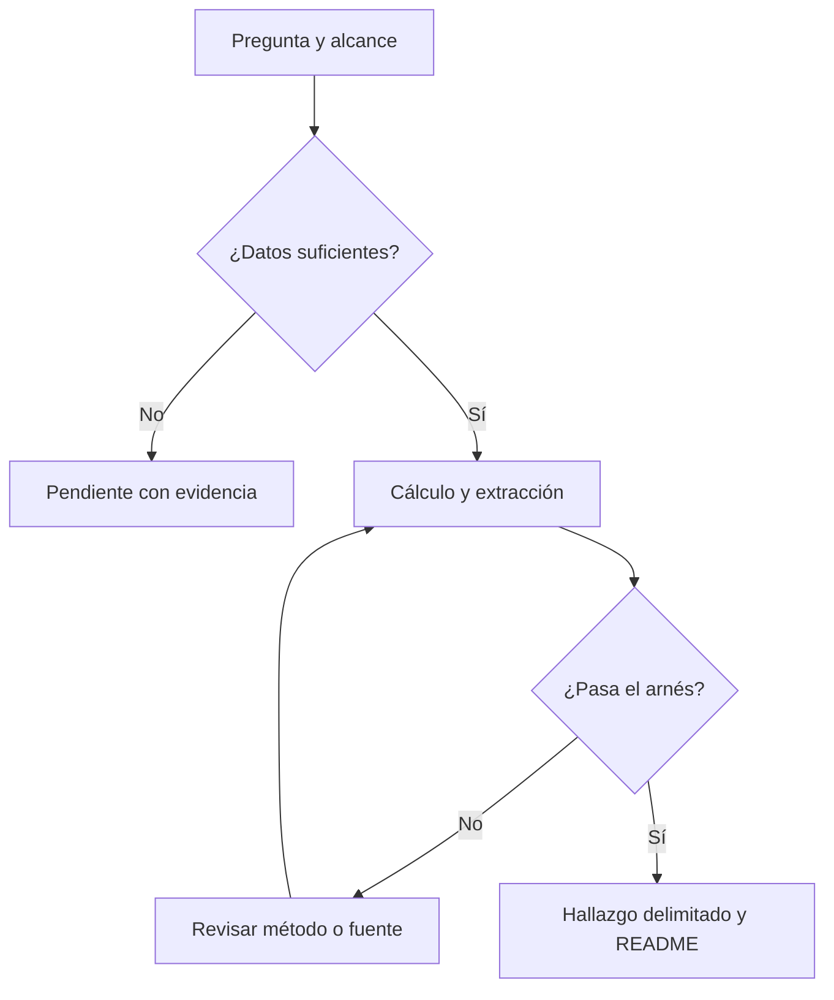

# De las fuentes a preguntas, herramientas y pruebas

Propuesta revisada el **2026-11-04**, America/Mexico_City. **72 fuentes · 216 preguntas · 16 temáticas.**

El objetivo es descubrir relaciones inesperadas usando IA y comprobarlas con datos. Esta propuesta conecta cada fuente con preguntas específicas, skills reutilizables, herramientas/MCP y un arnés de evaluación. Las preguntas son hipótesis abiertas; no son hallazgos calculados.

**Interpretación de la sigla:** se toma «MCC» como **MCP**, Model Context Protocol. Si la intención era otra, sólo habría que ajustar la capa de herramientas.

[Catálogo de fuentes](../CATALOGO_DATASETS_REALES.md) · [Tests y muestras existentes](../../source_tests/README.md) · [Guía de descubrimientos](../GUIA_DESCUBRIMIENTOS_IA.md) · [Plan JSON](../../catalogs/exploration_plan.json)

Base de la propuesta: [commit bb3a09f7](https://github.com/jcval94/DataCollectionMov/commit/bb3a09f747b8a28266b80edcb967dfc698c07f65). El JSON conserva los hashes del catálogo y las evidencias consultadas.

## Tres piezas que se complementan

| Pieza | Para qué sirve | Ejemplo |
| --- | --- | --- |
| Skill | Procedimiento, decisiones y criterios que el agente debe aplicar. | Analizar encuestas respetando ponderadores y dominios. |
| MCP o herramienta | Acceso a una capacidad: leer, consultar, extraer o ejecutar. | GitHub, HTTP de INEGI, lector PDF, Docling MCP, Python/SQL. |
| Arnés | Entorno y contrato que ejecuta, registra y evalúa el trabajo. | Fijar datos y pregunta, correr código, contrastar con referencias y producir evidencia revisable. |

La API de un productor, una biblioteca Python y un MCP son piezas distintas. Podemos usar las APIs actuales mediante adaptadores y herramientas nativas; añadir MCP donde facilite reutilizar capacidades entre clientes. El MCP por sí solo no garantiza corrección analítica.

## Prioridad sugerida

Reutilizar **BASE** y desarrollar primero **INGEST, GEO, CORPUS y VERSION**: cubren el trabajo ya iniciado con movilidad, fuentes públicas, documentos históricos y DOF. Especializar después SURVEY, VISION, GRAPH y MATH según el piloto elegido; AUDIO y MOTION necesitan corpus y dependencias específicos.

| Piloto | Pregunta inicial | Qué lo vuelve interesante | Primer alcance revisable |
| --- | --- | --- | --- |
| Bob Ross | ¿Qué cambia al comparar pigmentos declarados, motivos y color de las reproducciones? | Unir etiquetas, imagen y estadística; ya hay CSV y un piloto de coocurrencias. | Una muestra de imágenes autorizadas y cruce por episodio; no asumir derechos ni concordancia. |
| Retail | ¿Qué productos cambian de posición al descontar devoluciones? | Una decisión de negocio cambia al definir correctamente la métrica. | Ventas brutas/netas y tratamiento explícito de cancelaciones. |
| DOF y Git | ¿Qué cambia cuando leemos transitorios y vigencia además del diff? | Enseñar versiones con un caso real y una trampa de interpretación. | Un artículo y sus documentos oficiales, con antes/después revisado. |
| Matemáticas, GSM8K y CCH | ¿Un problema equivalente produce respuestas inconsistentes de IA? | Evaluar estabilidad, unidades y representaciones, además de acierto. | Pequeño conjunto con soluciones revisadas y variantes; no es evaluación de alumnos. |
| Territorio en México | ¿Qué brechas cambian al pasar de CP a recorridos caminables? | Conectar DENUE, escuelas, población y movilidad con tu repo. | Una zona, cortes compatibles y evaluación de calidad de red/capas. |
| Medicina histórica y diarios | ¿Vigilia nocturna significa costumbre, consejo o enfermedad? | Hallazgo potencial sorprendente con contraejemplos y contexto histórico. | Corpus delimitado de páginas y autores; hace falta recuperar contenido, no sólo portada. |
| Napoleón y literatura | ¿La red de interlocutores cuenta otra historia que los temas más frecuentes? | Contrastar análisis de texto y estructuras de relaciones. | Una edición y periodo, con entidades y pasajes revisados. |

Esta prioridad es una propuesta por acceso, utilidad didáctica y potencial de sorpresa; no es una estimación medida de costo o beneficio.

## Skills reutilizables

| ID | Skill | Situación | Cuándo conviene |
| --- | --- | --- | --- |
| [BASE](#skill-base) | Análisis, calidad, validación y visualización | Reutilizar capacidades existentes de Data | Ahora |
| [INGEST](#skill-ingest) | Integrar fuentes públicas con evidencia | Skill propuesta | Primera etapa |
| [GEO](#skill-geo) | Analizar territorio y cruces en México | Skill propuesta | Primera etapa |
| [SURVEY](#skill-survey) | Analizar encuestas y movilidad social | Skill propuesta | Cuando se descarguen microdatos y diseño |
| [CORPUS](#skill-corpus) | Investigar corpus históricos y textos con citas | Skill propuesta | Primera etapa |
| [VERSION](#skill-version) | Comparar publicaciones y reformas con Git | Skill propuesta | Primera etapa |
| [VISION](#skill-vision) | Analizar imágenes, arte y etiquetas | Skill propuesta | Segunda etapa |
| [AUDIO](#skill-audio) | Analizar grabaciones y sonidos | Skill propuesta | Cuando haya audio completo autorizado |
| [MOTION](#skill-motion) | Analizar movimiento y baile | Skill propuesta | Cuando haya secuencias completas |
| [GRAPH](#skill-graph) | Analizar redes y resolver entidades | Skill propuesta | Segunda etapa |
| [MATH](#skill-math) | Evaluar soluciones y razonamiento matemático | Skill propuesta | Segunda etapa |

Las fichas siguientes son diseños de skills, no archivos SKILL.md instalados. Una skill se justifica si captura decisiones repetidas y errores recurrentes. Las capacidades generales de Data ya disponibles cubren buena parte de BASE.

### skill-base

**Análisis, calidad, validación y visualización**. Definir pregunta y denominador; calcular con código; comprobar sesgos, explicaciones alternativas y comunicar evidencia. Equivalentes disponibles: analyze-data-quality, product-business-analysis, validate-data, visualize-data.

### skill-ingest

**Integrar fuentes públicas con evidencia**. Elegir recurso frente a portal, entender diccionario/licencia, capturar respuesta original y versión, paginar, registrar fallos, producir muestra y contrato de datos.

### skill-geo

**Analizar territorio y cruces en México**. CP, CVEGEO, CCT, CLUES y CLEE; CRS, puntos/polígonos, cambios de límites, accesibilidad y sensibilidad a la unidad territorial.

### skill-survey

**Analizar encuestas y movilidad social**. Ponderadores, estratos, UPM, dominios, incertidumbre, retrospectiva, armonización de olas y límites de inferencia.

### skill-corpus

**Investigar corpus históricos y textos con citas**. Edición, OCR, página, género, fecha, voces editoriales, negación, anacronismos, copias y contraejemplos. En textos modernos, adaptar taxonomía, idioma y selección del corpus.

### skill-version

**Comparar publicaciones y reformas con Git**. Documentos inmutables, artículos y transitorios, fecha de publicación frente a vigencia, diff textual/semántico y cita a la fuente oficial. Git es herramienta pedagógica y de trazabilidad.

### skill-vision

**Analizar imágenes, arte y etiquetas**. Derechos por imagen, decodificación, obra frente a reproducción, paletas, motivos, revisión humana y desacuerdos. Distinguir pigmento declarado de color de píxel.

### skill-audio

**Analizar grabaciones y sonidos**. Licencia, decodificación, tasa de muestreo, duración, ruido, anotación temporal y particiones por sitio/fecha/grabador. Un sonograma no sustituye al audio.

### skill-motion

**Analizar movimiento y baile**. Esqueleto, articulaciones, coordenadas, FPS, sincronía musical, partición por bailarín/música y comparación de movimiento sin inferir identidad o salud.

### skill-graph

**Analizar redes y resolver entidades**. Identificadores y alias, relaciones con significado explícito, grafos dirigidos/bipartitos, centralidad y pruebas al cambiar la definición de arista.

### skill-math

**Evaluar soluciones y razonamiento matemático**. Referencia comprobable, respuesta y unidades, variantes de enunciado, operaciones verificables, separación de evaluación y ejemplos conocidos; no evaluar alumnos con datos inexistentes.

## MCP y herramientas: situación real y propuesta

Todos los casos usan GitHub, archivos/ejecución y acceso a la fuente. La columna de herramientas de cada ficha añade lectores documentales o multimedia según lo necesario. «Propuesto» no significa «conectado» ni «probado».

### tool-repo

**GitHub** — Conector disponible; servidor MCP oficial como alternativa para otros clientes.

**Situación:** Conector utilizado en este proyecto; no se instaló otro servidor.

Leer versiones y guardar código, manifiestos, ejemplos y README. Para investigación, limitar herramientas al alcance necesario; publicación mediante operación separada autorizada.

### tool-files

**Archivos y ejecución de Python/SQL** — Herramientas nativas; Filesystem MCP de referencia opcional.

**Situación:** Acceso local y Python disponibles; servidor Filesystem adicional no configurado.

Trabajar sobre snapshots acotados y ejecutar cálculos reproducibles. pandas/stdlib ya usados; DuckDB es una opción para consultas locales, no un MCP instalado.

### tool-http

**HTTP/API del productor + Fetch MCP opcional** — Adaptadores públicos por fuente; Fetch es un MCP de referencia.

**Situación:** El repo ya tiene sondas HTTP; no hay MCP de INEGI/DOF/BTS configurados.

Usar API/CSV/JSON/XML original para datos; Fetch para lectura de páginas. Preservar bytes originales y no sustituirlos por una conversión a Markdown.

### tool-doc

**Lectores PDF/XML/IIIF; Docling MCP opcional** — pypdf/lectores ya usados; Docling tiene servidor MCP documentado.

**Situación:** pypdf ya usado; Docling MCP propuesto, sin instalar ni evaluar aquí.

Recuperar texto, tablas, páginas e imágenes con localizadores. Usar OCR cuando haga falta y contrastarlo con páginas reales.

### tool-media

**Herramientas de imagen, audio y movimiento** — Pillow y procesadores locales; futuras herramientas MCP sólo si aportan reutilización.

**Situación:** Pillow ya verificó nueve imágenes; audio/pose completos y sus dependencias deben comprobarse caso por caso.

Decodificar el medio y generar características con parámetros guardados. No se presupone un MCP universal de visión, audio o biomecánica.

### tool-search

**Búsqueda web con fuentes primarias** — Herramienta de búsqueda disponible.

**Situación:** Disponible en este trabajo.

Encontrar documentación, contexto histórico y fuentes de contraste; los resultados de búsqueda son pistas, no sustitutos de pasajes/documentos completos.

Un futuro MCP propio de datos públicos sólo tendría sentido si se reutilizan operaciones estables: listar recursos, recuperar un snapshot con manifiesto, consultar tablas permitidas, devolver una página y su localizador, o registrar evidencia. Sus nombres de herramientas y contratos se diseñarían entonces; no se presupone que existan servidores oficiales para cada fuente.

Para un piloto basta un coordinador, ejecución reproducible y revisión de evidencia. La consulta se calcula con código; la IA ayuda a clasificar, proponer conexiones y explicar. Elegir modelos por la evaluación del piloto: modelo económico para extracción estructurada revisable; más capacidad de razonamiento para diseñar el método o revisar casos ambiguos; visión/ASR sólo cuando la pregunta lo requiera. Guardar modelo, versión, parámetros, costo y prompt de cualquier ejecución futura.

## Arnés de ejecución por caso

Aquí se distinguen dos niveles: el arnés de ejecución coordina herramientas, estado y artefactos; los perfiles de validación fijan las pruebas de método. Cada fuente tiene ambos asignados. Esta distinción permite empezar en el entorno actual y adoptar un runtime más complejo sólo donde haga falta.

### execution-e1

**E1: Agente con terminal y ejecución Python/SQL**

Usar el entorno actual para explorar y una CLI Python reproducible para cálculos; pandas/stdlib y SQL local según volumen.

**Aplicar a:** Tablas, finanzas, geografía, encuestas y redes que caben en un flujo acotado.

**Situación:** Capacidades de archivos/ejecución disponibles; el análisis específico sigue propuesto.

**Aceptación:** El agente deja código, parámetros, logs y artefactos; las cifras se recomputan sin depender de la conversación.

### execution-e2

**E2: Flujo de corpus con estado y revisión**

Empezar con trabajos Python reanudables por documento/página. Si hay pausas, reintentos y revisiones de larga duración, LangGraph es candidato para orquestar estados y checkpoints.

**Aplicar a:** DOF, auditorías, historia, prensa, literatura, etiquetas y corpus con citas/versiones.

**Situación:** Diseño propuesto; LangGraph no se instaló ni se probó en este repo.

**Aceptación:** Reanudar no duplica documentos ni etiquetas; cada estado conserva corpus, página/versión, decisión y revisión.

### execution-e3

**E3: Evaluación por lotes con casos de referencia**

Runner Python de problemas, variantes, respuestas y evaluadores; tests deterministas para operaciones, unidades y formato, con revisión humana de referencias.

**Aplicar a:** GSM8K y guías CCH; adaptar a cualquier piloto que compare modelos.

**Situación:** Diseño propuesto; no se ejecutaron llamadas de evaluación a modelos.

**Aceptación:** Cada respuesta se asocia a problema, split/variante, configuración, costo/latencia y referencia; se reportan fallos del parser por separado.

### execution-e4

**E4: Pipeline multimedia por archivo y secuencia**

Trabajos Python con caché de decodificación y características, control de recursos y pasos separados de anotación, extracción y evaluación. El agente orquesta; los cálculos los hacen las herramientas.

**Aplicar a:** Arte, producto/etiqueta, biodiversidad visual, audio y baile.

**Situación:** Pillow ya se usó en pruebas de imagen; dependencias y corpus de cada análisis deben validarse.

**Aceptación:** Cada salida enlaza a medio/versión/intervalo; se fijan reproducción, FPS o frecuencia, y los grupos no se filtran entre particiones.

LangGraph se propone para reanudar flujos de documentos y revisión con estado explícito, capacidades documentadas por su productor. No se presupone que su adopción mejore la calidad de una respuesta: eso lo prueba la evaluación del piloto. [Documentación primaria](https://docs.langchain.com/oss/python/langgraph/overview).

## Arnés común y perfiles por método

Propuesta de implementación gradual: CLI Python, snapshots inmutables, contratos por fuente y funciones de cálculo/evaluación. SQL local puede apoyar tablas; la extensión espacial de DuckDB es una opción, su instalación sigue pendiente. Elegir un framework de agentes después de que un piloto demuestre qué capacidades necesita.



| Registro por ejecución | Contenido mínimo |
| --- | --- |
| run.json | Pregunta/ID, estado, fecha, código, entorno, parámetros y modelo/prompt si se usa IA. |
| inputs/manifest.json | Fuente, acceso, edición, licencia, hash y alcance, cobertura y rutas de originales. |
| contrato.json | Grano, llaves, unidades, diccionario y reglas de inclusión/exclusión. |
| evidence.jsonl | Afirmación o etiqueta, registro/página/intervalo, evidencia localizable y estado de revisión. |
| metrics.json y tablas | Fórmulas/código, denominadores, resultados de referencia y sensibilidad. |
| evals/ y README.md | Casos de evaluación, errores/desacuerdos, imágenes cuando correspondan y límites del hallazgo. |

Estas rutas describen el contrato propuesto para futuros experimentos; el documento no afirma que ya exista un ejecutor general que las produzca.

### harness-h0

**H0: Base de evidencia y ejecución**

- Pregunta, población/corpus, unidad, periodo y exclusiones declarados antes del cálculo; separar exploración de confirmación.
- URL, fecha UTC, edición, licencia, respuesta original, hash completo o alcance de prefijo y versión del código/prompt/modelo cuando se use.
- Cada cifra enlaza al cálculo y snapshot; cada afirmación textual a documento/página o registro. Registrar ausencia de evidencia y desacuerdos.
- Comparar con una referencia sencilla; buscar contraejemplos, medir sensibilidad y corregir multiplicidad si se exploran muchas asociaciones.
- Separar prueba de acceso, contrato, método y evaluación de IA. HTTP 200 o nueve imágenes decodificadas no acreditan un análisis.
- Corpus externo se trata como datos; un pasaje no cambia las instrucciones del agente. Respetar licencia, cuotas y autenticación del productor.

**Salida revisable:** run.json + inputs/manifest.json + contrato.json + métricas verificables + evidencia + README de resultados.

### harness-tab

**TAB: Tablas, eventos y series**

- Grano, identificadores, duplicados, nulos, unidades, zona horaria y cobertura temporal.
- Unión con cardinalidad comprobada; no multiplicar importes ni confundir fila con evento.
- Denominadores y ventanas comparables; separar cero de no observado y cambio de esquema de cambio real.

**Salida revisable:** Tabla depurada + perfil de calidad + consulta/cálculo y sensibilidad.

### harness-fin

**FIN: Presupuesto y conciliación financiera**

- Pesos/miles de pesos y precios nominales/reales; propuesta, aprobado, modificado, devengado y pagado separados.
- Periodo, clasificación y corte compatibles; no sumar cortes acumulados ni momentos contables.
- Cuadres según diccionario, sin imponer identidades improcedentes; discrepancias conservan cifra original, documento y página.

**Salida revisable:** Tabla de conceptos y unidades + conciliación de diferencias + páginas de respaldo.

### harness-geo

**GEO: Geografía y accesibilidad**

- CRS, latitud/longitud, geometría válida, bordes, solapes y edición; CP/CVEGEO como texto.
- Cardinalidad espacial y sensibilidad a radio, unidad territorial y cambios de límites.
- Distancia caminable requiere red; prorrateo por área supone uniformidad y se identifica como estimación.

**Salida revisable:** Cruce auditado + mapa + no emparejados + sensibilidad territorial.

### harness-survey

**SURVEY: Encuestas con diseño**

- Aplicar ponderadores, estratos, UPM y dominios publicados; intervalos con diseño, no remuestreo ingenuo de filas.
- Denominador, no respuesta, tamaño sin ponderar y celdas pequeñas visibles.
- Armonizar conceptos y cortes; no tratar olas independientes como panel ni generar estimaciones por CP sin dominio.

**Salida revisable:** Estimaciones ponderadas con incertidumbre + diccionario de armonización.

### harness-text

**TEXT: Texto y corpus documental**

- Obra/edición/página o ID/offset; separar contenido de encabezados, licencia, traducción y notas editoriales.
- Conjunto manual de pasajes positivos, negativos y ambiguos para extracción/clasificación; medir precisión, recall y errores OCR cuando aplique.
- Afirmaciones con cita localizada, autores/obras independientes y contraejemplos; un texto prescriptivo no prueba práctica general.

**Salida revisable:** Corpus delimitado + pasajes localizados + etiquetas revisadas + matriz de errores.

### harness-law

**LAW: Documentos, cambios y vigencia**

- Identificador y versión del documento, artículo, transitorio y fecha de publicación frente a entrada en vigor.
- Diff cotejado con original oficial; distinguir cambio de forma/OCR y cambio sustantivo.
- Casos manuales con reforma parcial, derogación y vigencia diferida; commits pedagógicos no simulan una consolidación jurídica oficial.

**Salida revisable:** Antes/después con localizadores + línea temporal de vigencia + diff explicable.

### harness-vision

**VISION: Imagen y comparación visual**

- Licencia por medio, archivo completo decodificado, dimensiones, perfil/reproducción y obra/versión.
- Muestra manual estratificada y desacuerdos; comparar extracción visual con metadatos/etiquetas y evitar duplicados entre particiones.
- Normalización y sensibilidad a recorte, reproducción e iluminación; no atribuir intención artística o pigmentos a píxeles.

**Salida revisable:** Galería con IDs + características + revisión humana y errores por tipo de imagen.

### harness-audio

**AUDIO: Audio y eventos sonoros**

- Audio completo decodificado: formato, duración, canales, tasa de muestreo y licencia.
- Anotaciones temporales verificadas; ruido y silencio; comparación con referencia sencilla.
- Separación por sitio/fecha/grabador e individuo cuando sea conocido; métricas por clase y calidad, sin fuga por clips vecinos.

**Salida revisable:** Clips autorizados/IDs + espectrogramas + anotaciones + evaluación por grupos.

### harness-motion

**MOTION: Pose, secuencias y sincronía**

- ASF/esqueleto y orden de canales, articulaciones, unidades, FPS, cámara y sistema de coordenadas.
- Alineación de música y movimiento, datos faltantes, normalización corporal y referencia simple.
- Particiones por bailarín, canción y secuencia; sensibilidad a FPS/esqueleto y validación visual de animación.

**Salida revisable:** Secuencias comparables + animación/recurso enlazado + métricas temporales.

### harness-graph

**GRAPH: Redes y entidades**

- Significado de nodo/arista, dirección, peso, periodo y cobertura; alias con IDs verificables.
- Duplicados y versiones resueltos; revisar aislados, relaciones faltantes y emparejamientos ambiguos.
- Centralidad/comunidades frente a frecuencia base y otra definición de relación; red registrada no equivale a red completa.

**Salida revisable:** Tabla de entidades/aristas + conflictos de identidad + métricas con sensibilidad.

### harness-math

**MATH: Evaluación matemática**

- Problema/edición/split identificados; respuesta y operaciones de referencia verificadas.
- Normalizar sólo equivalencias válidas, unidades y tolerancia aplicable; revisar fallos del parser antes de culpar al modelo.
- Contrastar enunciados equivalentes, distractores y problemas nuevos; documentar contaminación y no usar sólo autoevaluación del mismo modelo.

**Salida revisable:** Problemas con referencia + respuestas evaluadas + errores por habilidad y consistencia.

## Qué se considera una prueba suficiente

| Capa | Estado en este repo | Qué permite afirmar |
| --- | --- | --- |
| Acceso y ejemplos | Ya existen 72 fichas de prueba y nueve imágenes decodificadas. Cada petición conserva fecha y alcance. | Se recuperó el recurso/capa indicado, o se documentó el fallo. |
| Integridad de este plan | Validada por el script de este documento. | Todas las fuentes tienen preguntas y rutas válidas a skills, herramientas y arneses. |
| Método y datos completos | Propuesto por fuente; pendiente de ejecutar para estas nuevas preguntas. | Grano, transformaciones y conclusiones resisten controles pertinentes. |
| Calidad de la IA | Pendiente por piloto. | Una evaluación independiente muestra errores, estabilidad y límites en la tarea concreta. |

Como punto de partida, diseñar un conjunto manual pequeño y estratificado: páginas con OCR bueno/malo y pasajes ambiguos; imágenes con reproducciones distintas; ejercicios equivalentes y casos negativos. El tamaño y los umbrales se fijan según uso y riesgo antes de confirmar una hipótesis. Evaluar tanto errores como cobertura; una puntuación de un modelo que se evalúa a sí mismo no basta.

Pruebas negativas útiles: HTML con HTTP 200 donde se esperaba CSV; CP con cero inicial perdido; unión que duplica gasto; miles de pesos interpretados como pesos; página ausente; negación omitida; distintas fotos de la misma obra repartidas entre entrenamiento y prueba; fórmula o audio ilegible; instrucciones incrustadas en el corpus tratadas como texto. Son casos a implementar, no tests de método ya pasados.

## Matriz por fuente

En cada ficha, la fecha y estado de acceso proceden de las pruebas guardadas; no se volvieron a consultar las 72 fuentes para elaborar el plan. Todas las preguntas requieren validar los insumos indicados, incluso cuando una muestra ya existe. Las fuentes adicionales son dependencias propuestas; no se presupone un cruce válido.

| Fuente | Skills adicionales a BASE/INGEST | Ejecución | Validación adicional a H0 | Acceso probado |
| --- | --- | --- | --- | --- |
| [rifa-235-premios](#rifa-235-premios) | CORPUS | [E2](#execution-e2) | TEXT, TAB | `HTTP_ERROR` |
| [rifa-235-reportes](#rifa-235-reportes) | CORPUS, GEO | [E2](#execution-e2) | TEXT, FIN, GEO | `BLOCKED` |
| [rifa-235-asf](#rifa-235-asf) | CORPUS | [E2](#execution-e2) | TEXT, FIN | `DOCUMENT_SAMPLE` |
| [inegi-indicadores-api](#inegi-indicadores-api) | BASE/INGEST | [E1](#execution-e1) | TAB | `DOC_ONLY` |
| [inegi-denue](#inegi-denue) | GEO | [E1](#execution-e1) | TAB, GEO | `CACHED_SAMPLE` |
| [inegi-censo-2020-ageb](#inegi-censo-2020-ageb) | GEO | [E1](#execution-e1) | TAB, GEO | `DOC_ONLY` |
| [inegi-marco-geoestadistico](#inegi-marco-geoestadistico) | GEO | [E1](#execution-e1) | GEO, TAB | `DOC_ONLY` |
| [inegi-entorno-urbano-2020](#inegi-entorno-urbano-2020) | GEO | [E1](#execution-e1) | TAB, GEO | `DOC_ONLY` |
| [inegi-enigh-2024](#inegi-enigh-2024) | SURVEY | [E1](#execution-e1) | SURVEY, TAB | `DOC_ONLY` |
| [inegi-enoe](#inegi-enoe) | SURVEY | [E1](#execution-e1) | SURVEY, TAB | `DOC_ONLY` |
| [inegi-eod-zmvm-2017](#inegi-eod-zmvm-2017) | SURVEY, GEO | [E1](#execution-e1) | SURVEY, GEO, TAB | `DOC_ONLY` |
| [sepomex-codigos-postales](#sepomex-codigos-postales) | GEO | [E1](#execution-e1) | TAB, GEO | `DOC_ONLY` |
| [cdmx-codigos-postales-poligonos](#cdmx-codigos-postales-poligonos) | GEO | [E1](#execution-e1) | GEO, TAB | `HTTP_ERROR` |
| [shcp-pef](#shcp-pef) | BASE/INGEST | [E1](#execution-e1) | FIN, TAB | `BLOCKED` |
| [shcp-cuenta-publica](#shcp-cuenta-publica) | BASE/INGEST | [E1](#execution-e1) | FIN, TAB | `HTTP_ERROR` |
| [shcp-srft](#shcp-srft) | GEO | [E1](#execution-e1) | FIN, TAB, GEO | `HTTP_ERROR` |
| [sep-cct](#sep-cct) | GEO | [E1](#execution-e1) | TAB, GEO | `DOC_ONLY` |
| [sep-formato-911](#sep-formato-911) | GEO | [E1](#execution-e1) | TAB, GEO | `BLOCKED` |
| [anuies-anuario](#anuies-anuario) | BASE/INGEST | [E1](#execution-e1) | TAB | `DOC_ONLY` |
| [ceey-emovi-2023](#ceey-emovi-2023) | SURVEY | [E1](#execution-e1) | SURVEY, TAB | `DOC_ONLY` |
| [ceey-emovi-2017](#ceey-emovi-2017) | SURVEY | [E1](#execution-e1) | SURVEY, TAB | `DOC_ONLY` |
| [inegi-mmsi-2016](#inegi-mmsi-2016) | SURVEY | [E1](#execution-e1) | SURVEY, TAB | `DOC_ONLY` |
| [coneval-pobreza-municipal](#coneval-pobreza-municipal) | GEO | [E1](#execution-e1) | TAB, GEO | `DOC_ONLY` |
| [conapo-marginacion-2020](#conapo-marginacion-2020) | GEO | [E1](#execution-e1) | TAB, GEO | `BLOCKED` |
| [metrobus-gtfs](#metrobus-gtfs) | GEO | [E1](#execution-e1) | TAB, GEO | `CACHED_SAMPLE` |
| [ecobici-viajes](#ecobici-viajes) | GEO, GRAPH | [E1](#execution-e1) | TAB, GEO, GRAPH | `DATA_SAMPLE` |
| [ecobici-gbfs](#ecobici-gbfs) | GEO | [E1](#execution-e1) | TAB, GEO | `DATA_SAMPLE` |
| [salud-clues](#salud-clues) | GEO | [E1](#execution-e1) | TAB, GEO | `HTTP_ERROR` |
| [cdmx-fgj-carpetas](#cdmx-fgj-carpetas) | GEO | [E1](#execution-e1) | TAB, GEO | `HTTP_ERROR` |
| [inegi-atus](#inegi-atus) | GEO | [E1](#execution-e1) | TAB, GEO | `DOC_ONLY` |
| [dof-publicaciones](#dof-publicaciones) | CORPUS, VERSION | [E2](#execution-e2) | TEXT, LAW | `DOCUMENT_SAMPLE` |
| [usgs-sismos](#usgs-sismos) | GEO | [E1](#execution-e1) | TAB, GEO | `DATA_SAMPLE` |
| [nasa-exoplanetas](#nasa-exoplanetas) | BASE/INGEST | [E1](#execution-e1) | TAB | `DATA_SAMPLE` |
| [gwosc-ondas-gravitacionales](#gwosc-ondas-gravitacionales) | BASE/INGEST | [E1](#execution-e1) | TAB | `HTTP_ERROR` |
| [noaa-ghcn](#noaa-ghcn) | GEO | [E1](#execution-e1) | TAB, GEO | `METADATA_SAMPLE` |
| [gbif-biodiversidad](#gbif-biodiversidad) | GEO, VISION | [E4](#execution-e4) | TAB, GEO, VISION | `DATA_SAMPLE` |
| [xeno-canto-audio](#xeno-canto-audio) | AUDIO, GEO | [E4](#execution-e4) | TAB, AUDIO, GEO | `DATA_SAMPLE` |
| [met-arte](#met-arte) | VISION, CORPUS | [E4](#execution-e4) | TAB, VISION, TEXT | `DATA_SAMPLE` |
| [loc-prensa-historica](#loc-prensa-historica) | CORPUS | [E2](#execution-e2) | TEXT, TAB | `METADATA_SAMPLE` |
| [gutenberg-quijote](#gutenberg-quijote) | CORPUS, GRAPH | [E2](#execution-e2) | TEXT, GRAPH | `DOCUMENT_SAMPLE` |
| [openfoodfacts-alimentos](#openfoodfacts-alimentos) | VISION, CORPUS | [E4](#execution-e4) | TAB, TEXT, VISION | `DATA_SAMPLE` |
| [nuforc-ovnis](#nuforc-ovnis) | CORPUS, GEO | [E2](#execution-e2) | TEXT, TAB, GEO | `DOC_ONLY` |
| [gdelt-noticias](#gdelt-noticias) | CORPUS, GEO | [E2](#execution-e2) | TAB, TEXT, GEO | `METADATA_SAMPLE` |
| [nasa-bolidos](#nasa-bolidos) | BASE/INGEST | [E1](#execution-e1) | TAB | `DATA_SAMPLE` |
| [nyc-ratas](#nyc-ratas) | GEO | [E1](#execution-e1) | TAB, GEO | `DATA_SAMPLE` |
| [nyc-restaurantes](#nyc-restaurantes) | GEO, CORPUS | [E1](#execution-e1) | TAB, GEO, TEXT | `DATA_SAMPLE` |
| [openflights-red-aerea](#openflights-red-aerea) | GRAPH, GEO | [E1](#execution-e1) | TAB, GRAPH, GEO | `DATA_SAMPLE` |
| [bts-puntualidad-vuelos](#bts-puntualidad-vuelos) | BASE/INGEST | [E1](#execution-e1) | TAB | `DOC_ONLY` |
| [apple-apps](#apple-apps) | CORPUS | [E1](#execution-e1) | TAB, TEXT | `DATA_SAMPLE` |
| [apple-resenas-apps](#apple-resenas-apps) | CORPUS | [E2](#execution-e2) | TEXT, TAB | `DATA_SAMPLE` |
| [insideairbnb-cdmx](#insideairbnb-cdmx) | GEO, CORPUS | [E1](#execution-e1) | TAB, GEO, TEXT | `DATA_SAMPLE` |
| [napoleonica-cartas](#napoleonica-cartas) | CORPUS, GRAPH | [E2](#execution-e2) | TEXT, GRAPH, TAB | `DOC_ONLY` |
| [gallica-napoleon](#gallica-napoleon) | CORPUS | [E2](#execution-e2) | TEXT, TAB | `BLOCKED` |
| [pepys-diarios](#pepys-diarios) | CORPUS, GRAPH | [E2](#execution-e2) | TEXT, TAB, GRAPH | `DOCUMENT_SAMPLE` |
| [musicbrainz-conciertos](#musicbrainz-conciertos) | GRAPH, GEO | [E1](#execution-e1) | GRAPH, TAB, GEO | `DOC_ONLY` |
| [setlist-conciertos](#setlist-conciertos) | GRAPH | [E1](#execution-e1) | TAB, GRAPH | `DOC_ONLY` |
| [osm-mapas-restaurantes](#osm-mapas-restaurantes) | GEO | [E1](#execution-e1) | GEO, TAB | `HTTP_ERROR` |
| [loc-mapas-historicos](#loc-mapas-historicos) | GEO, VISION, CORPUS | [E4](#execution-e4) | GEO, VISION, TEXT | `METADATA_SAMPLE` |
| [gsm8k-examenes](#gsm8k-examenes) | MATH, CORPUS | [E3](#execution-e3) | MATH, TEXT, TAB | `DATA_SAMPLE` |
| [unam-colecciones](#unam-colecciones) | GEO, VISION, CORPUS | [E4](#execution-e4) | TAB, GEO, VISION, TEXT | `HTTP_ERROR` |
| [unam-agenda-estadistica](#unam-agenda-estadistica) | CORPUS | [E2](#execution-e2) | TEXT, TAB | `DOC_ONLY` |
| [unam-guias-examenes](#unam-guias-examenes) | MATH, CORPUS | [E3](#execution-e3) | TEXT, MATH | `DOCUMENT_SAMPLE` |
| [ct-ventas-inmuebles](#ct-ventas-inmuebles) | GEO | [E1](#execution-e1) | TAB, GEO | `DATA_SAMPLE` |
| [cmu-movimiento-baile](#cmu-movimiento-baile) | MOTION | [E4](#execution-e4) | TAB, MOTION | `HTTP_ERROR` |
| [aist-dance](#aist-dance) | MOTION, AUDIO | [E4](#execution-e4) | TAB, MOTION, AUDIO | `DOC_ONLY` |
| [artic-pintura](#artic-pintura) | VISION, CORPUS | [E4](#execution-e4) | TAB, VISION, TEXT | `BLOCKED` |
| [dracor-teatro](#dracor-teatro) | CORPUS, GRAPH | [E2](#execution-e2) | TEXT, GRAPH, TAB | `DATA_SAMPLE` |
| [uci-retail](#uci-retail) | BASE/INGEST | [E1](#execution-e1) | TAB, FIN | `DATA_SAMPLE` |
| [openfda-etiquetas](#openfda-etiquetas) | CORPUS, VERSION | [E2](#execution-e2) | TEXT, TAB | `DATA_SAMPLE` |
| [wellcome-medicina-antigua](#wellcome-medicina-antigua) | CORPUS, VISION | [E2](#execution-e2) | TEXT, VISION | `METADATA_SAMPLE` |
| [bob-ross-elementos](#bob-ross-elementos) | GRAPH | [E1](#execution-e1) | TAB, GRAPH | `DATA_SAMPLE` |
| [bob-ross-paletas](#bob-ross-paletas) | VISION | [E4](#execution-e4) | TAB, VISION | `DATA_SAMPLE` |

## Rifa del avión

### rifa-235-premios

**GSE 235: lista oficial de premios**. Unidad: Billete premiado.

**Skills:** [BASE](#skill-base), [INGEST](#skill-ingest), [CORPUS](#skill-corpus) · **Herramientas/MCP:** [REPO](#tool-repo), [FILES](#tool-files), [HTTP](#tool-http), [DOC](#tool-doc).

**Arnés de ejecución:** [E2](#execution-e2) · **Perfiles de validación:** [H0](#harness-h0), [TEXT](#harness-text), [TAB](#harness-tab).

**Acceso registrado:** `HTTP_ERROR`. [Test y ejemplos](../../source_tests/README.md#rifa-235-premios). El recurso falló o estuvo bloqueado en la petición guardada; recuperar acceso autorizado antes del análisis. No eludir el bloqueo.

**Preguntas:**

1. ¿Cómo se distribuyen las terminaciones y rangos de los números premiados frente a simulaciones que reproduzcan las reglas del GSE 235? (`rifa-235-premios.q1`)
2. ¿Qué errores de OCR cambiarían un número premiado o su importe y cuánto varía el análisis al cotejarlos con la página original? (`rifa-235-premios.q2`)
3. ¿Coinciden número de premios e importe agregado de la lista con lo reportado en la auditoría, usando el mismo corte y concepto? (`rifa-235-premios.q3`)

**Insumos pendientes o que deben fijarse:** Recuperar la lista oficial completa y reglas del sorteo; para Q3, páginas equivalentes de ASF.

**Cruces/contrastes propuestos:** [rifa-235-asf](#rifa-235-asf).

**Controles específicos:**

- Número de billete como texto con longitud original.
- Cantidad de premios y unidad monetaria cotejadas con reglas, sin inferir ventas o cobros.

**Primer resultado revisable:** Lista revisada por página, distribución simulada y conciliación de premios.

### rifa-235-reportes

**GSE 235: balance y beneficiarios publicados**. Unidad: Concepto financiero o institución, separado por documento.

**Skills:** [BASE](#skill-base), [INGEST](#skill-ingest), [CORPUS](#skill-corpus), [GEO](#skill-geo) · **Herramientas/MCP:** [REPO](#tool-repo), [FILES](#tool-files), [HTTP](#tool-http), [DOC](#tool-doc).

**Arnés de ejecución:** [E2](#execution-e2) · **Perfiles de validación:** [H0](#harness-h0), [TEXT](#harness-text), [FIN](#harness-fin), [GEO](#harness-geo).

**Acceso registrado:** `BLOCKED`. [Test y ejemplos](../../source_tests/README.md#rifa-235-reportes). El recurso falló o estuvo bloqueado en la petición guardada; recuperar acceso autorizado antes del análisis. No eludir el bloqueo.

**Preguntas:**

1. ¿Cómo cambió el balance comunicado de la rifa entre publicaciones y qué parte se explica por fecha de corte o definición? (`rifa-235-reportes.q1`)
2. ¿Qué escuelas u hospitales beneficiarios pueden enlazarse de forma documentada a CCT o CLUES y dónde quedan los casos ambiguos? (`rifa-235-reportes.q2`)
3. ¿Qué diferencia aparece entre beneficio anunciado, recursos transferidos y uso comprobado cuando los documentos permiten distinguirlos? (`rifa-235-reportes.q3`)

**Insumos pendientes o que deben fijarse:** Comunicados y reportes completos de varios cortes; documentos de transferencia/uso para Q3, si se publican.

**Cruces/contrastes propuestos:** [sep-cct](#sep-cct), [salud-clues](#salud-clues), [rifa-235-asf](#rifa-235-asf).

**Controles específicos:**

- No emparejar instituciones sólo por parecido de nombre.
- Anuncio, transferencia y uso son hitos distintos; falta de documento no equivale a falta de entrega.

**Primer resultado revisable:** Cronología de cifras y beneficiarios con evidencia y nivel de comprobación.

### rifa-235-asf

**GSE 235: auditoría de gestión financiera**. Unidad: Concepto o categoría del resultado 4.

**Skills:** [BASE](#skill-base), [INGEST](#skill-ingest), [CORPUS](#skill-corpus) · **Herramientas/MCP:** [REPO](#tool-repo), [FILES](#tool-files), [HTTP](#tool-http), [DOC](#tool-doc).

**Arnés de ejecución:** [E2](#execution-e2) · **Perfiles de validación:** [H0](#harness-h0), [TEXT](#harness-text), [FIN](#harness-fin).

**Acceso registrado:** `DOCUMENT_SAMPLE`. [Test y ejemplos](../../source_tests/README.md#rifa-235-asf). Hay registros/documento de muestra; adquirir y validar el corpus completo necesario antes de inferir resultados.

**Preguntas:**

1. ¿Qué cambia en el remanente al incorporar premios, gastos y conceptos que los balances públicos presentan por separado? (`rifa-235-asf.q1`)
2. ¿Qué diferencias de cifras dentro del informe se deben a unidades o cortes y cuáles quedan sin conciliar? (`rifa-235-asf.q2`)
3. ¿Cómo se distribuyen billetes y premios entre las categorías de tenedores o ganadores que realmente distingue la auditoría? (`rifa-235-asf.q3`)

**Insumos pendientes o que deben fijarse:** PDF completo y cuadros/páginas del resultado pertinente; contraste con reportes públicos para Q1.

**Cruces/contrastes propuestos:** [rifa-235-reportes](#rifa-235-reportes).

**Controles específicos:**

- Convertir miles de pesos de manera explícita.
- Conservar valores originales y no interpretar una discrepancia de extracción como irregularidad.

**Primer resultado revisable:** Libro de conciliación reproducible con página y unidad por cifra.


## INEGI y contexto

### inegi-indicadores-api

**API del Banco de Indicadores**. Unidad: Indicador × área × periodo.

**Skills:** [BASE](#skill-base), [INGEST](#skill-ingest) · **Herramientas/MCP:** [REPO](#tool-repo), [FILES](#tool-files), [HTTP](#tool-http).

**Arnés de ejecución:** [E1](#execution-e1) · **Perfiles de validación:** [H0](#harness-h0), [TAB](#harness-tab).

**Acceso registrado:** `DOC_ONLY`. [Test y ejemplos](../../source_tests/README.md#inegi-indicadores-api). Sólo se probaron metadatos/portal: conseguir datos o contenido y validar su contrato antes de analizar.

**Preguntas:**

1. ¿Qué indicadores de actividad, empleo o precios cambian antes o después de la demanda de movilidad, sin confundir coincidencia con causalidad? (`inegi-indicadores-api.q1`)
2. ¿Cuánto se modifica una tendencia si usamos tasas reales, índices o valores absolutos en lugar de mezclar sus unidades? (`inegi-indicadores-api.q2`)
3. ¿Qué series cambian al recapturarlas y qué efecto tienen esas revisiones en una conclusión previamente guardada? (`inegi-indicadores-api.q3`)

**Insumos pendientes o que deben fijarse:** Acceso autorizado a indicadores concretos, metadatos y observaciones; varios snapshots para Q3. Movilidad en periodos compatibles para Q1.

**Cruces/contrastes propuestos:** [metrobus-gtfs](#metrobus-gtfs), [ecobici-viajes](#ecobici-viajes).

**Controles específicos:**

- Unidad, base, frecuencia, área y ajuste estacional explícitos.
- La profundidad histórica debe corresponder a la movilidad efectivamente recolectada.

**Primer resultado revisable:** Panel pequeño de indicadores comparables y bitácora de revisiones.

### inegi-denue

**DENUE: establecimientos y actividad económica**. Unidad: Establecimiento por edición/snapshot.

**Skills:** [BASE](#skill-base), [INGEST](#skill-ingest), [GEO](#skill-geo) · **Herramientas/MCP:** [REPO](#tool-repo), [FILES](#tool-files), [HTTP](#tool-http).

**Arnés de ejecución:** [E1](#execution-e1) · **Perfiles de validación:** [H0](#harness-h0), [TAB](#harness-tab), [GEO](#harness-geo).

**Acceso registrado:** `CACHED_SAMPLE`. [Test y ejemplos](../../source_tests/README.md#inegi-denue). Hay datos del repo; fijar snapshot, cobertura y versión antes de ampliar el análisis.

**Preguntas:**

1. ¿Qué zonas combinan muchos restaurantes o escuelas con poca cercanía a estaciones del Metrobús? (`inegi-denue.q1`)
2. ¿La variedad de servicios cambia más entre códigos postales o dentro de cada CP al comparar recorridos a pie? (`inegi-denue.q2`)
3. ¿Qué altas, bajas o cambios de actividad persisten entre ediciones después de resolver cambios de identificador y cobertura? (`inegi-denue.q3`)

**Insumos pendientes o que deben fijarse:** DENUE de cobertura delimitada, estaciones y red peatonal para distancias caminables; ediciones comparables para Q3.

**Cruces/contrastes propuestos:** [metrobus-gtfs](#metrobus-gtfs), [sepomex-codigos-postales](#sepomex-codigos-postales).

**Controles específicos:**

- CLEE/ID y edición, SCIAN y estrato de personal.
- El snapshot integrado no es todo DENUE; cercanía geométrica no es recorrido peatonal.

**Primer resultado revisable:** Mapa de oferta y accesibilidad con sensibilidad a radio y cobertura.

### inegi-censo-2020-ageb

**Censo 2020: indicadores por AGEB y manzana urbana**. Unidad: Área geográfica × indicador; separar agregados.

**Skills:** [BASE](#skill-base), [INGEST](#skill-ingest), [GEO](#skill-geo) · **Herramientas/MCP:** [REPO](#tool-repo), [FILES](#tool-files), [HTTP](#tool-http).

**Arnés de ejecución:** [E1](#execution-e1) · **Perfiles de validación:** [H0](#harness-h0), [TAB](#harness-tab), [GEO](#harness-geo).

**Acceso registrado:** `DOC_ONLY`. [Test y ejemplos](../../source_tests/README.md#inegi-censo-2020-ageb). Sólo se probaron metadatos/portal: conseguir datos o contenido y validar su contrato antes de analizar.

**Preguntas:**

1. ¿Dónde coinciden población con discapacidad o mayor edad y baja proximidad al transporte disponible en la fecha estudiada? (`inegi-censo-2020-ageb.q1`)
2. ¿Qué zonas tienen más población en edad escolar que oferta educativa cercana, sin asumir que toda escuela atiende al mismo nivel? (`inegi-censo-2020-ageb.q2`)
3. ¿Cuánto cambia un ranking de rezago al usar población total, proporciones o agregación a CP mediante reglas espaciales explícitas? (`inegi-censo-2020-ageb.q3`)

**Insumos pendientes o que deben fijarse:** Indicadores y diccionario del Censo, cartografía compatible y catálogo escolar/estaciones fechado; estimaciones espaciales identificadas como tales.

**Cruces/contrastes propuestos:** [inegi-marco-geoestadistico](#inegi-marco-geoestadistico), [sep-cct](#sep-cct), [metrobus-gtfs](#metrobus-gtfs), [cdmx-codigos-postales-poligonos](#cdmx-codigos-postales-poligonos).

**Controles específicos:**

- No sumar totales con manzanas ni tratar valores reservados como cero.
- Censo 2020 y oferta de otro año no son una fotografía simultánea.

**Primer resultado revisable:** Brechas territoriales con denominadores y prueba de agregación.

### inegi-marco-geoestadistico

**Marco Geoestadístico y equivalencias**. Unidad: Polígono, localidad o clave por edición.

**Skills:** [BASE](#skill-base), [INGEST](#skill-ingest), [GEO](#skill-geo) · **Herramientas/MCP:** [REPO](#tool-repo), [FILES](#tool-files), [HTTP](#tool-http).

**Arnés de ejecución:** [E1](#execution-e1) · **Perfiles de validación:** [H0](#harness-h0), [GEO](#harness-geo), [TAB](#harness-tab).

**Acceso registrado:** `DOC_ONLY`. [Test y ejemplos](../../source_tests/README.md#inegi-marco-geoestadistico). Sólo se probaron metadatos/portal: conseguir datos o contenido y validar su contrato antes de analizar.

**Preguntas:**

1. ¿Qué cambios aparentes de población o pobreza desaparecen al homologar límites territoriales entre ediciones? (`inegi-marco-geoestadistico.q1`)
2. ¿Qué estaciones, escuelas o establecimientos cambian de asignación territorial al usar puntos precisos en lugar de centroides? (`inegi-marco-geoestadistico.q2`)
3. ¿Dónde los cruces entre CP, AGEB y municipio generan correspondencias múltiples que invalidan una unión uno a uno? (`inegi-marco-geoestadistico.q3`)

**Insumos pendientes o que deben fijarse:** Capas y equivalencias de las ediciones comparadas, puntos fechados y capa postal cuando proceda.

**Cruces/contrastes propuestos:** [inegi-censo-2020-ageb](#inegi-censo-2020-ageb), [coneval-pobreza-municipal](#coneval-pobreza-municipal), [cdmx-codigos-postales-poligonos](#cdmx-codigos-postales-poligonos), [sep-cct](#sep-cct), [metrobus-gtfs](#metrobus-gtfs).

**Controles específicos:**

- CVEGEO con nivel y edición, CRS y geometrías.
- La equivalencia por área no prueba equivalencia por población.

**Primer resultado revisable:** Tabla de correspondencias con ambigüedades y mapas de cambios.

### inegi-entorno-urbano-2020

**Características del entorno urbano 2020**. Unidad: Manzana y vialidad, tablas distintas.

**Skills:** [BASE](#skill-base), [INGEST](#skill-ingest), [GEO](#skill-geo) · **Herramientas/MCP:** [REPO](#tool-repo), [FILES](#tool-files), [HTTP](#tool-http).

**Arnés de ejecución:** [E1](#execution-e1) · **Perfiles de validación:** [H0](#harness-h0), [TAB](#harness-tab), [GEO](#harness-geo).

**Acceso registrado:** `DOC_ONLY`. [Test y ejemplos](../../source_tests/README.md#inegi-entorno-urbano-2020). Sólo se probaron metadatos/portal: conseguir datos o contenido y validar su contrato antes de analizar.

**Preguntas:**

1. ¿En qué entornos escolares registrados en 2020 faltan banquetas, rampas o alumbrado en combinaciones especialmente problemáticas? (`inegi-entorno-urbano-2020.q1`)
2. ¿Una estación cercana sigue siendo poco accesible cuando se considera la infraestructura peatonal del entorno? (`inegi-entorno-urbano-2020.q2`)
3. ¿Qué brechas entre territorios persisten al cambiar la unidad de comparación de manzana a corredor alrededor de una estación? (`inegi-entorno-urbano-2020.q3`)

**Insumos pendientes o que deben fijarse:** Tablas y cartografía del entorno urbano, definiciones por variable y escuelas/estaciones con corte compatible.

**Cruces/contrastes propuestos:** [sep-cct](#sep-cct), [metrobus-gtfs](#metrobus-gtfs), [inegi-marco-geoestadistico](#inegi-marco-geoestadistico).

**Controles específicos:**

- Separar vialidad y manzana y respetar códigos no disponibles.
- Describir 2020; verificar en campo si se quiere hablar de accesibilidad actual.

**Primer resultado revisable:** Tipología de barreras registradas y mapa de entornos prioritarios.

### inegi-enigh-2024

**ENIGH 2024: ingresos y gastos del hogar**. Unidad: Vivienda, hogar, persona, ingreso o gasto; tablas relacionadas.

**Skills:** [BASE](#skill-base), [INGEST](#skill-ingest), [SURVEY](#skill-survey) · **Herramientas/MCP:** [REPO](#tool-repo), [FILES](#tool-files), [HTTP](#tool-http).

**Arnés de ejecución:** [E1](#execution-e1) · **Perfiles de validación:** [H0](#harness-h0), [SURVEY](#harness-survey), [TAB](#harness-tab).

**Acceso registrado:** `DOC_ONLY`. [Test y ejemplos](../../source_tests/README.md#inegi-enigh-2024). Sólo se probaron metadatos/portal: conseguir datos o contenido y validar su contrato antes de analizar.

**Preguntas:**

1. ¿En qué grupos de ingreso el gasto conjunto de transporte y educación deja menos margen para otros gastos del hogar? (`inegi-enigh-2024.q1`)
2. ¿La carga de transporte cambia entre hogares con estudiantes, personas ocupadas o ambos, dentro de dominios representativos? (`inegi-enigh-2024.q2`)
3. ¿Qué cambia en las brechas al medir gasto absoluto, proporción del ingreso y proporción del gasto total? (`inegi-enigh-2024.q3`)

**Insumos pendientes o que deben fijarse:** Microdatos relacionados de ENIGH, diccionarios y variables de diseño; decisiones sobre ingresos nulos y gasto en especie.

**Controles específicos:**

- No duplicar ingreso del hogar al unir tablas de personas o gastos.
- Pesos, dominios, intervalos y denominadores explícitos; no estimar por CP.

**Primer resultado revisable:** Presupuestos domésticos ponderados y sensibilidad a la definición de carga.

### inegi-enoe

**ENOE: empleo, ingresos laborales e informalidad**. Unidad: Persona y hogar por trimestre.

**Skills:** [BASE](#skill-base), [INGEST](#skill-ingest), [SURVEY](#skill-survey) · **Herramientas/MCP:** [REPO](#tool-repo), [FILES](#tool-files), [HTTP](#tool-http).

**Arnés de ejecución:** [E1](#execution-e1) · **Perfiles de validación:** [H0](#harness-h0), [SURVEY](#harness-survey), [TAB](#harness-tab).

**Acceso registrado:** `DOC_ONLY`. [Test y ejemplos](../../source_tests/README.md#inegi-enoe). Sólo se probaron metadatos/portal: conseguir datos o contenido y validar su contrato antes de analizar.

**Preguntas:**

1. ¿En qué edades y niveles educativos la informalidad convive con jornadas extensas y bajos ingresos laborales? (`inegi-enoe.q1`)
2. ¿Cómo cambia una brecha de ingreso al comparar por hora en lugar de por mes, sin interpretar la comparación como causal? (`inegi-enoe.q2`)
3. ¿Qué ocupaciones muestran deterioro o recuperación que persiste al controlar composición y cambios de levantamiento? (`inegi-enoe.q3`)

**Insumos pendientes o que deben fijarse:** Microdatos y diseño de trimestres comparables, diccionario de ocupaciones y reglas de comparabilidad.

**Controles específicos:**

- Ingreso no declarado, cero e ingreso de no ocupados se distinguen.
- Comparación transversal por trimestre; vínculos longitudinales sólo si se valida el panel rotatorio.

**Primer resultado revisable:** Perfiles laborales con incertidumbre y descomposición descriptiva.

### inegi-eod-zmvm-2017

**Encuesta Origen Destino ZMVM 2017**. Unidad: Hogar, persona y viaje.

**Skills:** [BASE](#skill-base), [INGEST](#skill-ingest), [SURVEY](#skill-survey), [GEO](#skill-geo) · **Herramientas/MCP:** [REPO](#tool-repo), [FILES](#tool-files), [HTTP](#tool-http).

**Arnés de ejecución:** [E1](#execution-e1) · **Perfiles de validación:** [H0](#harness-h0), [SURVEY](#harness-survey), [GEO](#harness-geo), [TAB](#harness-tab).

**Acceso registrado:** `DOC_ONLY`. [Test y ejemplos](../../source_tests/README.md#inegi-eod-zmvm-2017). Sólo se probaron metadatos/portal: conseguir datos o contenido y validar su contrato antes de analizar.

**Preguntas:**

1. ¿Quiénes combinan viajes de estudio o trabajo largos con más transbordos en la ZMVM de 2017? (`inegi-eod-zmvm-2017.q1`)
2. ¿Cómo difieren las cadenas de viajes por cuidados, compras y empleo entre grupos comparables? (`inegi-eod-zmvm-2017.q2`)
3. ¿Qué pares de distritos muestran trayectos relativamente cortos en distancia pero largos en tiempo reportado? (`inegi-eod-zmvm-2017.q3`)

**Insumos pendientes o que deben fijarse:** Tablas de hogares, personas y viajes, diseño y cartografía EOD; calcular distancia sólo con geografía admisible.

**Controles específicos:**

- Conservar pesos al cambiar de persona a viaje.
- No inferir hábitos actuales ni equiparar distrito EOD con CP.

**Primer resultado revisable:** Matriz OD y tipologías de cadenas de viaje con tiempos ponderados.


## Código postal y territorio

### sepomex-codigos-postales

**Catálogo Nacional de Códigos Postales**. Unidad: Asentamiento × CP; un CP puede tener varios asentamientos.

**Skills:** [BASE](#skill-base), [INGEST](#skill-ingest), [GEO](#skill-geo) · **Herramientas/MCP:** [REPO](#tool-repo), [FILES](#tool-files), [HTTP](#tool-http).

**Arnés de ejecución:** [E1](#execution-e1) · **Perfiles de validación:** [H0](#harness-h0), [TAB](#harness-tab), [GEO](#harness-geo).

**Acceso registrado:** `DOC_ONLY`. [Test y ejemplos](../../source_tests/README.md#sepomex-codigos-postales). Sólo se probaron metadatos/portal: conseguir datos o contenido y validar su contrato antes de analizar.

**Preguntas:**

1. ¿Qué CP agrupan más asentamientos y qué sesgos produciría asumir que CP y colonia son equivalentes? (`sepomex-codigos-postales.q1`)
2. ¿En qué entidades la normalización de nombres cambia más los cruces de domicilios con otros catálogos? (`sepomex-codigos-postales.q2`)
3. ¿Qué indicadores territoriales cambian al respetar correspondencias CP–asentamiento múltiples frente a quedarse con la primera fila? (`sepomex-codigos-postales.q3`)

**Insumos pendientes o que deben fijarse:** Catálogo completo y versiones, ejemplos de domicilios públicos sin datos personales; capas postales sólo para análisis espacial.

**Controles específicos:**

- CP de cinco caracteres y relación muchos a muchos.
- No deducir polígonos ni coordenadas a partir del catálogo nominal.

**Primer resultado revisable:** Auditoría de llaves postales y comparación de estrategias de cruce.

### cdmx-codigos-postales-poligonos

**Códigos postales CDMX: capa geográfica**. Unidad: Polígono de código postal.

**Skills:** [BASE](#skill-base), [INGEST](#skill-ingest), [GEO](#skill-geo) · **Herramientas/MCP:** [REPO](#tool-repo), [FILES](#tool-files), [HTTP](#tool-http).

**Arnés de ejecución:** [E1](#execution-e1) · **Perfiles de validación:** [H0](#harness-h0), [GEO](#harness-geo), [TAB](#harness-tab).

**Acceso registrado:** `HTTP_ERROR`. [Test y ejemplos](../../source_tests/README.md#cdmx-codigos-postales-poligonos). El recurso falló o estuvo bloqueado en la petición guardada; recuperar acceso autorizado antes del análisis. No eludir el bloqueo.

**Preguntas:**

1. ¿Qué CP contienen mayor diversidad de servicios y cuáles dependen de servicios situados al otro lado de sus bordes? (`cdmx-codigos-postales-poligonos.q1`)
2. ¿Cuánto cambia la accesibilidad estimada al usar centroide de CP, población distribuida o puntos de demanda observados? (`cdmx-codigos-postales-poligonos.q2`)
3. ¿Qué solapes o huecos de la capa podrían explicar registros sin CP o asignados a más de uno? (`cdmx-codigos-postales-poligonos.q3`)

**Insumos pendientes o que deben fijarse:** Capa con CRS y fecha, DENUE y cartografía/población si se pondera demanda.

**Cruces/contrastes propuestos:** [inegi-denue](#inegi-denue), [inegi-censo-2020-ageb](#inegi-censo-2020-ageb), [inegi-marco-geoestadistico](#inegi-marco-geoestadistico).

**Controles específicos:**

- Validar geometría y resolver puntos en bordes sin asignación arbitraria.
- Prorrateo de población por superficie se etiqueta como supuesto.

**Primer resultado revisable:** Mapa de bordes problemáticos y sensibilidad de accesibilidad.


## Presupuesto

### shcp-pef

**Presupuesto de Egresos de la Federación aprobado**. Unidad: Clave presupuestaria × ejercicio.

**Skills:** [BASE](#skill-base), [INGEST](#skill-ingest) · **Herramientas/MCP:** [REPO](#tool-repo), [FILES](#tool-files), [HTTP](#tool-http).

**Arnés de ejecución:** [E1](#execution-e1) · **Perfiles de validación:** [H0](#harness-h0), [FIN](#harness-fin), [TAB](#harness-tab).

**Acceso registrado:** `BLOCKED`. [Test y ejemplos](../../source_tests/README.md#shcp-pef). El recurso falló o estuvo bloqueado en la petición guardada; recuperar acceso autorizado antes del análisis. No eludir el bloqueo.

**Preguntas:**

1. ¿Qué programas ganan participación presupuestaria y cuáles sólo crecen en pesos nominales? (`shcp-pef.q1`)
2. ¿Cuánto cambia la concentración del gasto al agrupar por ramo, programa o unidad responsable? (`shcp-pef.q2`)
3. ¿Qué cambios de clasificación ocultan continuidades o crean aparentes programas nuevos entre ejercicios? (`shcp-pef.q3`)

**Insumos pendientes o que deben fijarse:** PEF aprobado de varios años, diccionarios y equivalencias; deflactor oficial explícito para valores reales.

**Cruces/contrastes propuestos:** [inegi-indicadores-api](#inegi-indicadores-api).

**Controles específicos:**

- Separar PEF de PPEF y no sumar subtotales con detalle.
- Clasificación funcional y ubicación de ejecutora no equivalen a población beneficiaria.

**Primer resultado revisable:** Mapa de reasignaciones en términos reales con correspondencias de programas.

### shcp-cuenta-publica

**Cuenta Pública: gasto al cierre**. Unidad: Clave presupuestaria × ejercicio × momento contable.

**Skills:** [BASE](#skill-base), [INGEST](#skill-ingest) · **Herramientas/MCP:** [REPO](#tool-repo), [FILES](#tool-files), [HTTP](#tool-http).

**Arnés de ejecución:** [E1](#execution-e1) · **Perfiles de validación:** [H0](#harness-h0), [FIN](#harness-fin), [TAB](#harness-tab).

**Acceso registrado:** `HTTP_ERROR`. [Test y ejemplos](../../source_tests/README.md#shcp-cuenta-publica). El recurso falló o estuvo bloqueado en la petición guardada; recuperar acceso autorizado antes del análisis. No eludir el bloqueo.

**Preguntas:**

1. ¿Qué programas terminan con la mayor distancia entre aprobado, modificado, devengado y pagado? (`shcp-cuenta-publica.q1`)
2. ¿Las ampliaciones presupuestarias se asocian con mayor ejecución o con mayores saldos al cierre? (`shcp-cuenta-publica.q2`)
3. ¿Qué rankings de programas cambian al medir diferencia absoluta, porcentaje ejecutado y magnitud del presupuesto? (`shcp-cuenta-publica.q3`)

**Insumos pendientes o que deben fijarse:** Cuenta Pública de ejercicios comparables y llaves homologadas con el PEF.

**Cruces/contrastes propuestos:** [shcp-pef](#shcp-pef).

**Controles específicos:**

- No sumar momentos contables; definir ejecución según la pregunta.
- Una diferencia de ejecución no prueba por sí sola ineficiencia ni desvío.

**Primer resultado revisable:** Panel de trayectorias contables y sensibilidad de rankings.

### shcp-srft

**SRFT: ejercicio y destino del gasto federalizado**. Unidad: Ejercicio: registro presupuestario; destino: proyecto/ubicación × corte.

**Skills:** [BASE](#skill-base), [INGEST](#skill-ingest), [GEO](#skill-geo) · **Herramientas/MCP:** [REPO](#tool-repo), [FILES](#tool-files), [HTTP](#tool-http).

**Arnés de ejecución:** [E1](#execution-e1) · **Perfiles de validación:** [H0](#harness-h0), [FIN](#harness-fin), [TAB](#harness-tab), [GEO](#harness-geo).

**Acceso registrado:** `HTTP_ERROR`. [Test y ejemplos](../../source_tests/README.md#shcp-srft). El recurso falló o estuvo bloqueado en la petición guardada; recuperar acceso autorizado antes del análisis. No eludir el bloqueo.

**Preguntas:**

1. ¿Qué tipos de proyectos muestran mayor distancia entre avance físico y financiero dentro del mismo corte? (`shcp-srft.q1`)
2. ¿Cuáles aparentes saltos de gasto son correcciones del registro y cuáles avances entre cortes comparables? (`shcp-srft.q2`)
3. ¿Qué zonas acumulan proyectos reportados frente a su población o carencias, considerando ubicaciones múltiples y faltantes? (`shcp-srft.q3`)

**Insumos pendientes o que deben fijarse:** Módulos de ejercicio/destino separados, cortes sucesivos, diccionario y datos territoriales comparables.

**Cruces/contrastes propuestos:** [coneval-pobreza-municipal](#coneval-pobreza-municipal), [inegi-marco-geoestadistico](#inegi-marco-geoestadistico).

**Controles específicos:**

- No sumar acumulados trimestrales ni repetir el monto por cada ubicación.
- Revisar coordenadas de oficina antes de hablar de beneficiarios.

**Primer resultado revisable:** Conciliación por proyecto y mapa con incertidumbre de ubicación.


## Educación

### sep-cct

**Catálogo de Centros de Trabajo**. Unidad: Centro de trabajo; revisar servicios y turnos del archivo.

**Skills:** [BASE](#skill-base), [INGEST](#skill-ingest), [GEO](#skill-geo) · **Herramientas/MCP:** [REPO](#tool-repo), [FILES](#tool-files), [HTTP](#tool-http).

**Arnés de ejecución:** [E1](#execution-e1) · **Perfiles de validación:** [H0](#harness-h0), [TAB](#harness-tab), [GEO](#harness-geo).

**Acceso registrado:** `DOC_ONLY`. [Test y ejemplos](../../source_tests/README.md#sep-cct). Sólo se probaron metadatos/portal: conseguir datos o contenido y validar su contrato antes de analizar.

**Preguntas:**

1. ¿Cuántas escuelas aparentes desaparecen al distinguir CCT, servicio, turno e inmueble compartido? (`sep-cct.q1`)
2. ¿Dónde hay población en edad escolar sin oferta cercana del nivel educativo correspondiente? (`sep-cct.q2`)
3. ¿Qué aperturas, cierres o cambios de servicio persisten entre cortes y cuáles son recodificaciones del catálogo? (`sep-cct.q3`)

**Insumos pendientes o que deben fijarse:** Catálogo con estatus, turno/servicio, geografía cuando exista y al menos dos cortes para Q3.

**Cruces/contrastes propuestos:** [inegi-censo-2020-ageb](#inegi-censo-2020-ageb), [inegi-marco-geoestadistico](#inegi-marco-geoestadistico).

**Controles específicos:**

- CCT no equivale automáticamente a edificio.
- Validar CP y coordenadas; un registro activo no garantiza capacidad o calidad.

**Primer resultado revisable:** Inventario de servicios e inmuebles y brechas de proximidad.

### sep-formato-911

**Formato 911: alumnado, docentes y escuelas**. Unidad: Escuela/servicio o agregado, según archivo × ciclo.

**Skills:** [BASE](#skill-base), [INGEST](#skill-ingest), [GEO](#skill-geo) · **Herramientas/MCP:** [REPO](#tool-repo), [FILES](#tool-files), [HTTP](#tool-http).

**Arnés de ejecución:** [E1](#execution-e1) · **Perfiles de validación:** [H0](#harness-h0), [TAB](#harness-tab), [GEO](#harness-geo).

**Acceso registrado:** `BLOCKED`. [Test y ejemplos](../../source_tests/README.md#sep-formato-911). El recurso falló o estuvo bloqueado en la petición guardada; recuperar acceso autorizado antes del análisis. No eludir el bloqueo.

**Preguntas:**

1. ¿Dónde crece la matrícula más rápido que el número de docentes o grupos dentro de niveles comparables? (`sep-formato-911.q1`)
2. ¿Qué cambia en la relación alumnos/docente al separar modalidades, niveles y turnos? (`sep-formato-911.q2`)
3. ¿Qué rupturas de series escolares se explican por cambios de CCT o cobertura antes que por cambios de matrícula? (`sep-formato-911.q3`)

**Insumos pendientes o que deben fijarse:** Archivos 911 comparables, diccionario, ciclo y desagregación efectiva; catálogo CCT si es enlazable.

**Cruces/contrastes propuestos:** [sep-cct](#sep-cct).

**Controles específicos:**

- No tratar cocientes agregados como tamaño de aula observado.
- No usar matrícula como medida de aprendizaje ni inventar datos individuales.

**Primer resultado revisable:** Trayectorias de oferta y demanda educativa con rupturas documentadas.

### anuies-anuario

**Anuario Estadístico de Educación Superior**. Unidad: Institución/plantel × programa × ciclo, según exportación.

**Skills:** [BASE](#skill-base), [INGEST](#skill-ingest) · **Herramientas/MCP:** [REPO](#tool-repo), [FILES](#tool-files), [HTTP](#tool-http).

**Arnés de ejecución:** [E1](#execution-e1) · **Perfiles de validación:** [H0](#harness-h0), [TAB](#harness-tab).

**Acceso registrado:** `DOC_ONLY`. [Test y ejemplos](../../source_tests/README.md#anuies-anuario). Sólo se probaron metadatos/portal: conseguir datos o contenido y validar su contrato antes de analizar.

**Preguntas:**

1. ¿Qué carreras crecen en matrícula pero no muestran un crecimiento paralelo de egreso o titulación en los años siguientes? (`anuies-anuario.q1`)
2. ¿Qué brechas por sexo persisten dentro de la misma carrera y cuáles resultan de su diferente composición entre carreras? (`anuies-anuario.q2`)
3. ¿La expansión de oferta superior se concentra en las mismas instituciones y programas al homologar nombres y planteles? (`anuies-anuario.q3`)

**Insumos pendientes o que deben fijarse:** Exportaciones de varios ciclos, niveles y programas homologados; sexo u otras desagregaciones sólo cuando estén publicadas.

**Controles específicos:**

- No llamar tasa de cohorte a egresados divididos entre matrícula.
- Homologar cambios de carrera/plantel y distinguir ausencia de cero.

**Primer resultado revisable:** Mapa de oferta académica y cambios de composición con series comparables.


## Movilidad social

### ceey-emovi-2023

**ESRU–EMOVI 2023**. Unidad: Persona entrevistada con retrospectiva del hogar de origen.

**Skills:** [BASE](#skill-base), [INGEST](#skill-ingest), [SURVEY](#skill-survey) · **Herramientas/MCP:** [REPO](#tool-repo), [FILES](#tool-files), [HTTP](#tool-http).

**Arnés de ejecución:** [E1](#execution-e1) · **Perfiles de validación:** [H0](#harness-h0), [SURVEY](#harness-survey), [TAB](#harness-tab).

**Acceso registrado:** `DOC_ONLY`. [Test y ejemplos](../../source_tests/README.md#ceey-emovi-2023). Sólo se probaron metadatos/portal: conseguir datos o contenido y validar su contrato antes de analizar.

**Preguntas:**

1. ¿Qué diferencias de movilidad educativa persisten entre personas con condiciones de origen similares? (`ceey-emovi-2023.q1`)
2. ¿Cómo varían las oportunidades de ascenso reportadas según sexo y contexto regional, con incertidumbre de diseño? (`ceey-emovi-2023.q2`)
3. ¿Las asociaciones entre cuidados, inclusión financiera y posición de destino cambian al considerar origen y edad? (`ceey-emovi-2023.q3`)

**Insumos pendientes o que deben fijarse:** Microdatos, diseño y metodología de índices EMOVI; confirmar disponibilidad y codificación de cuidados e inclusión.

**Controles específicos:**

- Asociación no equivale a efecto de una intervención.
- Índices, cohortes y dominios definidos; no pronósticos por CP.

**Primer resultado revisable:** Matrices de transición y asociaciones ponderadas con límites de inferencia.

### ceey-emovi-2017

**ESRU–EMOVI 2017**. Unidad: Persona entrevistada y origen familiar retrospectivo.

**Skills:** [BASE](#skill-base), [INGEST](#skill-ingest), [SURVEY](#skill-survey) · **Herramientas/MCP:** [REPO](#tool-repo), [FILES](#tool-files), [HTTP](#tool-http).

**Arnés de ejecución:** [E1](#execution-e1) · **Perfiles de validación:** [H0](#harness-h0), [SURVEY](#harness-survey), [TAB](#harness-tab).

**Acceso registrado:** `DOC_ONLY`. [Test y ejemplos](../../source_tests/README.md#ceey-emovi-2017). Sólo se probaron metadatos/portal: conseguir datos o contenido y validar su contrato antes de analizar.

**Preguntas:**

1. ¿En qué grupos de origen se observa mayor persistencia en los extremos de la distribución de destino? (`ceey-emovi-2017.q1`)
2. ¿La movilidad relativa cambia entre cohortes cuando se homologa la medición de origen y destino? (`ceey-emovi-2017.q2`)
3. ¿Qué conclusiones se mantienen al comparar 2017 y 2023 sólo con variables e índices realmente armonizables? (`ceey-emovi-2017.q3`)

**Insumos pendientes o que deben fijarse:** Microdatos y diseño de 2017; metodología y variables comunes con 2023 para Q3.

**Cruces/contrastes propuestos:** [ceey-emovi-2023](#ceey-emovi-2023).

**Controles específicos:**

- 2017 y 2023 no son panel de las mismas personas.
- No confundir cambio de índice, cohorte y efecto temporal.

**Primer resultado revisable:** Transiciones por origen y tabla de comparabilidad entre olas.

### inegi-mmsi-2016

**Módulo de Movilidad Social Intergeneracional 2016**. Unidad: Persona de 25–64 años, presente y retrospectiva a los 14.

**Skills:** [BASE](#skill-base), [INGEST](#skill-ingest), [SURVEY](#skill-survey) · **Herramientas/MCP:** [REPO](#tool-repo), [FILES](#tool-files), [HTTP](#tool-http).

**Arnés de ejecución:** [E1](#execution-e1) · **Perfiles de validación:** [H0](#harness-h0), [SURVEY](#harness-survey), [TAB](#harness-tab).

**Acceso registrado:** `DOC_ONLY`. [Test y ejemplos](../../source_tests/README.md#inegi-mmsi-2016). Sólo se probaron metadatos/portal: conseguir datos o contenido y validar su contrato antes de analizar.

**Preguntas:**

1. ¿La movilidad educativa y la ocupacional cuentan historias distintas para personas con un mismo nivel de origen? (`inegi-mmsi-2016.q1`)
2. ¿Dónde aparecen personas con mayor escolaridad que sus padres pero sin un cambio ocupacional equivalente? (`inegi-mmsi-2016.q2`)
3. ¿Qué diferencias con EMOVI persisten al usar únicamente conceptos compatibles, edades y dominios comunes? (`inegi-mmsi-2016.q3`)

**Insumos pendientes o que deben fijarse:** Microdatos, diseño e instrumentos MMSI; armonización documentada con EMOVI para Q3.

**Cruces/contrastes propuestos:** [ceey-emovi-2017](#ceey-emovi-2017).

**Controles específicos:**

- Retrospectiva a los 14 años y población objetivo 25–64 según documentación.
- No igualar índices distintos ni encadenar personas entre encuestas.

**Primer resultado revisable:** Tipología de movilidad discordante con incertidumbre.

### coneval-pobreza-municipal

**Pobreza municipal 2010–2020**. Unidad: Municipio × año × indicador.

**Skills:** [BASE](#skill-base), [INGEST](#skill-ingest), [GEO](#skill-geo) · **Herramientas/MCP:** [REPO](#tool-repo), [FILES](#tool-files), [HTTP](#tool-http).

**Arnés de ejecución:** [E1](#execution-e1) · **Perfiles de validación:** [H0](#harness-h0), [TAB](#harness-tab), [GEO](#harness-geo).

**Acceso registrado:** `DOC_ONLY`. [Test y ejemplos](../../source_tests/README.md#coneval-pobreza-municipal). Sólo se probaron metadatos/portal: conseguir datos o contenido y validar su contrato antes de analizar.

**Preguntas:**

1. ¿Qué municipios reducen pobreza total sin una reducción equivalente de alguna carencia específica? (`coneval-pobreza-municipal.q1`)
2. ¿Cómo cambia la prioridad territorial al ordenar por tasa de pobreza frente a número de personas afectadas? (`coneval-pobreza-municipal.q2`)
3. ¿Qué trayectorias 2010–2020 se mantienen al homologar límites municipales y población de referencia? (`coneval-pobreza-municipal.q3`)

**Insumos pendientes o que deben fijarse:** Resultados municipales comparables y notas metodológicas; equivalencias territoriales.

**Cruces/contrastes propuestos:** [inegi-marco-geoestadistico](#inegi-marco-geoestadistico).

**Controles específicos:**

- Son resultados territoriales, no movilidad individual.
- No presentar el corte 2020 como situación actual ni omitir cambios municipales.

**Primer resultado revisable:** Trayectorias de carencias y ranking dual de tasas y población.

### conapo-marginacion-2020

**Índices de marginación 2020**. Unidad: Área geográfica × indicadores de marginación.

**Skills:** [BASE](#skill-base), [INGEST](#skill-ingest), [GEO](#skill-geo) · **Herramientas/MCP:** [REPO](#tool-repo), [FILES](#tool-files), [HTTP](#tool-http).

**Arnés de ejecución:** [E1](#execution-e1) · **Perfiles de validación:** [H0](#harness-h0), [TAB](#harness-tab), [GEO](#harness-geo).

**Acceso registrado:** `BLOCKED`. [Test y ejemplos](../../source_tests/README.md#conapo-marginacion-2020). El recurso falló o estuvo bloqueado en la petición guardada; recuperar acceso autorizado antes del análisis. No eludir el bloqueo.

**Preguntas:**

1. ¿Qué territorios tienen grados de marginación similares pero perfiles de carencias muy diferentes? (`conapo-marginacion-2020.q1`)
2. ¿En qué municipios pobreza y marginación producen prioridades distintas y qué indicadores explican la discrepancia? (`conapo-marginacion-2020.q2`)
3. ¿Cuánto cambia una prioridad al ponderar población frente a tratar todas las localidades por igual? (`conapo-marginacion-2020.q3`)

**Insumos pendientes o que deben fijarse:** Índice, componentes, población y nivel geográfico exacto; pobreza a nivel compatible para Q2.

**Cruces/contrastes propuestos:** [coneval-pobreza-municipal](#coneval-pobreza-municipal).

**Controles específicos:**

- Marginación y pobreza son constructos distintos.
- No traducir colonia/localidad a CP sin equivalencia documentada.

**Primer resultado revisable:** Perfiles de marginación y explicación de rankings discordantes.


## Movilidad

### metrobus-gtfs

**Metrobús: GTFS estático y tiempo real**. Unidad: Estación/viaje programado y vehículo × snapshot.

**Skills:** [BASE](#skill-base), [INGEST](#skill-ingest), [GEO](#skill-geo) · **Herramientas/MCP:** [REPO](#tool-repo), [FILES](#tool-files), [HTTP](#tool-http).

**Arnés de ejecución:** [E1](#execution-e1) · **Perfiles de validación:** [H0](#harness-h0), [TAB](#harness-tab), [GEO](#harness-geo).

**Acceso registrado:** `CACHED_SAMPLE`. [Test y ejemplos](../../source_tests/README.md#metrobus-gtfs). Hay datos del repo; fijar snapshot, cobertura y versión antes de ampliar el análisis.

**Preguntas:**

1. ¿Qué corredores muestran huecos frecuentes de observación o posiciones poco plausibles y cuánto depende del muestreo del feed? (`metrobus-gtfs.q1`)
2. ¿Qué escuelas o zonas de servicios tienen estaciones cercanas pero conexiones espaciales menos directas? (`metrobus-gtfs.q2`)
3. ¿Qué puede y qué no puede reconstruirse de un recorrido al comparar las posiciones disponibles con viajes y trazados estáticos? (`metrobus-gtfs.q3`)

**Insumos pendientes o que deben fijarse:** Snapshots con timestamp y claves, GTFS estático de edición compatible; mayor frecuencia de captura si se pretende medir intervalos/puntualidad.

**Cruces/contrastes propuestos:** [sep-cct](#sep-cct), [inegi-denue](#inegi-denue).

**Controles específicos:**

- Separar fecha del feed, timestamp del vehículo y hora local.
- Capturas horarias no son trayectorias completas ni una medición fiable de espera por sí solas.

**Primer resultado revisable:** Mapa de cobertura observada y diagnóstico de límites del muestreo.

### ecobici-viajes

**ECOBICI: viajes históricos**. Unidad: Viaje entre cicloestaciones.

**Skills:** [BASE](#skill-base), [INGEST](#skill-ingest), [GEO](#skill-geo), [GRAPH](#skill-graph) · **Herramientas/MCP:** [REPO](#tool-repo), [FILES](#tool-files), [HTTP](#tool-http).

**Arnés de ejecución:** [E1](#execution-e1) · **Perfiles de validación:** [H0](#harness-h0), [TAB](#harness-tab), [GEO](#harness-geo), [GRAPH](#harness-graph).

**Acceso registrado:** `DATA_SAMPLE`. [Test y ejemplos](../../source_tests/README.md#ecobici-viajes). Hay registros/documento de muestra; adquirir y validar el corpus completo necesario antes de inferir resultados.

**Preguntas:**

1. ¿Qué estaciones funcionan como origen por la mañana y destino por la tarde, y cuáles mantienen un papel estable? (`ecobici-viajes.q1`)
2. ¿Qué pares de estaciones concentran viajes cortos y cuáles parecen sustituir conexiones menos directas de transporte? (`ecobici-viajes.q2`)
3. ¿Cómo cambian los patrones de fin de semana frente a días laborables al usar meses y estaciones comparables? (`ecobici-viajes.q3`)

**Insumos pendientes o que deben fijarse:** Viajes históricos completos para ventana delimitada y catálogo de estaciones fechado; transporte/meteorología como contraste, si se usan.

**Cruces/contrastes propuestos:** [ecobici-gbfs](#ecobici-gbfs), [metrobus-gtfs](#metrobus-gtfs).

**Controles específicos:**

- Cambios de sistema y estaciones, duración imposible y zona horaria.
- Viaje próximo a una universidad no demuestra motivo educativo.

**Primer resultado revisable:** Red OD por franja y roles temporales de estaciones.

### ecobici-gbfs

**ECOBICI: catálogo y disponibilidad GBFS**. Unidad: Cicloestación × snapshot.

**Skills:** [BASE](#skill-base), [INGEST](#skill-ingest), [GEO](#skill-geo) · **Herramientas/MCP:** [REPO](#tool-repo), [FILES](#tool-files), [HTTP](#tool-http).

**Arnés de ejecución:** [E1](#execution-e1) · **Perfiles de validación:** [H0](#harness-h0), [TAB](#harness-tab), [GEO](#harness-geo).

**Acceso registrado:** `DATA_SAMPLE`. [Test y ejemplos](../../source_tests/README.md#ecobici-gbfs). Hay registros/documento de muestra; adquirir y validar el corpus completo necesario antes de inferir resultados.

**Preguntas:**

1. ¿Qué estaciones aparecen vacías o llenas con mayor frecuencia dentro de las horas efectivamente observadas? (`ecobici-gbfs.q1`)
2. ¿Qué estaciones cercanas presentan desequilibrios simultáneos que sugieren complementariedad de disponibilidad? (`ecobici-gbfs.q2`)
3. ¿Cuánto cambia el ranking de disponibilidad al excluir estaciones fuera de servicio o ponderar la cobertura de capturas? (`ecobici-gbfs.q3`)

**Insumos pendientes o que deben fijarse:** Snapshots repetidos de disponibilidad y capacidad/estado operativo; coordenadas y timestamps consistentes.

**Controles específicos:**

- Faltante no es cero bicicletas; estación no operativa se trata por separado.
- Fracción de snapshots vacíos no equivale a minutos reales sin servicio.

**Primer resultado revisable:** Perfiles de disponibilidad observada y cobertura por estación.


## Salud y seguridad

### salud-clues

**CLUES: establecimientos de salud**. Unidad: Establecimiento de salud × corte.

**Skills:** [BASE](#skill-base), [INGEST](#skill-ingest), [GEO](#skill-geo) · **Herramientas/MCP:** [REPO](#tool-repo), [FILES](#tool-files), [HTTP](#tool-http).

**Arnés de ejecución:** [E1](#execution-e1) · **Perfiles de validación:** [H0](#harness-h0), [TAB](#harness-tab), [GEO](#harness-geo).

**Acceso registrado:** `HTTP_ERROR`. [Test y ejemplos](../../source_tests/README.md#salud-clues). El recurso falló o estuvo bloqueado en la petición guardada; recuperar acceso autorizado antes del análisis. No eludir el bloqueo.

**Preguntas:**

1. ¿Dónde conviven población vulnerable y baja proximidad a establecimientos activos del tipo de atención requerido? (`salud-clues.q1`)
2. ¿Cuántas diferencias aparentes de oferta desaparecen al separar unidades activas, cerradas y duplicadas? (`salud-clues.q2`)
3. ¿Qué zonas dependen de establecimientos de otra demarcación cuando se usa accesibilidad geográfica en lugar de conteos administrativos? (`salud-clues.q3`)

**Insumos pendientes o que deben fijarse:** CLUES actualizado, estatus y tipo de unidad; población y red de rutas si se calcula tiempo de viaje.

**Cruces/contrastes propuestos:** [inegi-censo-2020-ageb](#inegi-censo-2020-ageb), [inegi-marco-geoestadistico](#inegi-marco-geoestadistico).

**Controles específicos:**

- Validar ubicación y CLUES por corte.
- Presencia y proximidad no acreditan capacidad, horarios, calidad ni atención efectiva.

**Primer resultado revisable:** Mapa de oferta registrada con tipos, estatus y supuestos de acceso.

### cdmx-fgj-carpetas

**Carpetas de investigación FGJ CDMX**. Unidad: Registro publicado de carpeta/delito según diccionario.

**Skills:** [BASE](#skill-base), [INGEST](#skill-ingest), [GEO](#skill-geo) · **Herramientas/MCP:** [REPO](#tool-repo), [FILES](#tool-files), [HTTP](#tool-http).

**Arnés de ejecución:** [E1](#execution-e1) · **Perfiles de validación:** [H0](#harness-h0), [TAB](#harness-tab), [GEO](#harness-geo).

**Acceso registrado:** `HTTP_ERROR`. [Test y ejemplos](../../source_tests/README.md#cdmx-fgj-carpetas). El recurso falló o estuvo bloqueado en la petición guardada; recuperar acceso autorizado antes del análisis. No eludir el bloqueo.

**Preguntas:**

1. ¿Cómo cambian los patrones horarios al usar fecha de hechos frente a fecha de apertura de la carpeta? (`cdmx-fgj-carpetas.q1`)
2. ¿Qué concentraciones espaciales persisten al cambiar el denominador entre población residente y exposición disponible? (`cdmx-fgj-carpetas.q2`)
3. ¿Qué saltos de tendencia coinciden con cambios de clasificación, cobertura o demora de registro? (`cdmx-fgj-carpetas.q3`)

**Insumos pendientes o que deben fijarse:** Datos y diccionario completos, fechas diferenciadas y denominadores justificables; exposición sólo si se puede medir.

**Cruces/contrastes propuestos:** [inegi-censo-2020-ageb](#inegi-censo-2020-ageb), [metrobus-gtfs](#metrobus-gtfs).

**Controles específicos:**

- Registro publicado, carpeta y delito no se asumen equivalentes.
- No confundir denuncia con incidencia total ni proximidad a una estación con riesgo por viaje.

**Primer resultado revisable:** Patrones registrados con retraso de denuncia y sensibilidad de tasas.

### inegi-atus

**ATUS: accidentes de tránsito urbanos y suburbanos**. Unidad: Accidente reportado.

**Skills:** [BASE](#skill-base), [INGEST](#skill-ingest), [GEO](#skill-geo) · **Herramientas/MCP:** [REPO](#tool-repo), [FILES](#tool-files), [HTTP](#tool-http).

**Arnés de ejecución:** [E1](#execution-e1) · **Perfiles de validación:** [H0](#harness-h0), [TAB](#harness-tab), [GEO](#harness-geo).

**Acceso registrado:** `DOC_ONLY`. [Test y ejemplos](../../source_tests/README.md#inegi-atus). Sólo se probaron metadatos/portal: conseguir datos o contenido y validar su contrato antes de analizar.

**Preguntas:**

1. ¿Qué combinaciones de hora, tipo de accidente y usuario involucrado concentran consecuencias más graves en los registros? (`inegi-atus.q1`)
2. ¿La composición de accidentes cambia entre días laborales y fines de semana dentro de municipios comparables? (`inegi-atus.q2`)
3. ¿Qué tendencias sobreviven a excluir años o municipios con notas de cobertura y a usar un denominador de exposición adecuado? (`inegi-atus.q3`)

**Insumos pendientes o que deben fijarse:** Microdatos ATUS, diccionarios y notas por año/municipio; exposición externa si se estiman tasas de riesgo.

**Controles específicos:**

- No asumir cobertura carretera federal ni coordenadas universales.
- Sin kilómetros/flujo no llamar riesgo de conducir al simple conteo.

**Primer resultado revisable:** Perfiles de gravedad y tendencias con cobertura explícita.


## Fuentes sorprendentes y multimodales

### dof-publicaciones

**DOF/SIDOF: publicaciones y reformas para explicar Git**. Unidad: Publicación identificada por código; secciones y documentos.

**Skills:** [BASE](#skill-base), [INGEST](#skill-ingest), [CORPUS](#skill-corpus), [VERSION](#skill-version) · **Herramientas/MCP:** [REPO](#tool-repo), [FILES](#tool-files), [HTTP](#tool-http), [DOC](#tool-doc), [SEARCH](#tool-search).

**Arnés de ejecución:** [E2](#execution-e2) · **Perfiles de validación:** [H0](#harness-h0), [TEXT](#harness-text), [LAW](#harness-law).

**Acceso registrado:** `DOCUMENT_SAMPLE`. [Test y ejemplos](../../source_tests/README.md#dof-publicaciones). Hay registros/documento de muestra; adquirir y validar el corpus completo necesario antes de inferir resultados.

**Preguntas:**

1. ¿Qué reformas parecen pequeñas en un diff de palabras pero cambian una condición, una excepción o una fecha importante? (`dof-publicaciones.q1`)
2. ¿Cuántas conclusiones equivocadas produciría confundir publicación, entrada en vigor y régimen transitorio en un conjunto delimitado? (`dof-publicaciones.q2`)
3. ¿Cómo reconstruir la secuencia de cambios de un artículo y explicar cada paso mediante commits, citas y documentos oficiales? (`dof-publicaciones.q3`)

**Insumos pendientes o que deben fijarse:** Documentos oficiales identificados, texto previo y reformas con transitorios; definir una norma y periodo acotados.

**Controles específicos:**

- Cotejar texto y transitorios con PDF oficial.
- La historia Git del ejemplo no es una consolidación oficial de vigencia.

**Primer resultado revisable:** Caso docente con diff textual/semántico, línea temporal y evidencia por artículo.

### usgs-sismos

**Terremotos del último día y sus revisiones**. Unidad: Evento sísmico revisable.

**Skills:** [BASE](#skill-base), [INGEST](#skill-ingest), [GEO](#skill-geo) · **Herramientas/MCP:** [REPO](#tool-repo), [FILES](#tool-files), [HTTP](#tool-http).

**Arnés de ejecución:** [E1](#execution-e1) · **Perfiles de validación:** [H0](#harness-h0), [TAB](#harness-tab), [GEO](#harness-geo).

**Acceso registrado:** `DATA_SAMPLE`. [Test y ejemplos](../../source_tests/README.md#usgs-sismos). Hay registros/documento de muestra; adquirir y validar el corpus completo necesario antes de inferir resultados.

**Preguntas:**

1. ¿Qué características de un sismo cambian más entre su primer reporte y su revisión posterior? (`usgs-sismos.q1`)
2. ¿Cómo cambia la distribución de profundidades al separar regiones, tipos de magnitud y estados de revisión? (`usgs-sismos.q2`)
3. ¿Qué patrones aparentemente llamativos desaparecen al usar ventanas de igual duración y umbrales de completitud comparables? (`usgs-sismos.q3`)

**Insumos pendientes o que deben fijarse:** Catálogo delimitado, metadatos y snapshots sucesivos; criterios de cobertura para ventanas comparadas.

**Controles específicos:**

- Evento ID, updated, tiempo UTC y unidades.
- No hacer predicción sísmica ni interpretar cobertura del feed como censo físico completo.

**Primer resultado revisable:** Historial de revisiones y distribuciones con cobertura temporal explícita.

### nasa-exoplanetas

**Planetas fuera del Sistema Solar**. Unidad: Planeta; tabla de parámetros compuestos.

**Skills:** [BASE](#skill-base), [INGEST](#skill-ingest) · **Herramientas/MCP:** [REPO](#tool-repo), [FILES](#tool-files), [HTTP](#tool-http).

**Arnés de ejecución:** [E1](#execution-e1) · **Perfiles de validación:** [H0](#harness-h0), [TAB](#harness-tab).

**Acceso registrado:** `DATA_SAMPLE`. [Test y ejemplos](../../source_tests/README.md#nasa-exoplanetas). Hay registros/documento de muestra; adquirir y validar el corpus completo necesario antes de inferir resultados.

**Preguntas:**

1. ¿Cuánto de la diferencia de tamaños y periodos observados entre planetas se asocia al método de descubrimiento? (`nasa-exoplanetas.q1`)
2. ¿Qué sistemas parecen excepcionales después de incorporar incertidumbres y descartar parámetros incompatibles? (`nasa-exoplanetas.q2`)
3. ¿Cómo cambió la diversidad de planetas catalogados a medida que cambiaron las técnicas de detección? (`nasa-exoplanetas.q3`)

**Insumos pendientes o que deben fijarse:** Tabla de parámetros, referencias, incertidumbres y método/fecha de descubrimiento.

**Controles específicos:**

- Un planeta no se duplica por publicación; fijar tabla y selección de parámetros.
- Muestra detectada no representa uniformemente la población de planetas.

**Primer resultado revisable:** Atlas de sesgos de detección y candidatos extremos con incertidumbre.

### gwosc-ondas-gravitacionales

**Colisiones de agujeros negros y ondas gravitacionales**. Unidad: Evento y versión de estimación; catálogo en la muestra inicial.

**Skills:** [BASE](#skill-base), [INGEST](#skill-ingest) · **Herramientas/MCP:** [REPO](#tool-repo), [FILES](#tool-files), [HTTP](#tool-http).

**Arnés de ejecución:** [E1](#execution-e1) · **Perfiles de validación:** [H0](#harness-h0), [TAB](#harness-tab).

**Acceso registrado:** `HTTP_ERROR`. [Test y ejemplos](../../source_tests/README.md#gwosc-ondas-gravitacionales). El recurso falló o estuvo bloqueado en la petición guardada; recuperar acceso autorizado antes del análisis. No eludir el bloqueo.

**Preguntas:**

1. ¿Qué cambia en masas y distancias estimadas de un mismo evento entre versiones del catálogo? (`gwosc-ondas-gravitacionales.q1`)
2. ¿La aparente concentración de ciertos sistemas persiste al considerar incertidumbres y selección del detector? (`gwosc-ondas-gravitacionales.q2`)
3. ¿Cómo difiere la descripción del evento al comparar valores centrales con intervalos de estimación? (`gwosc-ondas-gravitacionales.q3`)

**Insumos pendientes o que deben fijarse:** Catálogo de eventos completo con versión y parámetros; incertidumbres y documentación de selección. Señal strain sólo en una segunda fase.

**Controles específicos:**

- No confundir listado de catálogos con eventos ni eventos con señales descargadas.
- Conservar marco de masas y significado de intervalos según productor.

**Primer resultado revisable:** Comparativa de versiones y parámetros estimados; análisis de señales queda fuera del primer piloto.

### noaa-ghcn

**El clima escrito por estaciones meteorológicas**. Unidad: Estación–fecha–elemento; muestra inicial del catálogo de estaciones.

**Skills:** [BASE](#skill-base), [INGEST](#skill-ingest), [GEO](#skill-geo) · **Herramientas/MCP:** [REPO](#tool-repo), [FILES](#tool-files), [HTTP](#tool-http).

**Arnés de ejecución:** [E1](#execution-e1) · **Perfiles de validación:** [H0](#harness-h0), [TAB](#harness-tab), [GEO](#harness-geo).

**Acceso registrado:** `METADATA_SAMPLE`. [Test y ejemplos](../../source_tests/README.md#noaa-ghcn). Sólo se probaron metadatos/portal: conseguir datos o contenido y validar su contrato antes de analizar.

**Preguntas:**

1. ¿Qué supuestas tendencias de temperatura cambian al restringir el análisis a estaciones con cobertura estable? (`noaa-ghcn.q1`)
2. ¿Cómo varían las relaciones entre elevación, temperatura y precipitación dentro de regiones comparables? (`noaa-ghcn.q2`)
3. ¿Qué eventos extremos locales siguen siendo extremos después de revisar banderas de calidad y estacionalidad? (`noaa-ghcn.q3`)

**Insumos pendientes o que deben fijarse:** Observaciones GHCN además del catálogo de estaciones, diccionarios de elementos y banderas.

**Controles específicos:**

- Escalas por elemento, -9999 y periodos con observaciones.
- Catálogo de estaciones no contiene series meteorológicas; no atribuir tendencias sin homogeneización.

**Primer resultado revisable:** Series con cobertura y control de calidad por estación.

### gbif-biodiversidad

**Dónde se ha observado vida: especies y sesgo de muestreo**. Unidad: Registro de ocurrencia de un organismo.

**Skills:** [BASE](#skill-base), [INGEST](#skill-ingest), [GEO](#skill-geo), [VISION](#skill-vision) · **Herramientas/MCP:** [REPO](#tool-repo), [FILES](#tool-files), [HTTP](#tool-http), [MEDIA](#tool-media).

**Arnés de ejecución:** [E4](#execution-e4) · **Perfiles de validación:** [H0](#harness-h0), [TAB](#harness-tab), [GEO](#harness-geo), [VISION](#harness-vision).

**Acceso registrado:** `DATA_SAMPLE`. [Test y ejemplos](../../source_tests/README.md#gbif-biodiversidad). Hay registros/documento de muestra; adquirir y validar el corpus completo necesario antes de inferir resultados.

**Preguntas:**

1. ¿Qué zonas parecen pobres en especies sólo porque tienen pocos registros o campañas de observación? (`gbif-biodiversidad.q1`)
2. ¿Cómo difieren los patrones estacionales entre registros de observación, especímenes y fotografías? (`gbif-biodiversidad.q2`)
3. ¿Qué desacuerdos entre taxón, metadatos y revisión visual ameritan revisión humana sin que la IA se adjudique una identificación definitiva? (`gbif-biodiversidad.q3`)

**Insumos pendientes o que deben fijarse:** Ocurrencias, tipo de registro, esfuerzo o proxy de cobertura y licencias; imágenes autorizadas para Q3.

**Controles específicos:**

- Duplicados de ocurrencia, incertidumbre de coordenadas y taxonomía.
- Revisar licencia de cada fotografía por separado.

**Primer resultado revisable:** Mapa de esfuerzo y galería de casos discrepantes para revisión.

### xeno-canto-audio

**Cantos de aves, murciélagos e insectos**. Unidad: Grabación y metadatos.

**Skills:** [BASE](#skill-base), [INGEST](#skill-ingest), [AUDIO](#skill-audio), [GEO](#skill-geo) · **Herramientas/MCP:** [REPO](#tool-repo), [FILES](#tool-files), [HTTP](#tool-http), [MEDIA](#tool-media).

**Arnés de ejecución:** [E4](#execution-e4) · **Perfiles de validación:** [H0](#harness-h0), [TAB](#harness-tab), [AUDIO](#harness-audio), [GEO](#harness-geo).

**Acceso registrado:** `DATA_SAMPLE`. [Test y ejemplos](../../source_tests/README.md#xeno-canto-audio). Hay registros/documento de muestra; adquirir y validar el corpus completo necesario antes de inferir resultados.

**Preguntas:**

1. ¿Qué diferencias acústicas entre grabaciones de una misma especie persisten al separar lugar, grabador y calidad? (`xeno-canto-audio.q1`)
2. ¿Puede distinguirse un tipo de vocalización mejor que con una referencia simple, sin que clips del mismo sitio aparezcan en entrenamiento y prueba? (`xeno-canto-audio.q2`)
3. ¿Cuánto empeora la clasificación al pasar de grabaciones limpias a grabaciones ruidosas o de otras regiones? (`xeno-canto-audio.q3`)

**Insumos pendientes o que deben fijarse:** Audio completo autorizado, metadatos y etiquetas de vocalización; conjunto manual de segmentos y particiones por grupos.

**Controles específicos:**

- La clave pública demo puede limitar el corpus; no equivale a una API sin restricciones.
- El sonograma ya probado no acredita decodificación integral del audio ni identificación de individuos.

**Primer resultado revisable:** Corpus acústico pequeño con espectrogramas, anotaciones y evaluación por ruido y sitio.

### met-arte

**Arte, objetos e imágenes del Metropolitan Museum**. Unidad: Objeto y sus imágenes/metadatos.

**Skills:** [BASE](#skill-base), [INGEST](#skill-ingest), [VISION](#skill-vision), [CORPUS](#skill-corpus) · **Herramientas/MCP:** [REPO](#tool-repo), [FILES](#tool-files), [HTTP](#tool-http), [MEDIA](#tool-media).

**Arnés de ejecución:** [E4](#execution-e4) · **Perfiles de validación:** [H0](#harness-h0), [TAB](#harness-tab), [VISION](#harness-vision), [TEXT](#harness-text).

**Acceso registrado:** `DATA_SAMPLE`. [Test y ejemplos](../../source_tests/README.md#met-arte). Hay registros/documento de muestra; adquirir y validar el corpus completo necesario antes de inferir resultados.

**Preguntas:**

1. ¿Qué diferencias de paleta entre periodos persisten al comparar obras del mismo medio y tipo de reproducción? (`met-arte.q1`)
2. ¿Qué motivos visuales frecuentes faltan en títulos y descripciones del catálogo, y cuáles identifica erróneamente la IA? (`met-arte.q2`)
3. ¿Cuánto cambia una conclusión sobre la colección al restringirla a obras con imágenes abiertas frente al catálogo completo? (`met-arte.q3`)

**Insumos pendientes o que deben fijarse:** Metadatos e imágenes con isPublicDomain verificado; muestra por medio/periodo y anotación manual de motivos.

**Controles específicos:**

- Obra, imagen y reproducción se distinguen.
- Sesgo de adquisición y de disponibilidad digital; color fotografiado no es colorimetría del original.

**Primer resultado revisable:** Galería comparativa de motivos y paletas con auditoría de cobertura.

### loc-prensa-historica

**Periódicos antiguos: portadas, OCR y metadatos**. Unidad: Título/ejemplar/página; distinguir niveles.

**Skills:** [BASE](#skill-base), [INGEST](#skill-ingest), [CORPUS](#skill-corpus) · **Herramientas/MCP:** [REPO](#tool-repo), [FILES](#tool-files), [HTTP](#tool-http), [DOC](#tool-doc), [SEARCH](#tool-search).

**Arnés de ejecución:** [E2](#execution-e2) · **Perfiles de validación:** [H0](#harness-h0), [TEXT](#harness-text), [TAB](#harness-tab).

**Acceso registrado:** `METADATA_SAMPLE`. [Test y ejemplos](../../source_tests/README.md#loc-prensa-historica). Sólo se probaron metadatos/portal: conseguir datos o contenido y validar su contrato antes de analizar.

**Preguntas:**

1. ¿Cómo cambia el vocabulario usado para una enfermedad, tecnología o protesta entre periódicos del mismo periodo? (`loc-prensa-historica.q1`)
2. ¿Qué noticias aparentan difusión independiente pero son copias o republicaciones del mismo texto? (`loc-prensa-historica.q2`)
3. ¿Qué tendencias de palabras desaparecen al corregir OCR y normalizar por páginas o texto efectivamente disponibles? (`loc-prensa-historica.q3`)

**Insumos pendientes o que deben fijarse:** Páginas/OCR de ejemplares seleccionados y sus imágenes para cotejo; el catálogo de títulos por sí solo es insuficiente.

**Controles específicos:**

- Separar título, ejemplar y página; controlar fecha, idioma y género editorial.
- Contar textos independientes y cobertura, no sólo coincidencias de búsqueda.

**Primer resultado revisable:** Corpus de prensa con familias de republicación y frecuencias corregidas.

### gutenberg-quijote

**Don Quijote como corpus de lenguaje**. Unidad: Libro, capítulo y segmento de texto.

**Skills:** [BASE](#skill-base), [INGEST](#skill-ingest), [CORPUS](#skill-corpus), [GRAPH](#skill-graph) · **Herramientas/MCP:** [REPO](#tool-repo), [FILES](#tool-files), [HTTP](#tool-http), [DOC](#tool-doc).

**Arnés de ejecución:** [E2](#execution-e2) · **Perfiles de validación:** [H0](#harness-h0), [TEXT](#harness-text), [GRAPH](#harness-graph).

**Acceso registrado:** `DOCUMENT_SAMPLE`. [Test y ejemplos](../../source_tests/README.md#gutenberg-quijote). Hay registros/documento de muestra; adquirir y validar el corpus completo necesario antes de inferir resultados.

**Preguntas:**

1. ¿Qué personajes conectan grupos narrativos aunque tengan menos intervenciones que los protagonistas? (`gutenberg-quijote.q1`)
2. ¿Cómo cambia el contraste entre lo que un personaje dice y lo que el narrador cuenta sobre él a lo largo de la obra? (`gutenberg-quijote.q2`)
3. ¿Qué supuestas diferencias de estilo entre partes o capítulos se mantienen al separar narración, diálogo y episodios interpolados? (`gutenberg-quijote.q3`)

**Insumos pendientes o que deben fijarse:** Edición de texto completa, segmentación revisada y muestra manual de atribución de voz y personajes.

**Controles específicos:**

- Excluir licencia/encabezados y conservar texto original junto al normalizado.
- Copresencia, mención y diálogo son relaciones diferentes; errores de voz alteran la red.

**Primer resultado revisable:** Mapa de voces y personajes con pasajes de contraste.

### openfoodfacts-alimentos

**Alimentos: ingredientes, nutrientes y fotos de etiquetas**. Unidad: Producto por código de barras y versión.

**Skills:** [BASE](#skill-base), [INGEST](#skill-ingest), [VISION](#skill-vision), [CORPUS](#skill-corpus) · **Herramientas/MCP:** [REPO](#tool-repo), [FILES](#tool-files), [HTTP](#tool-http), [DOC](#tool-doc), [MEDIA](#tool-media).

**Arnés de ejecución:** [E4](#execution-e4) · **Perfiles de validación:** [H0](#harness-h0), [TAB](#harness-tab), [TEXT](#harness-text), [VISION](#harness-vision).

**Acceso registrado:** `DATA_SAMPLE`. [Test y ejemplos](../../source_tests/README.md#openfoodfacts-alimentos). Hay registros/documento de muestra; adquirir y validar el corpus completo necesario antes de inferir resultados.

**Preguntas:**

1. ¿En qué productos la imagen de la etiqueta y los nutrientes estructurados discrepan, y se explica por idioma, versión o error de captura? (`openfoodfacts-alimentos.q1`)
2. ¿Qué reclamos del envase aparecen junto a perfiles nutricionales distintos dentro de categorías comparables? (`openfoodfacts-alimentos.q2`)
3. ¿Qué diferencias entre países permanecen al homologar categoría, unidad por 100 g/ml y versión del producto? (`openfoodfacts-alimentos.q3`)

**Insumos pendientes o que deben fijarse:** Productos comparables, ingredientes, nutrientes, fecha/país y fotos legibles; historial para distinguir reformulaciones.

**Controles específicos:**

- Faltante no es cero; no mezclar porción con 100 g ni sólidos con líquidos.
- La foto alternativa en español tiene su propia prueba; marca y código no prueban formulación universal.

**Primer resultado revisable:** Auditoría etiqueta–registro con discrepancias revisadas y contexto de versión.

### nuforc-ovnis

**Relatos de avistamientos de ovnis/UAP**. Unidad: Reporte narrativo y clasificación.

**Skills:** [BASE](#skill-base), [INGEST](#skill-ingest), [CORPUS](#skill-corpus), [GEO](#skill-geo) · **Herramientas/MCP:** [REPO](#tool-repo), [FILES](#tool-files), [HTTP](#tool-http), [DOC](#tool-doc), [SEARCH](#tool-search).

**Arnés de ejecución:** [E2](#execution-e2) · **Perfiles de validación:** [H0](#harness-h0), [TEXT](#harness-text), [TAB](#harness-tab), [GEO](#harness-geo).

**Acceso registrado:** `DOC_ONLY`. [Test y ejemplos](../../source_tests/README.md#nuforc-ovnis). Sólo se probaron metadatos/portal: conseguir datos o contenido y validar su contrato antes de analizar.

**Preguntas:**

1. ¿Los relatos cambian después de episodios de alta cobertura mediática o sólo cambia la cantidad de reportes recibidos? (`nuforc-ovnis.q1`)
2. ¿Qué descripciones se parecen más por vocabulario que por fecha o lugar y cuántas son duplicados narrativos? (`nuforc-ovnis.q2`)
3. ¿Qué patrones horarios persisten al distinguir hora declarada, fecha de reporte, zonas horarias y observaciones ambiguas? (`nuforc-ovnis.q3`)

**Insumos pendientes o que deben fijarse:** Reportes accesibles con uso permitido, fechas y lugares; cobertura de noticias delimitada para Q1, no scraping masivo supuesto.

**Cruces/contrastes propuestos:** [gdelt-noticias](#gdelt-noticias).

**Controles específicos:**

- Son relatos de observación, no verificación de fenómenos extraterrestres.
- Clasificación con citas y casos ambiguos; sesgo de quien decide reportar.

**Primer resultado revisable:** Tipología de narrativas y línea temporal de cobertura frente a reportes.

### gdelt-noticias

**El mundo contado por noticias: eventos y menciones**. Unidad: Evento codificado, mención o registro GKG; archivos separados.

**Skills:** [BASE](#skill-base), [INGEST](#skill-ingest), [CORPUS](#skill-corpus), [GEO](#skill-geo) · **Herramientas/MCP:** [REPO](#tool-repo), [FILES](#tool-files), [HTTP](#tool-http), [DOC](#tool-doc), [SEARCH](#tool-search).

**Arnés de ejecución:** [E2](#execution-e2) · **Perfiles de validación:** [H0](#harness-h0), [TAB](#harness-tab), [TEXT](#harness-text), [GEO](#harness-geo).

**Acceso registrado:** `METADATA_SAMPLE`. [Test y ejemplos](../../source_tests/README.md#gdelt-noticias). Sólo se probaron metadatos/portal: conseguir datos o contenido y validar su contrato antes de analizar.

**Preguntas:**

1. ¿Qué acontecimientos parecen globales por volumen de noticias pero dependen de pocos medios o copias del mismo contenido? (`gdelt-noticias.q1`)
2. ¿Cómo cambia el tono registrado al comparar países de publicación, idiomas y fuentes para un mismo tema delimitado? (`gdelt-noticias.q2`)
3. ¿Qué discrepancias aparecen entre evento codificado, menciones y lectura de una muestra de fuentes originales? (`gdelt-noticias.q3`)

**Insumos pendientes o que deben fijarse:** Archivos Events/Mentions/GKG seleccionados y diccionarios; artículos sólo cuando su acceso y derechos permitan lectura.

**Controles específicos:**

- lastupdate es manifiesto y no eventos ya ingeridos.
- Tono/código automático no es verdad del hecho; noticias, eventos y menciones tienen granos distintos.

**Primer resultado revisable:** Mapa de cobertura y validación manual de codificación en una muestra.

### nasa-bolidos

**Bólidos: entradas atmosféricas detectadas por sensores**. Unidad: Evento de bólido.

**Skills:** [BASE](#skill-base), [INGEST](#skill-ingest) · **Herramientas/MCP:** [REPO](#tool-repo), [FILES](#tool-files), [HTTP](#tool-http).

**Arnés de ejecución:** [E1](#execution-e1) · **Perfiles de validación:** [H0](#harness-h0), [TAB](#harness-tab).

**Acceso registrado:** `DATA_SAMPLE`. [Test y ejemplos](../../source_tests/README.md#nasa-bolidos). Hay registros/documento de muestra; adquirir y validar el corpus completo necesario antes de inferir resultados.

**Preguntas:**

1. ¿Cómo se relacionan energía y altitud reportadas y qué tan sensible es el patrón a los registros sin datos completos? (`nasa-bolidos.q1`)
2. ¿Qué eventos parecen extremos sólo por un error de unidad, signo de hemisferio o interpretación de energía? (`nasa-bolidos.q2`)
3. ¿Cómo cambia la distribución espacial o temporal al exigir coordenadas, velocidad u otros campos que no siempre están presentes? (`nasa-bolidos.q3`)

**Insumos pendientes o que deben fijarse:** Catálogo y documentación de campos/unidades, indicadores de faltantes y fecha de captura.

**Controles específicos:**

- No exigir identificador único inexistente ni interpretar N/S/E/W como signos sin validar.
- Cobertura de sensores desconocida limita inferencias sobre frecuencia física global.

**Primer resultado revisable:** Catálogo de extremos y análisis de selección por completitud.

### nyc-ratas

**Inspecciones de ratas por predio en Nueva York**. Unidad: Inspección/intervención en predio.

**Skills:** [BASE](#skill-base), [INGEST](#skill-ingest), [GEO](#skill-geo) · **Herramientas/MCP:** [REPO](#tool-repo), [FILES](#tool-files), [HTTP](#tool-http).

**Arnés de ejecución:** [E1](#execution-e1) · **Perfiles de validación:** [H0](#harness-h0), [TAB](#harness-tab), [GEO](#harness-geo).

**Acceso registrado:** `DATA_SAMPLE`. [Test y ejemplos](../../source_tests/README.md#nyc-ratas). Hay registros/documento de muestra; adquirir y validar el corpus completo necesario antes de inferir resultados.

**Preguntas:**

1. ¿Qué zonas tienen más resultados positivos por inspección comparable, en lugar de sólo más inspecciones? (`nyc-ratas.q1`)
2. ¿Cuánto tarda una nueva inspección y cómo cambian sus resultados después de una intervención registrada? (`nyc-ratas.q2`)
3. ¿Los patrones por estación del año se mantienen al comparar los mismos predios y tipos de inspección? (`nyc-ratas.q3`)

**Insumos pendientes o que deben fijarse:** Inspecciones con BBL, fecha, tipo y resultado; secuencias de seguimiento claramente enlazables.

**Controles específicos:**

- Vigilancia y reinspección no son muestreo aleatorio.
- Una mejora tras intervención es asociación observada, no efecto causal demostrado.

**Primer resultado revisable:** Secuencias por predio y tasas de positividad condicionadas al esquema de inspección.


## Comida, viajes y aplicaciones

### nyc-restaurantes

**Inspecciones de restaurantes de Nueva York**. Unidad: Restaurante–inspección–infracción; varias filas por inspección.

**Skills:** [BASE](#skill-base), [INGEST](#skill-ingest), [GEO](#skill-geo), [CORPUS](#skill-corpus) · **Herramientas/MCP:** [REPO](#tool-repo), [FILES](#tool-files), [HTTP](#tool-http).

**Arnés de ejecución:** [E1](#execution-e1) · **Perfiles de validación:** [H0](#harness-h0), [TAB](#harness-tab), [GEO](#harness-geo), [TEXT](#harness-text).

**Acceso registrado:** `DATA_SAMPLE`. [Test y ejemplos](../../source_tests/README.md#nyc-restaurantes). Hay registros/documento de muestra; adquirir y validar el corpus completo necesario antes de inferir resultados.

**Preguntas:**

1. ¿Qué infracciones reaparecen en el mismo restaurante después de una inspección y de cuánto tiempo depende la recurrencia observada? (`nyc-restaurantes.q1`)
2. ¿Cuánto cambia un ranking sanitario al contar inspecciones únicas en lugar de filas de infracción? (`nyc-restaurantes.q2`)
3. ¿Qué diferencias por cocina o zona persisten al comparar tipos de inspección y periodos equivalentes? (`nyc-restaurantes.q3`)

**Insumos pendientes o que deben fijarse:** Historial de inspecciones e infracciones, CAMIS, tipo/fecha y seguimiento; cobertura completa para ventana definida.

**Controles específicos:**

- Separar restaurante, inspección e infracción.
- Puntaje sanitario no mide sabor; selección de inspección puede explicar diferencias observadas.

**Primer resultado revisable:** Mapa de recurrencia y comparación de rankings con grano correcto.

### openflights-red-aerea

**Aeropuertos, aerolíneas, aviones y rutas históricas**. Unidad: Aeropuerto y ruta; tablas distintas.

**Skills:** [BASE](#skill-base), [INGEST](#skill-ingest), [GRAPH](#skill-graph), [GEO](#skill-geo) · **Herramientas/MCP:** [REPO](#tool-repo), [FILES](#tool-files), [HTTP](#tool-http).

**Arnés de ejecución:** [E1](#execution-e1) · **Perfiles de validación:** [H0](#harness-h0), [TAB](#harness-tab), [GRAPH](#harness-graph), [GEO](#harness-geo).

**Acceso registrado:** `DATA_SAMPLE`. [Test y ejemplos](../../source_tests/README.md#openflights-red-aerea). Hay registros/documento de muestra; adquirir y validar el corpus completo necesario antes de inferir resultados.

**Preguntas:**

1. ¿Qué aeropuertos sostienen conexiones entre comunidades que quedarían separadas al retirar un nodo de la red histórica? (`openflights-red-aerea.q1`)
2. ¿Qué destinos tienen pocas alternativas aunque no estén lejos geográficamente de un aeropuerto grande? (`openflights-red-aerea.q2`)
3. ¿Cómo cambian las conclusiones al distinguir rutas dirigidas, códigos compartidos y equipos de aeronave incompletos? (`openflights-red-aerea.q3`)

**Insumos pendientes o que deben fijarse:** Aeropuertos, rutas y aerolíneas de la misma captura; enlaces a equipo sólo si los códigos se resuelven.

**Controles específicos:**

- No usar rutas históricas para horarios, precios o capacidad actual.
- Duplicados/codeshare y ausencia de rutas no prueban servicio vigente o inexistente.

**Primer resultado revisable:** Red histórica con simulación descriptiva de retiro de nodos y sensibilidad.

### bts-puntualidad-vuelos

**Puntualidad, cancelaciones y demoras aéreas**. Unidad: Vuelo–fecha–transportista.

**Skills:** [BASE](#skill-base), [INGEST](#skill-ingest) · **Herramientas/MCP:** [REPO](#tool-repo), [FILES](#tool-files), [HTTP](#tool-http).

**Arnés de ejecución:** [E1](#execution-e1) · **Perfiles de validación:** [H0](#harness-h0), [TAB](#harness-tab).

**Acceso registrado:** `DOC_ONLY`. [Test y ejemplos](../../source_tests/README.md#bts-puntualidad-vuelos). Sólo se probaron metadatos/portal: conseguir datos o contenido y validar su contrato antes de analizar.

**Preguntas:**

1. ¿Se acumulan retrasos a lo largo del día dentro de rutas y temporadas comparables? (`bts-puntualidad-vuelos.q1`)
2. ¿Qué aerolíneas o rutas cambian de posición al incluir cancelaciones en la comparación de desempeño? (`bts-puntualidad-vuelos.q2`)
3. ¿En qué casos una mayor holgura de horario coincide con mejor puntualidad de llegada aunque el tiempo total del viaje aumente? (`bts-puntualidad-vuelos.q3`)

**Insumos pendientes o que deben fijarse:** Registros de vuelos de meses delimitados, horarios programados/reales, cancelaciones y definiciones del productor.

**Controles específicos:**

- Excluir cancelados produce sesgo de supervivencia.
- Distinguir hora local de origen/destino, cambio de día y duración; no concluir causa sin diseño.

**Primer resultado revisable:** Comparativa de demoras y cancelaciones con métricas de tiempo total.

### apple-apps

**Catálogo público de apps de Apple**. Unidad: App–tienda–captura.

**Skills:** [BASE](#skill-base), [INGEST](#skill-ingest), [CORPUS](#skill-corpus) · **Herramientas/MCP:** [REPO](#tool-repo), [FILES](#tool-files), [HTTP](#tool-http), [DOC](#tool-doc).

**Arnés de ejecución:** [E1](#execution-e1) · **Perfiles de validación:** [H0](#harness-h0), [TAB](#harness-tab), [TEXT](#harness-text).

**Acceso registrado:** `DATA_SAMPLE`. [Test y ejemplos](../../source_tests/README.md#apple-apps). Hay registros/documento de muestra; adquirir y validar el corpus completo necesario antes de inferir resultados.

**Preguntas:**

1. ¿Qué grupos de apps prometen resolver el mismo problema aunque estén publicadas en categorías distintas? (`apple-apps.q1`)
2. ¿Qué promesas de funciones o monetización se relacionan con calificaciones diferentes dentro de muestras comparables? (`apple-apps.q2`)
3. ¿Cuánto cambian precio, descripción o versión de una app entre tiendas y capturas sin confundir cambio de país con evolución temporal? (`apple-apps.q3`)

**Insumos pendientes o que deben fijarse:** Muestra definida de apps, tiendas y capturas repetidas; taxonomía de promesas revisada a mano.

**Controles específicos:**

- Búsqueda no es censo; trackId, país y fecha forman la observación.
- Calificaciones no son ingresos, usuarios activos ni adopción.

**Primer resultado revisable:** Mapa de problemas prometidos y cambios de ficha por tienda.

### apple-resenas-apps

**Reseñas públicas de apps por tienda**. Unidad: Reseña publicada.

**Skills:** [BASE](#skill-base), [INGEST](#skill-ingest), [CORPUS](#skill-corpus) · **Herramientas/MCP:** [REPO](#tool-repo), [FILES](#tool-files), [HTTP](#tool-http), [DOC](#tool-doc).

**Arnés de ejecución:** [E2](#execution-e2) · **Perfiles de validación:** [H0](#harness-h0), [TEXT](#harness-text), [TAB](#harness-tab).

**Acceso registrado:** `DATA_SAMPLE`. [Test y ejemplos](../../source_tests/README.md#apple-resenas-apps). Hay registros/documento de muestra; adquirir y validar el corpus completo necesario antes de inferir resultados.

**Preguntas:**

1. ¿Qué fallos concretos aparecen tras una versión y quedan ocultos al mirar sólo el promedio de estrellas? (`apple-resenas-apps.q1`)
2. ¿Qué temas aparecen tanto en reseñas favorables como negativas y qué diferencia el contexto de uso? (`apple-resenas-apps.q2`)
3. ¿Cuánto cambia el ranking de problemas al deduplicar reseñas, separar países y revisar manualmente ironía o negación? (`apple-resenas-apps.q3`)

**Insumos pendientes o que deben fijarse:** Reseñas por ID/tienda/versión/fecha y muestra manual; ampliar captura prospectiva si el feed no cubre el periodo necesario.

**Cruces/contrastes propuestos:** [apple-apps](#apple-apps).

**Controles específicos:**

- Quienes reseñan no representan a toda la base.
- Un feed breve no permite reconstruir todas las versiones; no inferir causa sólo por proximidad temporal.

**Primer resultado revisable:** Taxonomía de problemas con citas breves e intervalos/alcance de la muestra.

### insideairbnb-cdmx

**Alojamiento turístico: Inside Airbnb CDMX**. Unidad: Anuncio; calendario y reseñas son tablas diferentes.

**Skills:** [BASE](#skill-base), [INGEST](#skill-ingest), [GEO](#skill-geo), [CORPUS](#skill-corpus) · **Herramientas/MCP:** [REPO](#tool-repo), [FILES](#tool-files), [HTTP](#tool-http), [DOC](#tool-doc).

**Arnés de ejecución:** [E1](#execution-e1) · **Perfiles de validación:** [H0](#harness-h0), [TAB](#harness-tab), [GEO](#harness-geo), [TEXT](#harness-text).

**Acceso registrado:** `DATA_SAMPLE`. [Test y ejemplos](../../source_tests/README.md#insideairbnb-cdmx). Hay registros/documento de muestra; adquirir y validar el corpus completo necesario antes de inferir resultados.

**Preguntas:**

1. ¿Qué zonas concentran anuncios de anfitriones con múltiples propiedades y cambia el patrón por tipo de alojamiento? (`insideairbnb-cdmx.q1`)
2. ¿Qué atributos del anuncio se asocian con precios diferentes dentro de zonas comparables, sin equipararlos a ingreso realizado? (`insideairbnb-cdmx.q2`)
3. ¿Cuánto cambia la concentración de oferta entre snapshots al separar anuncios persistentes, nuevos y desaparecidos? (`insideairbnb-cdmx.q3`)

**Insumos pendientes o que deben fijarse:** Listings completos y capturas comparables; detalle textual y geografía según archivo disponible.

**Controles específicos:**

- Disponibilidad no equivale a ocupación; precio anunciado no es precio cobrado.
- Múltiples anuncios no demuestran por sí solos propiedad legal ni impacto causal sobre vivienda.

**Primer resultado revisable:** Mapa de estructura de oferta y evolución de anuncios.


## Historia, diarios y literatura

### napoleonica-cartas

**Correspondencia general de Napoleón**. Unidad: Carta–destinatario–fecha; distinguir copias/ediciones.

**Skills:** [BASE](#skill-base), [INGEST](#skill-ingest), [CORPUS](#skill-corpus), [GRAPH](#skill-graph) · **Herramientas/MCP:** [REPO](#tool-repo), [FILES](#tool-files), [HTTP](#tool-http), [DOC](#tool-doc), [SEARCH](#tool-search).

**Arnés de ejecución:** [E2](#execution-e2) · **Perfiles de validación:** [H0](#harness-h0), [TEXT](#harness-text), [GRAPH](#harness-graph), [TAB](#harness-tab).

**Acceso registrado:** `DOC_ONLY`. [Test y ejemplos](../../source_tests/README.md#napoleonica-cartas). Sólo se probaron metadatos/portal: conseguir datos o contenido y validar su contrato antes de analizar.

**Preguntas:**

1. ¿Cambia el vocabulario de órdenes, dudas o urgencia según destinatario dentro del mismo año y género de carta? (`napoleonica-cartas.q1`)
2. ¿Qué destinatarios conectan asuntos militares, administrativos y familiares en la correspondencia conservada? (`napoleonica-cartas.q2`)
3. ¿Qué cambios de tema se mantienen al controlar cartas faltantes, copias y concentración editorial de ciertos periodos? (`napoleonica-cartas.q3`)

**Insumos pendientes o que deben fijarse:** Cartas completas con ID CG, fecha, destinatario y edición; taxonomía manual de temas y tipos de destinatario.

**Controles específicos:**

- Conservar original y traducción separados y resolver alias con evidencia.
- No inferir personalidad, diagnóstico o pensamientos no escritos de una selección editorial.

**Primer resultado revisable:** Red de destinatarios y cambios de temas con pasajes contrastables.

### gallica-napoleon

**Gallica: libros históricos sobre Napoleón y su correspondencia**. Unidad: Edición/volumen/página; no igual a una carta.

**Skills:** [BASE](#skill-base), [INGEST](#skill-ingest), [CORPUS](#skill-corpus) · **Herramientas/MCP:** [REPO](#tool-repo), [FILES](#tool-files), [HTTP](#tool-http), [DOC](#tool-doc), [SEARCH](#tool-search).

**Arnés de ejecución:** [E2](#execution-e2) · **Perfiles de validación:** [H0](#harness-h0), [TEXT](#harness-text), [TAB](#harness-tab).

**Acceso registrado:** `BLOCKED`. [Test y ejemplos](../../source_tests/README.md#gallica-napoleon). El recurso falló o estuvo bloqueado en la petición guardada; recuperar acceso autorizado antes del análisis. No eludir el bloqueo.

**Preguntas:**

1. ¿Cómo cambia la representación de Napoleón entre correspondencia, memorias y biografías publicadas en épocas distintas? (`gallica-napoleon.q1`)
2. ¿Qué citas se repiten en muchas obras pero proceden del mismo testimonio o edición anterior? (`gallica-napoleon.q2`)
3. ¿Qué diferencias entre ediciones de un mismo texto son correcciones, omisiones editoriales o errores de OCR? (`gallica-napoleon.q3`)

**Insumos pendientes o que deben fijarse:** Volúmenes/páginas u OCR accesibles con ARK y edición; originales de cartas como contraste cuando se obtengan.

**Cruces/contrastes propuestos:** [napoleonica-cartas](#napoleonica-cartas).

**Controles específicos:**

- Separar fecha del hecho, de escritura y de edición.
- Una coincidencia bibliográfica no acredita texto recuperado ni independencia del testimonio.

**Primer resultado revisable:** Árbol de citas y versiones con pasajes paralelos y procedencia.

### pepys-diarios

**Diario de Samuel Pepys: vida cotidiana, enfermedad y ciudad**. Unidad: Entrada fechada; separar notas del editor.

**Skills:** [BASE](#skill-base), [INGEST](#skill-ingest), [CORPUS](#skill-corpus), [GRAPH](#skill-graph) · **Herramientas/MCP:** [REPO](#tool-repo), [FILES](#tool-files), [HTTP](#tool-http), [DOC](#tool-doc), [SEARCH](#tool-search).

**Arnés de ejecución:** [E2](#execution-e2) · **Perfiles de validación:** [H0](#harness-h0), [TEXT](#harness-text), [TAB](#harness-tab), [GRAPH](#harness-graph).

**Acceso registrado:** `DOCUMENT_SAMPLE`. [Test y ejemplos](../../source_tests/README.md#pepys-diarios). Hay registros/documento de muestra; adquirir y validar el corpus completo necesario antes de inferir resultados.

**Preguntas:**

1. ¿Qué rutinas de sueño, comida o desplazamiento cambian por estación y cuáles sólo se vuelven más mencionadas? (`pepys-diarios.q1`)
2. ¿Cómo cambia la red de personas y lugares durante acontecimientos delimitados de la ciudad? (`pepys-diarios.q2`)
3. ¿Qué menciones de vigilia nocturna describen una práctica explícita y cuáles enfermedad, metáfora o un caso excepcional? (`pepys-diarios.q3`)

**Insumos pendientes o que deben fijarse:** Edición completa, entradas fechadas y separación de notas editoriales; anotación humana del contexto de sueño.

**Controles específicos:**

- Un diarista no es una muestra de la población.
- Distinguir ausencia de mención de ausencia de práctica y contrastar testimonios independientes.

**Primer resultado revisable:** Diario anotado por fecha con cronología y casos ambiguos.


## Música, baile y teatro

### musicbrainz-conciertos

**Eventos, artistas y lugares de conciertos**. Unidad: Evento; relaciones con artista y lugar.

**Skills:** [BASE](#skill-base), [INGEST](#skill-ingest), [GRAPH](#skill-graph), [GEO](#skill-geo) · **Herramientas/MCP:** [REPO](#tool-repo), [FILES](#tool-files), [HTTP](#tool-http).

**Arnés de ejecución:** [E1](#execution-e1) · **Perfiles de validación:** [H0](#harness-h0), [GRAPH](#harness-graph), [TAB](#harness-tab), [GEO](#harness-geo).

**Acceso registrado:** `DOC_ONLY`. [Test y ejemplos](../../source_tests/README.md#musicbrainz-conciertos). Sólo se probaron metadatos/portal: conseguir datos o contenido y validar su contrato antes de analizar.

**Preguntas:**

1. ¿Qué recintos o ciudades enlazan artistas que aparecen en escenas musicales distintas dentro del corpus registrado? (`musicbrainz-conciertos.q1`)
2. ¿Cómo cambian las rutas de eventos al distinguir giras individuales, festivales y eventos con varios artistas? (`musicbrainz-conciertos.q2`)
3. ¿Qué diferencias de centralidad desaparecen al corregir alias, eventos duplicados y lugares con relaciones incompletas? (`musicbrainz-conciertos.q3`)

**Insumos pendientes o que deben fijarse:** Eventos y relaciones de artistas/lugares de una consulta delimitada, con IDs MBID y cobertura.

**Controles específicos:**

- Registros colaborativos no son censo de conciertos.
- No usar número de eventos registrados como medida de asistencia o ingresos.

**Primer resultado revisable:** Red de eventos, artistas y recintos con cobertura y conflictos de identidad.

### setlist-conciertos

**Repertorios y orden de canciones en conciertos**. Unidad: Concierto–set–posición de canción; versión revisable.

**Skills:** [BASE](#skill-base), [INGEST](#skill-ingest), [GRAPH](#skill-graph) · **Herramientas/MCP:** [REPO](#tool-repo), [FILES](#tool-files), [HTTP](#tool-http).

**Arnés de ejecución:** [E1](#execution-e1) · **Perfiles de validación:** [H0](#harness-h0), [TAB](#harness-tab), [GRAPH](#harness-graph).

**Acceso registrado:** `DOC_ONLY`. [Test y ejemplos](../../source_tests/README.md#setlist-conciertos). Sólo se probaron metadatos/portal: conseguir datos o contenido y validar su contrato antes de analizar.

**Preguntas:**

1. ¿Qué canciones tienen funciones estables de apertura o cierre y cuáles cambian según etapa de una gira? (`setlist-conciertos.q1`)
2. ¿Qué conciertos sorprenden más por repertorio frente al repertorio habitual de la misma gira? (`setlist-conciertos.q2`)
3. ¿Las diferencias entre países se mantienen al controlar fecha, longitud del show, festival y setlists incompletos? (`setlist-conciertos.q3`)

**Insumos pendientes o que deben fijarse:** API key autorizada y repertorios con versión, sets/encores y posición; IDs de artista y canción homologados.

**Cruces/contrastes propuestos:** [musicbrainz-conciertos](#musicbrainz-conciertos).

**Controles específicos:**

- Preservar versionId; covers, medleys y repeticiones no se colapsan sin criterio.
- Un setlist incompleto no permite medir ausencia de canción con certeza.

**Primer resultado revisable:** Mapa de roles de canciones y rareza de repertorios por gira.

### cmu-movimiento-baile

**Movimiento humano y secuencias de baile CMU MoCap**. Unidad: Sujeto–secuencia–frame–articulación.

**Skills:** [BASE](#skill-base), [INGEST](#skill-ingest), [MOTION](#skill-motion) · **Herramientas/MCP:** [REPO](#tool-repo), [FILES](#tool-files), [HTTP](#tool-http), [MEDIA](#tool-media).

**Arnés de ejecución:** [E4](#execution-e4) · **Perfiles de validación:** [H0](#harness-h0), [TAB](#harness-tab), [MOTION](#harness-motion).

**Acceso registrado:** `HTTP_ERROR`. [Test y ejemplos](../../source_tests/README.md#cmu-movimiento-baile). El recurso falló o estuvo bloqueado en la petición guardada; recuperar acceso autorizado antes del análisis. No eludir el bloqueo.

**Preguntas:**

1. ¿Qué secuencias comparten ritmo de movimiento pero usan combinaciones articulares distintas? (`cmu-movimiento-baile.q1`)
2. ¿Puede una clasificación de movimientos generalizar a sujetos no vistos o depende de rasgos del intérprete? (`cmu-movimiento-baile.q2`)
3. ¿Cuánto cambian similitudes y grupos al normalizar tamaño corporal, velocidad y orientación? (`cmu-movimiento-baile.q3`)

**Insumos pendientes o que deben fijarse:** Pares ASF/AMC completos y licencia, etiquetas de secuencia, unidades/FPS y variedad de sujetos.

**Controles específicos:**

- Un prefijo AMC no valida toda la animación; usar su esqueleto correcto.
- No inferir salud, personalidad ni identidad desde el movimiento.

**Primer resultado revisable:** Animaciones comparables y evaluación de similitud por sujeto.

### aist-dance

**AIST++: baile, música y movimiento 3D**. Unidad: Secuencia–música–frame–joints/cámara.

**Skills:** [BASE](#skill-base), [INGEST](#skill-ingest), [MOTION](#skill-motion), [AUDIO](#skill-audio) · **Herramientas/MCP:** [REPO](#tool-repo), [FILES](#tool-files), [HTTP](#tool-http), [MEDIA](#tool-media).

**Arnés de ejecución:** [E4](#execution-e4) · **Perfiles de validación:** [H0](#harness-h0), [TAB](#harness-tab), [MOTION](#harness-motion), [AUDIO](#harness-audio).

**Acceso registrado:** `DOC_ONLY`. [Test y ejemplos](../../source_tests/README.md#aist-dance). Sólo se probaron metadatos/portal: conseguir datos o contenido y validar su contrato antes de analizar.

**Preguntas:**

1. ¿Qué géneros muestran acentos de movimiento más alineados con pulsos musicales dentro del corpus? (`aist-dance.q1`)
2. ¿Qué movimientos se transfieren entre canciones sin perder sincronía y cuáles dependen más de tempo o intérprete? (`aist-dance.q2`)
3. ¿La comparación entre estilos se mantiene al separar bailarines, música y cámaras entre entrenamiento y prueba? (`aist-dance.q3`)

**Insumos pendientes o que deben fijarse:** Poses, música y metadatos autorizados, FPS, calibración y particiones publicadas; anotaciones de pulso verificadas.

**Controles específicos:**

- Poses reconstruidas no son posiciones físicas exactas.
- No mezclar distintas vistas de una misma secuencia entre particiones.

**Primer resultado revisable:** Panel de sincronía con animación/sonido autorizado y errores por grupo.

### dracor-teatro

**DraCor: teatro, personajes y redes de diálogo**. Unidad: Obra–acto/escena–intervención–personaje.

**Skills:** [BASE](#skill-base), [INGEST](#skill-ingest), [CORPUS](#skill-corpus), [GRAPH](#skill-graph) · **Herramientas/MCP:** [REPO](#tool-repo), [FILES](#tool-files), [HTTP](#tool-http), [DOC](#tool-doc).

**Arnés de ejecución:** [E2](#execution-e2) · **Perfiles de validación:** [H0](#harness-h0), [TEXT](#harness-text), [GRAPH](#harness-graph), [TAB](#harness-tab).

**Acceso registrado:** `DATA_SAMPLE`. [Test y ejemplos](../../source_tests/README.md#dracor-teatro). Hay registros/documento de muestra; adquirir y validar el corpus completo necesario antes de inferir resultados.

**Preguntas:**

1. ¿Quién parece protagonista por volumen de palabras y quién conecta realmente grupos de personajes? (`dracor-teatro.q1`)
2. ¿Qué personajes cambian de función entre actos al comparar copresencia, menciones y turnos de habla? (`dracor-teatro.q2`)
3. ¿Qué estructura narrativa se mantiene o desaparece al construir la red con otra definición de relación? (`dracor-teatro.q3`)

**Insumos pendientes o que deben fijarse:** Obras TEI completas, edición/commit, personajes, escenas e intervenciones; anotación manual de una muestra.

**Controles específicos:**

- Copresencia no prueba conversación ni afinidad.
- Centralidad depende de segmentación y anotación, no reemplaza la lectura literaria.

**Primer resultado revisable:** Redes alternativas de una obra con pasajes que expliquen las diferencias.


## Mapas e inmuebles

### osm-mapas-restaurantes

**OpenStreetMap / Overpass: lugares y mapas vivos**. Unidad: Elemento OSM con etiquetas y versión.

**Skills:** [BASE](#skill-base), [INGEST](#skill-ingest), [GEO](#skill-geo) · **Herramientas/MCP:** [REPO](#tool-repo), [FILES](#tool-files), [HTTP](#tool-http).

**Arnés de ejecución:** [E1](#execution-e1) · **Perfiles de validación:** [H0](#harness-h0), [GEO](#harness-geo), [TAB](#harness-tab).

**Acceso registrado:** `HTTP_ERROR`. [Test y ejemplos](../../source_tests/README.md#osm-mapas-restaurantes). El recurso falló o estuvo bloqueado en la petición guardada; recuperar acceso autorizado antes del análisis. No eludir el bloqueo.

**Preguntas:**

1. ¿Dónde coincide poca oferta cartografiada de restaurantes con muchos establecimientos en DENUE, sugiriendo un hueco de mapeo? (`osm-mapas-restaurantes.q1`)
2. ¿Qué tanto cambian los resultados de accesibilidad al incluir caminos peatonales y restricciones de la red? (`osm-mapas-restaurantes.q2`)
3. ¿Qué categorías y zonas tienen etiquetas más completas y podrían sesgar un buscador de servicios? (`osm-mapas-restaurantes.q3`)

**Insumos pendientes o que deben fijarse:** Extracto OSM/Overpass permitido y delimitado, versiones/etiquetas y DENUE para contraste; red conectada para rutas.

**Cruces/contrastes propuestos:** [inegi-denue](#inegi-denue).

**Controles específicos:**

- Tipo de elemento + ID; nodos y polígonos del mismo sitio no se cuentan dos veces.
- Falta de etiqueta/objeto no equivale a servicio inexistente o cerrado.

**Primer resultado revisable:** Mapa de discrepancias entre fuentes y cobertura de etiquetas.

### loc-mapas-historicos

**Mapas históricos digitalizados**. Unidad: Mapa/edición/hoja.

**Skills:** [BASE](#skill-base), [INGEST](#skill-ingest), [GEO](#skill-geo), [VISION](#skill-vision), [CORPUS](#skill-corpus) · **Herramientas/MCP:** [REPO](#tool-repo), [FILES](#tool-files), [HTTP](#tool-http), [DOC](#tool-doc), [MEDIA](#tool-media).

**Arnés de ejecución:** [E4](#execution-e4) · **Perfiles de validación:** [H0](#harness-h0), [GEO](#harness-geo), [VISION](#harness-vision), [TEXT](#harness-text).

**Acceso registrado:** `METADATA_SAMPLE`. [Test y ejemplos](../../source_tests/README.md#loc-mapas-historicos). Sólo se probaron metadatos/portal: conseguir datos o contenido y validar su contrato antes de analizar.

**Preguntas:**

1. ¿Qué caminos, cursos de agua o topónimos cambian entre hojas comparables y cuáles diferencias son deformaciones de la reproducción? (`loc-mapas-historicos.q1`)
2. ¿Qué actividades o usos de edificios revela un mapa de seguros que no aparecen en un mapa actual? (`loc-mapas-historicos.q2`)
3. ¿Cuánto cambia una conclusión al mover puntos de control dentro del error de georreferenciación? (`loc-mapas-historicos.q3`)

**Insumos pendientes o que deben fijarse:** Imágenes de hojas/ediciones comparables, leyendas y mapa actual de la misma localidad; puntos de control documentados.

**Cruces/contrastes propuestos:** [osm-mapas-restaurantes](#osm-mapas-restaurantes).

**Controles específicos:**

- No comparar el ejemplo de Jonesport con CDMX como si fueran la misma zona.
- Escala, orientación y error residual se conservan; OCR de símbolo no sustituye lectura de leyenda.

**Primer resultado revisable:** Mapa superpuesto con error de georreferenciación y hallazgos localizados.

### ct-ventas-inmuebles

**Ventas inmobiliarias registradas en Connecticut**. Unidad: Transacción inmobiliaria registrada.

**Skills:** [BASE](#skill-base), [INGEST](#skill-ingest), [GEO](#skill-geo) · **Herramientas/MCP:** [REPO](#tool-repo), [FILES](#tool-files), [HTTP](#tool-http).

**Arnés de ejecución:** [E1](#execution-e1) · **Perfiles de validación:** [H0](#harness-h0), [TAB](#harness-tab), [GEO](#harness-geo).

**Acceso registrado:** `DATA_SAMPLE`. [Test y ejemplos](../../source_tests/README.md#ct-ventas-inmuebles). Hay registros/documento de muestra; adquirir y validar el corpus completo necesario antes de inferir resultados.

**Preguntas:**

1. ¿Qué supuestas gangas desaparecen al separar transferencias familiares, parciales y códigos de exclusión? (`ct-ventas-inmuebles.q1`)
2. ¿Cómo cambia la relación precio de venta/valor fiscal entre tipos de propiedad, ciudades y periodos comparables? (`ct-ventas-inmuebles.q2`)
3. ¿Qué tendencia se obtiene al usar fecha registrada en lugar de ListYear, y cuánto cambia la conclusión? (`ct-ventas-inmuebles.q3`)

**Insumos pendientes o que deben fijarse:** Transacciones completas y diccionario de exclusiones; geografía disponible y periodos delimitados.

**Controles específicos:**

- ListYear no equivale necesariamente al año de DateRecorded.
- Son ventas registradas en Connecticut, no anuncios ni mercado mexicano.

**Primer resultado revisable:** Atlas de transacciones comparables y anomalías explicadas sin inferir fraude.


## Educación, exámenes y UNAM

### gsm8k-examenes

**GSM8K: problemas matemáticos con soluciones**. Unidad: Problema–solución–respuesta final.

**Skills:** [BASE](#skill-base), [INGEST](#skill-ingest), [MATH](#skill-math), [CORPUS](#skill-corpus) · **Herramientas/MCP:** [REPO](#tool-repo), [FILES](#tool-files), [HTTP](#tool-http), [DOC](#tool-doc).

**Arnés de ejecución:** [E3](#execution-e3) · **Perfiles de validación:** [H0](#harness-h0), [MATH](#harness-math), [TEXT](#harness-text), [TAB](#harness-tab).

**Acceso registrado:** `DATA_SAMPLE`. [Test y ejemplos](../../source_tests/README.md#gsm8k-examenes). Hay registros/documento de muestra; adquirir y validar el corpus completo necesario antes de inferir resultados.

**Preguntas:**

1. ¿Qué habilidades explican más errores: conversiones, relaciones implícitas, varios pasos o datos irrelevantes? (`gsm8k-examenes.q1`)
2. ¿Qué respuestas correctas dejan de serlo al cambiar números, nombres o el orden de información sin cambiar la estructura matemática? (`gsm8k-examenes.q2`)
3. ¿Cuánto mejora una respuesta al verificar operaciones y unidades con código frente a responder sin esa comprobación? (`gsm8k-examenes.q3`)

**Insumos pendientes o que deben fijarse:** Split identificado, referencias comprobadas y variantes nuevas revisadas por una persona; configuración del modelo si se evalúa.

**Controles específicos:**

- Contaminación del benchmark y equivalencia real de variantes.
- Medir respuesta, consistencia y errores verificables; no atribuir comprensión general a un acierto.

**Primer resultado revisable:** Benchmark pequeño con variantes, referencia y errores por habilidad.

### unam-colecciones

**Colecciones universitarias abiertas UNAM**. Unidad: Ejemplar/objeto/registro de colección.

**Skills:** [BASE](#skill-base), [INGEST](#skill-ingest), [GEO](#skill-geo), [VISION](#skill-vision), [CORPUS](#skill-corpus) · **Herramientas/MCP:** [REPO](#tool-repo), [FILES](#tool-files), [HTTP](#tool-http), [DOC](#tool-doc), [MEDIA](#tool-media).

**Arnés de ejecución:** [E4](#execution-e4) · **Perfiles de validación:** [H0](#harness-h0), [TAB](#harness-tab), [GEO](#harness-geo), [VISION](#harness-vision), [TEXT](#harness-text).

**Acceso registrado:** `HTTP_ERROR`. [Test y ejemplos](../../source_tests/README.md#unam-colecciones). El recurso falló o estuvo bloqueado en la petición guardada; recuperar acceso autorizado antes del análisis. No eludir el bloqueo.

**Preguntas:**

1. ¿Qué zonas o periodos están poco representados por esfuerzo de colecta o digitalización, en vez de menor biodiversidad? (`unam-colecciones.q1`)
2. ¿Qué cambios de nombre, taxonomía o etiquetas alteran los conteos al homologar registros históricos? (`unam-colecciones.q2`)
3. ¿Qué discrepancias entre ficha e imagen pueden detectarse para revisión humana de una colección específica? (`unam-colecciones.q3`)

**Insumos pendientes o que deben fijarse:** Elegir una colección homogénea, recuperar registros y diccionario, licencias de imágenes y fechas de colecta/digitalización cuando existan.

**Cruces/contrastes propuestos:** [gbif-biodiversidad](#gbif-biodiversidad).

**Controles específicos:**

- No sumar especímenes, obras y objetos como si fueran unidades intercambiables.
- No tratar registro ausente como especie ausente ni usar coordenadas sensibles sin sus restricciones.

**Primer resultado revisable:** Auditoría de una colección y galería de discrepancias documentadas.

### unam-agenda-estadistica

**Agenda Estadística y numeralia UNAM**. Unidad: Indicador–entidad académica–periodo según cuadro.

**Skills:** [BASE](#skill-base), [INGEST](#skill-ingest), [CORPUS](#skill-corpus) · **Herramientas/MCP:** [REPO](#tool-repo), [FILES](#tool-files), [HTTP](#tool-http), [DOC](#tool-doc).

**Arnés de ejecución:** [E2](#execution-e2) · **Perfiles de validación:** [H0](#harness-h0), [TEXT](#harness-text), [TAB](#harness-tab).

**Acceso registrado:** `DOC_ONLY`. [Test y ejemplos](../../source_tests/README.md#unam-agenda-estadistica). Sólo se probaron metadatos/portal: conseguir datos o contenido y validar su contrato antes de analizar.

**Preguntas:**

1. ¿En qué entidades o niveles crece la matrícula más rápido que personal u oferta publicada, usando cuadros compatibles? (`unam-agenda-estadistica.q1`)
2. ¿Qué diferencias entre campus son cambios reales de composición y cuáles cambios de definición o desagregación del anuario? (`unam-agenda-estadistica.q2`)
3. ¿Cuánto cambia la narrativa institucional al usar tasas de crecimiento, participaciones o valores absolutos de matrícula e investigación? (`unam-agenda-estadistica.q3`)

**Insumos pendientes o que deben fijarse:** Cuadros de varias agendas con notas de definición y desagregación publicada; homologación de entidades.

**Controles específicos:**

- No inventar granularidad por plantel ni trayectorias de alumnos.
- Separar personas, plazas, productos y participaciones antes de construir cocientes.

**Primer resultado revisable:** Panel de numeralia homologada con notas y rupturas de serie.

### unam-guias-examenes

**Guías públicas de exámenes extraordinarios CCH**. Unidad: Guía–unidad–ejercicio; no intento de alumno.

**Skills:** [BASE](#skill-base), [INGEST](#skill-ingest), [MATH](#skill-math), [CORPUS](#skill-corpus) · **Herramientas/MCP:** [REPO](#tool-repo), [FILES](#tool-files), [HTTP](#tool-http), [DOC](#tool-doc), [MEDIA](#tool-media).

**Arnés de ejecución:** [E3](#execution-e3) · **Perfiles de validación:** [H0](#harness-h0), [TEXT](#harness-text), [MATH](#harness-math).

**Acceso registrado:** `DOCUMENT_SAMPLE`. [Test y ejemplos](../../source_tests/README.md#unam-guias-examenes). Hay registros/documento de muestra; adquirir y validar el corpus completo necesario antes de inferir resultados.

**Preguntas:**

1. ¿Qué habilidades y representaciones matemáticas aparecen con frecuencia y cuáles quedan poco cubiertas en las guías seleccionadas? (`unam-guias-examenes.q1`)
2. ¿En qué ejercicios la IA falla al interpretar una gráfica, fórmula o instrucción aunque resuelva problemas textuales parecidos? (`unam-guias-examenes.q2`)
3. ¿Qué ejercicios equivalentes producen respuestas distintas al cambiar sólo representación o redacción, tras verificar que la equivalencia es válida? (`unam-guias-examenes.q3`)

**Insumos pendientes o que deben fijarse:** Guías con plan, materia y edición exactos; en el ejemplo recuperado revisar cálculo diferencial, no asumir Matemáticas I. Soluciones revisadas manualmente.

**Controles específicos:**

- Son guías públicas, no intentos de alumno ni examen de admisión.
- Dificultad de contenido no equivale a dificultad empírica sin respuestas de estudiantes.

**Primer resultado revisable:** Mapa de habilidades y conjunto de ejercicios equivalentes con referencia.


## Arte, pintura y Bob Ross

### artic-pintura

**Obras, textos e imágenes del Art Institute of Chicago**. Unidad: Obra y sus registros/imágenes.

**Skills:** [BASE](#skill-base), [INGEST](#skill-ingest), [VISION](#skill-vision), [CORPUS](#skill-corpus) · **Herramientas/MCP:** [REPO](#tool-repo), [FILES](#tool-files), [HTTP](#tool-http), [MEDIA](#tool-media).

**Arnés de ejecución:** [E4](#execution-e4) · **Perfiles de validación:** [H0](#harness-h0), [TAB](#harness-tab), [VISION](#harness-vision), [TEXT](#harness-text).

**Acceso registrado:** `BLOCKED`. [Test y ejemplos](../../source_tests/README.md#artic-pintura). El recurso falló o estuvo bloqueado en la petición guardada; recuperar acceso autorizado antes del análisis. No eludir el bloqueo.

**Preguntas:**

1. ¿Qué motivos comparten obras visualmente cercanas que pertenecen a periodos o artistas muy distintos? (`artic-pintura.q1`)
2. ¿Cuánto de la diferencia de paletas entre Met y Art Institute se explica por medio, reproducción y selección de obras? (`artic-pintura.q2`)
3. ¿Qué pares de obras son similares por imagen pero distintos por descripción, y resiste esa diferencia una revisión humana? (`artic-pintura.q3`)

**Insumos pendientes o que deben fijarse:** API/metadatos e imágenes abiertas del Art Institute; muestra comparable de Met y taxonomía manual.

**Cruces/contrastes propuestos:** [met-arte](#met-arte).

**Controles específicos:**

- Revisar image_id y condiciones de cada imagen.
- Similitud visual no demuestra influencia histórica, autoría ni igualdad de pigmentos.

**Primer resultado revisable:** Galería de similitudes y desacuerdos entre imagen y texto.

### bob-ross-elementos

**Elementos que aparecen en los cuadros de Bob Ross**. Unidad: Episodio con indicadores binarios de motivos.

**Skills:** [BASE](#skill-base), [INGEST](#skill-ingest), [GRAPH](#skill-graph) · **Herramientas/MCP:** [REPO](#tool-repo), [FILES](#tool-files), [HTTP](#tool-http).

**Arnés de ejecución:** [E1](#execution-e1) · **Perfiles de validación:** [H0](#harness-h0), [TAB](#harness-tab), [GRAPH](#harness-graph).

**Acceso registrado:** `DATA_SAMPLE`. [Test y ejemplos](../../source_tests/README.md#bob-ross-elementos). Hay registros/documento de muestra; adquirir y validar el corpus completo necesario antes de inferir resultados.

**Preguntas:**

1. ¿Qué parejas de motivos coaparecen más de lo esperable después de considerar la frecuencia de cada motivo? (`bob-ross-elementos.q1`)
2. ¿Qué asociaciones cambian al excluir invitados, separar temporadas o corregir búsquedas de muchas parejas? (`bob-ross-elementos.q2`)
3. ¿Qué motivos organizan grupos de episodios y se mantienen esos grupos bajo otra medida de semejanza? (`bob-ross-elementos.q3`)

**Insumos pendientes o que deben fijarse:** CSV completo de indicadores y diccionario; el piloto existente ya calcula árboles/montañas, pero las nuevas asociaciones deben probarse aparte.

**Controles específicos:**

- TREE OR TREES y MOUNTAIN OR MOUNTAINS son presencia, no conteos de objetos.
- Etiquetas humanas con error; reservar datos o tratar nuevas asociaciones como exploratorias.

**Primer resultado revisable:** Red de motivos con frecuencias base, sensibilidad y asociaciones por confirmar.

### bob-ross-paletas

**Cuadros, paletas y episodios de Bob Ross**. Unidad: Cuadro–episodio; metadatos y enlaces.

**Skills:** [BASE](#skill-base), [INGEST](#skill-ingest), [VISION](#skill-vision) · **Herramientas/MCP:** [REPO](#tool-repo), [FILES](#tool-files), [HTTP](#tool-http), [MEDIA](#tool-media).

**Arnés de ejecución:** [E4](#execution-e4) · **Perfiles de validación:** [H0](#harness-h0), [TAB](#harness-tab), [VISION](#harness-vision).

**Acceso registrado:** `DATA_SAMPLE`. [Test y ejemplos](../../source_tests/README.md#bob-ross-paletas). Hay registros/documento de muestra; adquirir y validar el corpus completo necesario antes de inferir resultados.

**Preguntas:**

1. ¿Qué colores declarados diferencian paisajes nocturnos, invernales o montañosos tras revisar una muestra de etiquetas? (`bob-ross-paletas.q1`)
2. ¿Cuánto concuerda la similitud entre paletas declaradas con la similitud de color de las reproducciones? (`bob-ross-paletas.q2`)
3. ¿Qué patrones de paleta cambian entre temporadas después de cotejar episodios y separar invitados cuando el cruce lo permita? (`bob-ross-paletas.q3`)

**Insumos pendientes o que deben fijarse:** CSV de paletas, imágenes autorizadas y etiquetas de paisaje; cruce temporada/episodio revisado con el dataset de elementos.

**Cruces/contrastes propuestos:** [bob-ross-elementos](#bob-ross-elementos).

**Controles específicos:**

- Listas colors/color_hex completas y num_colors coherente, preservando la corrección CSV ya probada.
- Pigmentos declarados no son proporciones de píxeles; no asumir derechos sobre imágenes.

**Primer resultado revisable:** Galería de paletas y comparación imagen–metadatos con desacuerdos.


## Comercio y medicina

### uci-retail

**Online Retail: facturas y líneas de pedido reales**. Unidad: Línea de factura; no confundir con cesta o cliente.

**Skills:** [BASE](#skill-base), [INGEST](#skill-ingest) · **Herramientas/MCP:** [REPO](#tool-repo), [FILES](#tool-files), [HTTP](#tool-http).

**Arnés de ejecución:** [E1](#execution-e1) · **Perfiles de validación:** [H0](#harness-h0), [TAB](#harness-tab), [FIN](#harness-fin).

**Acceso registrado:** `DATA_SAMPLE`. [Test y ejemplos](../../source_tests/README.md#uci-retail). Hay registros/documento de muestra; adquirir y validar el corpus completo necesario antes de inferir resultados.

**Preguntas:**

1. ¿Qué productos pasan de estrellas a resultados modestos al descontar cancelaciones y devoluciones en lugar de mirar ventas brutas? (`uci-retail.q1`)
2. ¿Qué combinaciones de productos aparecen juntas más de lo esperable por sus frecuencias individuales? (`uci-retail.q2`)
3. ¿Qué segmentos de compra cambian al incluir pedidos sin CustomerID y al separar devoluciones, ajustes y ventas normales? (`uci-retail.q3`)

**Insumos pendientes o que deben fijarse:** Archivo completo, definición de cancelaciones y unidad de línea/factura; registros con ID faltante conservados en análisis adecuados.

**Controles específicos:**

- Factura + producto no garantiza línea única; conservar índice de fila.
- Sin costos no se calcula beneficio; RFM de identificados no representa a todos los compradores.

**Primer resultado revisable:** Ranking bruto/neto, cestas y sensibilidad a faltantes de cliente.

### openfda-etiquetas

**Etiquetas y documentación farmacéutica pública**. Unidad: Etiqueta–producto–versión.

**Skills:** [BASE](#skill-base), [INGEST](#skill-ingest), [CORPUS](#skill-corpus), [VERSION](#skill-version) · **Herramientas/MCP:** [REPO](#tool-repo), [FILES](#tool-files), [HTTP](#tool-http), [DOC](#tool-doc).

**Arnés de ejecución:** [E2](#execution-e2) · **Perfiles de validación:** [H0](#harness-h0), [TEXT](#harness-text), [TAB](#harness-tab).

**Acceso registrado:** `DATA_SAMPLE`. [Test y ejemplos](../../source_tests/README.md#openfda-etiquetas). Hay registros/documento de muestra; adquirir y validar el corpus completo necesario antes de inferir resultados.

**Preguntas:**

1. ¿Qué advertencias se expresan de forma distinta entre etiquetas de ingredientes comparables y cómo cambia la extracción según la redacción? (`openfda-etiquetas.q1`)
2. ¿Qué modificaciones de texto aparecen entre versiones de una misma etiqueta y cuáles afectan negación, población o condición de uso? (`openfda-etiquetas.q2`)
3. ¿En qué pasajes la IA confunde ausencia de mención, contraindicación e interacción, frente a revisión experta de la etiqueta? (`openfda-etiquetas.q3`)

**Insumos pendientes o que deben fijarse:** Etiquetas completas con set_id/id, effective_time y secciones; ingredientes y vías/formas compatibles; revisión experta para afirmaciones clínicas.

**Controles específicos:**

- Registro repetido y versión no son productos independientes.
- El análisis es documental; frecuencia de advertencias no estima riesgo clínico ni recomienda tratamiento.

**Primer resultado revisable:** Comparador de versiones y matriz de errores de extracción con citas.

### wellcome-medicina-antigua

**Libros, archivos e ilustraciones de medicina histórica**. Unidad: Obra–edición–página, con metadatos de producción.

**Skills:** [BASE](#skill-base), [INGEST](#skill-ingest), [CORPUS](#skill-corpus), [VISION](#skill-vision) · **Herramientas/MCP:** [REPO](#tool-repo), [FILES](#tool-files), [HTTP](#tool-http), [DOC](#tool-doc), [SEARCH](#tool-search), [MEDIA](#tool-media).

**Arnés de ejecución:** [E2](#execution-e2) · **Perfiles de validación:** [H0](#harness-h0), [TEXT](#harness-text), [VISION](#harness-vision).

**Acceso registrado:** `METADATA_SAMPLE`. [Test y ejemplos](../../source_tests/README.md#wellcome-medicina-antigua). Sólo se probaron metadatos/portal: conseguir datos o contenido y validar su contrato antes de analizar.

**Preguntas:**

1. ¿Qué pasajes sobre primer sueño, segundo sueño o vigilia describen práctica cotidiana, consejo médico, enfermedad, metáfora o un caso ambiguo? (`wellcome-medicina-antigua.q1`)
2. ¿La interpretación cambia al comparar autores, épocas y géneros documentales y al buscar testimonios que la contradigan? (`wellcome-medicina-antigua.q2`)
3. ¿Cuántas menciones aparentemente independientes son copias, reediciones o citas del mismo testimonio? (`wellcome-medicina-antigua.q3`)

**Insumos pendientes o que deben fijarse:** Obras/páginas y OCR completos del corpus delimitado, imágenes para cotejo y estudios históricos contrapuestos; la portada ya probada no responde estas preguntas.

**Cruces/contrastes propuestos:** [pepys-diarios](#pepys-diarios), [loc-prensa-historica](#loc-prensa-historica).

**Controles específicos:**

- Distinguir autor/obra/edición, lengua y fecha; vocabulario histórico contextualizado.
- No universalizar el sueño segmentado ni convertir historia de prácticas en consejo médico.

**Primer resultado revisable:** Corpus de pasajes con contexto, contraejemplos y genealogía de citas.

## Validación estructural de esta propuesta

| Comprobación | Resultado |
| --- | --- |
| Cobertura exacta del catálogo, sin IDs repetidos | PASS — 72 fuentes |
| Tres preguntas como mínimo por fuente; IDs/textos únicos | PASS — 216 preguntas |
| Referencias a skills, herramientas y perfiles existentes en el plan | PASS |
| Dependencias de otras fuentes pertenecen al catálogo | PASS |
| Todas las fichas conservan estado propuesto, insumos, controles y salida | PASS |

Esta comprobación valida el diseño y sus referencias. No certifica resultados analíticos ni disponibilidad futura, y no instala skills o MCP.

Reproducir desde la raíz, sin acceso a red:

```bash
python scripts/render_exploration_plan.py --check
python scripts/render_exploration_plan.py
```

[Recibo JSON de validación](validation.json) · [Plan estructurado](../../catalogs/exploration_plan.json)

## Documentación primaria consultada

Las recomendaciones de método y las preguntas son propuestas de este proyecto. Las capacidades técnicas indicadas se contrastaron con documentación del productor; esto no sustituye una prueba local de compatibilidad.

- [mcp-architecture](https://modelcontextprotocol.io/docs/learn/architecture): MCP conecta aplicaciones con herramientas/contexto; el protocolo no define por sí mismo un arnés analítico.
- [github-mcp](https://github.com/github/github-mcp-server/blob/main/docs/server-configuration.md): Servidor oficial GitHub, selección de herramientas y modo de sólo lectura.
- [fetch-mcp](https://github.com/modelcontextprotocol/servers/blob/main/src/fetch/README.md): Fetch MCP de referencia para recuperación de contenido web; leer el alcance y límites de la herramienta.
- [filesystem-mcp](https://github.com/modelcontextprotocol/servers/blob/main/src/filesystem/README.md): Servidor Filesystem de referencia con directorios permitidos; opcional frente a herramientas nativas.
- [docling-mcp](https://docling-project.github.io/docling/usage/mcp/): MCP documentado de Docling para conversión de documentos; propuesto, no probado en este repo.
- [duckdb-spatial](https://duckdb.org/docs/current/core_extensions/spatial/overview): Opción de SQL local con procesamiento espacial. Una biblioteca o extensión no equivale a un MCP configurado.
- [mcp-inspector](https://modelcontextprotocol.io/docs/tools/inspector): Probar conexión, descubrimiento y llamadas MCP; no sustituye validar datos, método o conclusiones.
- [langgraph-runtime](https://docs.langchain.com/oss/python/langgraph/overview): Runtime opcional de orquestación con estado, persistencia y revisión humana para corpus largos; no es necesario para una exploración acotada.
