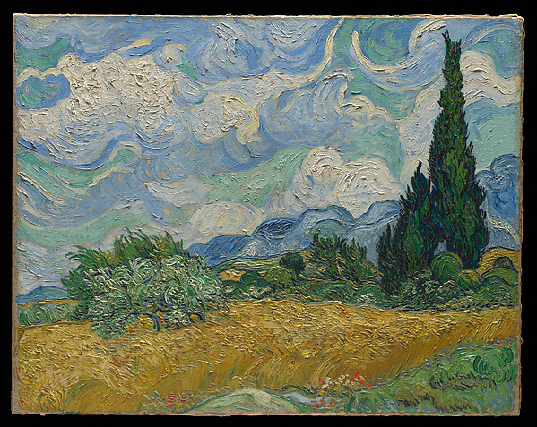

# Tests de fuentes: resultados, registros e imágenes

**3 fuentes comprobadas.** Fechas de las peticiones conservadas en este informe: `2026-11-05T16:02:34+00:00` a `2026-11-05T16:02:34+00:00` (UTC).

Este README contiene las pruebas y sus ejemplos. Las tablas proceden de respuestas reales; los errores quedan visibles. Las imágenes tienen una prueba adicional de descarga completa y decodificación. Cada capa conserva su propia fecha: añadir una imagen no equivale a volver a probar toda la fuente.

| Resultado más útil por fuente | Fuentes |
| --- | ---: |
| `DATA_SAMPLE` — Registros recuperados | 3 |

Una página `DOC_ONLY` no acredita registros descargados. `METADATA_SAMPLE` sólo acredita metadatos. `CACHED_SAMPLE` usa archivos del repo. Una muestra por prefijo no es aleatoria ni prueba calidad global; su hash no identifica el archivo completo.

Los errores/bloqueos describen estas peticiones desde este entorno, sin afirmar que el proveedor esté caído globalmente. No se inventan registros para sustituir datos inaccesibles.


## Índice de tests

| Fuente | Resultado |
| --- | --- |
| [ecobici-gbfs](#ecobici-gbfs) | `DATA_SAMPLE` |
| [usgs-sismos](#usgs-sismos) | `DATA_SAMPLE` |
| [met-arte](#met-arte) | `DATA_SAMPLE` |

## Reproducir

Desde la raíz del repositorio:

```bash
python -m pip install pypdf openpyxl Pillow
# Rehacer sólo los README a partir de la evidencia guardada (sin red):
python scripts/render_source_readmes.py
# Probar de nuevo las imágenes y actualizar los README:
python scripts/check_visual_examples.py
python scripts/render_source_readmes.py
# Nueva prueba de acceso a todas las fuentes:
python scripts/probe_catalog_sources.py
# O sólo algunas, en selected/ para conservar el informe acumulado:
python scripts/probe_catalog_sources.py --only dof-publicaciones bob-ross-paletas
```

`pypdf` y `openpyxl` son opcionales para PDF/XLSX; `Pillow` se usa para decodificar imágenes. El verificador de imágenes devuelve 1 si falla una imagen. En el verificador de fuentes, el código 0 sin `--strict` significa informe generado; `--strict` devuelve 1 si falla alguna comprobación, incluidos medios enlazados. No usa credenciales personales ni activa recolección programada.

## Tests y ejemplos por fuente

### ecobici-gbfs

**ECOBICI: catálogo y disponibilidad GBFS** — `DATA_SAMPLE`.

Sólo se confirma la capa descrita por cada prueba; no se generaliza disponibilidad o calidad.

**Prueba 1: `DATA_SAMPLE`** · [gbfs](https://gbfs.mex.lyftbikes.com/gbfs/gbfs.json) · HTTP `200`.

Captura UTC: `2026-11-05T16:02:34+00:00`; duración: 9.081 s.

Descubrimiento GBFS y validación del catálogo de estaciones.

Contenido: `text/plain; charset=UTF-8`; 1,049 bytes leídos; alcance del hash: `complete_response`.

| Campo | Ejemplo 1 | Ejemplo 2 |
| --- | --- | --- |
| station_id | 1 | 5 |
| name | CE-710 Molino del Rey - Glorieta de la Lealtad | CE-407  Prolongación Xochicalco-General Emiliano Zapata |
| lat | 19.416795 | 19.36726591257277 |
| lon | -99.192508 | -99.15865559132271 |
| capacity | 39 | 19 |

<details>
<summary>Ver los registros exactos en JSON</summary>

```json
[
  {
    "station_id": "1",
    "name": "CE-710 Molino del Rey - Glorieta de la Lealtad",
    "lat": 19.416795,
    "lon": -99.192508,
    "capacity": 39
  },
  {
    "station_id": "5",
    "name": "CE-407  Prolongación Xochicalco-General Emiliano Zapata",
    "lat": 19.36726591257277,
    "lon": -99.15865559132271,
    "capacity": 19
  }
]
```

</details>

**Recurso enlazado: comprobación independiente**

**Prueba 1.medio: `DATA_SAMPLE`** · [json](https://gbfs.mex.lyftbikes.com/gbfs/en/station_information.json) · HTTP `200`.

Captura UTC: `2026-11-05T16:02:38+00:00`; duración: 4.852 s.

Formato y campos de la muestra validados; no implica calidad de toda la fuente.

Contenido: `text/plain; charset=UTF-8`; 226,314 bytes leídos; alcance del hash: `complete_response`.

| Campo | Ejemplo 1 | Ejemplo 2 |
| --- | --- | --- |
| station_id | 1 | 5 |
| name | CE-710 Molino del Rey - Glorieta de la Lealtad | CE-407  Prolongación Xochicalco-General Emiliano Zapata |
| lat | 19.416795 | 19.36726591257277 |
| lon | -99.192508 | -99.15865559132271 |
| capacity | 39 | 19 |

<details>
<summary>Ver los registros exactos en JSON</summary>

```json
[
  {
    "station_id": "1",
    "name": "CE-710 Molino del Rey - Glorieta de la Lealtad",
    "lat": 19.416795,
    "lon": -99.192508,
    "capacity": 39
  },
  {
    "station_id": "5",
    "name": "CE-407  Prolongación Xochicalco-General Emiliano Zapata",
    "lat": 19.36726591257277,
    "lon": -99.15865559132271,
    "capacity": 19
  }
]
```

</details>

### usgs-sismos

**Terremotos del último día y sus revisiones** — `DATA_SAMPLE`.

Sólo se confirma la capa descrita por cada prueba; no se generaliza disponibilidad o calidad.

**Prueba 1: `DATA_SAMPLE`** · [geojson](https://earthquake.usgs.gov/earthquakes/feed/v1.0/summary/all_day.geojson) · HTTP `200`.

Captura UTC: `2026-11-05T16:02:34+00:00`; duración: 4.058 s.

Formato y campos de la muestra validados; no implica calidad de toda la fuente.

Contenido: `application/json; charset=utf-8`; 133,825 bytes leídos; alcance del hash: `complete_response`.

| Campo | Ejemplo 1 | Ejemplo 2 |
| --- | --- | --- |
| id | nc75462752 | aka2026vybunh |
| properties.title | M 0.6 - 8 km NW of The Geysers, CA | M 2.2 - 44 km WNW of Happy Valley, Alaska |
| properties.mag | 0.57 | 2.2 |
| properties.time | 1793892938920 | 1793892669666 |
| properties.updated | 1793893034165 | 1793892815939 |
| geometry.coordinates | [-122.818336486816, 38.8349990844727, 1.76999998092651] | [-152.482, 60.083, 90.5] |

<details>
<summary>Ver los registros exactos en JSON</summary>

```json
[
  {
    "id": "nc75462752",
    "properties.title": "M 0.6 - 8 km NW of The Geysers, CA",
    "properties.mag": 0.57,
    "properties.time": 1793892938920,
    "properties.updated": 1793893034165,
    "geometry.coordinates": [
      -122.818336486816,
      38.8349990844727,
      1.76999998092651
    ]
  },
  {
    "id": "aka2026vybunh",
    "properties.title": "M 2.2 - 44 km WNW of Happy Valley, Alaska",
    "properties.mag": 2.2,
    "properties.time": 1793892669666,
    "properties.updated": 1793892815939,
    "geometry.coordinates": [
      -152.482,
      60.083,
      90.5
    ]
  }
]
```

</details>

### met-arte

**Arte, objetos e imágenes del Metropolitan Museum** — `DATA_SAMPLE`.

Sólo se confirma la capa descrita por cada prueba; no se generaliza disponibilidad o calidad.

**Prueba 1: `DATA_SAMPLE`** · [json](https://collectionapi.metmuseum.org/public/collection/v1/objects/436535) · HTTP `200`.

Captura UTC: `2026-11-05T16:02:34+00:00`; duración: 10.152 s.

Formato y campos de la muestra validados; no implica calidad de toda la fuente. Se probó además la cabecera del medio enlazado; ver resultado del recurso.

Contenido: `application/json`; 2,794 bytes leídos; alcance del hash: `complete_response`.

| Campo | Ejemplo 1 |
| --- | --- |
| objectID | 436535 |
| title | Wheat Field with Cypresses |
| artistDisplayName | Vincent van Gogh |
| objectDate | 1889 |
| medium | Oil on canvas |
| isPublicDomain | true |
| primaryImage | https://images.metmuseum.org/CRDImages/ep/original/DP-42549-001.jpg |

<details>
<summary>Ver los registros exactos en JSON</summary>

```json
[
  {
    "objectID": 436535,
    "title": "Wheat Field with Cypresses",
    "artistDisplayName": "Vincent van Gogh",
    "objectDate": "1889",
    "medium": "Oil on canvas",
    "isPublicDomain": true,
    "primaryImage": "https://images.metmuseum.org/CRDImages/ep/original/DP-42549-001.jpg"
  }
]
```

</details>

**Recurso enlazado: comprobación independiente**

**Prueba 1.medio: `MEDIA_SAMPLE`** · [media](https://images.metmuseum.org/CRDImages/ep/web-large/DP-42549-001.jpg) · HTTP `200`.

Captura UTC: `2026-11-05T16:02:39+00:00`; duración: 5.07 s.

Sólo firma binaria y acceso al prefijo: no se decodificó, reprodujo ni validó el medio completo.

Contenido: `image/jpeg`; 65,536 bytes leídos; alcance del hash: `response_prefix`.

| Campo | Ejemplo 1 |
| --- | --- |
| format | JPEG |
| bytes_checked | 65536 |
| complete_file | false |

<details>
<summary>Ver los registros exactos en JSON</summary>

```json
[
  {
    "format": "JPEG",
    "bytes_checked": 65536,
    "complete_file": false
  }
]
```

</details>

**Ejemplo visual y su test**

<a href="https://www.metmuseum.org/art/collection/search/436535"></a>

**Wheat Field with Cypresses — Vincent van Gogh, 1889**. The Metropolitan Museum of Art; Purchase, The Annenberg Foundation Gift, 1993. [Ficha original](https://www.metmuseum.org/art/collection/search/436535) · [Licencia y condiciones](https://www.metmuseum.org/about-the-met/policies-and-documents/open-access): Dominio público (isPublicDomain=true).

Prueba de imagen: **`IMAGE_DECODED`**, HTTP `200`, `JPEG`, **599 × 477 px**, 221,383 bytes. Captura UTC: `2026-11-05T03:19:49+00:00`.

Vista del recurso original; decodificación de imagen independiente de la prueba de registros.

Archivo de imagen conservado en el repo.

GET completo y decodificación de píxeles comprobados. SHA-256 completo: `af0e3486621c210b54932d055294051b5601aa3362af4b84ab97e2831f8163bc`. [Metadatos de origen](https://collectionapi.metmuseum.org/public/collection/v1/objects/436535).

## Evidencia y alcance

[Resultados JSON](results.json) · [Definiciones de tests](../../../../catalogs/source_probes.json) · [Manifest de pruebas visuales](../../../../catalogs/visual_examples.json) · [Catálogo](../../../CATALOGO_DATASETS_REALES.md)

El informe acumulado conserva las fechas y versiones del verificador en `results.json`: corrida inicial, ampliaciones y reintentos. Cada prueba visual guarda URL, HTTP, formato, dimensiones, bytes y hash de la respuesta completa. Decodificar una imagen no valida etiquetas, autenticidad histórica, OCR, contenido clínico ni representatividad de los datos.
