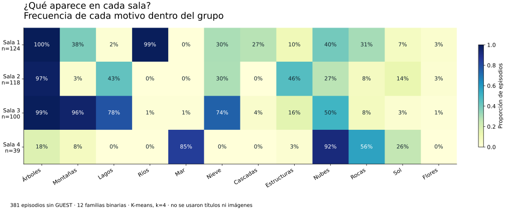

# Demo de clase · Cuatro salas para Bob Ross

**Problema:** un museo ficticio tiene cuatro salas. ¿Cómo organizar episodios por lo que aparece en sus cuadros y defender esa decisión con datos?

Demo para alumnos que ya usan ligeramente Codex/Claude: el agente escribe y ejecuta código; el equipo decide qué significa parecido, comprueba los resultados y firma una recomendación. **60 minutos**, con una versión docente de **35 minutos** para la cápsula de C17.

## Qué abrir y qué repartir

| Material | Uso |
| --- | --- |
| [demo.html](demo.html) | Presentación en seis pasos: encargo, tarjetas, agente, propuesta, refutación y decisión. Descargar el archivo y abrirlo en el navegador; GitHub muestra su código. |
| [ALUMNO.md](ALUMNO.md) | Problema, prompts por etapa, propuesta de variables y entregable; sin resultados de referencia. |
| [DOCENTE.md](DOCENTE.md) | Guion minuto a minuto, conceptos, respuestas esperables, errores, rúbrica y contingencias. |
| [reference/README.md](reference/README.md) | Resultados calculados, registros reales, tres gráficos, cuatro reproducciones enlazadas y resultados de tests. |
| [data/README.md](data/README.md) | Contrato, fuente, edición, transformaciones y licencia. |

La presentación no necesita servidor, API ni instalación. Datos resumidos y gráficos están incrustados; las cuatro reproducciones remotas son opcionales. Los controles exploran resultados precalculados y perfiles reales: **el navegador no vuelve a entrenar el modelo**. El análisis se ejecuta en Python con [run.py](run.py).

## La tensión que enseña el caso

Con doce familias binarias, 381 episodios sin invitados se agrupan en salas de **124, 118, 100 y 39 episodios**. Los centros son proporciones de motivos; los representantes son episodios reales. No se agrupan píxeles ni se descubren cuatro estilos verdaderos de Bob Ross.



Después se introduce deliberadamente un ID secuencial grande. La puntuación silhouette sube en ese otro espacio de variables y los grupos pasan a reflejar cronología. El alumno tiene que explicar por qué eso no resuelve mejor el encargo. La actividad refuerza criterio de similitud, variables pertinentes, lectura de centroides, elección de k y comprobaciones más allá de una cifra.

## Empezar sin clonar los históricos

Descargar `demo.html` para proyectar. Para alumnos, el docente puede generar un ZIP pequeño desde este paquete:

```bash
python examples/bob_ross_clustering/build_student_kit.py
```

El archivo queda en `examples/bob_ross_clustering/output/bob-ross-alumnos.zip`: sólo problema, CSV original, manifiesto y atribución. No incluye guía docente, solución, HTML con respuestas ni resultados calculados. Otra opción es descargar esta carpeta usando un checkout disperso; no hace falta el histórico de movilidad.

## Comprobaciones ejecutadas

- **8 tests del caso aprobados** y referencia analítica reproducida sin red.
- **4/4 imágenes** opcionales con descarga completa y decodificación verificadas; no se copiaron los archivos de las pinturas.
- **17 comprobaciones de interacción DOM** aprobadas. Los gráficos se renderizaron y revisaron como imágenes.
- El ensayo visual en navegador y móvil queda pendiente: el entorno impide iniciar Chromium por una restricción de sockets. La prueba DOM no acredita píxeles, portapapeles nativo ni descarga nativa. Ensayar `demo.html` en el equipo de clase.

Comandos y evidencia detallada en [reference/README.md](reference/README.md). El workflow [Validar demo de clustering Bob Ross](../../.github/workflows/bob-ross-demo.yml) verifica datos, tests, cálculo y correspondencia del HTML con la referencia.

## Fuente y límites

Datos de motivos: FiveThirtyEight, CC BY 4.0. Las reproducciones se enlazan desde Two Inch Brush mediante metadatos de jwilber; sus derechos son independientes. La demo no verifica todas las etiquetas visuales, mide preferencias del público ni establece una taxonomía de estilos. El caso de museo es una situación didáctica ficticia.
