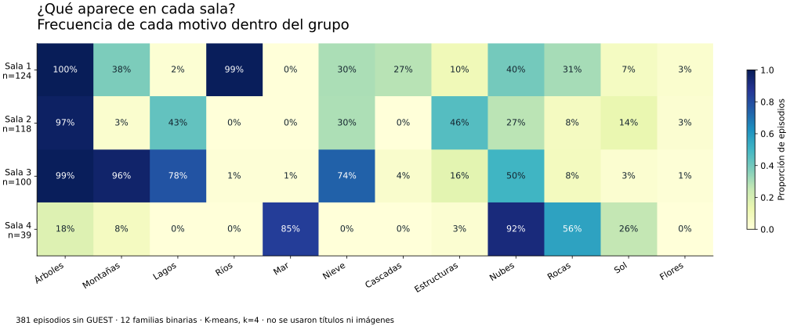
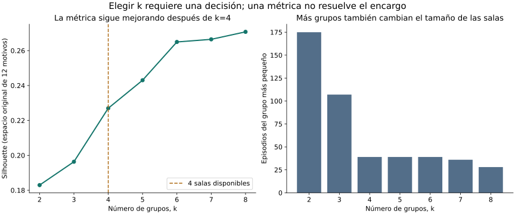
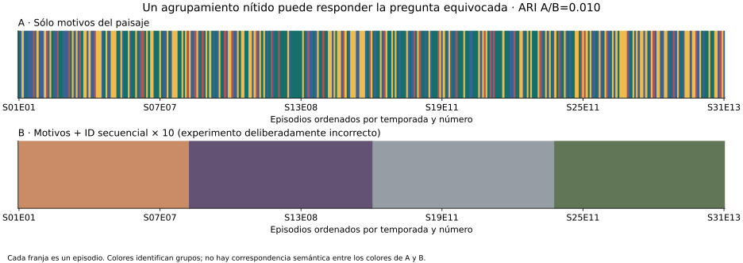

# Evidencia, registros, imágenes y tests

Esta solución de referencia es para el docente. Los resultados fueron calculados con el CSV completo fijado; no son ejemplos inventados ni respuestas de un LLM. La decisión de agrupar en cuatro salas es un encargo ficticio, no un resultado histórico sobre Bob Ross.

[Problema del alumno](../ALUMNO.md) · [Guía docente](../DOCENTE.md) · [Método y resultados JSON](report.json) · [Datos y licencia](../data/README.md)

## Contrato y resultados

| Medida | Resultado observado |
| --- | ---: |
| Episodios originales | 403 |
| Excluidos por GUEST | 22 |
| Usados | 381 |
| Familias binarias | 12 |
| Perfiles distintos | 122 |
| Perfiles de doce ceros | 3 |
| Silhouette con k=4 | 0.22698154 |

La agrupación usa distancia euclídea en doce familias binarias de igual peso y K-means con k=4, semilla 42 y n_init=50. Títulos, IDs, temporada, invitados, marcos, imágenes y paletas quedan fuera de X. Los ceros no se imputaron: son ausencias registradas.



| Sala | Episodios | Representante real | Caso distante que revisar |
| --- | ---: | --- | --- |
| 1 | 124 | S01E01 · A WALK IN THE WOODS | S11E05 · TOWERING GLACIER |
| 2 | 118 | S15E10 · FOREST DAWN OVAL | S10E13 · LAKESIDE CABIN |
| 3 | 100 | S01E07 · AUTUMN MOUNTAINS | S09E01 · WINTER EVERGREENS |
| 4 | 39 | S09E02 · SURF'S UP | S02E03 · EBONY SEA |

Los representantes son medoides calculados con distancias a miembros del grupo. Los centroides son frecuencias, no imágenes promedio. Los nombres de salas se proponen después; no se evaluó una taxonomía de estilos verdaderos.

## Ejemplos reales de registros

| Episodio | Título en la fuente de elementos | Motivos presentes en la representación |
| --- | --- | --- |
| S01E01 | A WALK IN THE WOODS | arboles, rios |
| S15E10 | FOREST DAWN OVAL | arboles |
| S01E07 | AUTUMN MOUNTAINS | arboles, montanas, lagos, nieve |
| S09E02 | SURF'S UP | mar, nubes, rocas |

Los 381 registros transformados están en [features.csv](features.csv); las asignaciones por episodio en [assignments.csv](assignments.csv). Los títulos sólo se incorporan después del ajuste para localizar ejemplos.

## Elegir k y comprobar sensibilidad



| k | Silhouette euclídeo | Tamaño mínimo |
| ---: | ---: | ---: |
| 2 | 0.182955 | 175 |
| 3 | 0.196334 | 107 |
| 4 | 0.226982 | 39 |
| 5 | 0.243029 | 39 |
| 6 | 0.264950 | 39 |
| 7 | 0.266460 | 36 |
| 8 | 0.270749 | 28 |

En diez semillas adicionales, ARI mínimo frente a la referencia: **0.969525**. Sin Árboles: **0.757937**. Incluyendo invitados y comparando sólo los mismos 381 episodios: **0.969525**. ARI mide acuerdo entre particiones; no exactitud ni calidad artística.

## Experimento deliberadamente incorrecto



Se añade `10 × (temporada × 13 + número de episodio)` como variable. El silhouette del espacio contaminado es **0.571323**, y ARI frente a la partición por motivos es **0.010225**. El resultado tiende a agrupar por cronología. Esta variable construida no forma parte del archivo original.

Los silhouette de espacios distintos no son una escala común de calidad. Una cifra más alta puede recompensar una separación irrelevante para el encargo. El resultado no prueba que todo clustering por fecha sea incorrecto: aquí la fecha no era el criterio de la exposición.

## Cuatro reproducciones opcionales y sus tests

Cada imagen se enlaza al proveedor sin guardar sus bytes en el repositorio. Las imágenes y paletas no entraron al modelo. El cruce ilustrativo usa temporada y episodio y dio una fila única por cada representante; no es una validación visual de cada etiqueta. Se conservan diferencias de título entre fuentes.

### Sala 1 · S01E01


Título en elementos: **A WALK IN THE WOODS**. Título en la fuente de reproducciones: **A Walk in the Woods**.

**`IMAGE_DECODED`**, HTTP `200`, WEBP, 450 × 337 px, 21,240 bytes. Captura UTC `2026-11-07T15:46:48+00:00`. Hash SHA-256 completo `d3aa6c9f407ce8de32cf94f9dbccd05e0b319f17686bf24036b8fc74aab67b49`.

Bob Ross; image hosted by Two Inch Brush, linked by jwilber/Bob_Ross_Paintings. Derechos de sus titulares; no se confirmó licencia abierta de la reproducción. [Manifiesto de imágenes](gallery.json).

### Sala 2 · S15E10


Título en elementos: **FOREST DAWN OVAL**. Título en la fuente de reproducciones: **Forest Down Oval**.

**`IMAGE_DECODED`**, HTTP `200`, WEBP, 450 × 337 px, 18,580 bytes. Captura UTC `2026-11-07T15:46:56+00:00`. Hash SHA-256 completo `3e733f0d49992e6a00ab44ca59dcf8581c365eba528860f309df495110e0ecc4`.

Bob Ross; image hosted by Two Inch Brush, linked by jwilber/Bob_Ross_Paintings. Derechos de sus titulares; no se confirmó licencia abierta de la reproducción. [Manifiesto de imágenes](gallery.json).

### Sala 3 · S01E07


Título en elementos: **AUTUMN MOUNTAINS**. Título en la fuente de reproducciones: **Autumn Mountain**.

**`IMAGE_DECODED`**, HTTP `200`, WEBP, 450 × 337 px, 14,848 bytes. Captura UTC `2026-11-07T15:47:04+00:00`. Hash SHA-256 completo `e99021cffce58f5f91f58be7176c69bd194ac952267779b460707fafa647a7bc`.

Bob Ross; image hosted by Two Inch Brush, linked by jwilber/Bob_Ross_Paintings. Derechos de sus titulares; no se confirmó licencia abierta de la reproducción. [Manifiesto de imágenes](gallery.json).

### Sala 4 · S09E02


Título en elementos: **SURF'S UP**. Título en la fuente de reproducciones: **Surf's Up**.

**`IMAGE_DECODED`**, HTTP `200`, WEBP, 450 × 337 px, 14,322 bytes. Captura UTC `2026-11-07T15:47:15+00:00`. Hash SHA-256 completo `02627f3f275c0cf836ab69c0b3cc915ed503e40b3f7cbfd733dc27228ef6714f`.

Bob Ross; image hosted by Two Inch Brush, linked by jwilber/Bob_Ross_Paintings. Derechos de sus titulares; no se confirmó licencia abierta de la reproducción. [Manifiesto de imágenes](gallery.json).

## Resultado de los controles

| Control | Resultado / alcance |
| --- | --- |
| Archivo original | Hash completo coincide; 66,315 bytes, edición fijada. |
| Pruebas del caso | 8/8 aprobadas: hash alterado, IDs duplicados, etiquetas inválidas, OR, exclusión de metadatos, ceros, población y paquete sin respuestas. |
| Reproducción del análisis | `run.py --check`: PASS sin red; compara el JSON analítico completo con la referencia. |
| Reproducciones ilustrativas | 4/4 cruces únicos y 4/4 imágenes descargadas completas y decodificadas. |
| Interacción en DOM | 17/17 comprobaciones jsdom aprobadas: pasos, tarjetas, títulos, distancias, centros, k, revelación, estado y descarga simulada. |
| Navegador visual / móvil | No verificado en este entorno: Chromium no puede crear el socket que requiere al iniciar. Los gráficos sí se renderizaron y revisaron como imágenes. Hacer ensayo de proyección antes de clase. |

**Alcance de jsdom:** no acredita píxeles, layout móvil, portapapeles nativo ni descarga nativa. Ver [recibo de comprobaciones](dom-validation.json). No se presenta como una prueba de navegador aprobada.

## Reproducir desde la raíz

```bash
python -m pip install -r examples/bob_ross_clustering/requirements.txt
python -m unittest discover -s examples/bob_ross_clustering/tests -v
python examples/bob_ross_clustering/run.py --check
# Recalcular artefactos en output/ (ignorado por git):
python examples/bob_ross_clustering/run.py
# Volver a construir el HTML a partir de reference/:
python examples/bob_ross_clustering/build_demo.py
# Paquete con sólo problema, datos, manifiesto y atribución:
python examples/bob_ross_clustering/build_student_kit.py
# Opcional, requiere red: comprobar otra vez las imágenes, sin copiar archivos:
python examples/bob_ross_clustering/verify_gallery.py
```

La validación analítica de GitHub Actions corre con Python 3.12 y dependencias fijadas. Una actualización de versión puede cambiar una solución en casos con empates; revisar cambios antes de reemplazar reference/. [Versiones y hash de código](runtime.json).

Prueba DOM opcional con Node: instalar `jsdom@26.1.0` en una carpeta de QA y ejecutar `qa_dom.cjs` con `JSDOM_MODULE_PATH` apuntando a ese módulo. No se necesita Node para presentar el HTML ni para calcular el clustering.

## Fuentes de método

- [KMeans, scikit-learn](https://scikit-learn.org/stable/modules/generated/sklearn.cluster.KMeans.html): objetivo, inicializaciones y semilla.
- [Silhouette, scikit-learn](https://scikit-learn.org/stable/modules/generated/sklearn.metrics.silhouette_score.html): separación y cohesión en la distancia elegida.
- [Adjusted Rand Index, scikit-learn](https://scikit-learn.org/stable/modules/generated/sklearn.metrics.adjusted_rand_score.html): comparación de particiones, no accuracy.
- [FiveThirtyEight, edición fijada de los elementos](https://github.com/fivethirtyeight/data/tree/4c1ff5e3aef1816ae04af63218015066e186c147/bob-ross).
- [jwilber/Bob_Ross_Paintings, edición fijada para enlaces ilustrativos](https://github.com/jwilber/Bob_Ross_Paintings/tree/f8741b2ba36d7b7a6e3fc87cb757ea73c9da6e1f).
