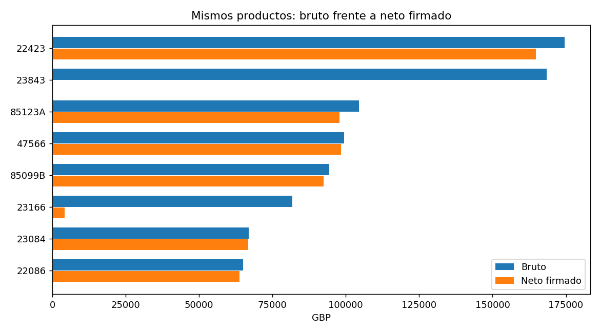

# Piloto ejecutado: retail bruto frente a neto

Pregunta: ¿qué productos cambian de posición al incorporar créditos/cancelaciones registrados? Este piloto calcula importes; no ejecuta un modelo de IA.

Captura/ejecución UTC: `2026-11-05T04:46:49+00:00`. Fuente: [UCI Online Retail](https://archive.ics.uci.edu/dataset/352/online+retail), Daqing Chen, CC BY 4.0. [Manifiesto y hash completo](inputs_manifest.json).

**541,909 filas leídas**, **536,429 elegibles**, 3,914 códigos de producto. Periodo observado: 2010-12-01T08:26:00 a 2011-12-09T12:50:00.

## Definiciones y límites

Product-like StockCode: five digits plus optional letters; positive price, nonzero integer quantity. Quarantine positive quantity on C invoice. Retain missing customers and exact duplicate lines; sensitivity removes duplicates.

Bruto = suma de importes positivos; créditos = valor absoluto de importes negativos; neto firmado = bruto − créditos. Importes en GBP. Una línea negativa no prueba una devolución físicamente enlazada a la venta original; el neto no es utilidad ni ingreso auditado. Las facturas pueden repetirse por producto; no se inventa una llave única. Los códigos con cinco dígitos y letras se tratan como productos por una regla explícita, pendiente de validación comercial.

Se conservan duplicados exactos porque podrían ser líneas legítimas; se compara una variante que los elimina. No se excluyen clientes faltantes. [Métricas completas y sensibilidad](metrics.json) · [Ranking completo](product_ranking.csv) · [Variante sin duplicados](product_ranking_deduplicated.csv).

## Resultados: productos del top 20 bruto

| Código | Bruto GBP | Créditos GBP | Neto GBP | Puesto bruto | Puesto neto |
| --- | ---: | ---: | ---: | ---: | ---: |
| 22423 | 174,484.74 | 9,722.55 | 164,762.19 | 1 | 1 |
| 23843 | 168,469.60 | 168,469.60 | 0.00 | 2 | 3894 |
| 85123A | 104,518.80 | 6,624.30 | 97,894.50 | 3 | 3 |
| 47566 | 99,504.33 | 1,201.35 | 98,302.98 | 4 | 2 |
| 85099B | 94,340.05 | 1,984.02 | 92,356.03 | 5 | 4 |
| 23166 | 81,700.92 | 77,479.64 | 4,221.28 | 6 | 581 |
| 23084 | 66,964.99 | 208.40 | 66,756.59 | 7 | 5 |
| 22086 | 64,952.29 | 1,160.35 | 63,791.94 | 8 | 6 |
| 84879 | 59,094.93 | 135.20 | 58,959.73 | 9 | 7 |
| 79321 | 54,117.76 | 349.70 | 53,768.06 | 10 | 8 |
| 22502 | 51,426.62 | 385.25 | 51,041.37 | 11 | 9 |
| 22197 | 51,354.02 | 366.55 | 50,987.47 | 12 | 10 |
| 23298 | 43,182.83 | 482.81 | 42,700.02 | 13 | 11 |
| 22386 | 42,436.24 | 816.58 | 41,619.66 | 14 | 12 |
| 23203 | 42,067.78 | 1,076.40 | 40,991.38 | 15 | 13 |
| 21137 | 40,652.13 | 55.17 | 40,596.96 | 16 | 14 |
| 23284 | 38,166.64 | 1,601.25 | 36,565.39 | 17 | 16 |
| 22720 | 38,158.39 | 744.95 | 37,413.44 | 18 | 15 |
| 22960 | 37,128.88 | 1,012.79 | 36,116.09 | 19 | 17 |
| 20725 | 36,042.01 | 854.70 | 35,187.31 | 20 | 19 |



Ejemplo medido: `23843` ocupa el puesto bruto 2, con 168,469.60 GBP positivos y 168,469.60 negativos: neto 0.00 GBP. Las líneas del producto se muestran abajo; no se atribuye una causa comercial. Los empates de ranking se ordenan por código y las descripciones son la última observada por producto.

```json
[
  {
    "InvoiceNo": "581483",
    "StockCode": "23843",
    "Description": "PAPER CRAFT , LITTLE BIRDIE",
    "Quantity": "80995",
    "InvoiceDate": "12/9/2011 9:15",
    "UnitPrice": "2.08",
    "Country": "United Kingdom"
  },
  {
    "InvoiceNo": "C581484",
    "StockCode": "23843",
    "Description": "PAPER CRAFT , LITTLE BIRDIE",
    "Quantity": "-80995",
    "InvoiceDate": "12/9/2011 9:27",
    "UnitPrice": "2.08",
    "Country": "United Kingdom"
  }
]
```

## Sensibilidad a duplicados

| Variante | Bruto GBP | Créditos GBP | Neto GBP |
| --- | ---: | ---: | ---: |
| retained_duplicates | 10,271,034.61 | 478,724.18 | 9,792,310.43 |
| removed_duplicates | 10,246,820.87 | 475,901.16 | 9,770,919.71 |

## Tests ejecutados

| Comprobación | Resultado |
| --- | --- |
| exact_decimal_arithmetic | PASS |
| signed_credits | PASS |
| duplicate_sensitivity | PASS |
| C_positive_quarantine | PASS |
| product_scope | PASS |
| missing_customers_retained | PASS |
| ranking_reversal | PASS |
| invalid_schema_rejected | PASS |
| Esquema del archivo completo | PASS |
| Cuadre bruto − créditos = neto, ambas variantes | PASS |

Calidad observada:

```json
{
  "input_rows": 541909,
  "exact_duplicate_rows": 5268,
  "missing_customer_rows": 135080,
  "eligible_rows": 536429,
  "negative_without_C": 0,
  "excluded_non_product_code": 2995,
  "excluded_nonpositive_price": 2485
}
```

## Registros reales de ejemplo

```json
[
  {
    "InvoiceNo": "536365",
    "StockCode": "85123A",
    "Description": "WHITE HANGING HEART T-LIGHT HOLDER",
    "Quantity": "6",
    "UnitPrice": "2.55"
  },
  {
    "InvoiceNo": "536365",
    "StockCode": "71053",
    "Description": "WHITE METAL LANTERN",
    "Quantity": "6",
    "UnitPrice": "3.39"
  },
  {
    "InvoiceNo": "536365",
    "StockCode": "84406B",
    "Description": "CREAM CUPID HEARTS COAT HANGER",
    "Quantity": "8",
    "UnitPrice": "2.75"
  },
  {
    "InvoiceNo": "536365",
    "StockCode": "84029G",
    "Description": "KNITTED UNION FLAG HOT WATER BOTTLE",
    "Quantity": "6",
    "UnitPrice": "3.39"
  },
  {
    "InvoiceNo": "536365",
    "StockCode": "84029E",
    "Description": "RED WOOLLY HOTTIE WHITE HEART.",
    "Quantity": "6",
    "UnitPrice": "3.39"
  }
]
```

## Reproducir

```bash
python -m pip install matplotlib
python scripts/run_discovery.py --self-check
python scripts/run_discovery.py --case uci-retail
# Sin red, usando una copia cuyo hash se coteja con el manifiesto:
python scripts/run_discovery.py --input /ruta/data.csv --output /ruta/resultados
```

La descarga completa usa un límite de 64 MiB y timeout de 30 s. El original no se añade al repositorio; se identifica por hash para verificar futuras reproducciones. El ejecutor implementa el primer adaptador retail; los perfiles de otros métodos siguen siendo diseños.
