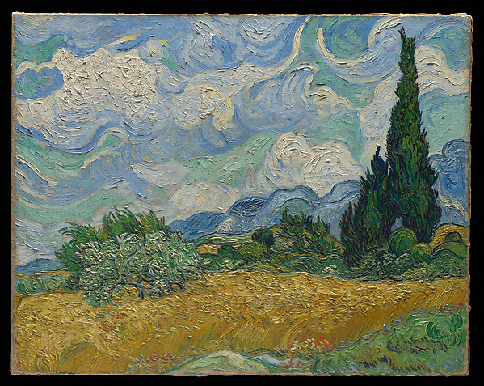
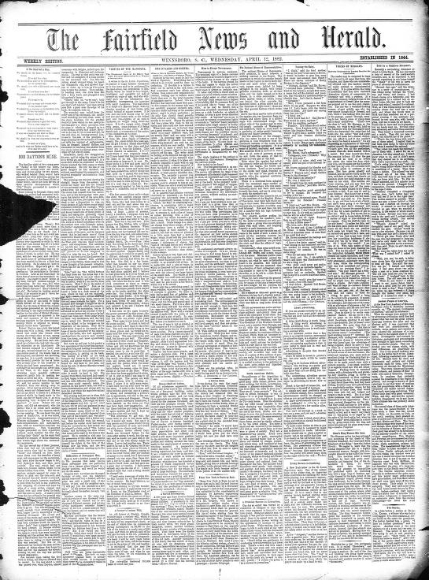
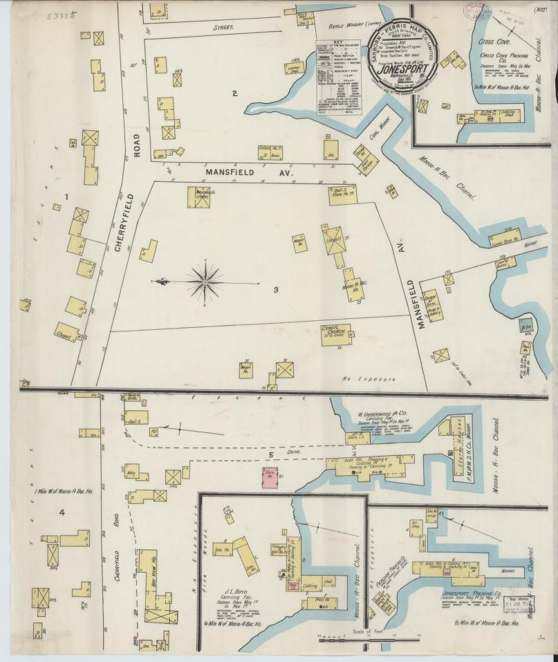

# Tests de fuentes: resultados, registros e imágenes

**72 fuentes comprobadas.** Fechas de las peticiones conservadas en este informe: `2026-11-05T00:07:41+00:00` a `2026-11-05T03:21:35+00:00` (UTC).

Este README contiene las pruebas y sus ejemplos. Las tablas proceden de respuestas reales; los errores quedan visibles. Las imágenes tienen una prueba adicional de descarga completa y decodificación. Cada capa conserva su propia fecha: añadir una imagen no equivale a volver a probar toda la fuente.

| Resultado más útil por fuente | Fuentes |
| --- | ---: |
| `BLOCKED` — Acceso bloqueado | 6 |
| `CACHED_SAMPLE` — Registros publicados en el repo | 2 |
| `DATA_SAMPLE` — Registros recuperados | 22 |
| `DOCUMENT_SAMPLE` — Documento recuperado | 5 |
| `DOC_ONLY` — Sólo portal o documentación | 22 |
| `HTTP_ERROR` — Error HTTP | 10 |
| `METADATA_SAMPLE` — Sólo catálogo o manifiesto | 5 |

Una página `DOC_ONLY` no acredita registros descargados. `METADATA_SAMPLE` sólo acredita metadatos. `CACHED_SAMPLE` usa archivos del repo. Una muestra por prefijo no es aleatoria ni prueba calidad global; su hash no identifica el archivo completo.

Los errores/bloqueos describen estas peticiones desde este entorno, sin afirmar que el proveedor esté caído globalmente. No se inventan registros para sustituir datos inaccesibles.

## README por temática

| Tema | Fuentes | Ejemplos visuales decodificados |
| --- | ---: | ---: |
| [Rifa del avión](by_topic/rifa-del-avion/README.md) | 3 | 0 |
| [INEGI y contexto](by_topic/inegi-y-contexto/README.md) | 8 | 0 |
| [Código postal y territorio](by_topic/codigo-postal-y-territorio/README.md) | 2 | 0 |
| [Presupuesto](by_topic/presupuesto/README.md) | 3 | 0 |
| [Educación](by_topic/educacion/README.md) | 3 | 0 |
| [Movilidad social](by_topic/movilidad-social/README.md) | 5 | 0 |
| [Movilidad](by_topic/movilidad/README.md) | 3 | 0 |
| [Salud y seguridad](by_topic/salud-y-seguridad/README.md) | 3 | 0 |
| [Fuentes sorprendentes y multimodales](by_topic/fuentes-sorprendentes-y-multimodales/README.md) | 15 | 5 |
| [Comida, viajes y aplicaciones](by_topic/comida-viajes-y-aplicaciones/README.md) | 6 | 1 |
| [Historia, diarios y literatura](by_topic/historia-diarios-y-literatura/README.md) | 3 | 0 |
| [Música, baile y teatro](by_topic/musica-baile-y-teatro/README.md) | 5 | 0 |
| [Mapas e inmuebles](by_topic/mapas-e-inmuebles/README.md) | 3 | 1 |
| [Educación, exámenes y UNAM](by_topic/educacion-examenes-y-unam/README.md) | 4 | 0 |
| [Arte, pintura y Bob Ross](by_topic/arte-pintura-y-bob-ross/README.md) | 3 | 1 |
| [Comercio y medicina](by_topic/comercio-y-medicina/README.md) | 3 | 1 |

## Índice de tests

| Fuente | Resultado |
| --- | --- |
| [rifa-235-premios](#rifa-235-premios) | `HTTP_ERROR` |
| [rifa-235-reportes](#rifa-235-reportes) | `BLOCKED` |
| [rifa-235-asf](#rifa-235-asf) | `DOCUMENT_SAMPLE` |
| [inegi-indicadores-api](#inegi-indicadores-api) | `DOC_ONLY` |
| [inegi-denue](#inegi-denue) | `CACHED_SAMPLE` |
| [inegi-censo-2020-ageb](#inegi-censo-2020-ageb) | `DOC_ONLY` |
| [inegi-marco-geoestadistico](#inegi-marco-geoestadistico) | `DOC_ONLY` |
| [inegi-entorno-urbano-2020](#inegi-entorno-urbano-2020) | `DOC_ONLY` |
| [inegi-enigh-2024](#inegi-enigh-2024) | `DOC_ONLY` |
| [inegi-enoe](#inegi-enoe) | `DOC_ONLY` |
| [inegi-eod-zmvm-2017](#inegi-eod-zmvm-2017) | `DOC_ONLY` |
| [sepomex-codigos-postales](#sepomex-codigos-postales) | `DOC_ONLY` |
| [cdmx-codigos-postales-poligonos](#cdmx-codigos-postales-poligonos) | `HTTP_ERROR` |
| [shcp-pef](#shcp-pef) | `BLOCKED` |
| [shcp-cuenta-publica](#shcp-cuenta-publica) | `HTTP_ERROR` |
| [shcp-srft](#shcp-srft) | `HTTP_ERROR` |
| [sep-cct](#sep-cct) | `DOC_ONLY` |
| [sep-formato-911](#sep-formato-911) | `BLOCKED` |
| [anuies-anuario](#anuies-anuario) | `DOC_ONLY` |
| [ceey-emovi-2023](#ceey-emovi-2023) | `DOC_ONLY` |
| [ceey-emovi-2017](#ceey-emovi-2017) | `DOC_ONLY` |
| [inegi-mmsi-2016](#inegi-mmsi-2016) | `DOC_ONLY` |
| [coneval-pobreza-municipal](#coneval-pobreza-municipal) | `DOC_ONLY` |
| [conapo-marginacion-2020](#conapo-marginacion-2020) | `BLOCKED` |
| [metrobus-gtfs](#metrobus-gtfs) | `CACHED_SAMPLE` |
| [ecobici-viajes](#ecobici-viajes) | `DATA_SAMPLE` |
| [ecobici-gbfs](#ecobici-gbfs) | `DATA_SAMPLE` |
| [salud-clues](#salud-clues) | `HTTP_ERROR` |
| [cdmx-fgj-carpetas](#cdmx-fgj-carpetas) | `HTTP_ERROR` |
| [inegi-atus](#inegi-atus) | `DOC_ONLY` |
| [dof-publicaciones](#dof-publicaciones) | `DOCUMENT_SAMPLE` |
| [usgs-sismos](#usgs-sismos) | `DATA_SAMPLE` |
| [nasa-exoplanetas](#nasa-exoplanetas) | `DATA_SAMPLE` |
| [gwosc-ondas-gravitacionales](#gwosc-ondas-gravitacionales) | `HTTP_ERROR` |
| [noaa-ghcn](#noaa-ghcn) | `METADATA_SAMPLE` |
| [gbif-biodiversidad](#gbif-biodiversidad) | `DATA_SAMPLE` |
| [xeno-canto-audio](#xeno-canto-audio) | `DATA_SAMPLE` |
| [met-arte](#met-arte) | `DATA_SAMPLE` |
| [loc-prensa-historica](#loc-prensa-historica) | `METADATA_SAMPLE` |
| [gutenberg-quijote](#gutenberg-quijote) | `DOCUMENT_SAMPLE` |
| [openfoodfacts-alimentos](#openfoodfacts-alimentos) | `DATA_SAMPLE` |
| [nuforc-ovnis](#nuforc-ovnis) | `DOC_ONLY` |
| [gdelt-noticias](#gdelt-noticias) | `METADATA_SAMPLE` |
| [nasa-bolidos](#nasa-bolidos) | `DATA_SAMPLE` |
| [nyc-ratas](#nyc-ratas) | `DATA_SAMPLE` |
| [nyc-restaurantes](#nyc-restaurantes) | `DATA_SAMPLE` |
| [openflights-red-aerea](#openflights-red-aerea) | `DATA_SAMPLE` |
| [bts-puntualidad-vuelos](#bts-puntualidad-vuelos) | `DOC_ONLY` |
| [apple-apps](#apple-apps) | `DATA_SAMPLE` |
| [apple-resenas-apps](#apple-resenas-apps) | `DATA_SAMPLE` |
| [insideairbnb-cdmx](#insideairbnb-cdmx) | `DATA_SAMPLE` |
| [napoleonica-cartas](#napoleonica-cartas) | `DOC_ONLY` |
| [gallica-napoleon](#gallica-napoleon) | `BLOCKED` |
| [pepys-diarios](#pepys-diarios) | `DOCUMENT_SAMPLE` |
| [musicbrainz-conciertos](#musicbrainz-conciertos) | `DOC_ONLY` |
| [setlist-conciertos](#setlist-conciertos) | `DOC_ONLY` |
| [osm-mapas-restaurantes](#osm-mapas-restaurantes) | `HTTP_ERROR` |
| [loc-mapas-historicos](#loc-mapas-historicos) | `METADATA_SAMPLE` |
| [gsm8k-examenes](#gsm8k-examenes) | `DATA_SAMPLE` |
| [unam-colecciones](#unam-colecciones) | `HTTP_ERROR` |
| [unam-agenda-estadistica](#unam-agenda-estadistica) | `DOC_ONLY` |
| [unam-guias-examenes](#unam-guias-examenes) | `DOCUMENT_SAMPLE` |
| [ct-ventas-inmuebles](#ct-ventas-inmuebles) | `DATA_SAMPLE` |
| [cmu-movimiento-baile](#cmu-movimiento-baile) | `HTTP_ERROR` |
| [aist-dance](#aist-dance) | `DOC_ONLY` |
| [artic-pintura](#artic-pintura) | `BLOCKED` |
| [dracor-teatro](#dracor-teatro) | `DATA_SAMPLE` |
| [uci-retail](#uci-retail) | `DATA_SAMPLE` |
| [openfda-etiquetas](#openfda-etiquetas) | `DATA_SAMPLE` |
| [wellcome-medicina-antigua](#wellcome-medicina-antigua) | `METADATA_SAMPLE` |
| [bob-ross-elementos](#bob-ross-elementos) | `DATA_SAMPLE` |
| [bob-ross-paletas](#bob-ross-paletas) | `DATA_SAMPLE` |

## Reproducir

Desde la raíz del repositorio:

```bash
python -m pip install pypdf openpyxl Pillow
# Rehacer sólo los README a partir de la evidencia guardada (sin red):
python scripts/render_source_readmes.py
# Probar de nuevo las imágenes y actualizar los README:
python scripts/check_visual_examples.py
python scripts/render_source_readmes.py
# Nueva prueba de acceso a todas las fuentes:
python scripts/probe_catalog_sources.py
# O sólo algunas, en selected/ para conservar el informe acumulado:
python scripts/probe_catalog_sources.py --only dof-publicaciones bob-ross-paletas
```

`pypdf` y `openpyxl` son opcionales para PDF/XLSX; `Pillow` se usa para decodificar imágenes. El verificador de imágenes devuelve 1 si falla una imagen. En el verificador de fuentes, el código 0 sin `--strict` significa informe generado; `--strict` devuelve 1 si falla alguna comprobación, incluidos medios enlazados. No usa credenciales personales ni activa recolección programada.

## Tests y ejemplos por fuente

### rifa-235-premios

**GSE 235: lista oficial de premios** — `HTTP_ERROR`.

Sólo se confirma la capa descrita por cada prueba; no se generaliza disponibilidad o calidad.

**Prueba 1: `HTTP_ERROR`** · [pdf](https://www.lotenal.gob.mx/Comercial/Listas/235.pdf) · HTTP `503`.

Captura UTC: `2026-11-05T00:07:41+00:00`; duración: 3.628 s.

HTTP 503: Service Unavailable. No se sorteó el bloqueo ni se usaron credenciales personales.

Sin registros o ejemplos recuperados para esta prueba.

### rifa-235-reportes

**GSE 235: balance y beneficiarios publicados** — `BLOCKED`.

Sólo se confirma la capa descrita por cada prueba; no se generaliza disponibilidad o calidad.

**Prueba 1: `BLOCKED`** · [html](https://www.gob.mx/lotenal/prensa/197193) · HTTP `403`.

Captura UTC: `2026-11-05T00:07:41+00:00`; duración: 4.167 s.

HTTP 403: Forbidden. No se sorteó el bloqueo ni se usaron credenciales personales.

Sin registros o ejemplos recuperados para esta prueba.

### rifa-235-asf

**GSE 235: auditoría de gestión financiera** — `DOCUMENT_SAMPLE`.

Sólo se confirma la capa descrita por cada prueba; no se generaliza disponibilidad o calidad.

**Prueba 1: `DOCUMENT_SAMPLE`** · [pdf](https://www.asf.gob.mx/Trans/Informes/IR2020c/Documentos/Auditorias/2020_0051_a.pdf) · HTTP `200`.

Captura UTC: `2026-11-05T00:07:41+00:00`; duración: 3.541 s.

Firma PDF y extracción de una página validadas; sin OCR ni auditoría de todas sus tablas.

Contenido: `application/pdf`; 541,919 bytes leídos; alcance del hash: `complete_response`.

| Campo | Ejemplo 1 |
| --- | --- |
| page | 28 |
| excerpt | Informe Individual del Resultado de la Fiscalización Superior de la Cuenta Pública 2020 28 Celebración del sorteo De conformidad con |

<details>
<summary>Ver los registros exactos en JSON</summary>

```json
[
  {
    "page": 28,
    "excerpt": "Informe Individual del Resultado de la Fiscalización Superior de la Cuenta Pública 2020 28 Celebración del sorteo De conformidad con"
  }
]
```

</details>

### inegi-indicadores-api

**API del Banco de Indicadores** — `DOC_ONLY`.

Sólo se confirma la capa descrita por cada prueba; no se generaliza disponibilidad o calidad.

**Prueba 1: `DOC_ONLY`** · [html](https://www.inegi.org.mx/servicios/api-indicadores/) · HTTP `200`.

Captura UTC: `2026-11-05T00:07:41+00:00`; duración: 3.625 s.

Ejemplo de página; no son registros del dataset. Los enlaces pueden requerir JavaScript, sesión o descarga adicional.

Contenido: `text/html`; 153,586 bytes leídos; alcance del hash: `complete_response`.

| Campo | Ejemplo 1 |
| --- | --- |
| page_title | API del Banco de Indicadores |

<details>
<summary>Ver los registros exactos en JSON</summary>

```json
[
  {
    "page_title": "API del Banco de Indicadores"
  }
]
```

</details>

### inegi-denue

**DENUE: establecimientos y actividad económica** — `CACHED_SAMPLE`.

La muestra es el CSV público ya recolectado; no se prueba la API autenticada en vivo.

**Prueba 1: `DOC_ONLY`** · [html](https://www.inegi.org.mx/servicios/api-denue/) · HTTP `200`.

Captura UTC: `2026-11-05T00:07:45+00:00`; duración: 3.558 s.

Ejemplo de página; no son registros del dataset. Los enlaces pueden requerir JavaScript, sesión o descarga adicional.

Contenido: `text/html`; 100,446 bytes leídos; alcance del hash: `complete_response`.

| Campo | Ejemplo 1 |
| --- | --- |
| page_title | API del DENUE |

<details>
<summary>Ver los registros exactos en JSON</summary>

```json
[
  {
    "page_title": "API del DENUE"
  }
]
```

</details>

**Prueba 2: `CACHED_SAMPLE`** · [csv](https://raw.githubusercontent.com/jcval94/DataCollectionMov/main/data/current/denue_cdmx_sector_61_servicios_educativos.csv) · HTTP `200`.

Captura UTC: `2026-11-05T00:07:48+00:00`; duración: 3.971 s.

Primeras filas completas del archivo; no se contó el total ni se comprobaron llaves globales.

Contenido: `text/plain; charset=utf-8`; 65,536 bytes leídos; alcance del hash: `response_prefix`.

| Campo | Ejemplo 1 | Ejemplo 2 |
| --- | --- | --- |
| id_establecimiento | 9496872 | 824823 |
| clee | 09005611621001441000000000U9 | 09007611122001343002000000U2 |
| nombre | 12 ROUNDS | 24 DE FEBRERO TURNO MATUTINO PRIMARIA CCT 09DPR2087X |
| cp | 07500 | 09510 |
| latitud | 19.48014404 | 19.36841162 |
| longitud | -99.06501588 | -99.01300142 |

<details>
<summary>Ver los registros exactos en JSON</summary>

```json
[
  {
    "id_establecimiento": "9496872",
    "clee": "09005611621001441000000000U9",
    "nombre": "12 ROUNDS",
    "cp": "07500",
    "latitud": "19.48014404",
    "longitud": "-99.06501588"
  },
  {
    "id_establecimiento": "824823",
    "clee": "09007611122001343002000000U2",
    "nombre": "24 DE FEBRERO TURNO MATUTINO PRIMARIA CCT 09DPR2087X",
    "cp": "09510",
    "latitud": "19.36841162",
    "longitud": "-99.01300142"
  }
]
```

</details>

### inegi-censo-2020-ageb

**Censo 2020: indicadores por AGEB y manzana urbana** — `DOC_ONLY`.

Sólo se confirma la capa descrita por cada prueba; no se generaliza disponibilidad o calidad.

**Prueba 1: `DOC_ONLY`** · [html](https://www.inegi.org.mx/programas/ccpv/2020/) · HTTP `200`.

Captura UTC: `2026-11-05T00:07:45+00:00`; duración: 3.293 s.

Ejemplo de página; no son registros del dataset. Los enlaces pueden requerir JavaScript, sesión o descarga adicional.

Contenido: `text/html`; 5,163 bytes leídos; alcance del hash: `complete_response`.

| Campo | Ejemplo 1 |
| --- | --- |
| page_title | Censo de Población y Vivienda (CPV) 2020 |

<details>
<summary>Ver los registros exactos en JSON</summary>

```json
[
  {
    "page_title": "Censo de Población y Vivienda (CPV) 2020"
  }
]
```

</details>

### inegi-marco-geoestadistico

**Marco Geoestadístico y equivalencias** — `DOC_ONLY`.

Sólo se confirma la capa descrita por cada prueba; no se generaliza disponibilidad o calidad.

**Prueba 1: `DOC_ONLY`** · [html](https://www.inegi.org.mx/temas/mg/) · HTTP `200`.

Captura UTC: `2026-11-05T00:07:45+00:00`; duración: 3.301 s.

Ejemplo de página; no son registros del dataset. Los enlaces pueden requerir JavaScript, sesión o descarga adicional.

Contenido: `text/html`; 4,265 bytes leídos; alcance del hash: `complete_response`.

| Campo | Ejemplo 1 |
| --- | --- |
| page_title | Marco Geoestadístico |

<details>
<summary>Ver los registros exactos en JSON</summary>

```json
[
  {
    "page_title": "Marco Geoestadístico"
  }
]
```

</details>

### inegi-entorno-urbano-2020

**Características del entorno urbano 2020** — `DOC_ONLY`.

Sólo se confirma la capa descrita por cada prueba; no se generaliza disponibilidad o calidad.

**Prueba 1: `DOC_ONLY`** · [html](https://www.inegi.org.mx/rnm/index.php/catalog/941/related-materials) · HTTP `200`.

Captura UTC: `2026-11-05T00:07:45+00:00`; duración: 3.149 s.

Ejemplo de página; no son registros del dataset. Los enlaces pueden requerir JavaScript, sesión o descarga adicional.

Contenido: `text/html; charset=UTF-8`; 273,272 bytes leídos; alcance del hash: `complete_response`.

| Campo | Ejemplo 1 |
| --- | --- |
| page_title | Mexico - Características de las Localidades y del Entorno Urbano 2020 |

<details>
<summary>Ver los registros exactos en JSON</summary>

```json
[
  {
    "page_title": "Mexico - Características de las Localidades y del Entorno Urbano 2020"
  }
]
```

</details>

### inegi-enigh-2024

**ENIGH 2024: ingresos y gastos del hogar** — `DOC_ONLY`.

Sólo se confirma la capa descrita por cada prueba; no se generaliza disponibilidad o calidad.

**Prueba 1: `DOC_ONLY`** · [html](https://www.inegi.org.mx/programas/enigh/nc/2024/) · HTTP `200`.

Captura UTC: `2026-11-05T00:07:48+00:00`; duración: 3.315 s.

Ejemplo de página; no son registros del dataset. Los enlaces pueden requerir JavaScript, sesión o descarga adicional.

Contenido: `text/html`; 3,918 bytes leídos; alcance del hash: `complete_response`.

| Campo | Ejemplo 1 |
| --- | --- |
| page_title | Encuesta Nacional de Ingresos y Gastos de los Hogares (ENIGH) 2024 |

<details>
<summary>Ver los registros exactos en JSON</summary>

```json
[
  {
    "page_title": "Encuesta Nacional de Ingresos y Gastos de los Hogares (ENIGH) 2024"
  }
]
```

</details>

### inegi-enoe

**ENOE: empleo, ingresos laborales e informalidad** — `DOC_ONLY`.

Sólo se confirma la capa descrita por cada prueba; no se generaliza disponibilidad o calidad.

**Prueba 1: `DOC_ONLY`** · [html](https://www.inegi.org.mx/programas/enoe/15ymas/) · HTTP `200`.

Captura UTC: `2026-11-05T00:07:48+00:00`; duración: 3.268 s.

Ejemplo de página; no son registros del dataset. Los enlaces pueden requerir JavaScript, sesión o descarga adicional.

Contenido: `text/html`; 5,765 bytes leídos; alcance del hash: `complete_response`.

| Campo | Ejemplo 1 |
| --- | --- |
| page_title | Encuesta Nacional de Ocupación y Empleo (ENOE), población de 15 años y más de edad |

<details>
<summary>Ver los registros exactos en JSON</summary>

```json
[
  {
    "page_title": "Encuesta Nacional de Ocupación y Empleo (ENOE), población de 15 años y más de edad"
  }
]
```

</details>

### inegi-eod-zmvm-2017

**Encuesta Origen Destino ZMVM 2017** — `DOC_ONLY`.

Sólo se confirma la capa descrita por cada prueba; no se generaliza disponibilidad o calidad.

**Prueba 1: `DOC_ONLY`** · [html](https://www.inegi.org.mx/programas/eod/2017/default.html) · HTTP `200`.

Captura UTC: `2026-11-05T00:07:49+00:00`; duración: 2.92 s.

Ejemplo de página; no son registros del dataset. Los enlaces pueden requerir JavaScript, sesión o descarga adicional.

Contenido: `text/html`; 5,164 bytes leídos; alcance del hash: `complete_response`.

| Campo | Ejemplo 1 |
| --- | --- |
| page_title | Encuesta Origen Destino en Hogares de la Zona Metropolitana del Valle de México (EOD) 2017 |

<details>
<summary>Ver los registros exactos en JSON</summary>

```json
[
  {
    "page_title": "Encuesta Origen Destino en Hogares de la Zona Metropolitana del Valle de México (EOD) 2017"
  }
]
```

</details>

### sepomex-codigos-postales

**Catálogo Nacional de Códigos Postales** — `DOC_ONLY`.

Sólo se confirma la capa descrita por cada prueba; no se generaliza disponibilidad o calidad.

**Prueba 1: `DOC_ONLY`** · [html](https://www.correosdemexico.gob.mx/SSLServicios/ConsultaCP/CodigoPostal_Exportar.aspx) · HTTP `200`.

Captura UTC: `2026-11-05T00:07:51+00:00`; duración: 3.039 s.

Ejemplo de página; no son registros del dataset. Los enlaces pueden requerir JavaScript, sesión o descarga adicional.

Contenido: `text/html; charset=iso-8859-1`; 16,842 bytes leídos; alcance del hash: `complete_response`.

| Campo | Ejemplo 1 |
| --- | --- |
| page_title | Descarga de Códigos Postales |

<details>
<summary>Ver los registros exactos en JSON</summary>

```json
[
  {
    "page_title": "Descarga de Códigos Postales"
  }
]
```

</details>

### cdmx-codigos-postales-poligonos

**Códigos postales CDMX: capa geográfica** — `HTTP_ERROR`.

Sólo se confirma la capa descrita por cada prueba; no se generaliza disponibilidad o calidad.

**Prueba 1: `HTTP_ERROR`** · [html](https://www.datos.cdmx.gob.mx/es_AR/dataset/codigos-postales) · HTTP `503`.

Captura UTC: `2026-11-05T00:07:51+00:00`; duración: 8.096 s.

HTTP 503: Service Unavailable. No se sorteó el bloqueo ni se usaron credenciales personales.

Sin registros o ejemplos recuperados para esta prueba.

**Prueba 2: `HTTP_ERROR`** · [ckan](https://datos.cdmx.gob.mx/api/3/action/package_show?id=codigos-postales) · HTTP `503`.

Captura UTC: `2026-11-05T00:08:00+00:00`; duración: 8.37 s.

HTTP 503: Service Unavailable. No se sorteó el bloqueo ni se usaron credenciales personales.

Sin registros o ejemplos recuperados para esta prueba.

### shcp-pef

**Presupuesto de Egresos de la Federación aprobado** — `BLOCKED`.

Sólo se confirma la capa descrita por cada prueba; no se generaliza disponibilidad o calidad.

**Prueba 1: `BLOCKED`** · [html](https://www.datos.gob.mx/dataset/presupuesto_egresos_federacion_pef) · HTTP `403`.

Captura UTC: `2026-11-05T00:07:51+00:00`; duración: 3.445 s.

HTTP 403: Forbidden. No se sorteó el bloqueo ni se usaron credenciales personales.

Sin registros o ejemplos recuperados para esta prueba.

### shcp-cuenta-publica

**Cuenta Pública: gasto al cierre** — `HTTP_ERROR`.

Sólo se confirma la capa descrita por cada prueba; no se generaliza disponibilidad o calidad.

**Prueba 1: `HTTP_ERROR`** · [html](https://www.transparenciapresupuestaria.gob.mx/es/PTP/Cuenta_Publica_2025) · HTTP `503`.

Captura UTC: `2026-11-05T00:07:52+00:00`; duración: 3.065 s.

HTTP 503: Service Unavailable. No se sorteó el bloqueo ni se usaron credenciales personales.

Sin registros o ejemplos recuperados para esta prueba.

### shcp-srft

**SRFT: ejercicio y destino del gasto federalizado** — `HTTP_ERROR`.

Sólo se confirma la capa descrita por cada prueba; no se generaliza disponibilidad o calidad.

**Prueba 1: `HTTP_ERROR`** · [html](https://www.transparenciapresupuestaria.gob.mx/Entidades-Federativas) · HTTP `503`.

Captura UTC: `2026-11-05T00:07:54+00:00`; duración: 0.941 s.

HTTP 503: Service Unavailable. No se sorteó el bloqueo ni se usaron credenciales personales.

Sin registros o ejemplos recuperados para esta prueba.

### sep-cct

**Catálogo de Centros de Trabajo** — `DOC_ONLY`.

Sólo se confirma la capa descrita por cada prueba; no se generaliza disponibilidad o calidad.

**Prueba 1: `DOC_ONLY`** · [html](https://siged.sep.gob.mx/SIGED/datos_abiertos.html) · HTTP `200`.

Captura UTC: `2026-11-05T00:07:55+00:00`; duración: 3.762 s.

Ejemplo de página; no son registros del dataset. Los enlaces pueden requerir JavaScript, sesión o descarga adicional.

Contenido: `text/html`; 18,651 bytes leídos; alcance del hash: `complete_response`.

| Campo | Ejemplo 1 |
| --- | --- |
| page_title | SEP &#124; SIGED |

<details>
<summary>Ver los registros exactos en JSON</summary>

```json
[
  {
    "page_title": "SEP | SIGED"
  }
]
```

</details>

### sep-formato-911

**Formato 911: alumnado, docentes y escuelas** — `BLOCKED`.

Sólo se confirma la capa descrita por cada prueba; no se generaliza disponibilidad o calidad.

**Prueba 1: `BLOCKED`** · [html](https://www.datos.gob.mx/dataset/registro_alumnado_personal_docente_educacion_basica_media_superior_formato_911) · HTTP `403`.

Captura UTC: `2026-11-05T00:07:55+00:00`; duración: 3.123 s.

HTTP 403: Forbidden. No se sorteó el bloqueo ni se usaron credenciales personales.

Sin registros o ejemplos recuperados para esta prueba.

### anuies-anuario

**Anuario Estadístico de Educación Superior** — `DOC_ONLY`.

Sólo se confirma la capa descrita por cada prueba; no se generaliza disponibilidad o calidad.

**Prueba 1: `DOC_ONLY`** · [html](https://anuario.anuies.mx/) · HTTP `200`.

Captura UTC: `2026-11-05T00:07:55+00:00`; duración: 4.07 s.

Ejemplo de página; no son registros del dataset. Los enlaces pueden requerir JavaScript, sesión o descarga adicional.

Contenido: `text/html; charset=UTF-8`; 311,474 bytes leídos; alcance del hash: `complete_response`.

| Campo | Ejemplo 1 |
| --- | --- |
| page_title | Anuarios ANUIES |

<details>
<summary>Ver los registros exactos en JSON</summary>

```json
[
  {
    "page_title": "Anuarios ANUIES"
  }
]
```

</details>

### ceey-emovi-2023

**ESRU–EMOVI 2023** — `DOC_ONLY`.

Sólo se confirma la capa descrita por cada prueba; no se generaliza disponibilidad o calidad.

**Prueba 1: `DOC_ONLY`** · [html](https://ceey.org.mx/contenido/que-hacemos/emovi/) · HTTP `200`.

Captura UTC: `2026-11-05T00:07:58+00:00`; duración: 3.972 s.

Ejemplo de página; no son registros del dataset. Los enlaces pueden requerir JavaScript, sesión o descarga adicional.

Contenido: `text/html; charset=UTF-8`; 317,672 bytes leídos; alcance del hash: `complete_response`.

| Campo | Ejemplo 1 |
| --- | --- |
| page_title | ESRU – EMOVI – Centro de Estudios Espinosa Yglesias |

<details>
<summary>Ver los registros exactos en JSON</summary>

```json
[
  {
    "page_title": "ESRU – EMOVI – Centro de Estudios Espinosa Yglesias"
  }
]
```

</details>

**Prueba 2: `BLOCKED`** · [html](https://drive.google.com/file/d/1r736z5vok0ss68cIW11SnZ5_MR0bUiDC/view?usp=drive_link) · HTTP `429`.

Captura UTC: `2026-11-05T00:08:02+00:00`; duración: 7.045 s.

HTTP 429: Too Many Requests. No se sorteó el bloqueo ni se usaron credenciales personales.

Sin registros o ejemplos recuperados para esta prueba.

### ceey-emovi-2017

**ESRU–EMOVI 2017** — `DOC_ONLY`.

Sólo se confirma la capa descrita por cada prueba; no se generaliza disponibilidad o calidad.

**Prueba 1: `DOC_ONLY`** · [html](https://ceey.org.mx/contenido/que-hacemos/emovi/) · HTTP `200`.

Captura UTC: `2026-11-05T00:07:59+00:00`; duración: 3.828 s.

Ejemplo de página; no son registros del dataset. Los enlaces pueden requerir JavaScript, sesión o descarga adicional.

Contenido: `text/html; charset=UTF-8`; 317,672 bytes leídos; alcance del hash: `complete_response`.

| Campo | Ejemplo 1 |
| --- | --- |
| page_title | ESRU – EMOVI – Centro de Estudios Espinosa Yglesias |

<details>
<summary>Ver los registros exactos en JSON</summary>

```json
[
  {
    "page_title": "ESRU – EMOVI – Centro de Estudios Espinosa Yglesias"
  }
]
```

</details>

**Prueba 2: `BLOCKED`** · [html](https://drive.google.com/file/d/1hko58nfnlexpw5kiB1K0kqeXlOPAaGyr/view?usp=sharing) · HTTP `429`.

Captura UTC: `2026-11-05T00:08:02+00:00`; duración: 7.003 s.

HTTP 429: Too Many Requests. No se sorteó el bloqueo ni se usaron credenciales personales.

Sin registros o ejemplos recuperados para esta prueba.

### inegi-mmsi-2016

**Módulo de Movilidad Social Intergeneracional 2016** — `DOC_ONLY`.

Sólo se confirma la capa descrita por cada prueba; no se generaliza disponibilidad o calidad.

**Prueba 1: `DOC_ONLY`** · [html](https://www.inegi.org.mx/programas/mmsi/2016/) · HTTP `200`.

Captura UTC: `2026-11-05T00:07:59+00:00`; duración: 3.917 s.

Ejemplo de página; no son registros del dataset. Los enlaces pueden requerir JavaScript, sesión o descarga adicional.

Contenido: `text/html`; 2,726 bytes leídos; alcance del hash: `complete_response`.

| Campo | Ejemplo 1 |
| --- | --- |
| page_title | Módulo de Movilidad Social Intergeneracional (MMSI) 2016 |

<details>
<summary>Ver los registros exactos en JSON</summary>

```json
[
  {
    "page_title": "Módulo de Movilidad Social Intergeneracional (MMSI) 2016"
  }
]
```

</details>

### coneval-pobreza-municipal

**Pobreza municipal 2010–2020** — `DOC_ONLY`.

Sólo se confirma la capa descrita por cada prueba; no se generaliza disponibilidad o calidad.

**Prueba 1: `DOC_ONLY`** · [html](https://www.coneval.org.mx/Medicion/Paginas/Programas_BD_municipal_2010_2020.aspx) · HTTP `200`.

Captura UTC: `2026-11-05T00:08:03+00:00`; duración: 3.808 s.

Ejemplo de página; no son registros del dataset. Los enlaces pueden requerir JavaScript, sesión o descarga adicional.

Contenido: `text/html; charset=utf-8`; 121,024 bytes leídos; alcance del hash: `complete_response`.

| Campo | Ejemplo 1 |
| --- | --- |
| page_title | Bases de datos y programas de cálculo pobreza municipal 2010-2020 |

<details>
<summary>Ver los registros exactos en JSON</summary>

```json
[
  {
    "page_title": "Bases de datos y programas de cálculo pobreza municipal 2010-2020"
  }
]
```

</details>

### conapo-marginacion-2020

**Índices de marginación 2020** — `BLOCKED`.

Sólo se confirma la capa descrita por cada prueba; no se generaliza disponibilidad o calidad.

**Prueba 1: `BLOCKED`** · [html](https://www.gob.mx/conapo/documentos/indices-de-marginacion-2020-284372) · HTTP `403`.

Captura UTC: `2026-11-05T00:08:07+00:00`; duración: 5.113 s.

HTTP 403: Forbidden. No se sorteó el bloqueo ni se usaron credenciales personales.

Sin registros o ejemplos recuperados para esta prueba.

### metrobus-gtfs

**Metrobús: GTFS estático y tiempo real** — `CACHED_SAMPLE`.

Snapshot público del repo; no demuestra respuesta actual del feed autenticado ni todas las tablas GTFS.

**Prueba 1: `CACHED_SAMPLE`** · [csv](https://raw.githubusercontent.com/jcval94/DataCollectionMov/main/data/current/metrobus_vehicle_positions.csv) · HTTP `200`.

Captura UTC: `2026-11-05T00:08:08+00:00`; duración: 3.448 s.

Primeras filas completas del archivo; no se contó el total ni se comprobaron llaves globales.

Contenido: `text/plain; charset=utf-8`; 65,536 bytes leídos; alcance del hash: `response_prefix`.

| Campo | Ejemplo 1 | Ejemplo 2 |
| --- | --- | --- |
| entity_id | 3f98eff3-6ee2-4cfd-9455-8cd0763e8187 | 98cc1a26-2a7e-4e2b-9779-ca4cb9617b08 |
| route_id | 19472 | 19562 |
| trip_id |  |  |
| latitude | 19.491252899169922 | 19.406333923339844 |
| longitude | -99.13525390625 | -99.17977142333984 |
| timestamp_cdmx | 2026-11-04 13:48:53-06:00 | 2026-11-04 13:48:54-06:00 |
| _snapshot_id | 20261104T194911Z | 20261104T194911Z |

<details>
<summary>Ver los registros exactos en JSON</summary>

```json
[
  {
    "entity_id": "3f98eff3-6ee2-4cfd-9455-8cd0763e8187",
    "route_id": "19472",
    "trip_id": "",
    "latitude": "19.491252899169922",
    "longitude": "-99.13525390625",
    "timestamp_cdmx": "2026-11-04 13:48:53-06:00",
    "_snapshot_id": "20261104T194911Z"
  },
  {
    "entity_id": "98cc1a26-2a7e-4e2b-9779-ca4cb9617b08",
    "route_id": "19562",
    "trip_id": "",
    "latitude": "19.406333923339844",
    "longitude": "-99.17977142333984",
    "timestamp_cdmx": "2026-11-04 13:48:54-06:00",
    "_snapshot_id": "20261104T194911Z"
  }
]
```

</details>

### ecobici-viajes

**ECOBICI: viajes históricos** — `DATA_SAMPLE`.

Sólo se confirma la capa descrita por cada prueba; no se generaliza disponibilidad o calidad.

**Prueba 1: `DATA_SAMPLE`** · [discover_csv](https://ecobici.cdmx.gob.mx/datos-abiertos/) · HTTP `200`.

Captura UTC: `2026-11-05T00:08:09+00:00`; duración: 7.613 s.

Descarga CSV descubierta en página oficial, muestreo por prefijo.

Contenido: `text/html; charset=UTF-8`; 117,065 bytes leídos; alcance del hash: `complete_response`.

| Campo | Ejemplo 1 | Ejemplo 2 |
| --- | --- | --- |
| Genero_Usuario | M | F |
| Edad_Usuario | 30.0 | 33.0 |
| Bici | 6583322 | 4139655 |
| Ciclo_Estacion_Retiro | 028 | 030 |
| Fecha_Retiro | 31/08/2026 | 31/08/2026 |
| Hora_Retiro | 23:54:59 | 23:24:43 |
| Ciclo_EstacionArribo | 258 | 530 |
| Fecha_Arribo | 01/09/2026 | 01/09/2026 |
| Hora_Arribo | 00:00:03 | 00:00:04 |

<details>
<summary>Ver los registros exactos en JSON</summary>

```json
[
  {
    "Genero_Usuario": "M",
    "Edad_Usuario": "30.0",
    "Bici": "6583322",
    "Ciclo_Estacion_Retiro": "028",
    "Fecha_Retiro": "31/08/2026",
    "Hora_Retiro": "23:54:59",
    "Ciclo_EstacionArribo": "258",
    "Fecha_Arribo": "01/09/2026",
    "Hora_Arribo": "00:00:03"
  },
  {
    "Genero_Usuario": "F",
    "Edad_Usuario": "33.0",
    "Bici": "4139655",
    "Ciclo_Estacion_Retiro": "030",
    "Fecha_Retiro": "31/08/2026",
    "Hora_Retiro": "23:24:43",
    "Ciclo_EstacionArribo": "530",
    "Fecha_Arribo": "01/09/2026",
    "Hora_Arribo": "00:00:04"
  }
]
```

</details>

**Recurso enlazado: comprobación independiente**

**Prueba 1.medio: `DATA_SAMPLE`** · [csv](https://ecobici.cdmx.gob.mx/wp-content/uploads/2026/10/public_data_web_2026-09.csv) · HTTP `200`.

Captura UTC: `2026-11-05T00:08:13+00:00`; duración: 3.676 s.

Primeras filas completas del archivo; no se contó el total ni se comprobaron llaves globales.

Contenido: `text/csv`; 65,536 bytes leídos; alcance del hash: `response_prefix`.

| Campo | Ejemplo 1 | Ejemplo 2 |
| --- | --- | --- |
| Genero_Usuario | M | F |
| Edad_Usuario | 30.0 | 33.0 |
| Bici | 6583322 | 4139655 |
| Ciclo_Estacion_Retiro | 028 | 030 |
| Fecha_Retiro | 31/08/2026 | 31/08/2026 |
| Hora_Retiro | 23:54:59 | 23:24:43 |
| Ciclo_EstacionArribo | 258 | 530 |
| Fecha_Arribo | 01/09/2026 | 01/09/2026 |
| Hora_Arribo | 00:00:03 | 00:00:04 |

<details>
<summary>Ver los registros exactos en JSON</summary>

```json
[
  {
    "Genero_Usuario": "M",
    "Edad_Usuario": "30.0",
    "Bici": "6583322",
    "Ciclo_Estacion_Retiro": "028",
    "Fecha_Retiro": "31/08/2026",
    "Hora_Retiro": "23:54:59",
    "Ciclo_EstacionArribo": "258",
    "Fecha_Arribo": "01/09/2026",
    "Hora_Arribo": "00:00:03"
  },
  {
    "Genero_Usuario": "F",
    "Edad_Usuario": "33.0",
    "Bici": "4139655",
    "Ciclo_Estacion_Retiro": "030",
    "Fecha_Retiro": "31/08/2026",
    "Hora_Retiro": "23:24:43",
    "Ciclo_EstacionArribo": "530",
    "Fecha_Arribo": "01/09/2026",
    "Hora_Arribo": "00:00:04"
  }
]
```

</details>

### ecobici-gbfs

**ECOBICI: catálogo y disponibilidad GBFS** — `DATA_SAMPLE`.

Sólo se confirma la capa descrita por cada prueba; no se generaliza disponibilidad o calidad.

**Prueba 1: `DATA_SAMPLE`** · [gbfs](https://gbfs.mex.lyftbikes.com/gbfs/gbfs.json) · HTTP `200`.

Captura UTC: `2026-11-05T00:08:09+00:00`; duración: 6.769 s.

Descubrimiento GBFS y validación del catálogo de estaciones.

Contenido: `text/plain; charset=UTF-8`; 1,049 bytes leídos; alcance del hash: `complete_response`.

| Campo | Ejemplo 1 | Ejemplo 2 |
| --- | --- | --- |
| station_id | 1 | 5 |
| name | CE-710 Molino del Rey - Glorieta de la Lealtad | CE-407  Prolongación Xochicalco-General Emiliano Zapata |
| lat | 19.416795 | 19.36726591257277 |
| lon | -99.192508 | -99.15865559132271 |
| capacity | 39 | 19 |

<details>
<summary>Ver los registros exactos en JSON</summary>

```json
[
  {
    "station_id": "1",
    "name": "CE-710 Molino del Rey - Glorieta de la Lealtad",
    "lat": 19.416795,
    "lon": -99.192508,
    "capacity": 39
  },
  {
    "station_id": "5",
    "name": "CE-407  Prolongación Xochicalco-General Emiliano Zapata",
    "lat": 19.36726591257277,
    "lon": -99.15865559132271,
    "capacity": 19
  }
]
```

</details>

**Recurso enlazado: comprobación independiente**

**Prueba 1.medio: `DATA_SAMPLE`** · [json](https://gbfs.mex.lyftbikes.com/gbfs/en/station_information.json) · HTTP `200`.

Captura UTC: `2026-11-05T00:08:13+00:00`; duración: 3.316 s.

Formato y campos de la muestra validados; no implica calidad de toda la fuente.

Contenido: `text/plain; charset=UTF-8`; 226,314 bytes leídos; alcance del hash: `complete_response`.

| Campo | Ejemplo 1 | Ejemplo 2 |
| --- | --- | --- |
| station_id | 1 | 5 |
| name | CE-710 Molino del Rey - Glorieta de la Lealtad | CE-407  Prolongación Xochicalco-General Emiliano Zapata |
| lat | 19.416795 | 19.36726591257277 |
| lon | -99.192508 | -99.15865559132271 |
| capacity | 39 | 19 |

<details>
<summary>Ver los registros exactos en JSON</summary>

```json
[
  {
    "station_id": "1",
    "name": "CE-710 Molino del Rey - Glorieta de la Lealtad",
    "lat": 19.416795,
    "lon": -99.192508,
    "capacity": 39
  },
  {
    "station_id": "5",
    "name": "CE-407  Prolongación Xochicalco-General Emiliano Zapata",
    "lat": 19.36726591257277,
    "lon": -99.15865559132271,
    "capacity": 19
  }
]
```

</details>

### salud-clues

**CLUES: establecimientos de salud** — `HTTP_ERROR`.

Sólo se confirma la capa descrita por cada prueba; no se generaliza disponibilidad o calidad.

**Prueba 1: `HTTP_ERROR`** · [xlsx](https://gobi.salud.gob.mx/historico_clues/ESTABLECIMIENTO_SALUD_202609.xlsx?v=1.1) · HTTP `503`.

Captura UTC: `2026-11-05T00:08:11+00:00`; duración: 8.294 s.

HTTP 503: Service Unavailable. No se sorteó el bloqueo ni se usaron credenciales personales.

Sin registros o ejemplos recuperados para esta prueba.

### cdmx-fgj-carpetas

**Carpetas de investigación FGJ CDMX** — `HTTP_ERROR`.

Sólo se confirma la capa descrita por cada prueba; no se generaliza disponibilidad o calidad.

**Prueba 1: `HTTP_ERROR`** · [html](https://datos.cdmx.gob.mx/dataset/carpetas-de-investigacion-fgj-de-la-ciudad-de-mexico) · HTTP `503`.

Captura UTC: `2026-11-05T00:08:12+00:00`; duración: 9.02 s.

HTTP 503: Service Unavailable. No se sorteó el bloqueo ni se usaron credenciales personales.

Sin registros o ejemplos recuperados para esta prueba.

**Prueba 2: `HTTP_ERROR`** · [ckan](https://datos.cdmx.gob.mx/api/3/action/package_show?id=carpetas-de-investigacion-fgj-de-la-ciudad-de-mexico) · HTTP `503`.

Captura UTC: `2026-11-05T00:08:21+00:00`; duración: 8.201 s.

HTTP 503: Service Unavailable. No se sorteó el bloqueo ni se usaron credenciales personales.

Sin registros o ejemplos recuperados para esta prueba.

### inegi-atus

**ATUS: accidentes de tránsito urbanos y suburbanos** — `DOC_ONLY`.

Sólo se confirma la capa descrita por cada prueba; no se generaliza disponibilidad o calidad.

**Prueba 1: `DOC_ONLY`** · [html](https://www.inegi.org.mx/programas/accidentes/default.html) · HTTP `200`.

Captura UTC: `2026-11-05T00:08:16+00:00`; duración: 3.089 s.

Ejemplo de página; no son registros del dataset. Los enlaces pueden requerir JavaScript, sesión o descarga adicional.

Contenido: `text/html`; 3,876 bytes leídos; alcance del hash: `complete_response`.

| Campo | Ejemplo 1 |
| --- | --- |
| page_title | Accidentes de Tránsito Terrestre en Zonas Urbanas y Suburbanas (ATUS) |

<details>
<summary>Ver los registros exactos en JSON</summary>

```json
[
  {
    "page_title": "Accidentes de Tránsito Terrestre en Zonas Urbanas y Suburbanas (ATUS)"
  }
]
```

</details>

### dof-publicaciones

**DOF/SIDOF: publicaciones y reformas para explicar Git** — `DOCUMENT_SAMPLE`.

Sólo se confirma la capa descrita por cada prueba; no se generaliza disponibilidad o calidad.

**Prueba 1: `DOC_ONLY`** · [html](https://sidof.segob.gob.mx/datos_abiertos) · HTTP `200`.

Captura UTC: `2026-11-05T00:08:17+00:00`; duración: 4.835 s.

Ejemplo de página; no son registros del dataset. Los enlaces pueden requerir JavaScript, sesión o descarga adicional.

Contenido: `text/html; charset=UTF-8`; 73,112 bytes leídos; alcance del hash: `complete_response`.

| Campo | Ejemplo 1 |
| --- | --- |
| page_title | Diario Oficial de la Federación &#124;&#124; Datos abiertos |

<details>
<summary>Ver los registros exactos en JSON</summary>

```json
[
  {
    "page_title": "Diario Oficial de la Federación || Datos abiertos"
  }
]
```

</details>

**Prueba 2: `DOCUMENT_SAMPLE`** · [dof](https://sidof.segob.gob.mx/notas/docFuente/5675889) · HTTP `200`.

Captura UTC: `2026-11-05T00:08:22+00:00`; duración: 3.921 s.

Texto real de nota histórica; campos extraídos/normalizados para la demostración.

Contenido: `text/html; charset=UTF-8`; 9,468 bytes leídos; alcance del hash: `complete_response`.

| Campo | Ejemplo 1 |
| --- | --- |
| codigo | 5675889 |
| titulo | Decreto de reforma de los artículos 76 y 78 de la LFT |
| publicacion | 2022-12-27 |
| nuevo_minimo_dias | 12 |
| entrada_vigor | 2023-01-01 |

<details>
<summary>Ver los registros exactos en JSON</summary>

```json
[
  {
    "codigo": "5675889",
    "titulo": "Decreto de reforma de los artículos 76 y 78 de la LFT",
    "publicacion": "2022-12-27",
    "nuevo_minimo_dias": 12,
    "entrada_vigor": "2023-01-01"
  }
]
```

</details>

### usgs-sismos

**Terremotos del último día y sus revisiones** — `DATA_SAMPLE`.

Sólo se confirma la capa descrita por cada prueba; no se generaliza disponibilidad o calidad.

**Prueba 1: `DATA_SAMPLE`** · [geojson](https://earthquake.usgs.gov/earthquakes/feed/v1.0/summary/all_day.geojson) · HTTP `200`.

Captura UTC: `2026-11-05T00:08:19+00:00`; duración: 3.331 s.

Formato y campos de la muestra validados; no implica calidad de toda la fuente.

Contenido: `application/json; charset=utf-8`; 144,196 bytes leídos; alcance del hash: `complete_response`.

| Campo | Ejemplo 1 | Ejemplo 2 |
| --- | --- | --- |
| id | ci41358519 | ci41358511 |
| properties.title | M 0.8 - 10 km SW of Idyllwild, CA | M 0.9 - 13 km SE of Tehachapi, CA |
| properties.mag | 0.83 | 0.92 |
| properties.time | 1793837018700 | 1793835466310 |
| properties.updated | 1793837221405 | 1793835679040 |
| geometry.coordinates | [-116.780666666667, 33.6643333333333, 13.53] | [-118.332666666667, 35.0611666666667, 1.7] |

<details>
<summary>Ver los registros exactos en JSON</summary>

```json
[
  {
    "id": "ci41358519",
    "properties.title": "M 0.8 - 10 km SW of Idyllwild, CA",
    "properties.mag": 0.83,
    "properties.time": 1793837018700,
    "properties.updated": 1793837221405,
    "geometry.coordinates": [
      -116.780666666667,
      33.6643333333333,
      13.53
    ]
  },
  {
    "id": "ci41358511",
    "properties.title": "M 0.9 - 13 km SE of Tehachapi, CA",
    "properties.mag": 0.92,
    "properties.time": 1793835466310,
    "properties.updated": 1793835679040,
    "geometry.coordinates": [
      -118.332666666667,
      35.0611666666667,
      1.7
    ]
  }
]
```

</details>

### nasa-exoplanetas

**Planetas fuera del Sistema Solar** — `DATA_SAMPLE`.

Sólo se confirma la capa descrita por cada prueba; no se generaliza disponibilidad o calidad.

**Prueba 1: `DATA_SAMPLE`** · [csv](https://exoplanetarchive.ipac.caltech.edu/TAP/sync?query=select+top+3+pl_name,hostname,discoverymethod,disc_year,pl_orbper+from+pscomppars&format=csv) · HTTP `200`.

Captura UTC: `2026-11-05T00:08:20+00:00`; duración: 4.195 s.

Primeras filas completas del archivo; no se contó el total ni se comprobaron llaves globales.

Contenido: `text/plain`; 229 bytes leídos; alcance del hash: `complete_response`.

| Campo | Ejemplo 1 | Ejemplo 2 |
| --- | --- | --- |
| pl_name | 55 Cnc b | 55 Cnc c |
| hostname | 55 Cnc | 55 Cnc |
| discoverymethod | Radial Velocity | Radial Velocity |
| disc_year | 1996 | 2004 |
| pl_orbper | 14.65155200000 | 44.39360000000 |

<details>
<summary>Ver los registros exactos en JSON</summary>

```json
[
  {
    "pl_name": "55 Cnc b",
    "hostname": "55 Cnc",
    "discoverymethod": "Radial Velocity",
    "disc_year": "1996",
    "pl_orbper": "14.65155200000"
  },
  {
    "pl_name": "55 Cnc c",
    "hostname": "55 Cnc",
    "discoverymethod": "Radial Velocity",
    "disc_year": "2004",
    "pl_orbper": "44.39360000000"
  }
]
```

</details>

### gwosc-ondas-gravitacionales

**Colisiones de agujeros negros y ondas gravitacionales** — `HTTP_ERROR`.

Sólo se confirma la capa descrita por cada prueba; no se generaliza disponibilidad o calidad.

**Prueba 1: `HTTP_ERROR`** · [json](https://gwosc.org/api/v2/catalogs?format=json) · HTTP `503`.

Captura UTC: `2026-11-05T00:08:23+00:00`; duración: 7.969 s.

HTTP 503: Service Unavailable. No se sorteó el bloqueo ni se usaron credenciales personales.

Sin registros o ejemplos recuperados para esta prueba.

### noaa-ghcn

**El clima escrito por estaciones meteorológicas** — `METADATA_SAMPLE`.

Sólo se confirma la capa descrita por cada prueba; no se generaliza disponibilidad o calidad.

**Prueba 1: `METADATA_SAMPLE`** · [noaa_fixed](https://www.ncei.noaa.gov/pub/data/ghcn/daily/ghcnd-stations.txt) · HTTP `200`.

Captura UTC: `2026-11-05T00:08:24+00:00`; duración: 3.372 s.

Catálogo de estaciones de ancho fijo; observaciones meteorológicas no probadas.

Contenido: `text/plain`; 65,536 bytes leídos; alcance del hash: `response_prefix`.

| Campo | Ejemplo 1 | Ejemplo 2 |
| --- | --- | --- |
| station_id | ACW00011604 | ACW00011647 |
| latitude | 17.1167 | 17.1333 |
| longitude | -61.7833 | -61.7833 |
| elevation_m | 10.1 | 19.2 |
| name | ST JOHNS COOLIDGE FLD | ST JOHNS |

<details>
<summary>Ver los registros exactos en JSON</summary>

```json
[
  {
    "station_id": "ACW00011604",
    "latitude": 17.1167,
    "longitude": -61.7833,
    "elevation_m": 10.1,
    "name": "ST JOHNS COOLIDGE FLD"
  },
  {
    "station_id": "ACW00011647",
    "latitude": 17.1333,
    "longitude": -61.7833,
    "elevation_m": 19.2,
    "name": "ST JOHNS"
  }
]
```

</details>

### gbif-biodiversidad

**Dónde se ha observado vida: especies y sesgo de muestreo** — `DATA_SAMPLE`.

Sólo se confirma la capa descrita por cada prueba; no se generaliza disponibilidad o calidad.

**Prueba 1: `DATA_SAMPLE`** · [json](https://api.gbif.org/v1/occurrence/search?country=MX&limit=3) · HTTP `200`.

Captura UTC: `2026-11-05T00:08:26+00:00`; duración: 3.846 s.

Formato y campos de la muestra validados; no implica calidad de toda la fuente.

Contenido: `application/json`; 18,157 bytes leídos; alcance del hash: `complete_response`.

| Campo | Ejemplo 1 | Ejemplo 2 |
| --- | --- | --- |
| key | 5937748320 | 5937748335 |
| scientificName | Panthiades bathildis (R.F.C.Felder, 1865) | Urbanus dorantes (Stoll, 1790) |
| countryCode | MX | MX |
| eventDate | 2026-01-01 | 2026-01-01 |
| basisOfRecord | HUMAN_OBSERVATION | HUMAN_OBSERVATION |
| license | http://creativecommons.org/licenses/by-nc/4.0/legalcode | http://creativecommons.org/licenses/by-nc/4.0/legalcode |

<details>
<summary>Ver los registros exactos en JSON</summary>

```json
[
  {
    "key": 5937748320,
    "scientificName": "Panthiades bathildis (R.F.C.Felder, 1865)",
    "countryCode": "MX",
    "eventDate": "2026-01-01",
    "basisOfRecord": "HUMAN_OBSERVATION",
    "license": "http://creativecommons.org/licenses/by-nc/4.0/legalcode"
  },
  {
    "key": 5937748335,
    "scientificName": "Urbanus dorantes (Stoll, 1790)",
    "countryCode": "MX",
    "eventDate": "2026-01-01",
    "basisOfRecord": "HUMAN_OBSERVATION",
    "license": "http://creativecommons.org/licenses/by-nc/4.0/legalcode"
  }
]
```

</details>

**Ejemplo visual y su test**

<a href="https://www.gbif.org/occurrence/5938027608"></a>

**Telebasis salva — fotografía de observación naturalista**. Sinaloa Silvestre; iNaturalist / GBIF. [Ficha original](https://www.gbif.org/occurrence/5938027608) · [Licencia y condiciones](https://creativecommons.org/publicdomain/zero/1.0/): CC0 1.0 en el medio seleccionado.

Prueba de imagen: **`IMAGE_DECODED`**, HTTP `200`, `JPEG`, **500 × 369 px**, 69,292 bytes. Captura UTC: `2026-11-05T03:19:53+00:00`.

Se revisó la licencia del medio seleccionado, además de la del registro; no se asume que sean iguales para toda la colección.

Archivo de imagen conservado en el repo.

GET completo y decodificación de píxeles comprobados. SHA-256 completo: `affd90a06b86fa6be4b97402216d3b6365d15cdb3a9adee98ebf8c41ad22579d`. [Metadatos de origen](https://api.gbif.org/v1/occurrence/search?country=MX&mediaType=StillImage&license=CC0_1_0&limit=3).

### xeno-canto-audio

**Cantos de aves, murciélagos e insectos** — `DATA_SAMPLE`.

Sólo se confirma la capa descrita por cada prueba; no se generaliza disponibilidad o calidad.

**Prueba 1: `DOC_ONLY`** · [html](https://xeno-canto.org/explore/api) · HTTP `200`.

Captura UTC: `2026-11-05T00:09:58+00:00`; duración: 3.89 s.

Ejemplo de página; no son registros del dataset. Los enlaces pueden requerir JavaScript, sesión o descarga adicional.

Contenido: `text/html; charset=UTF-8`; 52,259 bytes leídos; alcance del hash: `complete_response`.

| Campo | Ejemplo 1 |
| --- | --- |
| page_title | API :: xeno-canto |

<details>
<summary>Ver los registros exactos en JSON</summary>

```json
[
  {
    "page_title": "API :: xeno-canto"
  }
]
```

</details>

**Prueba 2: `DATA_SAMPLE`** · [json](https://xeno-canto.org/api/3/recordings?query=gen:larus+sp:fuscus&key=demo&per_page=2) · HTTP `200`.

Captura UTC: `2026-11-05T00:10:02+00:00`; duración: 7.379 s.

Formato y campos de la muestra validados; no implica calidad de toda la fuente. Se probó además la cabecera del medio enlazado; ver resultado del recurso.

Contenido: `application/json`; 100,822 bytes leídos; alcance del hash: `complete_response`.

| Campo | Ejemplo 1 | Ejemplo 2 |
| --- | --- | --- |
| id | 1154497 | 1065457 |
| gen | Larus | Larus |
| sp | fuscus | fuscus |
| cnt | United Kingdom | Italy |
| type | alarm call | flight call |
| length | 1:33 | 0:10 |
| file | https://xeno-canto.org/1154497/download | https://xeno-canto.org/1065457/download |
| lic | https://creativecommons.org/licenses/by-nc-sa/4.0/ | https://creativecommons.org/licenses/by-nc-sa/4.0/ |

<details>
<summary>Ver los registros exactos en JSON</summary>

```json
[
  {
    "id": "1154497",
    "gen": "Larus",
    "sp": "fuscus",
    "cnt": "United Kingdom",
    "type": "alarm call",
    "length": "1:33",
    "file": "https://xeno-canto.org/1154497/download",
    "lic": "https://creativecommons.org/licenses/by-nc-sa/4.0/"
  },
  {
    "id": "1065457",
    "gen": "Larus",
    "sp": "fuscus",
    "cnt": "Italy",
    "type": "flight call",
    "length": "0:10",
    "file": "https://xeno-canto.org/1065457/download",
    "lic": "https://creativecommons.org/licenses/by-nc-sa/4.0/"
  }
]
```

</details>

**Recurso enlazado: comprobación independiente**

**Prueba 2.medio: `MEDIA_SAMPLE`** · [media](https://xeno-canto.org/1154497/download) · HTTP `200`.

Captura UTC: `2026-11-05T00:10:06+00:00`; duración: 3.456 s.

Sólo firma binaria y acceso al prefijo: no se decodificó, reprodujo ni validó el medio completo.

Contenido: `audio/wav`; 65,536 bytes leídos; alcance del hash: `response_prefix`.

| Campo | Ejemplo 1 |
| --- | --- |
| format | WAV |
| bytes_checked | 65536 |
| complete_file | false |

<details>
<summary>Ver los registros exactos en JSON</summary>

```json
[
  {
    "format": "WAV",
    "bytes_checked": 65536,
    "complete_file": false
  }
]
```

</details>

**Ejemplo visual y su test**

<a href="https://xeno-canto.org/1154497"></a>

**Sonograma de Larus fuscus — grabación XC1154497**. David Darrell-Lambert; xeno-canto, XC1154497. [Ficha original](https://xeno-canto.org/1154497) · [Licencia y condiciones](https://creativecommons.org/licenses/by-nc-sa/4.0/): CC BY-NC-SA 4.0 para la grabación, según su ficha.

Prueba de imagen: **`IMAGE_DECODED`**, HTTP `200`, `PNG`, **486 × 241 px**, 9,858 bytes. Captura UTC: `2026-11-05T03:19:57+00:00`.

Sonograma remoto ofrecido por la ficha. La prueba visual no equivale a reproducir o decodificar el audio completo.

Imagen incrustada desde el proveedor; su visualización depende de que esa URL siga disponible.

GET completo y decodificación de píxeles comprobados. SHA-256 completo: `c78c96fe816da0c81438ebeceb3184f7ec28958392a44e29566360a6d4c3fff6`. [Metadatos de origen](https://xeno-canto.org/api/3/recordings?query=gen:larus+sp:fuscus&key=demo&per_page=2).

### met-arte

**Arte, objetos e imágenes del Metropolitan Museum** — `DATA_SAMPLE`.

Sólo se confirma la capa descrita por cada prueba; no se generaliza disponibilidad o calidad.

**Prueba 1: `DATA_SAMPLE`** · [json](https://collectionapi.metmuseum.org/public/collection/v1/objects/436535) · HTTP `200`.

Captura UTC: `2026-11-05T00:08:30+00:00`; duración: 7.528 s.

Formato y campos de la muestra validados; no implica calidad de toda la fuente. Se probó además la cabecera del medio enlazado; ver resultado del recurso.

Contenido: `application/json`; 2,794 bytes leídos; alcance del hash: `complete_response`.

| Campo | Ejemplo 1 |
| --- | --- |
| objectID | 436535 |
| title | Wheat Field with Cypresses |
| artistDisplayName | Vincent van Gogh |
| objectDate | 1889 |
| medium | Oil on canvas |
| isPublicDomain | true |
| primaryImage | https://images.metmuseum.org/CRDImages/ep/original/DP-42549-001.jpg |

<details>
<summary>Ver los registros exactos en JSON</summary>

```json
[
  {
    "objectID": 436535,
    "title": "Wheat Field with Cypresses",
    "artistDisplayName": "Vincent van Gogh",
    "objectDate": "1889",
    "medium": "Oil on canvas",
    "isPublicDomain": true,
    "primaryImage": "https://images.metmuseum.org/CRDImages/ep/original/DP-42549-001.jpg"
  }
]
```

</details>

**Recurso enlazado: comprobación independiente**

**Prueba 1.medio: `MEDIA_SAMPLE`** · [media](https://images.metmuseum.org/CRDImages/ep/web-large/DP-42549-001.jpg) · HTTP `200`.

Captura UTC: `2026-11-05T00:08:33+00:00`; duración: 3.921 s.

Sólo firma binaria y acceso al prefijo: no se decodificó, reprodujo ni validó el medio completo.

Contenido: `image/jpeg`; 65,536 bytes leídos; alcance del hash: `response_prefix`.

| Campo | Ejemplo 1 |
| --- | --- |
| format | JPEG |
| bytes_checked | 65536 |
| complete_file | false |

<details>
<summary>Ver los registros exactos en JSON</summary>

```json
[
  {
    "format": "JPEG",
    "bytes_checked": 65536,
    "complete_file": false
  }
]
```

</details>

**Ejemplo visual y su test**

<a href="https://www.metmuseum.org/art/collection/search/436535"></a>

**Wheat Field with Cypresses — Vincent van Gogh, 1889**. The Metropolitan Museum of Art; Purchase, The Annenberg Foundation Gift, 1993. [Ficha original](https://www.metmuseum.org/art/collection/search/436535) · [Licencia y condiciones](https://www.metmuseum.org/about-the-met/policies-and-documents/open-access): Dominio público (isPublicDomain=true).

Prueba de imagen: **`IMAGE_DECODED`**, HTTP `200`, `JPEG`, **599 × 477 px**, 221,383 bytes. Captura UTC: `2026-11-05T03:19:49+00:00`.

Vista del recurso original; decodificación de imagen independiente de la prueba de registros.

Archivo de imagen conservado en el repo.

GET completo y decodificación de píxeles comprobados. SHA-256 completo: `af0e3486621c210b54932d055294051b5601aa3362af4b84ab97e2831f8163bc`. [Metadatos de origen](https://collectionapi.metmuseum.org/public/collection/v1/objects/436535).

### loc-prensa-historica

**Periódicos antiguos: portadas, OCR y metadatos** — `METADATA_SAMPLE`.

Sólo se confirma la capa descrita por cada prueba; no se generaliza disponibilidad o calidad.

**Prueba 1: `METADATA_SAMPLE`** · [json](https://www.loc.gov/newspapers/?fo=json&c=3) · HTTP `200`.

Captura UTC: `2026-11-05T00:08:30+00:00`; duración: 3.103 s.

Formato y campos de la muestra validados; no implica calidad de toda la fuente.

Contenido: `application/json`; 100,574 bytes leídos; alcance del hash: `complete_response`.

| Campo | Ejemplo 1 | Ejemplo 2 |
| --- | --- | --- |
| id | http://www.loc.gov/item/2012218613/1882-04-12/ed-1/ | http://www.loc.gov/item/sn83045313/1949-10-25/ed-1/ |
| title | The Fairfield news and herald (Winnsboro, S.C.), April 12, 1882 | Le messager (Lewiston, Me.), October 25, 1949 |
| date | 1882-04-12 | 1949-10-25 |
| language | [&quot;english&quot;] | [&quot;french&quot;, &quot;english&quot;] |
| original_format | [&quot;newspaper&quot;] | [&quot;newspaper&quot;] |
| url | https://www.loc.gov/item/2012218613/1882-04-12/ed-1/ | https://www.loc.gov/item/sn83045313/1949-10-25/ed-1/ |

<details>
<summary>Ver los registros exactos en JSON</summary>

```json
[
  {
    "id": "http://www.loc.gov/item/2012218613/1882-04-12/ed-1/",
    "title": "The Fairfield news and herald (Winnsboro, S.C.), April 12, 1882",
    "date": "1882-04-12",
    "language": [
      "english"
    ],
    "original_format": [
      "newspaper"
    ],
    "url": "https://www.loc.gov/item/2012218613/1882-04-12/ed-1/"
  },
  {
    "id": "http://www.loc.gov/item/sn83045313/1949-10-25/ed-1/",
    "title": "Le messager (Lewiston, Me.), October 25, 1949",
    "date": "1949-10-25",
    "language": [
      "french",
      "english"
    ],
    "original_format": [
      "newspaper"
    ],
    "url": "https://www.loc.gov/item/sn83045313/1949-10-25/ed-1/"
  }
]
```

</details>

**Ejemplo visual y su test**

<a href="https://www.loc.gov/item/2012218613/1882-04-12/ed-1/"></a>

**The Fairfield news and herald — portada del 12 de abril de 1882**. Library of Congress; University of South Carolina, Columbia, SC. [Ficha original](https://www.loc.gov/item/2012218613/1882-04-12/ed-1/) · [Licencia y condiciones](https://www.loc.gov/collections/chronicling-america/about-this-collection/rights-and-access/): Dominio público (edición de 1882).

Prueba de imagen: **`IMAGE_DECODED`**, HTTP `200`, `JPEG`, **545 × 736 px**, 144,127 bytes. Captura UTC: `2026-11-05T03:19:49+00:00`.

Vista del recurso original; decodificación de imagen independiente de la prueba de registros.

Archivo de imagen conservado en el repo.

GET completo y decodificación de píxeles comprobados. SHA-256 completo: `472cbe967361142cd5f7bd80d2eae9f2bb842cc6d9108ec9f98165c5f3016662`. [Metadatos de origen](https://www.loc.gov/item/2012218613/1882-04-12/ed-1/?fo=json).

### gutenberg-quijote

**Don Quijote como corpus de lenguaje** — `DOCUMENT_SAMPLE`.

Sólo se confirma la capa descrita por cada prueba; no se generaliza disponibilidad o calidad.

**Prueba 1: `DOCUMENT_SAMPLE`** · [text](https://www.gutenberg.org/cache/epub/2000/pg2000.txt) · HTTP `200`.

Captura UTC: `2026-11-05T00:08:31+00:00`; duración: 3.829 s.

Prefijo de documento real; no se descargó el corpus completo.

Contenido: `text/plain; charset=utf-8`; 65,536 bytes leídos; alcance del hash: `response_prefix`.

| Campo | Ejemplo 1 |
| --- | --- |
| excerpt | En un lugar de la Mancha, de cuyo nombre no quiero acordarme, no ha mucho tiempo que vivía un hidalgo de los de lanza en astillero, adarga antigua, rocín flaco y galgo corredor. Una olla de algo más vaca que carnero, salpicón las más noches, duelos y quebrantos los sábados, lantejas los viernes, algún palomino de añadidura los domingos, consumían |

<details>
<summary>Ver los registros exactos en JSON</summary>

```json
[
  {
    "excerpt": "En un lugar de la Mancha, de cuyo nombre no quiero acordarme, no ha mucho tiempo que vivía un hidalgo de los de lanza en astillero, adarga antigua, rocín flaco y galgo corredor. Una olla de algo más vaca que carnero, salpicón las más noches, duelos y quebrantos los sábados, lantejas los viernes, algún palomino de añadidura los domingos, consumían"
  }
]
```

</details>

### openfoodfacts-alimentos

**Alimentos: ingredientes, nutrientes y fotos de etiquetas** — `DATA_SAMPLE`.

Sólo se confirma la capa descrita por cada prueba; no se generaliza disponibilidad o calidad.

**Prueba 1: `DATA_SAMPLE`** · [json](https://world.openfoodfacts.org/api/v2/product/3017620422003?fields=code,product_name,brands,nutriments,nutriscore_grade,image_url) · HTTP `200`.

Captura UTC: `2026-11-05T00:08:33+00:00`; duración: 3.421 s.

Formato y campos de la muestra validados; no implica calidad de toda la fuente.

Contenido: `application/json; charset=utf-8`; 2,687 bytes leídos; alcance del hash: `complete_response`.

| Campo | Ejemplo 1 |
| --- | --- |
| code | 3017620422003 |
| product_name | Nutella |
| brands | Nutella, Ferrero |
| nutriscore_grade | unknown |
| nutriments | {&quot;added-sugars&quot;: 52.13, &quot;added-sugars_100g&quot;: 52.13, &quot;added-sugars_unit&quot;: &quot;g&quot;, &quot;added-sugars_value&quot;: 52.13, &quot;carbohydrates&quot;: 57.5, &quot;carbohydrates_100g&quot;: 57.5, &quot;carbohydrates_unit&quot;: &quot;g&quot;, &quot;carbohydrates_value&quot;: 57.5, &quot;energy&quot;: 2252, &quot;energy-kcal&quot;: 539, &quot;energy-kcal_100g&quot;: 539, &quot;energy-kcal_unit&quot;: &quot;kcal&quot;} |
| image_url | https://images.openfoodfacts.org/images/products/301/762/042/2003/front_en.879.400.jpg |

<details>
<summary>Ver los registros exactos en JSON</summary>

```json
[
  {
    "code": "3017620422003",
    "product_name": "Nutella",
    "brands": "Nutella, Ferrero",
    "nutriscore_grade": "unknown",
    "nutriments": {
      "added-sugars": 52.13,
      "added-sugars_100g": 52.13,
      "added-sugars_unit": "g",
      "added-sugars_value": 52.13,
      "carbohydrates": 57.5,
      "carbohydrates_100g": 57.5,
      "carbohydrates_unit": "g",
      "carbohydrates_value": 57.5,
      "energy": 2252,
      "energy-kcal": 539,
      "energy-kcal_100g": 539,
      "energy-kcal_unit": "kcal"
    },
    "image_url": "https://images.openfoodfacts.org/images/products/301/762/042/2003/front_en.879.400.jpg"
  }
]
```

</details>

**Ejemplo visual y su test**

<a href="https://world.openfoodfacts.org/product/3017620422003"></a>

**Nutella — fotografía del envase en español, código 3017620422003**. Open Food Facts y sus colaboradores; marcas de sus titulares. [Ficha original](https://world.openfoodfacts.org/product/3017620422003) · [Licencia y condiciones](https://world.openfoodfacts.org/terms-of-use): Licencia de imágenes indicada por Open Food Facts; marcas conservan derechos.

Prueba de imagen: **`IMAGE_DECODED`**, HTTP `200`, `JPEG`, **336 × 400 px**, 25,515 bytes. Captura UTC: `2026-11-05T03:22:50+00:00`.

Vista en español publicada en selected_images.front.display.es de la API. La foto en inglés del ejemplo inicial devolvió HTTP 503; se conserva ese fallo en previous_tests. No demuestra que los nutrientes estén actualizados para todos los países.

Imagen incrustada desde el proveedor; su visualización depende de que esa URL siga disponible.

GET completo y decodificación de píxeles comprobados. SHA-256 completo: `a973622bf4464c2cc6db260671ec2756942f81a12768a76b56347f7e70d246c3`. [Metadatos de origen](https://world.openfoodfacts.org/api/v2/product/3017620422003.json).

### nuforc-ovnis

**Relatos de avistamientos de ovnis/UAP** — `DOC_ONLY`.

Sólo se confirma la capa descrita por cada prueba; no se generaliza disponibilidad o calidad.

**Prueba 1: `DOC_ONLY`** · [html](https://nuforc.org/databank/?id=latest) · HTTP `200`.

Captura UTC: `2026-11-05T00:08:34+00:00`; duración: 4.593 s.

Ejemplo de página; no son registros del dataset. Los enlaces pueden requerir JavaScript, sesión o descarga adicional.

Contenido: `text/html; charset=UTF-8`; 160,850 bytes leídos; alcance del hash: `complete_response`.

| Campo | Ejemplo 1 |
| --- | --- |
| page_title | NUFORC Reports for State atest |

<details>
<summary>Ver los registros exactos en JSON</summary>

```json
[
  {
    "page_title": "NUFORC Reports for State atest"
  }
]
```

</details>

### gdelt-noticias

**El mundo contado por noticias: eventos y menciones** — `METADATA_SAMPLE`.

Sólo se confirma la capa descrita por cada prueba; no se generaliza disponibilidad o calidad.

**Prueba 1: `METADATA_SAMPLE`** · [gdelt_index](https://data.gdeltproject.org/gdeltv2/lastupdate.txt) · HTTP `200`.

Captura UTC: `2026-11-05T00:08:36+00:00`; duración: 3.522 s.

Manifiesto recuperado; archivos de eventos/mentions/GKG no descargados.

Contenido: `text/plain`; 321 bytes leídos; alcance del hash: `complete_response`.

| Campo | Ejemplo 1 | Ejemplo 2 | Ejemplo 3 |
| --- | --- | --- | --- |
| bytes | 131623 | 122069 | 5009186 |
| md5 | 8c1327fd003001080389187c21fbb939 | c27d37d8d98604efe7d9085d02db02d7 | 3b8c897d4d7173d767dfcb5ad99f2243 |
| url | http://data.gdeltproject.org/gdeltv2/20261105001500.export.CSV.zip | http://data.gdeltproject.org/gdeltv2/20261105001500.mentions.CSV.zip | http://data.gdeltproject.org/gdeltv2/20261105001500.gkg.csv.zip |

<details>
<summary>Ver los registros exactos en JSON</summary>

```json
[
  {
    "bytes": 131623,
    "md5": "8c1327fd003001080389187c21fbb939",
    "url": "http://data.gdeltproject.org/gdeltv2/20261105001500.export.CSV.zip"
  },
  {
    "bytes": 122069,
    "md5": "c27d37d8d98604efe7d9085d02db02d7",
    "url": "http://data.gdeltproject.org/gdeltv2/20261105001500.mentions.CSV.zip"
  },
  {
    "bytes": 5009186,
    "md5": "3b8c897d4d7173d767dfcb5ad99f2243",
    "url": "http://data.gdeltproject.org/gdeltv2/20261105001500.gkg.csv.zip"
  }
]
```

</details>

### nasa-bolidos

**Bólidos: entradas atmosféricas detectadas por sensores** — `DATA_SAMPLE`.

Sólo se confirma la capa descrita por cada prueba; no se generaliza disponibilidad o calidad.

**Prueba 1: `DATA_SAMPLE`** · [nasa_rows](https://ssd-api.jpl.nasa.gov/fireball.api?limit=3) · HTTP `200`.

Captura UTC: `2026-11-05T00:08:37+00:00`; duración: 3.165 s.

Formato y campos de la muestra validados; no implica calidad de toda la fuente.

Contenido: `application/json`; 390 bytes leídos; alcance del hash: `complete_response`.

| Campo | Ejemplo 1 | Ejemplo 2 |
| --- | --- | --- |
| date | 2026-10-04 03:14:45 | 2026-09-15 11:26:13 |
| energy | 5.4 | 2.2 |
| impact-e | 0.18 | 0.079 |
| lat | 41.8 | 37.6 |
| lat-dir | S | S |
| lon | 173.1 | 161.6 |
| lon-dir | W | W |
| alt | 26.9 | 37.0 |
| vel | 13.8 | null |

<details>
<summary>Ver los registros exactos en JSON</summary>

```json
[
  {
    "date": "2026-10-04 03:14:45",
    "energy": "5.4",
    "impact-e": "0.18",
    "lat": "41.8",
    "lat-dir": "S",
    "lon": "173.1",
    "lon-dir": "W",
    "alt": "26.9",
    "vel": "13.8"
  },
  {
    "date": "2026-09-15 11:26:13",
    "energy": "2.2",
    "impact-e": "0.079",
    "lat": "37.6",
    "lat-dir": "S",
    "lon": "161.6",
    "lon-dir": "W",
    "alt": "37.0"
  }
]
```

</details>

### nyc-ratas

**Inspecciones de ratas por predio en Nueva York** — `DATA_SAMPLE`.

Sólo se confirma la capa descrita por cada prueba; no se generaliza disponibilidad o calidad.

**Prueba 1: `DATA_SAMPLE`** · [json](https://data.cityofnewyork.us/resource/p937-wjvj.json?$limit=3) · HTTP `200`.

Captura UTC: `2026-11-05T00:08:38+00:00`; duración: 3.143 s.

Formato y campos de la muestra validados; no implica calidad de toda la fuente.

Contenido: `application/json;charset=utf-8`; 653 bytes leídos; alcance del hash: `complete_response`.

| Campo | Ejemplo 1 | Ejemplo 2 |
| --- | --- | --- |
| job_id | PC8178739 | PC8129591 |
| inspection_date | 2023-09-21T10:54:00.000 | 2023-06-25T15:20:41.000 |
| inspection_type | Stoppage | Treatments |
| zip_code | 11216 | 11237 |
| borough | Brooklyn | Brooklyn |
| result | Stoppage done | Bait applied |

<details>
<summary>Ver los registros exactos en JSON</summary>

```json
[
  {
    "job_id": "PC8178739",
    "inspection_date": "2023-09-21T10:54:00.000",
    "inspection_type": "Stoppage",
    "zip_code": "11216",
    "borough": "Brooklyn",
    "result": "Stoppage done"
  },
  {
    "job_id": "PC8129591",
    "inspection_date": "2023-06-25T15:20:41.000",
    "inspection_type": "Treatments",
    "zip_code": "11237",
    "borough": "Brooklyn",
    "result": "Bait applied"
  }
]
```

</details>

### nyc-restaurantes

**Inspecciones de restaurantes de Nueva York** — `DATA_SAMPLE`.

Ampliación para descubrimiento: los ejemplos verifican acceso/formato; la pregunta de investigación sigue siendo una hipótesis salvo resultado calculado explícito.

**Prueba 1: `DATA_SAMPLE`** · [json](https://data.cityofnewyork.us/resource/43nn-pn8j.json?$limit=3) · HTTP `200`.

Captura UTC: `2026-11-05T00:51:41+00:00`; duración: 9.964 s.

Formato y campos de la muestra validados; no implica calidad de toda la fuente.

Contenido: `application/json;charset=utf-8`; 2,033 bytes leídos; alcance del hash: `complete_response`.

| Campo | Ejemplo 1 | Ejemplo 2 |
| --- | --- | --- |
| camis | 50160418 | 50177284 |
| dba | MAMAS CHICKEN SHACK HAPPY DUMPLING COCOA CABIN COCOA CABIN | WORLD SPA ENTERTAINMENT LLC |
| boro | Manhattan | Brooklyn |
| zipcode | 10036 | 11230 |
| inspection_date | 1900-01-01T00:00:00.000 | 1900-01-01T00:00:00.000 |

<details>
<summary>Ver los registros exactos en JSON</summary>

```json
[
  {
    "camis": "50160418",
    "dba": "MAMAS CHICKEN SHACK HAPPY DUMPLING COCOA CABIN COCOA CABIN",
    "boro": "Manhattan",
    "zipcode": "10036",
    "inspection_date": "1900-01-01T00:00:00.000"
  },
  {
    "camis": "50177284",
    "dba": "WORLD SPA ENTERTAINMENT LLC",
    "boro": "Brooklyn",
    "zipcode": "11230",
    "inspection_date": "1900-01-01T00:00:00.000"
  }
]
```

</details>

### openflights-red-aerea

**Aeropuertos, aerolíneas, aviones y rutas históricas** — `DATA_SAMPLE`.

Ampliación para descubrimiento: los ejemplos verifican acceso/formato; la pregunta de investigación sigue siendo una hipótesis salvo resultado calculado explícito.

**Prueba 1: `DATA_SAMPLE`** · [csv](https://raw.githubusercontent.com/jpatokal/openflights/master/data/airports.dat) · HTTP `200`.

Captura UTC: `2026-11-05T00:51:41+00:00`; duración: 5.231 s.

Primeras filas completas del archivo; no se contó el total ni se comprobaron llaves globales.

Contenido: `text/plain; charset=utf-8`; 65,536 bytes leídos; alcance del hash: `response_prefix`.

| Campo | Ejemplo 1 | Ejemplo 2 |
| --- | --- | --- |
| airport_id | 1 | 2 |
| name | Goroka Airport | Madang Airport |
| country | Papua New Guinea | Papua New Guinea |
| iata | GKA | MAG |
| latitude | -6.081689834590001 | -5.20707988739 |
| longitude | 145.391998291 | 145.789001465 |

<details>
<summary>Ver los registros exactos en JSON</summary>

```json
[
  {
    "airport_id": "1",
    "name": "Goroka Airport",
    "country": "Papua New Guinea",
    "iata": "GKA",
    "latitude": "-6.081689834590001",
    "longitude": "145.391998291"
  },
  {
    "airport_id": "2",
    "name": "Madang Airport",
    "country": "Papua New Guinea",
    "iata": "MAG",
    "latitude": "-5.20707988739",
    "longitude": "145.789001465"
  }
]
```

</details>

**Prueba 2: `DATA_SAMPLE`** · [csv](https://raw.githubusercontent.com/jpatokal/openflights/master/data/routes.dat) · HTTP `200`.

Captura UTC: `2026-11-05T00:51:46+00:00`; duración: 3.454 s.

Primeras filas completas del archivo; no se contó el total ni se comprobaron llaves globales.

Contenido: `text/plain; charset=utf-8`; 65,536 bytes leídos; alcance del hash: `response_prefix`.

| Campo | Ejemplo 1 | Ejemplo 2 |
| --- | --- | --- |
| airline | 2B | 2B |
| airline_id | 410 | 410 |
| source_airport | AER | ASF |
| source_id | 2965 | 2966 |
| dest_airport | KZN | KZN |
| dest_id | 2990 | 2990 |
| codeshare |  |  |
| stops | 0 | 0 |
| equipment | CR2 | CR2 |

<details>
<summary>Ver los registros exactos en JSON</summary>

```json
[
  {
    "airline": "2B",
    "airline_id": "410",
    "source_airport": "AER",
    "source_id": "2965",
    "dest_airport": "KZN",
    "dest_id": "2990",
    "codeshare": "",
    "stops": "0",
    "equipment": "CR2"
  },
  {
    "airline": "2B",
    "airline_id": "410",
    "source_airport": "ASF",
    "source_id": "2966",
    "dest_airport": "KZN",
    "dest_id": "2990",
    "codeshare": "",
    "stops": "0",
    "equipment": "CR2"
  }
]
```

</details>

### bts-puntualidad-vuelos

**Puntualidad, cancelaciones y demoras aéreas** — `DOC_ONLY`.

Ampliación para descubrimiento: los ejemplos verifican acceso/formato; la pregunta de investigación sigue siendo una hipótesis salvo resultado calculado explícito.

**Prueba 1: `DOC_ONLY`** · [html](https://transtats.bts.gov/ONTIME/) · HTTP `200`.

Captura UTC: `2026-11-05T00:51:41+00:00`; duración: 4.982 s.

Ejemplo de página; no son registros del dataset. Los enlaces pueden requerir JavaScript, sesión o descarga adicional.

Contenido: `text/html; charset=utf-8`; 59,532 bytes leídos; alcance del hash: `complete_response`.

| Campo | Ejemplo 1 |
| --- | --- |
| page_title | On-Time Index pageLockU.S. Department of TransportationUnited States Department of Transportation |

<details>
<summary>Ver los registros exactos en JSON</summary>

```json
[
  {
    "page_title": "On-Time Index pageLockU.S. Department of TransportationUnited States Department of Transportation"
  }
]
```

</details>

### apple-apps

**Catálogo público de apps de Apple** — `DATA_SAMPLE`.

Ampliación para descubrimiento: los ejemplos verifican acceso/formato; la pregunta de investigación sigue siendo una hipótesis salvo resultado calculado explícito.

**Prueba 1: `DATA_SAMPLE`** · [json](https://itunes.apple.com/search?term=travel&entity=software&country=mx&limit=3) · HTTP `200`.

Captura UTC: `2026-11-05T00:51:41+00:00`; duración: 4.707 s.

Formato y campos de la muestra validados; no implica calidad de toda la fuente.

Contenido: `text/javascript; charset=utf-8`; 33,441 bytes leídos; alcance del hash: `complete_response`.

| Campo | Ejemplo 1 | Ejemplo 2 |
| --- | --- | --- |
| trackId | 912390687 | 427916203 |
| trackName | TREBEL Music - Download Songs | Expedia: hoteles y vuelos |
| primaryGenreName | Music | Travel |
| price | 0.0 | 0.0 |
| currency | MXN | MXN |
| averageUserRating | 4.70673 | 4.852 |
| userRatingCount | 470548 | 371599 |
| version | 7.9.9 | 2026.44 |

<details>
<summary>Ver los registros exactos en JSON</summary>

```json
[
  {
    "trackId": 912390687,
    "trackName": "TREBEL Music - Download Songs",
    "primaryGenreName": "Music",
    "price": 0.0,
    "currency": "MXN",
    "averageUserRating": 4.70673,
    "userRatingCount": 470548,
    "version": "7.9.9"
  },
  {
    "trackId": 427916203,
    "trackName": "Expedia: hoteles y vuelos",
    "primaryGenreName": "Travel",
    "price": 0.0,
    "currency": "MXN",
    "averageUserRating": 4.852,
    "userRatingCount": 371599,
    "version": "2026.44"
  }
]
```

</details>

**Ejemplo visual y su test**

<a href="https://apps.apple.com/mx/app/trebel-music-download-songs/id912390687"></a>

**Icono de TREBEL Music — ficha de App Store México**. TREBEL Music; icono servido por Apple App Store. [Ficha original](https://apps.apple.com/mx/app/trebel-music-download-songs/id912390687) · [Licencia y condiciones](https://www.apple.com/legal/internet-services/itunes/): Derechos de sus titulares; icono remoto, sin licencia abierta confirmada.

Prueba de imagen: **`IMAGE_DECODED`**, HTTP `200`, `JPEG`, **100 × 100 px**, 2,857 bytes. Captura UTC: `2026-11-05T03:19:59+00:00`.

Icono de la ficha recuperada; no acredita instalaciones, usuarios activos ni acceso al código de la app.

Imagen incrustada desde el proveedor; su visualización depende de que esa URL siga disponible.

GET completo y decodificación de píxeles comprobados. SHA-256 completo: `348aeb47032c868a5115d3f766756af5d1348d990daca71b4c8815087e2b9625`. [Metadatos de origen](https://itunes.apple.com/lookup?id=912390687&country=mx).

### apple-resenas-apps

**Reseñas públicas de apps por tienda** — `DATA_SAMPLE`.

Ampliación para descubrimiento: los ejemplos verifican acceso/formato; la pregunta de investigación sigue siendo una hipótesis salvo resultado calculado explícito.

**Prueba 1: `DATA_SAMPLE`** · [json](https://itunes.apple.com/mx/rss/customerreviews/id=310633997/sortBy=mostRecent/json) · HTTP `200`.

Captura UTC: `2026-11-05T00:51:45+00:00`; duración: 3.811 s.

Formato y campos de la muestra validados; no implica calidad de toda la fuente.

Contenido: `text/javascript; charset=UTF-8`; 38,785 bytes leídos; alcance del hash: `complete_response`.

| Campo | Ejemplo 1 |
| --- | --- |
| id.label | 14746272762 |
| im:rating.label | 1 |
| im:version.label | 26.43.75 |
| title.label | Hackean |

<details>
<summary>Ver los registros exactos en JSON</summary>

```json
[
  {
    "id.label": "14746272762",
    "im:rating.label": "1",
    "im:version.label": "26.43.75",
    "title.label": "Hackean"
  }
]
```

</details>

### insideairbnb-cdmx

**Alojamiento turístico: Inside Airbnb CDMX** — `DATA_SAMPLE`.

Ampliación para descubrimiento: los ejemplos verifican acceso/formato; la pregunta de investigación sigue siendo una hipótesis salvo resultado calculado explícito.

**Prueba 1: `DATA_SAMPLE`** · [csv](https://data.insideairbnb.com/mexico/df/mexico-city/2026-09-23/visualisations/listings.csv) · HTTP `200`.

Captura UTC: `2026-11-05T00:51:46+00:00`; duración: 4.238 s.

Primeras filas completas del archivo; no se contó el total ni se comprobaron llaves globales.

Contenido: `application/csv`; 65,536 bytes leídos; alcance del hash: `response_prefix`.

| Campo | Ejemplo 1 | Ejemplo 2 |
| --- | --- | --- |
| id | 35797 | 44616 |
| neighbourhood | Cuajimalpa de Morelos | Cuauhtémoc |
| room_type | Private room | Entire home/apt |
| price | 8874 | 21950 |
| minimum_nights | 1 | 1 |
| number_of_reviews | 0 | 67 |
| availability_365 | 363 | 361 |

<details>
<summary>Ver los registros exactos en JSON</summary>

```json
[
  {
    "id": "35797",
    "neighbourhood": "Cuajimalpa de Morelos",
    "room_type": "Private room",
    "price": "8874",
    "minimum_nights": "1",
    "number_of_reviews": "0",
    "availability_365": "363"
  },
  {
    "id": "44616",
    "neighbourhood": "Cuauhtémoc",
    "room_type": "Entire home/apt",
    "price": "21950",
    "minimum_nights": "1",
    "number_of_reviews": "67",
    "availability_365": "361"
  }
]
```

</details>

### napoleonica-cartas

**Correspondencia general de Napoleón** — `DOC_ONLY`.

Ampliación para descubrimiento: los ejemplos verifican acceso/formato; la pregunta de investigación sigue siendo una hipótesis salvo resultado calculado explícito.

**Prueba 1: `DOC_ONLY`** · [html](https://www.napoleonica.org/collection/9457) · HTTP `200`.

Captura UTC: `2026-11-05T00:51:49+00:00`; duración: 5.716 s.

Ejemplo de página; no son registros del dataset. Los enlaces pueden requerir JavaScript, sesión o descarga adicional.

Contenido: `text/html;charset=UTF-8`; 167,335 bytes leídos; alcance del hash: `complete_response`.

| Campo | Ejemplo 1 |
| --- | --- |
| page_title | correspondance (Napoleonica les archives) |

<details>
<summary>Ver los registros exactos en JSON</summary>

```json
[
  {
    "page_title": "correspondance (Napoleonica les archives)"
  }
]
```

</details>

### gallica-napoleon

**Gallica: libros históricos sobre Napoleón y su correspondencia** — `BLOCKED`.

Ampliación para descubrimiento: los ejemplos verifican acceso/formato; la pregunta de investigación sigue siendo una hipótesis salvo resultado calculado explícito.

**Prueba 1: `BLOCKED`** · [sru](https://gallica.bnf.fr/SRU?version=1.2&operation=searchRetrieve&query=dc.title%20all%20%22correspondance%20Napoleon%22&maximumRecords=3) · HTTP `403`.

Captura UTC: `2026-11-05T00:51:49+00:00`; duración: 3.887 s.

HTTP 403: Forbidden. No se sorteó el bloqueo ni se usaron credenciales personales.

Sin registros o ejemplos recuperados para esta prueba.

### pepys-diarios

**Diario de Samuel Pepys: vida cotidiana, enfermedad y ciudad** — `DOCUMENT_SAMPLE`.

Ampliación para descubrimiento: los ejemplos verifican acceso/formato; la pregunta de investigación sigue siendo una hipótesis salvo resultado calculado explícito.

**Prueba 1: `DOCUMENT_SAMPLE`** · [text](https://www.gutenberg.org/cache/epub/4184/pg4184.txt) · HTTP `200`.

Captura UTC: `2026-11-05T00:51:50+00:00`; duración: 3.255 s.

Prefijo de documento real; no se descargó el corpus completo.

Contenido: `text/plain; charset=utf-8`; 65,536 bytes leídos; alcance del hash: `response_prefix`.

| Campo | Ejemplo 1 |
| --- | --- |
| excerpt | The Project Gutenberg eBook of Diary of Samuel Pepys — Complete 1667 N.S. This eBook is for the use of anyone anywhere in the United States and most other parts of the world at no cost and with almost no restrictions whatsoever. You may copy it, give it away or re-use it under the terms of the Project Gutenberg License |

<details>
<summary>Ver los registros exactos en JSON</summary>

```json
[
  {
    "excerpt": "The Project Gutenberg eBook of Diary of Samuel Pepys — Complete 1667 N.S. This eBook is for the use of anyone anywhere in the United States and most other parts of the world at no cost and with almost no restrictions whatsoever. You may copy it, give it away or re-use it under the terms of the Project Gutenberg License"
  }
]
```

</details>

### musicbrainz-conciertos

**Eventos, artistas y lugares de conciertos** — `DOC_ONLY`.

Ampliación para descubrimiento: los ejemplos verifican acceso/formato; la pregunta de investigación sigue siendo una hipótesis salvo resultado calculado explícito.

**Prueba 1: `PARSE_ERROR`** · [json](https://musicbrainz.org/ws/2/event/?query=type:Concert&fmt=json&limit=3) · HTTP `200`.

Captura UTC: `2026-11-05T00:53:47+00:00`; duración: 3.49 s.

JSONDecodeError: Expecting value: line 1 column 1 (char 0)

Contenido: `text/html`; 195 bytes leídos; alcance del hash: `complete_response`.

Sin registros o ejemplos recuperados para esta prueba.

**Prueba 2: `DOC_ONLY`** · [html](https://musicbrainz.org/doc/MusicBrainz_API) · HTTP `200`.

Captura UTC: `2026-11-05T00:53:50+00:00`; duración: 4.701 s.

Ejemplo de página; no son registros del dataset. Los enlaces pueden requerir JavaScript, sesión o descarga adicional.

Contenido: `text/html`; 195 bytes leídos; alcance del hash: `complete_response`.

| Campo | Ejemplo 1 |
| --- | --- |
| page_title | Site Unavailable |

<details>
<summary>Ver los registros exactos en JSON</summary>

```json
[
  {
    "page_title": "Site Unavailable"
  }
]
```

</details>

### setlist-conciertos

**Repertorios y orden de canciones en conciertos** — `DOC_ONLY`.

Ampliación para descubrimiento: los ejemplos verifican acceso/formato; la pregunta de investigación sigue siendo una hipótesis salvo resultado calculado explícito.

**Prueba 1: `DOC_ONLY`** · [html](https://api.setlist.fm/docs/1.0/index.html) · HTTP `200`.

Captura UTC: `2026-11-05T00:51:53+00:00`; duración: 4.019 s.

Ejemplo de página; no son registros del dataset. Los enlaces pueden requerir JavaScript, sesión o descarga adicional.

Contenido: `text/html`; 25,681 bytes leídos; alcance del hash: `complete_response`.

| Campo | Ejemplo 1 |
| --- | --- |
| page_title | setlist.fm API |

<details>
<summary>Ver los registros exactos en JSON</summary>

```json
[
  {
    "page_title": "setlist.fm API"
  }
]
```

</details>

### osm-mapas-restaurantes

**OpenStreetMap / Overpass: lugares y mapas vivos** — `HTTP_ERROR`.

Ampliación para descubrimiento: los ejemplos verifican acceso/formato; la pregunta de investigación sigue siendo una hipótesis salvo resultado calculado explícito.

**Prueba 1: `HTTP_ERROR`** · [json](https://overpass-api.de/api/interpreter?data=%5Bout%3Ajson%5D%5Btimeout%3A15%5D%3Bnode%5Bamenity%3Drestaurant%5D%2819.42%2C-99.18%2C19.44%2C-99.15%29%3Bout%203%3B) · HTTP `502`.

Captura UTC: `2026-11-05T00:51:53+00:00`; duración: 3.666 s.

HTTP 502: Bad Gateway. No se sorteó el bloqueo ni se usaron credenciales personales.

Sin registros o ejemplos recuperados para esta prueba.

### loc-mapas-historicos

**Mapas históricos digitalizados** — `METADATA_SAMPLE`.

Ampliación para descubrimiento: los ejemplos verifican acceso/formato; la pregunta de investigación sigue siendo una hipótesis salvo resultado calculado explícito.

**Prueba 1: `METADATA_SAMPLE`** · [json](https://www.loc.gov/maps/?fo=json&c=3) · HTTP `200`.

Captura UTC: `2026-11-05T00:51:54+00:00`; duración: 3.225 s.

Formato y campos de la muestra validados; no implica calidad de toda la fuente.

Contenido: `application/json`; 54,622 bytes leídos; alcance del hash: `complete_response`.

| Campo | Ejemplo 1 |
| --- | --- |
| id | http://www.loc.gov/item/sanborn03483_002/ |
| title | Sanborn Fire Insurance Map from Jonesport, Washington County, Maine. |
| date | 1895-09 |
| original_format | [&quot;map&quot;] |

<details>
<summary>Ver los registros exactos en JSON</summary>

```json
[
  {
    "id": "http://www.loc.gov/item/sanborn03483_002/",
    "title": "Sanborn Fire Insurance Map from Jonesport, Washington County, Maine.",
    "date": "1895-09",
    "original_format": [
      "map"
    ]
  }
]
```

</details>

**Ejemplo visual y su test**

<a href="https://www.loc.gov/item/sanborn03483_002/"></a>

**Mapa Sanborn de Jonesport, Maine — septiembre de 1895**. Library of Congress, Geography and Map Division, Sanborn Maps Collection. [Ficha original](https://www.loc.gov/item/sanborn03483_002/) · [Licencia y condiciones](https://www.loc.gov/collections/sanborn-maps/about-this-collection/rights-and-access/): Dominio público.

Prueba de imagen: **`IMAGE_DECODED`**, HTTP `200`, `JPEG`, **807 × 957 px**, 102,894 bytes. Captura UTC: `2026-11-05T03:19:49+00:00`.

Vista del recurso original; decodificación de imagen independiente de la prueba de registros.

Archivo de imagen conservado en el repo.

GET completo y decodificación de píxeles comprobados. SHA-256 completo: `57aed0aa7ecc19448dad7dbc63098719098e9dee46e7d3bd2a6d95f408187bca`. [Metadatos de origen](https://www.loc.gov/item/sanborn03483_002/?fo=json).

### gsm8k-examenes

**GSM8K: problemas matemáticos con soluciones** — `DATA_SAMPLE`.

Ampliación para descubrimiento: los ejemplos verifican acceso/formato; la pregunta de investigación sigue siendo una hipótesis salvo resultado calculado explícito.

**Prueba 1: `DATA_SAMPLE`** · [gsm_jsonl](https://raw.githubusercontent.com/openai/grade-school-math/master/grade_school_math/data/test.jsonl) · HTTP `200`.

Captura UTC: `2026-11-05T00:51:55+00:00`; duración: 2.848 s.

Una línea JSONL real: fragmento breve de pregunta y respuesta final de referencia, sin ejecutar un modelo ni evaluar todo el benchmark.

Contenido: `text/plain; charset=utf-8`; 65,536 bytes leídos; alcance del hash: `response_prefix`.

| Campo | Ejemplo 1 |
| --- | --- |
| question_excerpt | Janet’s ducks lay 16 eggs per day. She eats three for breakfast every morning and bakes muffins for |
| answer_numeric | 18 |

<details>
<summary>Ver los registros exactos en JSON</summary>

```json
[
  {
    "question_excerpt": "Janet’s ducks lay 16 eggs per day. She eats three for breakfast every morning and bakes muffins for",
    "answer_numeric": "18"
  }
]
```

</details>

### unam-colecciones

**Colecciones universitarias abiertas UNAM** — `HTTP_ERROR`.

Ampliación para descubrimiento: los ejemplos verifican acceso/formato; la pregunta de investigación sigue siendo una hipótesis salvo resultado calculado explícito.

**Prueba 1: `HTTP_ERROR`** · [html](https://datosabiertos.unam.mx/IBUNAM%3AMEXU%3A1210262) · HTTP `503`.

Captura UTC: `2026-11-05T00:51:57+00:00`; duración: 8.544 s.

HTTP 503: Service Unavailable. No se sorteó el bloqueo ni se usaron credenciales personales.

Sin registros o ejemplos recuperados para esta prueba.

### unam-agenda-estadistica

**Agenda Estadística y numeralia UNAM** — `DOC_ONLY`.

Ampliación para descubrimiento: los ejemplos verifican acceso/formato; la pregunta de investigación sigue siendo una hipótesis salvo resultado calculado explícito.

**Prueba 1: `PARSE_ERROR`** · [html](https://estadistica.unam.mx/numeralia/) · HTTP `200`.

Captura UTC: `2026-11-05T00:53:47+00:00`; duración: 4.392 s.

ValueError: Página vacía sin título ni contenido suficiente

Contenido: `text/html; charset=UTF-8`; 76 bytes leídos; alcance del hash: `complete_response`.

Sin registros o ejemplos recuperados para esta prueba.

**Prueba 2: `DOC_ONLY`** · [html](https://web.planeacion.unam.mx/direccion-de-sistemas-de-informacion-estadistica/agenda/) · HTTP `200`.

Captura UTC: `2026-11-05T00:53:51+00:00`; duración: 5.66 s.

Ejemplo de página; no son registros del dataset. Los enlaces pueden requerir JavaScript, sesión o descarga adicional.

Contenido: `text/html; charset=UTF-8`; 123,882 bytes leídos; alcance del hash: `complete_response`.

| Campo | Ejemplo 1 |
| --- | --- |
| page_title | Agenda Estadística – Coordinación de Planeación, Evaluación y Simplificación de la Gestión Institucional |

<details>
<summary>Ver los registros exactos en JSON</summary>

```json
[
  {
    "page_title": "Agenda Estadística – Coordinación de Planeación, Evaluación y Simplificación de la Gestión Institucional"
  }
]
```

</details>

### unam-guias-examenes

**Guías públicas de exámenes extraordinarios CCH** — `DOCUMENT_SAMPLE`.

Ampliación para descubrimiento: los ejemplos verifican acceso/formato; la pregunta de investigación sigue siendo una hipótesis salvo resultado calculado explícito.

**Prueba 1: `DOCUMENT_SAMPLE`** · [pdf](https://portalacademico.cch.unam.mx/materiales/al/Guias_extras/Matematicas/cal1_ori.pdf) · HTTP `200`.

Captura UTC: `2026-11-05T00:51:57+00:00`; duración: 3.68 s.

Firma PDF y extracción de una página validadas; sin OCR ni auditoría de todas sus tablas.

Contenido: `application/pdf`; 332,663 bytes leídos; alcance del hash: `complete_response`.

| Campo | Ejemplo 1 |
| --- | --- |
| page | 1 |
| excerpt | UNIVERSIDAD NACIONAL AUTÓNOMA DE MÉXICO COLEGIO DE CIENCIAS Y HUMANIDADES PLANTEL ORIENTE GUÍA PARA EL EXAMEN EXTRAORDINARIO DE CÁLCULO DIFERENCIAL |

<details>
<summary>Ver los registros exactos en JSON</summary>

```json
[
  {
    "page": 1,
    "excerpt": "UNIVERSIDAD NACIONAL AUTÓNOMA DE MÉXICO COLEGIO DE CIENCIAS Y HUMANIDADES PLANTEL ORIENTE GUÍA PARA EL EXAMEN EXTRAORDINARIO DE CÁLCULO DIFERENCIAL"
  }
]
```

</details>

### ct-ventas-inmuebles

**Ventas inmobiliarias registradas en Connecticut** — `DATA_SAMPLE`.

Ampliación para descubrimiento: los ejemplos verifican acceso/formato; la pregunta de investigación sigue siendo una hipótesis salvo resultado calculado explícito.

**Prueba 1: `DATA_SAMPLE`** · [json](https://data.ct.gov/resource/5mzw-sjtu.json?$limit=3) · HTTP `200`.

Captura UTC: `2026-11-05T00:51:58+00:00`; duración: 3.717 s.

Formato y campos de la muestra validados; no implica calidad de toda la fuente.

Contenido: `application/json;charset=utf-8`; 765 bytes leídos; alcance del hash: `complete_response`.

| Campo | Ejemplo 1 | Ejemplo 2 |
| --- | --- | --- |
| serialnumber | 24079 | 240171 |
| listyear | 2024 | 2024 |
| daterecorded | 2025-09-26T00:00:00.000 | 2025-06-06T00:00:00.000 |
| town | Ashford | Berlin |
| assessedvalue | 54460 | 251400 |
| saleamount | 95000 | 350000 |
| salesratio | 0.5732 | 0.7182 |
| propertytype | Vacant Land | Commercial |
| nonusecode | null | 25 - Other |

<details>
<summary>Ver los registros exactos en JSON</summary>

```json
[
  {
    "serialnumber": "24079",
    "listyear": "2024",
    "daterecorded": "2025-09-26T00:00:00.000",
    "town": "Ashford",
    "assessedvalue": "54460",
    "saleamount": "95000",
    "salesratio": "0.5732",
    "propertytype": "Vacant Land"
  },
  {
    "serialnumber": "240171",
    "listyear": "2024",
    "daterecorded": "2025-06-06T00:00:00.000",
    "town": "Berlin",
    "assessedvalue": "251400",
    "saleamount": "350000",
    "salesratio": "0.7182",
    "propertytype": "Commercial",
    "nonusecode": "25 - Other"
  }
]
```

</details>

### cmu-movimiento-baile

**Movimiento humano y secuencias de baile CMU MoCap** — `HTTP_ERROR`.

Ampliación para descubrimiento: los ejemplos verifican acceso/formato; la pregunta de investigación sigue siendo una hipótesis salvo resultado calculado explícito.

**Prueba 1: `HTTP_ERROR`** · [amc](https://mocap.cs.cmu.edu/subjects/05/05_02.amc) · HTTP `503`.

Captura UTC: `2026-11-05T00:52:00+00:00`; duración: 3.788 s.

HTTP 503: Service Unavailable. No se sorteó el bloqueo ni se usaron credenciales personales.

Sin registros o ejemplos recuperados para esta prueba.

### aist-dance

**AIST++: baile, música y movimiento 3D** — `DOC_ONLY`.

Ampliación para descubrimiento: los ejemplos verifican acceso/formato; la pregunta de investigación sigue siendo una hipótesis salvo resultado calculado explícito.

**Prueba 1: `DOC_ONLY`** · [html](https://google.github.io/aistplusplus_dataset/factsfigures.html) · HTTP `200`.

Captura UTC: `2026-11-05T00:52:01+00:00`; duración: 4.482 s.

Ejemplo de página; no son registros del dataset. Los enlaces pueden requerir JavaScript, sesión o descarga adicional.

Contenido: `text/html; charset=utf-8`; 9,192 bytes leídos; alcance del hash: `complete_response`.

| Campo | Ejemplo 1 |
| --- | --- |
| page_title | AIST++ Dataset - Description |

<details>
<summary>Ver los registros exactos en JSON</summary>

```json
[
  {
    "page_title": "AIST++ Dataset - Description"
  }
]
```

</details>

### artic-pintura

**Obras, textos e imágenes del Art Institute of Chicago** — `BLOCKED`.

Ampliación para descubrimiento: los ejemplos verifican acceso/formato; la pregunta de investigación sigue siendo una hipótesis salvo resultado calculado explícito.

**Prueba 1: `BLOCKED`** · [json](https://api.artic.edu/api/v1/artworks/search?q=Monet&fields=id,title,artist_title,date_display,image_id,is_public_domain&limit=3) · HTTP `403`.

Captura UTC: `2026-11-05T00:52:01+00:00`; duración: 2.934 s.

HTTP 403: Forbidden. No se sorteó el bloqueo ni se usaron credenciales personales.

Sin registros o ejemplos recuperados para esta prueba.

### dracor-teatro

**DraCor: teatro, personajes y redes de diálogo** — `DATA_SAMPLE`.

Ampliación para descubrimiento: los ejemplos verifican acceso/formato; la pregunta de investigación sigue siendo una hipótesis salvo resultado calculado explícito.

**Prueba 1: `DATA_SAMPLE`** · [json](https://dracor.org/api/v1/corpora/ger/plays/goethe-faust-eine-tragoedie) · HTTP `200`.

Captura UTC: `2026-11-05T00:52:04+00:00`; duración: 4.592 s.

Formato y campos de la muestra validados; no implica calidad de toda la fuente.

Contenido: `application/json;charset=utf-8`; 18,424 bytes leídos; alcance del hash: `complete_response`.

| Campo | Ejemplo 1 |
| --- | --- |
| id | ger000243 |
| title | Faust |
| name | goethe-faust-eine-tragoedie |
| allInSegment | 28 |
| segments | [{&quot;type&quot;: &quot;scene&quot;, &quot;title&quot;: &quot;Zueignung.&quot;, &quot;number&quot;: 1}, {&quot;type&quot;: &quot;scene&quot;, &quot;title&quot;: &quot;Vorspiel auf dem Theater.&quot;, &quot;speakers&quot;: [&quot;direktor&quot;, &quot;dichter&quot;, &quot;lustige_person&quot;], &quot;number&quot;: 2}, {&quot;type&quot;: &quot;scene&quot;, &quot;title&quot;: &quot;Prolog im Himmel.&quot;, &quot;speakers&quot;: [&quot;raphael&quot;, &quot;gabriel&quot;, &quot;michael&quot;, &quot;mephistopheles&quot;, &quot;der_herr&quot;], &quot;number&quot;: 3}, {&quot;type&quot;: &quot;scene&quot;, &quot;title&quot;: &quot;Nacht.&quot;, &quot;speakers&quot;: [&quot;faust&quot;, &quot;geist&quot;, &quot;wagner&quot;, &quot;chor_der_engel&quot;, &quot;chor_der_weiber&quot;, &quot;chor_der_juenger&quot;], &quot;number&quot;: 4}, {&quot;type&quot;: &quot;scene&quot;, &quot;title&quot;: &quot;Vor dem Tor.&quot;, &quot;speakers&quot;: [&quot;einige_handwerksburschen&quot;, &quot;andre_handwerksburschen&quot;, &quot;ein_handwerksbursch&quot;, &quot;zweiter_handwerksbursch&quot;, &quot;ein_dritter_handwerksbursch&quot;, &quot;vierter_handwerksbursch&quot;, &quot;fuenfter_h… [ver JSON completo debajo] |

<details>
<summary>Ver los registros exactos en JSON</summary>

```json
[
  {
    "id": "ger000243",
    "title": "Faust",
    "name": "goethe-faust-eine-tragoedie",
    "allInSegment": 28,
    "segments": [
      {
        "type": "scene",
        "title": "Zueignung.",
        "number": 1
      },
      {
        "type": "scene",
        "title": "Vorspiel auf dem Theater.",
        "speakers": [
          "direktor",
          "dichter",
          "lustige_person"
        ],
        "number": 2
      },
      {
        "type": "scene",
        "title": "Prolog im Himmel.",
        "speakers": [
          "raphael",
          "gabriel",
          "michael",
          "mephistopheles",
          "der_herr"
        ],
        "number": 3
      },
      {
        "type": "scene",
        "title": "Nacht.",
        "speakers": [
          "faust",
          "geist",
          "wagner",
          "chor_der_engel",
          "chor_der_weiber",
          "chor_der_juenger"
        ],
        "number": 4
      },
      {
        "type": "scene",
        "title": "Vor dem Tor.",
        "speakers": [
          "einige_handwerksburschen",
          "andre_handwerksburschen",
          "ein_handwerksbursch",
          "zweiter_handwerksbursch",
          "ein_dritter_handwerksbursch",
          "vierter_handwerksbursch",
          "fuenfter_handwerksbursch",
          "erstes_dienstmaedchen"
        ],
        "number": 5
      },
      {
        "type": "scene",
        "title": "Studierzimmer.",
        "speakers": [
          "faust",
          "geister",
          "mephistopheles"
        ],
        "number": 6
      },
      {
        "type": "scene",
        "title": "Studierzimmer.",
        "speakers": [
          "faust",
          "mephistopheles",
          "geisterchor",
          "schueler"
        ],
        "number": 7
      },
      {
        "type": "scene",
        "title": "Auerbachs Keller in Leipzig.",
        "speakers": [
          "frosch",
          "brander",
          "siebel",
          "altmayer",
          "mephistopheles",
          "faust"
        ],
        "number": 8
      }
    ]
  }
]
```

</details>

**Prueba 2: `DOCUMENT_SAMPLE`** · [tei](https://dracor.org/api/v1/corpora/ger/plays/goethe-faust-eine-tragoedie/tei) · HTTP `200`.

Captura UTC: `2026-11-05T00:52:09+00:00`; duración: 3.941 s.

Documento TEI con título e intervenciones; no se calculó todavía la red completa de personajes.

Contenido: `application/xml; charset=UTF-8`; 398,630 bytes leídos; alcance del hash: `complete_response`.

| Campo | Ejemplo 1 |
| --- | --- |
| title | Faust |
| speaker_examples | [&quot;Direktor.&quot;, &quot;Dichter.&quot;] |
| passage_excerpt | Im Elend! Verzweifelnd! Erbärmlich auf der Erde lange verirrt und nun gefangen! Als Missetäterin im Kerker zu entsetzlichen Qualen eingesperrt |

<details>
<summary>Ver los registros exactos en JSON</summary>

```json
[
  {
    "title": "Faust",
    "speaker_examples": [
      "Direktor.",
      "Dichter."
    ],
    "passage_excerpt": "Im Elend! Verzweifelnd! Erbärmlich auf der Erde lange verirrt und nun gefangen! Als Missetäterin im Kerker zu entsetzlichen Qualen eingesperrt"
  }
]
```

</details>

### uci-retail

**Online Retail: facturas y líneas de pedido reales** — `DATA_SAMPLE`.

Ampliación para descubrimiento: los ejemplos verifican acceso/formato; la pregunta de investigación sigue siendo una hipótesis salvo resultado calculado explícito.

**Prueba 1: `DATA_SAMPLE`** · [csv](https://archive.ics.uci.edu/static/public/352/data.csv) · HTTP `200`.

Captura UTC: `2026-11-05T00:52:04+00:00`; duración: 3.337 s.

Primeras filas completas del archivo; no se contó el total ni se comprobaron llaves globales.

Contenido: ``; 65,536 bytes leídos; alcance del hash: `response_prefix`.

| Campo | Ejemplo 1 | Ejemplo 2 |
| --- | --- | --- |
| InvoiceNo | 536365 | 536365 |
| StockCode | 85123A | 71053 |
| Description | WHITE HANGING HEART T-LIGHT HOLDER | WHITE METAL LANTERN |
| Quantity | 6 | 6 |
| InvoiceDate | 12/1/2010 8:26 | 12/1/2010 8:26 |
| UnitPrice | 2.55 | 3.39 |
| CustomerID | 17850 | 17850 |
| Country | United Kingdom | United Kingdom |

<details>
<summary>Ver los registros exactos en JSON</summary>

```json
[
  {
    "InvoiceNo": "536365",
    "StockCode": "85123A",
    "Description": "WHITE HANGING HEART T-LIGHT HOLDER",
    "Quantity": "6",
    "InvoiceDate": "12/1/2010 8:26",
    "UnitPrice": "2.55",
    "CustomerID": "17850",
    "Country": "United Kingdom"
  },
  {
    "InvoiceNo": "536365",
    "StockCode": "71053",
    "Description": "WHITE METAL LANTERN",
    "Quantity": "6",
    "InvoiceDate": "12/1/2010 8:26",
    "UnitPrice": "3.39",
    "CustomerID": "17850",
    "Country": "United Kingdom"
  }
]
```

</details>

### openfda-etiquetas

**Etiquetas y documentación farmacéutica pública** — `DATA_SAMPLE`.

Ampliación para descubrimiento: los ejemplos verifican acceso/formato; la pregunta de investigación sigue siendo una hipótesis salvo resultado calculado explícito.

**Prueba 1: `DATA_SAMPLE`** · [json](https://api.fda.gov/drug/label.json?limit=1) · HTTP `200`.

Captura UTC: `2026-11-05T00:52:05+00:00`; duración: 3.58 s.

Formato y campos de la muestra validados; no implica calidad de toda la fuente.

Contenido: `application/json; charset=utf-8`; 3,933 bytes leídos; alcance del hash: `complete_response`.

| Campo | Ejemplo 1 |
| --- | --- |
| id | ca7bbcc8-2354-375c-e053-2995a90a72a0 |
| set_id | 0000025c-6dbf-4af7-a741-5cbacaed519a |
| effective_time | 20210902 |
| openfda.brand_name | [&quot;SILICEA&quot;] |
| openfda.generic_name | [&quot;SILICEA&quot;] |

<details>
<summary>Ver los registros exactos en JSON</summary>

```json
[
  {
    "id": "ca7bbcc8-2354-375c-e053-2995a90a72a0",
    "set_id": "0000025c-6dbf-4af7-a741-5cbacaed519a",
    "effective_time": "20210902",
    "openfda.brand_name": [
      "SILICEA"
    ],
    "openfda.generic_name": [
      "SILICEA"
    ]
  }
]
```

</details>

### wellcome-medicina-antigua

**Libros, archivos e ilustraciones de medicina histórica** — `METADATA_SAMPLE`.

Ampliación para descubrimiento: los ejemplos verifican acceso/formato; la pregunta de investigación sigue siendo una hipótesis salvo resultado calculado explícito.

**Prueba 1: `METADATA_SAMPLE`** · [json](https://api.wellcomecollection.org/catalogue/v2/works?query=sleep&production.dates.to=1900-01-01&pageSize=3&include=production,items) · HTTP `200`.

Captura UTC: `2026-11-05T00:52:05+00:00`; duración: 3.383 s.

Formato y campos de la muestra validados; no implica calidad de toda la fuente.

Contenido: `application/json`; 4,838 bytes leídos; alcance del hash: `complete_response`.

| Campo | Ejemplo 1 |
| --- | --- |
| id | gvybrs3w |
| title | Sleep and dreams. |
| production | [{&quot;label&quot;: &quot;London : Longman, Brown, [1857]&quot;, &quot;agents&quot;: [{&quot;label&quot;: &quot;Longman, Brown&quot;, &quot;type&quot;: &quot;Agent&quot;}], &quot;dates&quot;: [{&quot;label&quot;: &quot;[1857]&quot;, &quot;type&quot;: &quot;Period&quot;}], &quot;function&quot;: {&quot;label&quot;: &quot;Publication&quot;, &quot;type&quot;: &quot;Concept&quot;}, &quot;type&quot;: &quot;ProductionEvent&quot;, &quot;places&quot;: [{&quot;label&quot;: &quot;London&quot;, &quot;type&quot;: &quot;Place&quot;}]}] |
| workType | {&quot;id&quot;: &quot;a&quot;, &quot;type&quot;: &quot;Format&quot;, &quot;label&quot;: &quot;Books&quot;} |

<details>
<summary>Ver los registros exactos en JSON</summary>

```json
[
  {
    "id": "gvybrs3w",
    "title": "Sleep and dreams.",
    "production": [
      {
        "label": "London : Longman, Brown, [1857]",
        "agents": [
          {
            "label": "Longman, Brown",
            "type": "Agent"
          }
        ],
        "dates": [
          {
            "label": "[1857]",
            "type": "Period"
          }
        ],
        "function": {
          "label": "Publication",
          "type": "Concept"
        },
        "type": "ProductionEvent",
        "places": [
          {
            "label": "London",
            "type": "Place"
          }
        ]
      }
    ],
    "workType": {
      "id": "a",
      "type": "Format",
      "label": "Books"
    }
  }
]
```

</details>

**Ejemplo visual y su test**

<a href="https://wellcomecollection.org/works/gvybrs3w"></a>

**Sleep and dreams; two lectures — John Addington Symonds, 1857, portada interior**. Wellcome Collection; John Addington Symonds. [Ficha original](https://wellcomecollection.org/works/gvybrs3w) · [Licencia y condiciones](https://creativecommons.org/publicdomain/mark/1.0/): Public Domain Mark 1.0.

Prueba de imagen: **`IMAGE_DECODED`**, HTTP `200`, `JPEG`, **684 × 1024 px**, 93,980 bytes. Captura UTC: `2026-11-05T03:19:49+00:00`.

Portada interior, canvas 5 del manifiesto IIIF. No es evidencia de sueño segmentado: esa hipótesis requiere lectura, contexto y contraste de textos.

Archivo de imagen conservado en el repo.

GET completo y decodificación de píxeles comprobados. SHA-256 completo: `4a7f014b22dee507e071388ffcae8e4638b569ba3272b59f1a2546b67929cbeb`. [Metadatos de origen](https://iiif.wellcomecollection.org/presentation/v2/b21001923).

### bob-ross-elementos

**Elementos que aparecen en los cuadros de Bob Ross** — `DATA_SAMPLE`.

Ampliación para descubrimiento: los ejemplos verifican acceso/formato; la pregunta de investigación sigue siendo una hipótesis salvo resultado calculado explícito.

**Prueba 1: `DATA_SAMPLE`** · [csv](https://raw.githubusercontent.com/fivethirtyeight/data/master/bob-ross/elements-by-episode.csv) · HTTP `200`.

Captura UTC: `2026-11-05T00:52:08+00:00`; duración: 3.885 s.

Primeras filas completas del archivo; no se contó el total ni se comprobaron llaves globales.

Contenido: `text/plain; charset=utf-8`; 65,536 bytes leídos; alcance del hash: `response_prefix`.

| Campo | Ejemplo 1 | Ejemplo 2 |
| --- | --- | --- |
| EPISODE | S01E01 | S01E02 |
| TITLE | &quot;A WALK IN THE WOODS&quot; | &quot;MT. MCKINLEY&quot; |
| TREE | 1 | 1 |
| TREES | 1 | 1 |
| MOUNTAIN | 0 | 1 |
| MOUNTAINS | 0 | 0 |
| CLOUDS | 0 | 1 |
| GUEST | 0 | 0 |

<details>
<summary>Ver los registros exactos en JSON</summary>

```json
[
  {
    "EPISODE": "S01E01",
    "TITLE": "\"A WALK IN THE WOODS\"",
    "TREE": "1",
    "TREES": "1",
    "MOUNTAIN": "0",
    "MOUNTAINS": "0",
    "CLOUDS": "0",
    "GUEST": "0"
  },
  {
    "EPISODE": "S01E02",
    "TITLE": "\"MT. MCKINLEY\"",
    "TREE": "1",
    "TREES": "1",
    "MOUNTAIN": "1",
    "MOUNTAINS": "0",
    "CLOUDS": "1",
    "GUEST": "0"
  }
]
```

</details>

### bob-ross-paletas

**Cuadros, paletas y episodios de Bob Ross** — `DATA_SAMPLE`.

Ampliación para descubrimiento: los ejemplos verifican acceso/formato; la pregunta de investigación sigue siendo una hipótesis salvo resultado calculado explícito.

**Prueba 1: `DATA_SAMPLE`** · [csv](https://raw.githubusercontent.com/jwilber/Bob_Ross_Paintings/master/data/bob_ross_paintings.csv) · HTTP `200`.

Captura UTC: `2026-11-05T03:21:35+00:00`; duración: 3.831 s.

Primeras filas completas del archivo; no se contó el total ni se comprobaron llaves globales.

Contenido: `text/plain; charset=utf-8`; 65,536 bytes leídos; alcance del hash: `response_prefix`.

| Campo | Ejemplo 1 | Ejemplo 2 |
| --- | --- | --- |
| painting_index | 282 | 283 |
| painting_title | A Walk in the Woods | Mt. McKinley |
| season | 1 | 1 |
| episode | 1 | 2 |
| num_colors | 8 | 8 |
| colors | [&quot;Alizarin Crimson&quot;, &quot;Bright Red&quot;, &quot;Cadmium Yellow&quot;, &quot;Phthalo Green&quot;, &quot;Prussian Blue&quot;, &quot;Sap Green&quot;, &quot;Titanium White&quot;, &quot;Van Dyke Brown&quot;] | [&quot;Alizarin Crimson&quot;, &quot;Bright Red&quot;, &quot;Cadmium Yellow&quot;, &quot;Phthalo Green&quot;, &quot;Prussian Blue&quot;, &quot;Sap Green&quot;, &quot;Titanium White&quot;, &quot;Van Dyke Brown&quot;] |
| color_hex | [&quot;#4E1500&quot;, &quot;#DB0000&quot;, &quot;#FFEC00&quot;, &quot;#102E3C&quot;, &quot;#021E44&quot;, &quot;#0A3410&quot;, &quot;#FFFFFF&quot;, &quot;#221B15&quot;] | [&quot;#4E1500&quot;, &quot;#DB0000&quot;, &quot;#FFEC00&quot;, &quot;#102E3C&quot;, &quot;#021E44&quot;, &quot;#0A3410&quot;, &quot;#FFFFFF&quot;, &quot;#221B15&quot;] |
| img_src | https://www.twoinchbrush.com/images/painting282.webp | https://www.twoinchbrush.com/images/painting283.webp |

<details>
<summary>Ver los registros exactos en JSON</summary>

```json
[
  {
    "painting_index": "282",
    "painting_title": "A Walk in the Woods",
    "season": "1",
    "episode": "1",
    "num_colors": "8",
    "colors": [
      "Alizarin Crimson",
      "Bright Red",
      "Cadmium Yellow",
      "Phthalo Green",
      "Prussian Blue",
      "Sap Green",
      "Titanium White",
      "Van Dyke Brown"
    ],
    "color_hex": [
      "#4E1500",
      "#DB0000",
      "#FFEC00",
      "#102E3C",
      "#021E44",
      "#0A3410",
      "#FFFFFF",
      "#221B15"
    ],
    "img_src": "https://www.twoinchbrush.com/images/painting282.webp"
  },
  {
    "painting_index": "283",
    "painting_title": "Mt. McKinley",
    "season": "1",
    "episode": "2",
    "num_colors": "8",
    "colors": [
      "Alizarin Crimson",
      "Bright Red",
      "Cadmium Yellow",
      "Phthalo Green",
      "Prussian Blue",
      "Sap Green",
      "Titanium White",
      "Van Dyke Brown"
    ],
    "color_hex": [
      "#4E1500",
      "#DB0000",
      "#FFEC00",
      "#102E3C",
      "#021E44",
      "#0A3410",
      "#FFFFFF",
      "#221B15"
    ],
    "img_src": "https://www.twoinchbrush.com/images/painting283.webp"
  }
]
```

</details>

**Ejemplo visual y su test**

<a href="https://www.twoinchbrush.com/painting/a-walk-in-the-woods"></a>

**A Walk in the Woods — Bob Ross, temporada 1, episodio 1**. Bob Ross; imagen enlazada por Two Inch Brush, referencia en el CSV de jwilber. [Ficha original](https://www.twoinchbrush.com/painting/a-walk-in-the-woods) · [Licencia y condiciones](https://www.twoinchbrush.com/): Derechos de sus titulares; imagen remota, sin licencia abierta confirmada.

Prueba de imagen: **`IMAGE_DECODED`**, HTTP `200`, `WEBP`, **450 × 337 px**, 21,240 bytes. Captura UTC: `2026-11-05T03:19:54+00:00`.

Ilustración enlazada desde el CSV de paletas. No se redistribuye el archivo de la pintura ni se afirma haber validado sus etiquetas con visión artificial.

Imagen incrustada desde el proveedor; su visualización depende de que esa URL siga disponible.

GET completo y decodificación de píxeles comprobados. SHA-256 completo: `d3aa6c9f407ce8de32cf94f9dbccd05e0b319f17686bf24036b8fc74aab67b49`. [Metadatos de origen](https://raw.githubusercontent.com/jwilber/Bob_Ross_Paintings/master/data/bob_ross_paintings.csv).

## Evidencia y alcance

[Resultados JSON](results.json) · [Definiciones de tests](../catalogs/source_probes.json) · [Manifest de pruebas visuales](../catalogs/visual_examples.json) · [Catálogo](../docs/CATALOGO_DATASETS_REALES.md)

El informe acumulado conserva las fechas y versiones del verificador en `results.json`: corrida inicial, ampliaciones y reintentos. Cada prueba visual guarda URL, HTTP, formato, dimensiones, bytes y hash de la respuesta completa. Decodificar una imagen no valida etiquetas, autenticidad histórica, OCR, contenido clínico ni representatividad de los datos.
