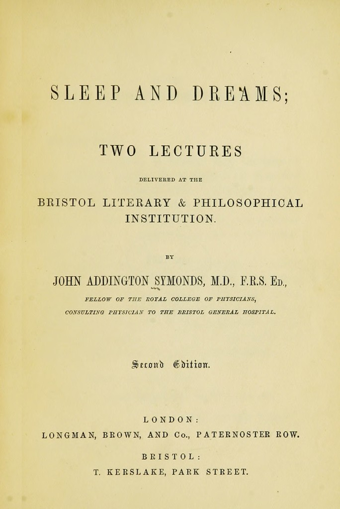

# Tests: Comercio y medicina

[Todas las pruebas](../../README.md) · [Catálogo](../../../docs/CATALOGO_DATASETS_REALES.md)

Resultados y ejemplos de las peticiones indicadas. Las imágenes se comprueban por separado; un portal accesible no equivale a datos ingeridos.

### uci-retail

**Online Retail: facturas y líneas de pedido reales** — `DATA_SAMPLE`.

Ampliación para descubrimiento: los ejemplos verifican acceso/formato; la pregunta de investigación sigue siendo una hipótesis salvo resultado calculado explícito.

**Prueba 1: `DATA_SAMPLE`** · [csv](https://archive.ics.uci.edu/static/public/352/data.csv) · HTTP `200`.

Captura UTC: `2026-11-05T00:52:04+00:00`; duración: 3.337 s.

Primeras filas completas del archivo; no se contó el total ni se comprobaron llaves globales.

Contenido: ``; 65,536 bytes leídos; alcance del hash: `response_prefix`.

| Campo | Ejemplo 1 | Ejemplo 2 |
| --- | --- | --- |
| InvoiceNo | 536365 | 536365 |
| StockCode | 85123A | 71053 |
| Description | WHITE HANGING HEART T-LIGHT HOLDER | WHITE METAL LANTERN |
| Quantity | 6 | 6 |
| InvoiceDate | 12/1/2010 8:26 | 12/1/2010 8:26 |
| UnitPrice | 2.55 | 3.39 |
| CustomerID | 17850 | 17850 |
| Country | United Kingdom | United Kingdom |

<details>
<summary>Ver los registros exactos en JSON</summary>

```json
[
  {
    "InvoiceNo": "536365",
    "StockCode": "85123A",
    "Description": "WHITE HANGING HEART T-LIGHT HOLDER",
    "Quantity": "6",
    "InvoiceDate": "12/1/2010 8:26",
    "UnitPrice": "2.55",
    "CustomerID": "17850",
    "Country": "United Kingdom"
  },
  {
    "InvoiceNo": "536365",
    "StockCode": "71053",
    "Description": "WHITE METAL LANTERN",
    "Quantity": "6",
    "InvoiceDate": "12/1/2010 8:26",
    "UnitPrice": "3.39",
    "CustomerID": "17850",
    "Country": "United Kingdom"
  }
]
```

</details>

### openfda-etiquetas

**Etiquetas y documentación farmacéutica pública** — `DATA_SAMPLE`.

Ampliación para descubrimiento: los ejemplos verifican acceso/formato; la pregunta de investigación sigue siendo una hipótesis salvo resultado calculado explícito.

**Prueba 1: `DATA_SAMPLE`** · [json](https://api.fda.gov/drug/label.json?limit=1) · HTTP `200`.

Captura UTC: `2026-11-05T00:52:05+00:00`; duración: 3.58 s.

Formato y campos de la muestra validados; no implica calidad de toda la fuente.

Contenido: `application/json; charset=utf-8`; 3,933 bytes leídos; alcance del hash: `complete_response`.

| Campo | Ejemplo 1 |
| --- | --- |
| id | ca7bbcc8-2354-375c-e053-2995a90a72a0 |
| set_id | 0000025c-6dbf-4af7-a741-5cbacaed519a |
| effective_time | 20210902 |
| openfda.brand_name | [&quot;SILICEA&quot;] |
| openfda.generic_name | [&quot;SILICEA&quot;] |

<details>
<summary>Ver los registros exactos en JSON</summary>

```json
[
  {
    "id": "ca7bbcc8-2354-375c-e053-2995a90a72a0",
    "set_id": "0000025c-6dbf-4af7-a741-5cbacaed519a",
    "effective_time": "20210902",
    "openfda.brand_name": [
      "SILICEA"
    ],
    "openfda.generic_name": [
      "SILICEA"
    ]
  }
]
```

</details>

### wellcome-medicina-antigua

**Libros, archivos e ilustraciones de medicina histórica** — `METADATA_SAMPLE`.

Ampliación para descubrimiento: los ejemplos verifican acceso/formato; la pregunta de investigación sigue siendo una hipótesis salvo resultado calculado explícito.

**Prueba 1: `METADATA_SAMPLE`** · [json](https://api.wellcomecollection.org/catalogue/v2/works?query=sleep&production.dates.to=1900-01-01&pageSize=3&include=production,items) · HTTP `200`.

Captura UTC: `2026-11-05T00:52:05+00:00`; duración: 3.383 s.

Formato y campos de la muestra validados; no implica calidad de toda la fuente.

Contenido: `application/json`; 4,838 bytes leídos; alcance del hash: `complete_response`.

| Campo | Ejemplo 1 |
| --- | --- |
| id | gvybrs3w |
| title | Sleep and dreams. |
| production | [{&quot;label&quot;: &quot;London : Longman, Brown, [1857]&quot;, &quot;agents&quot;: [{&quot;label&quot;: &quot;Longman, Brown&quot;, &quot;type&quot;: &quot;Agent&quot;}], &quot;dates&quot;: [{&quot;label&quot;: &quot;[1857]&quot;, &quot;type&quot;: &quot;Period&quot;}], &quot;function&quot;: {&quot;label&quot;: &quot;Publication&quot;, &quot;type&quot;: &quot;Concept&quot;}, &quot;type&quot;: &quot;ProductionEvent&quot;, &quot;places&quot;: [{&quot;label&quot;: &quot;London&quot;, &quot;type&quot;: &quot;Place&quot;}]}] |
| workType | {&quot;id&quot;: &quot;a&quot;, &quot;type&quot;: &quot;Format&quot;, &quot;label&quot;: &quot;Books&quot;} |

<details>
<summary>Ver los registros exactos en JSON</summary>

```json
[
  {
    "id": "gvybrs3w",
    "title": "Sleep and dreams.",
    "production": [
      {
        "label": "London : Longman, Brown, [1857]",
        "agents": [
          {
            "label": "Longman, Brown",
            "type": "Agent"
          }
        ],
        "dates": [
          {
            "label": "[1857]",
            "type": "Period"
          }
        ],
        "function": {
          "label": "Publication",
          "type": "Concept"
        },
        "type": "ProductionEvent",
        "places": [
          {
            "label": "London",
            "type": "Place"
          }
        ]
      }
    ],
    "workType": {
      "id": "a",
      "type": "Format",
      "label": "Books"
    }
  }
]
```

</details>

**Ejemplo visual y su test**

<a href="https://wellcomecollection.org/works/gvybrs3w"></a>

**Sleep and dreams; two lectures — John Addington Symonds, 1857, portada interior**. Wellcome Collection; John Addington Symonds. [Ficha original](https://wellcomecollection.org/works/gvybrs3w) · [Licencia y condiciones](https://creativecommons.org/publicdomain/mark/1.0/): Public Domain Mark 1.0.

Prueba de imagen: **`IMAGE_DECODED`**, HTTP `200`, `JPEG`, **684 × 1024 px**, 93,980 bytes. Captura UTC: `2026-11-05T03:19:49+00:00`.

Portada interior, canvas 5 del manifiesto IIIF. No es evidencia de sueño segmentado: esa hipótesis requiere lectura, contexto y contraste de textos.

Archivo de imagen conservado en el repo.

GET completo y decodificación de píxeles comprobados. SHA-256 completo: `4a7f014b22dee507e071388ffcae8e4638b569ba3272b59f1a2546b67929cbeb`. [Metadatos de origen](https://iiif.wellcomecollection.org/presentation/v2/b21001923).

