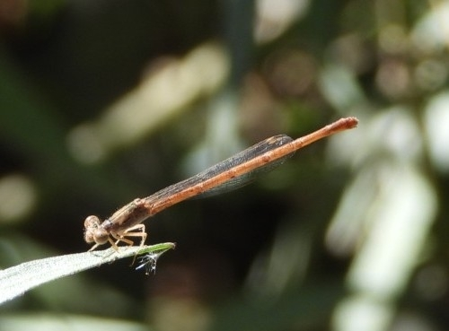
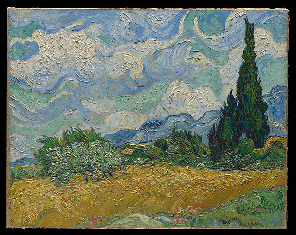
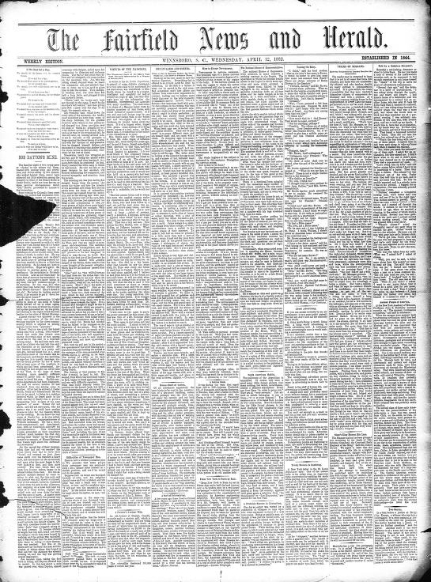

# Tests: Fuentes sorprendentes y multimodales

[Todas las pruebas](../../README.md) · [Catálogo](../../../docs/CATALOGO_DATASETS_REALES.md)

Resultados y ejemplos de las peticiones indicadas. Las imágenes se comprueban por separado; un portal accesible no equivale a datos ingeridos.

### dof-publicaciones

**DOF/SIDOF: publicaciones y reformas para explicar Git** — `DOCUMENT_SAMPLE`.

Sólo se confirma la capa descrita por cada prueba; no se generaliza disponibilidad o calidad.

**Prueba 1: `DOC_ONLY`** · [html](https://sidof.segob.gob.mx/datos_abiertos) · HTTP `200`.

Captura UTC: `2026-11-05T00:08:17+00:00`; duración: 4.835 s.

Ejemplo de página; no son registros del dataset. Los enlaces pueden requerir JavaScript, sesión o descarga adicional.

Contenido: `text/html; charset=UTF-8`; 73,112 bytes leídos; alcance del hash: `complete_response`.

| Campo | Ejemplo 1 |
| --- | --- |
| page_title | Diario Oficial de la Federación &#124;&#124; Datos abiertos |

<details>
<summary>Ver los registros exactos en JSON</summary>

```json
[
  {
    "page_title": "Diario Oficial de la Federación || Datos abiertos"
  }
]
```

</details>

**Prueba 2: `DOCUMENT_SAMPLE`** · [dof](https://sidof.segob.gob.mx/notas/docFuente/5675889) · HTTP `200`.

Captura UTC: `2026-11-05T00:08:22+00:00`; duración: 3.921 s.

Texto real de nota histórica; campos extraídos/normalizados para la demostración.

Contenido: `text/html; charset=UTF-8`; 9,468 bytes leídos; alcance del hash: `complete_response`.

| Campo | Ejemplo 1 |
| --- | --- |
| codigo | 5675889 |
| titulo | Decreto de reforma de los artículos 76 y 78 de la LFT |
| publicacion | 2022-12-27 |
| nuevo_minimo_dias | 12 |
| entrada_vigor | 2023-01-01 |

<details>
<summary>Ver los registros exactos en JSON</summary>

```json
[
  {
    "codigo": "5675889",
    "titulo": "Decreto de reforma de los artículos 76 y 78 de la LFT",
    "publicacion": "2022-12-27",
    "nuevo_minimo_dias": 12,
    "entrada_vigor": "2023-01-01"
  }
]
```

</details>

### usgs-sismos

**Terremotos del último día y sus revisiones** — `DATA_SAMPLE`.

Sólo se confirma la capa descrita por cada prueba; no se generaliza disponibilidad o calidad.

**Prueba 1: `DATA_SAMPLE`** · [geojson](https://earthquake.usgs.gov/earthquakes/feed/v1.0/summary/all_day.geojson) · HTTP `200`.

Captura UTC: `2026-11-05T00:08:19+00:00`; duración: 3.331 s.

Formato y campos de la muestra validados; no implica calidad de toda la fuente.

Contenido: `application/json; charset=utf-8`; 144,196 bytes leídos; alcance del hash: `complete_response`.

| Campo | Ejemplo 1 | Ejemplo 2 |
| --- | --- | --- |
| id | ci41358519 | ci41358511 |
| properties.title | M 0.8 - 10 km SW of Idyllwild, CA | M 0.9 - 13 km SE of Tehachapi, CA |
| properties.mag | 0.83 | 0.92 |
| properties.time | 1793837018700 | 1793835466310 |
| properties.updated | 1793837221405 | 1793835679040 |
| geometry.coordinates | [-116.780666666667, 33.6643333333333, 13.53] | [-118.332666666667, 35.0611666666667, 1.7] |

<details>
<summary>Ver los registros exactos en JSON</summary>

```json
[
  {
    "id": "ci41358519",
    "properties.title": "M 0.8 - 10 km SW of Idyllwild, CA",
    "properties.mag": 0.83,
    "properties.time": 1793837018700,
    "properties.updated": 1793837221405,
    "geometry.coordinates": [
      -116.780666666667,
      33.6643333333333,
      13.53
    ]
  },
  {
    "id": "ci41358511",
    "properties.title": "M 0.9 - 13 km SE of Tehachapi, CA",
    "properties.mag": 0.92,
    "properties.time": 1793835466310,
    "properties.updated": 1793835679040,
    "geometry.coordinates": [
      -118.332666666667,
      35.0611666666667,
      1.7
    ]
  }
]
```

</details>

### nasa-exoplanetas

**Planetas fuera del Sistema Solar** — `DATA_SAMPLE`.

Sólo se confirma la capa descrita por cada prueba; no se generaliza disponibilidad o calidad.

**Prueba 1: `DATA_SAMPLE`** · [csv](https://exoplanetarchive.ipac.caltech.edu/TAP/sync?query=select+top+3+pl_name,hostname,discoverymethod,disc_year,pl_orbper+from+pscomppars&format=csv) · HTTP `200`.

Captura UTC: `2026-11-05T00:08:20+00:00`; duración: 4.195 s.

Primeras filas completas del archivo; no se contó el total ni se comprobaron llaves globales.

Contenido: `text/plain`; 229 bytes leídos; alcance del hash: `complete_response`.

| Campo | Ejemplo 1 | Ejemplo 2 |
| --- | --- | --- |
| pl_name | 55 Cnc b | 55 Cnc c |
| hostname | 55 Cnc | 55 Cnc |
| discoverymethod | Radial Velocity | Radial Velocity |
| disc_year | 1996 | 2004 |
| pl_orbper | 14.65155200000 | 44.39360000000 |

<details>
<summary>Ver los registros exactos en JSON</summary>

```json
[
  {
    "pl_name": "55 Cnc b",
    "hostname": "55 Cnc",
    "discoverymethod": "Radial Velocity",
    "disc_year": "1996",
    "pl_orbper": "14.65155200000"
  },
  {
    "pl_name": "55 Cnc c",
    "hostname": "55 Cnc",
    "discoverymethod": "Radial Velocity",
    "disc_year": "2004",
    "pl_orbper": "44.39360000000"
  }
]
```

</details>

### gwosc-ondas-gravitacionales

**Colisiones de agujeros negros y ondas gravitacionales** — `HTTP_ERROR`.

Sólo se confirma la capa descrita por cada prueba; no se generaliza disponibilidad o calidad.

**Prueba 1: `HTTP_ERROR`** · [json](https://gwosc.org/api/v2/catalogs?format=json) · HTTP `503`.

Captura UTC: `2026-11-05T00:08:23+00:00`; duración: 7.969 s.

HTTP 503: Service Unavailable. No se sorteó el bloqueo ni se usaron credenciales personales.

Sin registros o ejemplos recuperados para esta prueba.

### noaa-ghcn

**El clima escrito por estaciones meteorológicas** — `METADATA_SAMPLE`.

Sólo se confirma la capa descrita por cada prueba; no se generaliza disponibilidad o calidad.

**Prueba 1: `METADATA_SAMPLE`** · [noaa_fixed](https://www.ncei.noaa.gov/pub/data/ghcn/daily/ghcnd-stations.txt) · HTTP `200`.

Captura UTC: `2026-11-05T00:08:24+00:00`; duración: 3.372 s.

Catálogo de estaciones de ancho fijo; observaciones meteorológicas no probadas.

Contenido: `text/plain`; 65,536 bytes leídos; alcance del hash: `response_prefix`.

| Campo | Ejemplo 1 | Ejemplo 2 |
| --- | --- | --- |
| station_id | ACW00011604 | ACW00011647 |
| latitude | 17.1167 | 17.1333 |
| longitude | -61.7833 | -61.7833 |
| elevation_m | 10.1 | 19.2 |
| name | ST JOHNS COOLIDGE FLD | ST JOHNS |

<details>
<summary>Ver los registros exactos en JSON</summary>

```json
[
  {
    "station_id": "ACW00011604",
    "latitude": 17.1167,
    "longitude": -61.7833,
    "elevation_m": 10.1,
    "name": "ST JOHNS COOLIDGE FLD"
  },
  {
    "station_id": "ACW00011647",
    "latitude": 17.1333,
    "longitude": -61.7833,
    "elevation_m": 19.2,
    "name": "ST JOHNS"
  }
]
```

</details>

### gbif-biodiversidad

**Dónde se ha observado vida: especies y sesgo de muestreo** — `DATA_SAMPLE`.

Sólo se confirma la capa descrita por cada prueba; no se generaliza disponibilidad o calidad.

**Prueba 1: `DATA_SAMPLE`** · [json](https://api.gbif.org/v1/occurrence/search?country=MX&limit=3) · HTTP `200`.

Captura UTC: `2026-11-05T00:08:26+00:00`; duración: 3.846 s.

Formato y campos de la muestra validados; no implica calidad de toda la fuente.

Contenido: `application/json`; 18,157 bytes leídos; alcance del hash: `complete_response`.

| Campo | Ejemplo 1 | Ejemplo 2 |
| --- | --- | --- |
| key | 5937748320 | 5937748335 |
| scientificName | Panthiades bathildis (R.F.C.Felder, 1865) | Urbanus dorantes (Stoll, 1790) |
| countryCode | MX | MX |
| eventDate | 2026-01-01 | 2026-01-01 |
| basisOfRecord | HUMAN_OBSERVATION | HUMAN_OBSERVATION |
| license | http://creativecommons.org/licenses/by-nc/4.0/legalcode | http://creativecommons.org/licenses/by-nc/4.0/legalcode |

<details>
<summary>Ver los registros exactos en JSON</summary>

```json
[
  {
    "key": 5937748320,
    "scientificName": "Panthiades bathildis (R.F.C.Felder, 1865)",
    "countryCode": "MX",
    "eventDate": "2026-01-01",
    "basisOfRecord": "HUMAN_OBSERVATION",
    "license": "http://creativecommons.org/licenses/by-nc/4.0/legalcode"
  },
  {
    "key": 5937748335,
    "scientificName": "Urbanus dorantes (Stoll, 1790)",
    "countryCode": "MX",
    "eventDate": "2026-01-01",
    "basisOfRecord": "HUMAN_OBSERVATION",
    "license": "http://creativecommons.org/licenses/by-nc/4.0/legalcode"
  }
]
```

</details>

**Ejemplo visual y su test**

<a href="https://www.gbif.org/occurrence/5938027608"></a>

**Telebasis salva — fotografía de observación naturalista**. Sinaloa Silvestre; iNaturalist / GBIF. [Ficha original](https://www.gbif.org/occurrence/5938027608) · [Licencia y condiciones](https://creativecommons.org/publicdomain/zero/1.0/): CC0 1.0 en el medio seleccionado.

Prueba de imagen: **`IMAGE_DECODED`**, HTTP `200`, `JPEG`, **500 × 369 px**, 69,292 bytes. Captura UTC: `2026-11-05T03:19:53+00:00`.

Se revisó la licencia del medio seleccionado, además de la del registro; no se asume que sean iguales para toda la colección.

Archivo de imagen conservado en el repo.

GET completo y decodificación de píxeles comprobados. SHA-256 completo: `affd90a06b86fa6be4b97402216d3b6365d15cdb3a9adee98ebf8c41ad22579d`. [Metadatos de origen](https://api.gbif.org/v1/occurrence/search?country=MX&mediaType=StillImage&license=CC0_1_0&limit=3).

### xeno-canto-audio

**Cantos de aves, murciélagos e insectos** — `DATA_SAMPLE`.

Sólo se confirma la capa descrita por cada prueba; no se generaliza disponibilidad o calidad.

**Prueba 1: `DOC_ONLY`** · [html](https://xeno-canto.org/explore/api) · HTTP `200`.

Captura UTC: `2026-11-05T00:09:58+00:00`; duración: 3.89 s.

Ejemplo de página; no son registros del dataset. Los enlaces pueden requerir JavaScript, sesión o descarga adicional.

Contenido: `text/html; charset=UTF-8`; 52,259 bytes leídos; alcance del hash: `complete_response`.

| Campo | Ejemplo 1 |
| --- | --- |
| page_title | API :: xeno-canto |

<details>
<summary>Ver los registros exactos en JSON</summary>

```json
[
  {
    "page_title": "API :: xeno-canto"
  }
]
```

</details>

**Prueba 2: `DATA_SAMPLE`** · [json](https://xeno-canto.org/api/3/recordings?query=gen:larus+sp:fuscus&key=demo&per_page=2) · HTTP `200`.

Captura UTC: `2026-11-05T00:10:02+00:00`; duración: 7.379 s.

Formato y campos de la muestra validados; no implica calidad de toda la fuente. Se probó además la cabecera del medio enlazado; ver resultado del recurso.

Contenido: `application/json`; 100,822 bytes leídos; alcance del hash: `complete_response`.

| Campo | Ejemplo 1 | Ejemplo 2 |
| --- | --- | --- |
| id | 1154497 | 1065457 |
| gen | Larus | Larus |
| sp | fuscus | fuscus |
| cnt | United Kingdom | Italy |
| type | alarm call | flight call |
| length | 1:33 | 0:10 |
| file | https://xeno-canto.org/1154497/download | https://xeno-canto.org/1065457/download |
| lic | https://creativecommons.org/licenses/by-nc-sa/4.0/ | https://creativecommons.org/licenses/by-nc-sa/4.0/ |

<details>
<summary>Ver los registros exactos en JSON</summary>

```json
[
  {
    "id": "1154497",
    "gen": "Larus",
    "sp": "fuscus",
    "cnt": "United Kingdom",
    "type": "alarm call",
    "length": "1:33",
    "file": "https://xeno-canto.org/1154497/download",
    "lic": "https://creativecommons.org/licenses/by-nc-sa/4.0/"
  },
  {
    "id": "1065457",
    "gen": "Larus",
    "sp": "fuscus",
    "cnt": "Italy",
    "type": "flight call",
    "length": "0:10",
    "file": "https://xeno-canto.org/1065457/download",
    "lic": "https://creativecommons.org/licenses/by-nc-sa/4.0/"
  }
]
```

</details>

**Recurso enlazado: comprobación independiente**

**Prueba 2.medio: `MEDIA_SAMPLE`** · [media](https://xeno-canto.org/1154497/download) · HTTP `200`.

Captura UTC: `2026-11-05T00:10:06+00:00`; duración: 3.456 s.

Sólo firma binaria y acceso al prefijo: no se decodificó, reprodujo ni validó el medio completo.

Contenido: `audio/wav`; 65,536 bytes leídos; alcance del hash: `response_prefix`.

| Campo | Ejemplo 1 |
| --- | --- |
| format | WAV |
| bytes_checked | 65536 |
| complete_file | false |

<details>
<summary>Ver los registros exactos en JSON</summary>

```json
[
  {
    "format": "WAV",
    "bytes_checked": 65536,
    "complete_file": false
  }
]
```

</details>

**Ejemplo visual y su test**

<a href="https://xeno-canto.org/1154497"></a>

**Sonograma de Larus fuscus — grabación XC1154497**. David Darrell-Lambert; xeno-canto, XC1154497. [Ficha original](https://xeno-canto.org/1154497) · [Licencia y condiciones](https://creativecommons.org/licenses/by-nc-sa/4.0/): CC BY-NC-SA 4.0 para la grabación, según su ficha.

Prueba de imagen: **`IMAGE_DECODED`**, HTTP `200`, `PNG`, **486 × 241 px**, 9,858 bytes. Captura UTC: `2026-11-05T03:19:57+00:00`.

Sonograma remoto ofrecido por la ficha. La prueba visual no equivale a reproducir o decodificar el audio completo.

Imagen incrustada desde el proveedor; su visualización depende de que esa URL siga disponible.

GET completo y decodificación de píxeles comprobados. SHA-256 completo: `c78c96fe816da0c81438ebeceb3184f7ec28958392a44e29566360a6d4c3fff6`. [Metadatos de origen](https://xeno-canto.org/api/3/recordings?query=gen:larus+sp:fuscus&key=demo&per_page=2).

### met-arte

**Arte, objetos e imágenes del Metropolitan Museum** — `DATA_SAMPLE`.

Sólo se confirma la capa descrita por cada prueba; no se generaliza disponibilidad o calidad.

**Prueba 1: `DATA_SAMPLE`** · [json](https://collectionapi.metmuseum.org/public/collection/v1/objects/436535) · HTTP `200`.

Captura UTC: `2026-11-05T00:08:30+00:00`; duración: 7.528 s.

Formato y campos de la muestra validados; no implica calidad de toda la fuente. Se probó además la cabecera del medio enlazado; ver resultado del recurso.

Contenido: `application/json`; 2,794 bytes leídos; alcance del hash: `complete_response`.

| Campo | Ejemplo 1 |
| --- | --- |
| objectID | 436535 |
| title | Wheat Field with Cypresses |
| artistDisplayName | Vincent van Gogh |
| objectDate | 1889 |
| medium | Oil on canvas |
| isPublicDomain | true |
| primaryImage | https://images.metmuseum.org/CRDImages/ep/original/DP-42549-001.jpg |

<details>
<summary>Ver los registros exactos en JSON</summary>

```json
[
  {
    "objectID": 436535,
    "title": "Wheat Field with Cypresses",
    "artistDisplayName": "Vincent van Gogh",
    "objectDate": "1889",
    "medium": "Oil on canvas",
    "isPublicDomain": true,
    "primaryImage": "https://images.metmuseum.org/CRDImages/ep/original/DP-42549-001.jpg"
  }
]
```

</details>

**Recurso enlazado: comprobación independiente**

**Prueba 1.medio: `MEDIA_SAMPLE`** · [media](https://images.metmuseum.org/CRDImages/ep/web-large/DP-42549-001.jpg) · HTTP `200`.

Captura UTC: `2026-11-05T00:08:33+00:00`; duración: 3.921 s.

Sólo firma binaria y acceso al prefijo: no se decodificó, reprodujo ni validó el medio completo.

Contenido: `image/jpeg`; 65,536 bytes leídos; alcance del hash: `response_prefix`.

| Campo | Ejemplo 1 |
| --- | --- |
| format | JPEG |
| bytes_checked | 65536 |
| complete_file | false |

<details>
<summary>Ver los registros exactos en JSON</summary>

```json
[
  {
    "format": "JPEG",
    "bytes_checked": 65536,
    "complete_file": false
  }
]
```

</details>

**Ejemplo visual y su test**

<a href="https://www.metmuseum.org/art/collection/search/436535"></a>

**Wheat Field with Cypresses — Vincent van Gogh, 1889**. The Metropolitan Museum of Art; Purchase, The Annenberg Foundation Gift, 1993. [Ficha original](https://www.metmuseum.org/art/collection/search/436535) · [Licencia y condiciones](https://www.metmuseum.org/about-the-met/policies-and-documents/open-access): Dominio público (isPublicDomain=true).

Prueba de imagen: **`IMAGE_DECODED`**, HTTP `200`, `JPEG`, **599 × 477 px**, 221,383 bytes. Captura UTC: `2026-11-05T03:19:49+00:00`.

Vista del recurso original; decodificación de imagen independiente de la prueba de registros.

Archivo de imagen conservado en el repo.

GET completo y decodificación de píxeles comprobados. SHA-256 completo: `af0e3486621c210b54932d055294051b5601aa3362af4b84ab97e2831f8163bc`. [Metadatos de origen](https://collectionapi.metmuseum.org/public/collection/v1/objects/436535).

### loc-prensa-historica

**Periódicos antiguos: portadas, OCR y metadatos** — `METADATA_SAMPLE`.

Sólo se confirma la capa descrita por cada prueba; no se generaliza disponibilidad o calidad.

**Prueba 1: `METADATA_SAMPLE`** · [json](https://www.loc.gov/newspapers/?fo=json&c=3) · HTTP `200`.

Captura UTC: `2026-11-05T00:08:30+00:00`; duración: 3.103 s.

Formato y campos de la muestra validados; no implica calidad de toda la fuente.

Contenido: `application/json`; 100,574 bytes leídos; alcance del hash: `complete_response`.

| Campo | Ejemplo 1 | Ejemplo 2 |
| --- | --- | --- |
| id | http://www.loc.gov/item/2012218613/1882-04-12/ed-1/ | http://www.loc.gov/item/sn83045313/1949-10-25/ed-1/ |
| title | The Fairfield news and herald (Winnsboro, S.C.), April 12, 1882 | Le messager (Lewiston, Me.), October 25, 1949 |
| date | 1882-04-12 | 1949-10-25 |
| language | [&quot;english&quot;] | [&quot;french&quot;, &quot;english&quot;] |
| original_format | [&quot;newspaper&quot;] | [&quot;newspaper&quot;] |
| url | https://www.loc.gov/item/2012218613/1882-04-12/ed-1/ | https://www.loc.gov/item/sn83045313/1949-10-25/ed-1/ |

<details>
<summary>Ver los registros exactos en JSON</summary>

```json
[
  {
    "id": "http://www.loc.gov/item/2012218613/1882-04-12/ed-1/",
    "title": "The Fairfield news and herald (Winnsboro, S.C.), April 12, 1882",
    "date": "1882-04-12",
    "language": [
      "english"
    ],
    "original_format": [
      "newspaper"
    ],
    "url": "https://www.loc.gov/item/2012218613/1882-04-12/ed-1/"
  },
  {
    "id": "http://www.loc.gov/item/sn83045313/1949-10-25/ed-1/",
    "title": "Le messager (Lewiston, Me.), October 25, 1949",
    "date": "1949-10-25",
    "language": [
      "french",
      "english"
    ],
    "original_format": [
      "newspaper"
    ],
    "url": "https://www.loc.gov/item/sn83045313/1949-10-25/ed-1/"
  }
]
```

</details>

**Ejemplo visual y su test**

<a href="https://www.loc.gov/item/2012218613/1882-04-12/ed-1/"></a>

**The Fairfield news and herald — portada del 12 de abril de 1882**. Library of Congress; University of South Carolina, Columbia, SC. [Ficha original](https://www.loc.gov/item/2012218613/1882-04-12/ed-1/) · [Licencia y condiciones](https://www.loc.gov/collections/chronicling-america/about-this-collection/rights-and-access/): Dominio público (edición de 1882).

Prueba de imagen: **`IMAGE_DECODED`**, HTTP `200`, `JPEG`, **545 × 736 px**, 144,127 bytes. Captura UTC: `2026-11-05T03:19:49+00:00`.

Vista del recurso original; decodificación de imagen independiente de la prueba de registros.

Archivo de imagen conservado en el repo.

GET completo y decodificación de píxeles comprobados. SHA-256 completo: `472cbe967361142cd5f7bd80d2eae9f2bb842cc6d9108ec9f98165c5f3016662`. [Metadatos de origen](https://www.loc.gov/item/2012218613/1882-04-12/ed-1/?fo=json).

### gutenberg-quijote

**Don Quijote como corpus de lenguaje** — `DOCUMENT_SAMPLE`.

Sólo se confirma la capa descrita por cada prueba; no se generaliza disponibilidad o calidad.

**Prueba 1: `DOCUMENT_SAMPLE`** · [text](https://www.gutenberg.org/cache/epub/2000/pg2000.txt) · HTTP `200`.

Captura UTC: `2026-11-05T00:08:31+00:00`; duración: 3.829 s.

Prefijo de documento real; no se descargó el corpus completo.

Contenido: `text/plain; charset=utf-8`; 65,536 bytes leídos; alcance del hash: `response_prefix`.

| Campo | Ejemplo 1 |
| --- | --- |
| excerpt | En un lugar de la Mancha, de cuyo nombre no quiero acordarme, no ha mucho tiempo que vivía un hidalgo de los de lanza en astillero, adarga antigua, rocín flaco y galgo corredor. Una olla de algo más vaca que carnero, salpicón las más noches, duelos y quebrantos los sábados, lantejas los viernes, algún palomino de añadidura los domingos, consumían |

<details>
<summary>Ver los registros exactos en JSON</summary>

```json
[
  {
    "excerpt": "En un lugar de la Mancha, de cuyo nombre no quiero acordarme, no ha mucho tiempo que vivía un hidalgo de los de lanza en astillero, adarga antigua, rocín flaco y galgo corredor. Una olla de algo más vaca que carnero, salpicón las más noches, duelos y quebrantos los sábados, lantejas los viernes, algún palomino de añadidura los domingos, consumían"
  }
]
```

</details>

### openfoodfacts-alimentos

**Alimentos: ingredientes, nutrientes y fotos de etiquetas** — `DATA_SAMPLE`.

Sólo se confirma la capa descrita por cada prueba; no se generaliza disponibilidad o calidad.

**Prueba 1: `DATA_SAMPLE`** · [json](https://world.openfoodfacts.org/api/v2/product/3017620422003?fields=code,product_name,brands,nutriments,nutriscore_grade,image_url) · HTTP `200`.

Captura UTC: `2026-11-05T00:08:33+00:00`; duración: 3.421 s.

Formato y campos de la muestra validados; no implica calidad de toda la fuente.

Contenido: `application/json; charset=utf-8`; 2,687 bytes leídos; alcance del hash: `complete_response`.

| Campo | Ejemplo 1 |
| --- | --- |
| code | 3017620422003 |
| product_name | Nutella |
| brands | Nutella, Ferrero |
| nutriscore_grade | unknown |
| nutriments | {&quot;added-sugars&quot;: 52.13, &quot;added-sugars_100g&quot;: 52.13, &quot;added-sugars_unit&quot;: &quot;g&quot;, &quot;added-sugars_value&quot;: 52.13, &quot;carbohydrates&quot;: 57.5, &quot;carbohydrates_100g&quot;: 57.5, &quot;carbohydrates_unit&quot;: &quot;g&quot;, &quot;carbohydrates_value&quot;: 57.5, &quot;energy&quot;: 2252, &quot;energy-kcal&quot;: 539, &quot;energy-kcal_100g&quot;: 539, &quot;energy-kcal_unit&quot;: &quot;kcal&quot;} |
| image_url | https://images.openfoodfacts.org/images/products/301/762/042/2003/front_en.879.400.jpg |

<details>
<summary>Ver los registros exactos en JSON</summary>

```json
[
  {
    "code": "3017620422003",
    "product_name": "Nutella",
    "brands": "Nutella, Ferrero",
    "nutriscore_grade": "unknown",
    "nutriments": {
      "added-sugars": 52.13,
      "added-sugars_100g": 52.13,
      "added-sugars_unit": "g",
      "added-sugars_value": 52.13,
      "carbohydrates": 57.5,
      "carbohydrates_100g": 57.5,
      "carbohydrates_unit": "g",
      "carbohydrates_value": 57.5,
      "energy": 2252,
      "energy-kcal": 539,
      "energy-kcal_100g": 539,
      "energy-kcal_unit": "kcal"
    },
    "image_url": "https://images.openfoodfacts.org/images/products/301/762/042/2003/front_en.879.400.jpg"
  }
]
```

</details>

**Ejemplo visual y su test**

<a href="https://world.openfoodfacts.org/product/3017620422003"></a>

**Nutella — fotografía del envase en español, código 3017620422003**. Open Food Facts y sus colaboradores; marcas de sus titulares. [Ficha original](https://world.openfoodfacts.org/product/3017620422003) · [Licencia y condiciones](https://world.openfoodfacts.org/terms-of-use): Licencia de imágenes indicada por Open Food Facts; marcas conservan derechos.

Prueba de imagen: **`IMAGE_DECODED`**, HTTP `200`, `JPEG`, **336 × 400 px**, 25,515 bytes. Captura UTC: `2026-11-05T03:22:50+00:00`.

Vista en español publicada en selected_images.front.display.es de la API. La foto en inglés del ejemplo inicial devolvió HTTP 503; se conserva ese fallo en previous_tests. No demuestra que los nutrientes estén actualizados para todos los países.

Imagen incrustada desde el proveedor; su visualización depende de que esa URL siga disponible.

GET completo y decodificación de píxeles comprobados. SHA-256 completo: `a973622bf4464c2cc6db260671ec2756942f81a12768a76b56347f7e70d246c3`. [Metadatos de origen](https://world.openfoodfacts.org/api/v2/product/3017620422003.json).

### nuforc-ovnis

**Relatos de avistamientos de ovnis/UAP** — `DOC_ONLY`.

Sólo se confirma la capa descrita por cada prueba; no se generaliza disponibilidad o calidad.

**Prueba 1: `DOC_ONLY`** · [html](https://nuforc.org/databank/?id=latest) · HTTP `200`.

Captura UTC: `2026-11-05T00:08:34+00:00`; duración: 4.593 s.

Ejemplo de página; no son registros del dataset. Los enlaces pueden requerir JavaScript, sesión o descarga adicional.

Contenido: `text/html; charset=UTF-8`; 160,850 bytes leídos; alcance del hash: `complete_response`.

| Campo | Ejemplo 1 |
| --- | --- |
| page_title | NUFORC Reports for State atest |

<details>
<summary>Ver los registros exactos en JSON</summary>

```json
[
  {
    "page_title": "NUFORC Reports for State atest"
  }
]
```

</details>

### gdelt-noticias

**El mundo contado por noticias: eventos y menciones** — `METADATA_SAMPLE`.

Sólo se confirma la capa descrita por cada prueba; no se generaliza disponibilidad o calidad.

**Prueba 1: `METADATA_SAMPLE`** · [gdelt_index](https://data.gdeltproject.org/gdeltv2/lastupdate.txt) · HTTP `200`.

Captura UTC: `2026-11-05T00:08:36+00:00`; duración: 3.522 s.

Manifiesto recuperado; archivos de eventos/mentions/GKG no descargados.

Contenido: `text/plain`; 321 bytes leídos; alcance del hash: `complete_response`.

| Campo | Ejemplo 1 | Ejemplo 2 | Ejemplo 3 |
| --- | --- | --- | --- |
| bytes | 131623 | 122069 | 5009186 |
| md5 | 8c1327fd003001080389187c21fbb939 | c27d37d8d98604efe7d9085d02db02d7 | 3b8c897d4d7173d767dfcb5ad99f2243 |
| url | http://data.gdeltproject.org/gdeltv2/20261105001500.export.CSV.zip | http://data.gdeltproject.org/gdeltv2/20261105001500.mentions.CSV.zip | http://data.gdeltproject.org/gdeltv2/20261105001500.gkg.csv.zip |

<details>
<summary>Ver los registros exactos en JSON</summary>

```json
[
  {
    "bytes": 131623,
    "md5": "8c1327fd003001080389187c21fbb939",
    "url": "http://data.gdeltproject.org/gdeltv2/20261105001500.export.CSV.zip"
  },
  {
    "bytes": 122069,
    "md5": "c27d37d8d98604efe7d9085d02db02d7",
    "url": "http://data.gdeltproject.org/gdeltv2/20261105001500.mentions.CSV.zip"
  },
  {
    "bytes": 5009186,
    "md5": "3b8c897d4d7173d767dfcb5ad99f2243",
    "url": "http://data.gdeltproject.org/gdeltv2/20261105001500.gkg.csv.zip"
  }
]
```

</details>

### nasa-bolidos

**Bólidos: entradas atmosféricas detectadas por sensores** — `DATA_SAMPLE`.

Sólo se confirma la capa descrita por cada prueba; no se generaliza disponibilidad o calidad.

**Prueba 1: `DATA_SAMPLE`** · [nasa_rows](https://ssd-api.jpl.nasa.gov/fireball.api?limit=3) · HTTP `200`.

Captura UTC: `2026-11-05T00:08:37+00:00`; duración: 3.165 s.

Formato y campos de la muestra validados; no implica calidad de toda la fuente.

Contenido: `application/json`; 390 bytes leídos; alcance del hash: `complete_response`.

| Campo | Ejemplo 1 | Ejemplo 2 |
| --- | --- | --- |
| date | 2026-10-04 03:14:45 | 2026-09-15 11:26:13 |
| energy | 5.4 | 2.2 |
| impact-e | 0.18 | 0.079 |
| lat | 41.8 | 37.6 |
| lat-dir | S | S |
| lon | 173.1 | 161.6 |
| lon-dir | W | W |
| alt | 26.9 | 37.0 |
| vel | 13.8 | null |

<details>
<summary>Ver los registros exactos en JSON</summary>

```json
[
  {
    "date": "2026-10-04 03:14:45",
    "energy": "5.4",
    "impact-e": "0.18",
    "lat": "41.8",
    "lat-dir": "S",
    "lon": "173.1",
    "lon-dir": "W",
    "alt": "26.9",
    "vel": "13.8"
  },
  {
    "date": "2026-09-15 11:26:13",
    "energy": "2.2",
    "impact-e": "0.079",
    "lat": "37.6",
    "lat-dir": "S",
    "lon": "161.6",
    "lon-dir": "W",
    "alt": "37.0"
  }
]
```

</details>

### nyc-ratas

**Inspecciones de ratas por predio en Nueva York** — `DATA_SAMPLE`.

Sólo se confirma la capa descrita por cada prueba; no se generaliza disponibilidad o calidad.

**Prueba 1: `DATA_SAMPLE`** · [json](https://data.cityofnewyork.us/resource/p937-wjvj.json?$limit=3) · HTTP `200`.

Captura UTC: `2026-11-05T00:08:38+00:00`; duración: 3.143 s.

Formato y campos de la muestra validados; no implica calidad de toda la fuente.

Contenido: `application/json;charset=utf-8`; 653 bytes leídos; alcance del hash: `complete_response`.

| Campo | Ejemplo 1 | Ejemplo 2 |
| --- | --- | --- |
| job_id | PC8178739 | PC8129591 |
| inspection_date | 2023-09-21T10:54:00.000 | 2023-06-25T15:20:41.000 |
| inspection_type | Stoppage | Treatments |
| zip_code | 11216 | 11237 |
| borough | Brooklyn | Brooklyn |
| result | Stoppage done | Bait applied |

<details>
<summary>Ver los registros exactos en JSON</summary>

```json
[
  {
    "job_id": "PC8178739",
    "inspection_date": "2023-09-21T10:54:00.000",
    "inspection_type": "Stoppage",
    "zip_code": "11216",
    "borough": "Brooklyn",
    "result": "Stoppage done"
  },
  {
    "job_id": "PC8129591",
    "inspection_date": "2023-06-25T15:20:41.000",
    "inspection_type": "Treatments",
    "zip_code": "11237",
    "borough": "Brooklyn",
    "result": "Bait applied"
  }
]
```

</details>

